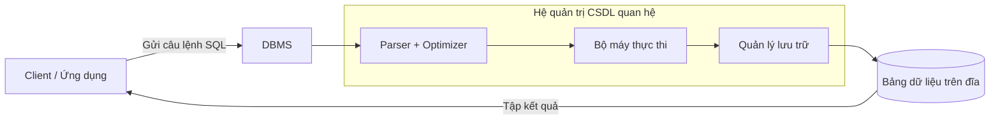

# Ngày 1: Giới thiệu SQL, RDBMS và môi trường thực hành

> **Tóm tắt:** SQL là ngôn ngữ để làm việc với dữ liệu trong cơ sở dữ liệu quan hệ. Hôm nay bạn tìm hiểu SQL và hệ quản trị CSDL quan hệ (RDBMS) là gì, dựng PostgreSQL 16 cùng bộ dữ liệu DSC Shop trên máy, rồi chạy những câu lệnh đầu tiên để khám phá dữ liệu.

**Sau bài này bạn có thể:**

- Giải thích SQL, cơ sở dữ liệu, RDBMS là gì và vì sao khóa học chọn PostgreSQL.
- Dựng môi trường thực hành bằng Docker (hoặc cài trực tiếp) và kết nối được bằng `psql` và Adminer.
- Dùng `\dt`, `\d tên_bảng` để xem danh sách bảng và cấu trúc một bảng của DSC Shop.
- Viết câu `SELECT` đơn giản để xem dữ liệu của một bảng.
- Xếp một câu lệnh SQL vào đúng nhóm DDL, DML, DCL hoặc TCL.

## SQL là gì

Hãy hình dung một cửa hàng đồ công nghệ ghi chép mọi thứ vào sổ: sổ khách hàng, sổ sản phẩm, sổ đơn hàng. Khi cửa hàng lớn lên, sổ giấy không còn đủ: cần tìm nhanh "khách nào mua iPhone tháng trước", cần nhiều nhân viên cùng ghi mà không giẫm chân nhau, cần không mất dữ liệu khi mất điện. Phần mềm làm những việc đó gọi là **hệ quản trị cơ sở dữ liệu** (DBMS, Database Management System).

**SQL** (Structured Query Language) là ngôn ngữ bạn dùng để "nói chuyện" với DBMS: tạo bảng, thêm dữ liệu, hỏi dữ liệu, phân quyền. SQL là ngôn ngữ **khai báo**: bạn mô tả *muốn lấy gì*, còn DBMS tự quyết định *lấy như thế nào*. Ví dụ "cho tôi tên và thành phố của mọi khách hàng" viết thành:

```sql
SELECT full_name, city FROM customers;
```

SQL được dùng ở hầu hết mọi nơi có dữ liệu: backend web và mobile, phân tích dữ liệu, báo cáo kinh doanh, kho dữ liệu (BigQuery, Snowflake). SQL có chuẩn quốc tế (ISO/IEC 9075), nhưng mỗi DBMS thêm phần mở rộng riêng, gọi là **dialect**. Khóa học viết theo dialect của PostgreSQL và ghi chú khi các hệ khác viết khác.

## Cơ sở dữ liệu quan hệ và RDBMS

**Cơ sở dữ liệu quan hệ** lưu dữ liệu thành các **bảng** (table). Mỗi bảng có các **cột** (column) cố định, mỗi **dòng** (row) là một bản ghi. Các bảng liên kết với nhau qua giá trị chung: dòng trong bảng `orders` ghi `customer_id = 1` nghĩa là đơn đó của khách có mã 1 trong bảng `customers`.

Hai khái niệm cốt lõi (Ngày 2 học kỹ):

- **Khóa chính** (primary key): cột xác định duy nhất mỗi dòng, ví dụ `customers.customer_id`.
- **Khóa ngoại** (foreign key): cột trỏ tới khóa chính của bảng khác, ví dụ `orders.customer_id`.

**RDBMS** là phần mềm quản lý cơ sở dữ liệu quan hệ. Khi bạn gửi một câu SQL, RDBMS phân tích câu lệnh, chọn cách thực hiện nhanh nhất, rồi đọc/ghi dữ liệu trên đĩa:



### Các RDBMS phổ biến

| RDBMS | Điểm mạnh | Cần lưu ý | Hay gặp ở |
| --- | --- | --- | --- |
| PostgreSQL | Mã nguồn mở, bám sát chuẩn SQL, nhiều kiểu dữ liệu (JSONB, mảng, khoảng thời gian), mở rộng được | Cấu hình và vận hành có nhiều thứ cần học hơn MySQL | Backend, phân tích dữ liệu, tài chính, GIS |
| MySQL | Mã nguồn mở, phổ biến, dễ bắt đầu | Window function và CTE chỉ có từ bản 8.0; có kiểu JSON nhưng ít toán tử hơn JSONB | Web (WordPress, nhiều hệ thống PHP) |
| SQL Server | Công cụ quản trị tốt, tích hợp hệ sinh thái Microsoft | Bản thương mại tốn phí bản quyền (có bản Express/Developer miễn phí) | Doanh nghiệp dùng .NET |
| SQLite | Không cần server, cả database là một file | Không có quản lý user/quyền, không có stored procedure; ghi đồng thời bị giới hạn | Ứng dụng mobile, desktop, thử nghiệm nhanh |

Khóa học chỉ dùng **PostgreSQL 16**: có đủ mọi tính năng mà 30 ngày cần (CTE, window function, `FULL JOIN`, `INTERSECT`/`EXCEPT`, JSONB, partition, `EXPLAIN ANALYZE`, PL/pgSQL), miễn phí và chạy được trên mọi hệ điều hành. Học vững một hệ thì chuyển sang hệ khác rất nhanh, vì phần lớn SQL là giống nhau.

## Dựng môi trường thực hành

Hướng dẫn đầy đủ (kể cả xử lý sự cố, nạp dữ liệu lớn, làm lại từ đầu) ở [setup/README.md](../setup/README.md). Dưới đây là các bước chính.

### Cách 1: Docker (khuyến nghị)

Docker chạy PostgreSQL trong một "container" tách biệt, không đụng tới máy bạn, và dữ liệu mẫu được nạp tự động.

1. Cài [Docker Desktop](https://www.docker.com/products/docker-desktop/) và mở nó lên.
2. Tải repo khóa học về (`git clone` hoặc tải ZIP), mở terminal ở thư mục gốc của repo.
3. Chạy:

```sh
docker compose up -d
```

Lần đầu Docker tải image nên mất vài phút. Xong, bạn có hai dịch vụ:

| Dịch vụ | Địa chỉ | Thông tin đăng nhập |
| --- | --- | --- |
| PostgreSQL 16 | `localhost:5432` | user `postgres`, mật khẩu `postgres`, database `sql_challenge` |
| Adminer (giao diện web) | <http://localhost:8080> | System: PostgreSQL, Server: `db`, user/mật khẩu như trên, Database: `sql_challenge` |

Kiểm tra container đang chạy:

```sh
docker compose ps
```

### Cách 2: Cài PostgreSQL trực tiếp

Nếu máy không chạy được Docker:

1. Tải và cài PostgreSQL 16 trở lên từ <https://www.postgresql.org/download/>. Trên Windows, trình cài đặt hỏi mật khẩu cho user `postgres`: hãy ghi nhớ nó. Nhớ chọn cài kèm "Command Line Tools" để có `psql`.
2. Ở thư mục gốc của repo, tạo database và nạp dữ liệu:

```sh
createdb -U postgres sql_challenge
psql -U postgres -d sql_challenge -f setup/init/01_schema.sql -f setup/init/02_seed.sql
```

Với cách này, bỏ phần `docker compose exec db` ở các lệnh trong khóa học và gõ thẳng `psql -U postgres -d sql_challenge`.

## Kết nối bằng psql

`psql` là chương trình dòng lệnh đi kèm PostgreSQL. Với Docker:

```sh
docker compose exec db psql -U postgres -d sql_challenge
```

Bạn thấy dấu nhắc `sql_challenge=#`. Gõ câu lệnh SQL, kết thúc bằng dấu `;` rồi Enter:

```sql
SELECT version();
```

| version |
| --- |
| PostgreSQL 16.15 (Debian 16.15-1.pgdg13+2) on x86_64-pc-linux-gnu, compiled by gcc (Debian 14.2.0-19) 14.2.0, 64-bit |

Số phiên bản phụ (16.x) trên máy bạn có thể khác, miễn là bắt đầu bằng 16.

Ngoài câu lệnh SQL, `psql` có các **lệnh meta** bắt đầu bằng dấu `\`. Chúng do `psql` xử lý chứ không gửi lên server, nên **không cần dấu `;`**:

| Lệnh | Tác dụng |
| --- | --- |
| `\dt` | Liệt kê các bảng |
| `\d tên_bảng` | Xem cấu trúc một bảng |
| `\dn` | Liệt kê các schema |
| `\l` | Liệt kê các database |
| `\c tên_db` | Chuyển sang database khác |
| `\conninfo` | Xem đang kết nối tới đâu |
| `\x` | Bật/tắt hiển thị dọc (tiện khi bảng nhiều cột) |
| `\?` | Danh sách mọi lệnh meta |
| `\q` | Thoát `psql` |

Mẹo: phím mũi tên lên để gọi lại lệnh cũ, phím Tab để tự hoàn thành tên bảng, tên cột.

### Adminer và các công cụ đồ họa

Nếu thích giao diện đồ họa, mở <http://localhost:8080>, đăng nhập theo bảng ở trên, bấm "SQL command" để gõ lệnh. Bạn cũng có thể dùng DBeaver, pgAdmin, DataGrip hoặc extension PostgreSQL của VS Code, kết nối tới `localhost:5432`. Khóa học in kết quả theo kiểu `psql`, nhưng mọi câu SQL chạy giống nhau trên các công cụ này.

## Khám phá DSC Shop

DSC Shop là cửa hàng đồ công nghệ giả lập, dùng cho cả khóa. Các bảng nằm trong **schema** `shop` (schema là một "thư mục" chứa bảng bên trong database). Database đã được cấu hình để bạn viết `customers` thay vì `shop.customers`.

```sql
\dn
```

| Name | Owner |
| --- | --- |
| perf | postgres |
| public | pg_database_owner |
| shop | postgres |

Schema `perf` chứa dữ liệu lớn cho các bài hiệu năng; nếu bạn chưa chạy `setup/perf_seed.sql` thì chưa có dòng này. Xem các bảng của cửa hàng:

```sql
\dt
```

| Schema | Name | Type | Owner |
| --- | --- | --- | --- |
| shop | categories | table | postgres |
| shop | customers | table | postgres |
| shop | employees | table | postgres |
| shop | order_items | table | postgres |
| shop | orders | table | postgres |
| shop | payments | table | postgres |
| shop | products | table | postgres |

Bảy bảng, ý nghĩa như sau:

| Bảng | Số dòng | Chứa gì |
| --- | --- | --- |
| `categories` | 13 | Danh mục sản phẩm, dạng cây (`Máy tính` > `Laptop` > `Laptop gaming`) |
| `products` | 24 | Sản phẩm, giá bán (VNĐ), tồn kho, thông số kỹ thuật |
| `customers` | 18 | Khách hàng |
| `employees` | 8 | Nhân viên, ai quản lý ai |
| `orders` | 40 | Đơn hàng từ 01/2025 đến 10/2026 |
| `order_items` | 60 | Từng dòng hàng trong mỗi đơn |
| `payments` | 37 | Các lần thanh toán |

Sơ đồ quan hệ giữa các bảng có ở [setup/README.md](../setup/README.md#bộ-dữ-liệu-dsc-shop). Xem cấu trúc bảng `customers`:

```sql
\d customers
```

```text
                                    Table "shop.customers"
   Column    |           Type           | Collation | Nullable |           Default
-------------+--------------------------+-----------+----------+------------------------------
 customer_id | integer                  |           | not null | generated always as identity
 full_name   | character varying(100)   |           | not null |
 email       | character varying(255)   |           |          |
 phone       | character varying(20)    |           |          |
 city        | character varying(100)   |           |          |
 birth_date  | date                     |           |          |
 created_at  | timestamp with time zone |           | not null | now()
Indexes:
    "customers_pkey" PRIMARY KEY, btree (customer_id)
    "customers_email_key" UNIQUE CONSTRAINT, btree (email)
Referenced by:
    TABLE "orders" CONSTRAINT "orders_customer_id_fkey" FOREIGN KEY (customer_id) REFERENCES customers(customer_id)
```

Đọc nhanh: mỗi cột có một kiểu dữ liệu (`integer`, `character varying(100)` tức `VARCHAR(100)`, `date`, ...). Cột `Nullable` ghi `not null` nghĩa là bắt buộc có giá trị. `customer_id` là khóa chính và tự sinh số; `email` không được trùng; bảng `orders` trỏ tới bảng này qua `customer_id`. Ngày 2 sẽ giải thích từng chi tiết.

### Câu SELECT đầu tiên

`SELECT ... FROM ...` lấy dữ liệu từ một bảng. Dấu `*` nghĩa là "mọi cột":

```sql
SELECT * FROM categories;
```

| category_id | name | parent_id |
| --- | --- | --- |
| 1 | Máy tính | |
| 2 | Laptop | 1 |
| 3 | Laptop gaming | 2 |
| 4 | Laptop văn phòng | 2 |
| 5 | PC & Màn hình | 1 |
| 6 | Điện thoại & Tablet | |
| 7 | Điện thoại | 6 |
| 8 | Máy tính bảng | 6 |
| 9 | Phụ kiện | |
| 10 | Chuột & Bàn phím | 9 |
| 11 | Tai nghe & Loa | 9 |
| 12 | Sạc & Cáp | 9 |
| 13 | Thiết bị mạng | |

Ô trống ở `parent_id` là giá trị **NULL**, nghĩa là "không có giá trị": danh mục gốc thì không có cha. NULL rất quan trọng và sẽ được học kỹ ở Ngày 3.

Chỉ lấy vài cột thì liệt kê tên cột, cách nhau bởi dấu phẩy:

```sql
SELECT full_name, email, city FROM customers;
```

| full_name | email | city |
| --- | --- | --- |
| Nguyễn Văn An | an.nguyen@gmail.com | TP. Hồ Chí Minh |
| Trần Thị Bình | binh.tran@gmail.com | Hà Nội |
| Lê Hoàng Cường | cuong.le@outlook.com | Đà Nẵng |
| Phạm Minh Duy | duy.pham@gmail.com | TP. Hồ Chí Minh |
| Hoàng Thị Em | | Cần Thơ |
| Võ Quốc Phong | phong.vo@student.hcmute.edu.vn | Hồ Chí Minh |
| ... | ... | ... |

(... tổng 18 dòng)

Để ý: cùng là TP. Hồ Chí Minh nhưng có dòng ghi `TP. Hồ Chí Minh`, có dòng ghi `Hồ Chí Minh`; có khách không có email. Dữ liệu thật thường "bẩn" như vậy, và DSC Shop cố ý giữ những điểm này để bạn luyện cách xử lý ở các bài sau.

> Khi không có `ORDER BY` (Ngày 4), PostgreSQL không hứa trả về các dòng theo thứ tự nào. Trên dữ liệu gốc, bạn thường thấy thứ tự như trên, nhưng đừng dựa vào điều đó.

## Các nhóm lệnh SQL

Câu lệnh SQL chia thành bốn nhóm theo việc chúng làm:

| Nhóm | Viết tắt của | Làm gì | Lệnh tiêu biểu | Học ở |
| --- | --- | --- | --- | --- |
| DDL | Data Definition Language | Định nghĩa cấu trúc: tạo, sửa, xóa bảng và các đối tượng khác | `CREATE`, `ALTER`, `DROP`, `TRUNCATE` | Ngày 2, 6 |
| DML | Data Manipulation Language | Đọc và thay đổi dữ liệu trong bảng | `SELECT`, `INSERT`, `UPDATE`, `DELETE` | Ngày 3-14 |
| DCL | Data Control Language | Cấp và thu hồi quyền | `GRANT`, `REVOKE` | Ngày 30 |
| TCL | Transaction Control Language | Gom nhiều lệnh thành một giao dịch (transaction): hoặc tất cả thành công, hoặc không gì cả | `BEGIN`, `COMMIT`, `ROLLBACK`, `SAVEPOINT` | Ngày 6, 16 |

Nhiều tài liệu tách `SELECT` ra một nhóm riêng là **DQL** (Data Query Language), vì nó chỉ đọc chứ không thay đổi dữ liệu. Hai cách chia đều gặp, bạn chỉ cần biết cả hai.

Chạy thử khối dưới đây để thấy ba nhóm DDL, DML, TCL làm việc cùng nhau. Chưa cần hiểu từng lệnh, chỉ cần quan sát:

```sql
BEGIN;                                          -- TCL: mở giao dịch
CREATE TABLE thu_nghiem (ghi_chu TEXT);         -- DDL: tạo bảng
INSERT INTO thu_nghiem VALUES ('Xin chào SQL'); -- DML: thêm dữ liệu
SELECT * FROM thu_nghiem;                       -- DML/DQL: đọc dữ liệu
ROLLBACK;                                       -- TCL: hủy mọi thứ từ BEGIN
```

Câu `SELECT` trả về:

| ghi_chu |
| --- |
| Xin chào SQL |

Sau `ROLLBACK`, cả bảng lẫn dữ liệu biến mất như chưa từng tồn tại:

```sql
SELECT * FROM thu_nghiem;
```

```text
ERROR:  relation "thu_nghiem" does not exist
LINE 1: SELECT * FROM thu_nghiem;
                      ^
```

PostgreSQL cho phép hủy cả lệnh tạo bảng trong transaction, điều mà không phải RDBMS nào cũng làm được (MySQL tự động commit khi gặp `CREATE TABLE`). Mẹo `BEGIN ... ROLLBACK` này sẽ giúp bạn thử nghiệm an toàn ở Ngày 6.

`--` bắt đầu một **chú thích** (comment): phần còn lại của dòng bị bỏ qua khi chạy.

## Lỗi thường gặp

**Quên dấu `;`.** Trong `psql`, câu SQL chỉ được gửi đi khi gặp `;`. Nếu quên, dấu nhắc đổi từ `sql_challenge=#` thành `sql_challenge-#` và `psql` chờ bạn gõ tiếp. Chỉ cần gõ `;` rồi Enter. Ngược lại, lệnh meta như `\dt` không cần `;`.

**Dùng nháy kép cho chuỗi.** Trong SQL chuẩn, chuỗi ký tự nằm trong nháy đơn `'...'`; nháy kép `"..."` dành cho **tên** cột, tên bảng.

```sql
SELECT "Hà Nội";
```

```text
ERROR:  column "Hà Nội" does not exist
LINE 1: SELECT "Hà Nội";
               ^
```

Cách đúng:

```sql
SELECT 'Hà Nội';
```

| ?column? |
| --- |
| Hà Nội |

> **Ghi chú dialect:** MySQL mặc định chấp nhận cả nháy kép cho chuỗi, nên thói quen này hay mang sang PostgreSQL và gây lỗi.

**Kết nối nhầm database hoặc mất `search_path`.** Nếu bạn kết nối vào database `postgres` (mặc định) thay vì `sql_challenge`, hoặc đổi `search_path`, PostgreSQL không tìm thấy bảng:

```sql
SET search_path = public;
SELECT * FROM customers;
```

```text
ERROR:  relation "customers" does not exist
LINE 1: SELECT * FROM customers;
                      ^
```

Kiểm tra bằng `\conninfo`, chuyển database bằng `\c sql_challenge`, hoặc đưa `search_path` về mặc định:

```sql
RESET search_path;
```

**Tên database, bảng có chữ hoa.** PostgreSQL tự đổi tên không nằm trong nháy kép thành chữ thường: `CREATE DATABASE ShopDB;` tạo ra database tên `shopdb`. Nhưng `\c ShopDB` của `psql` dùng đúng chuỗi bạn gõ, nên báo database "ShopDB" không tồn tại. Cách tránh đơn giản nhất: luôn đặt tên bằng chữ thường, nối các từ bằng dấu gạch dưới (`snake_case`), như mọi bảng trong DSC Shop. Ngày 2 có ví dụ chi tiết.

**Cổng 5432 đã bị chiếm.** Nếu máy đã cài sẵn PostgreSQL, `docker compose up -d` có thể báo lỗi cổng 5432 đang dùng. Tắt dịch vụ PostgreSQL cài sẵn, hoặc đổi dòng `"5432:5432"` trong `docker-compose.yml` thành `"5433:5432"` và kết nối công cụ đồ họa qua cổng 5433 (lệnh `docker compose exec db psql ...` không bị ảnh hưởng).

## Bài tập

### Cơ bản

**Bài 1.** Kết nối vào `sql_challenge` bằng `psql`, kiểm tra bạn đang kết nối tới database nào và phiên bản PostgreSQL là bao nhiêu.

<details>
<summary>Đáp án</summary>

```sql
\conninfo
SELECT version();
```

Kết quả: `\conninfo` in dòng `You are connected to database "sql_challenge" as user "postgres" ...`; `SELECT version();` trả về một dòng bắt đầu bằng `PostgreSQL 16`.
</details>

**Bài 2.** Xem cấu trúc bảng `products`. Trả lời: (a) cột giá bán tên gì, kiểu gì; (b) những cột nào được phép để trống (NULL); (c) cột nào không được trùng giá trị giữa các sản phẩm.

<details>
<summary>Đáp án</summary>

```sql
\d products
```

Kết quả:

```text
                                      Table "shop.products"
     Column     |           Type           | Collation | Nullable |           Default
----------------+--------------------------+-----------+----------+------------------------------
 product_id     | integer                  |           | not null | generated always as identity
 sku            | character varying(20)    |           | not null |
 name           | character varying(200)   |           | not null |
 category_id    | integer                  |           | not null |
 price          | numeric(12,0)            |           | not null |
 cost_price     | numeric(12,0)            |           |          |
 stock_quantity | integer                  |           | not null | 0
 attributes     | jsonb                    |           |          |
 is_active      | boolean                  |           | not null | true
 created_at     | timestamp with time zone |           | not null | now()
Indexes:
    "products_pkey" PRIMARY KEY, btree (product_id)
    "products_category_id_idx" btree (category_id)
    "products_sku_key" UNIQUE CONSTRAINT, btree (sku)
Check constraints:
    "products_cost_price_check" CHECK (cost_price >= 0::numeric)
    "products_price_check" CHECK (price >= 0::numeric)
    "products_stock_quantity_check" CHECK (stock_quantity >= 0)
Foreign-key constraints:
    "products_category_id_fkey" FOREIGN KEY (category_id) REFERENCES categories(category_id)
Referenced by:
    TABLE "order_items" CONSTRAINT "order_items_product_id_fkey" FOREIGN KEY (product_id) REFERENCES products(product_id)
```

(a) `price`, kiểu `numeric(12,0)`. (b) `cost_price` và `attributes` (cột `Nullable` để trống). (c) `sku` (có `UNIQUE CONSTRAINT`), và tất nhiên cả khóa chính `product_id`.
</details>

**Bài 3.** Liệt kê họ tên, chức danh và ngày vào làm của mọi nhân viên.

<details>
<summary>Đáp án</summary>

```sql
SELECT full_name, title, hire_date FROM employees;
```

Kết quả:

| full_name | title | hire_date |
| --- | --- | --- |
| Nguyễn Thành Long | Giám đốc | 2020-01-15 |
| Lê Thị Hạnh | Trưởng phòng Kinh doanh | 2021-03-01 |
| Trần Quốc Bảo | Trưởng phòng Kỹ thuật | 2021-06-15 |
| Phạm Thị Thu | Nhân viên bán hàng | 2022-02-10 |
| Đỗ Minh Tuấn | Nhân viên bán hàng | 2023-07-01 |
| Vũ Hoài Nam | Nhân viên bán hàng | 2024-09-01 |
| Lâm Gia Huy | Kỹ thuật viên | 2022-11-20 |
| Kiều Anh Thư | Thực tập sinh bán hàng | 2026-06-01 |
</details>

### Vận dụng

**Bài 4.** Xem tên, giá bán và số lượng tồn kho của mọi sản phẩm. Nhìn kết quả và cho biết có bao nhiêu sản phẩm đang hết hàng (tồn kho bằng 0).

<details>
<summary>Đáp án</summary>

```sql
SELECT name, price, stock_quantity FROM products;
```

Kết quả (vài dòng đầu):

| name | price | stock_quantity |
| --- | --- | --- |
| ASUS ROG Strix G16 | 32990000 | 5 |
| Lenovo Legion 5 | 29990000 | 3 |
| Acer Nitro V 15 | 21990000 | 0 |
| Dell Inspiron 14 | 18490000 | 8 |
| MacBook Air M2 13 inch | 24990000 | 6 |

(... tổng 24 dòng)

Có 3 sản phẩm hết hàng: `Acer Nitro V 15`, `Nokia 105 4G`, `Loa JBL Flip 6`. Đếm bằng mắt chỉ ổn với 24 dòng; Ngày 3 bạn sẽ dùng `WHERE stock_quantity = 0` để lọc, Ngày 8 dùng `COUNT` để đếm.
</details>

**Bài 5.** Dựa vào kết quả `SELECT * FROM categories;` ở trên, vẽ cây danh mục ra giấy. Danh mục nào là gốc (không có cha)? `Laptop gaming` nằm dưới những danh mục nào?

<details>
<summary>Đáp án</summary>

Bốn danh mục gốc có `parent_id` là NULL: `Máy tính` (1), `Điện thoại & Tablet` (6), `Phụ kiện` (9), `Thiết bị mạng` (13). `Laptop gaming` (3) có cha là `Laptop` (2), và `Laptop` có cha là `Máy tính` (1): `Máy tính` > `Laptop` > `Laptop gaming`. Ngày 29 bạn sẽ viết truy vấn đệ quy để máy tự đi theo cây này.
</details>

**Bài 6.** Xếp mỗi câu lệnh sau vào nhóm DDL, DML, DCL hoặc TCL:
`DROP TABLE carts;` · `UPDATE products SET price = 0;` · `COMMIT;` · `GRANT SELECT ON customers TO intern;` · `ALTER TABLE customers ADD COLUMN gender TEXT;` · `SELECT * FROM orders;`

<details>
<summary>Đáp án</summary>

| Câu lệnh | Nhóm |
| --- | --- |
| `DROP TABLE carts;` | DDL |
| `UPDATE products SET price = 0;` | DML |
| `COMMIT;` | TCL |
| `GRANT SELECT ON customers TO intern;` | DCL |
| `ALTER TABLE customers ADD COLUMN gender TEXT;` | DDL |
| `SELECT * FROM orders;` | DML (hoặc DQL theo cách chia tách riêng) |

Bài này chỉ phân loại, đừng chạy các câu lệnh trên vào database.
</details>

### Thử thách

**Bài 7.** Dùng lệnh meta để tìm: bảng nào trỏ tới bảng `orders` qua khóa ngoại, và khi xóa một đơn hàng thì bảng nào được cấu hình để tự xóa các dòng liên quan? (Gợi ý: xem phần "Referenced by".)

<details>
<summary>Đáp án</summary>

```sql
\d orders
```

Phần cuối của kết quả:

```text
Referenced by:
    TABLE "order_items" CONSTRAINT "order_items_order_id_fkey" FOREIGN KEY (order_id) REFERENCES orders(order_id) ON DELETE CASCADE
    TABLE "payments" CONSTRAINT "payments_order_id_fkey" FOREIGN KEY (order_id) REFERENCES orders(order_id)
```

Hai bảng `order_items` và `payments` trỏ tới `orders`. Chỉ `order_items` có `ON DELETE CASCADE`: xóa đơn thì các dòng hàng của đơn bị xóa theo. Ngày 2 giải thích vì sao `payments` không được thiết kế như vậy.
</details>

**Bài 8.** Mở Adminer (<http://localhost:8080>), đăng nhập vào `sql_challenge`, chọn schema `shop` và xem dữ liệu bảng `payments`. Sau đó vào "SQL command", chạy câu lệnh lấy mã đơn, số tiền và phương thức thanh toán của mọi lần thanh toán. So sánh số dòng với bảng ở mục "Khám phá DSC Shop".

<details>
<summary>Đáp án</summary>

```sql
SELECT order_id, amount, method FROM payments;
```

Kết quả: 37 dòng, khớp với bảng tổng quan. Ba dòng đầu:

| order_id | amount | method |
| --- | --- | --- |
| 1 | 699000 | momo |
| 2 | 26990000 | cash |
| 3 | 5780000 | bank_transfer |

(... tổng 37 dòng)
</details>

## Tóm tắt

- SQL là ngôn ngữ khai báo để làm việc với cơ sở dữ liệu quan hệ; RDBMS là phần mềm lưu trữ và thực thi SQL.
- Khóa học dùng PostgreSQL 16 và bộ dữ liệu DSC Shop (7 bảng trong schema `shop`), dựng bằng `docker compose up -d` hoặc cài trực tiếp theo [setup/README.md](../setup/README.md).
- `psql`: câu SQL kết thúc bằng `;`; lệnh meta bắt đầu bằng `\` (`\dt`, `\d bảng`, `\conninfo`, `\q`) không cần `;`.
- `SELECT cột1, cột2 FROM bảng;` lấy dữ liệu; `*` là mọi cột; ô trống là NULL.
- Bốn nhóm lệnh: DDL (cấu trúc), DML (dữ liệu), DCL (quyền), TCL (giao dịch).
- Chuỗi dùng nháy đơn; tên đặt bằng chữ thường `snake_case`.

## Đọc thêm

- [setup/README.md](../setup/README.md): chi tiết cài đặt và mô tả bộ dữ liệu DSC Shop.
- [PostgreSQL Tutorial (tài liệu chính thức)](https://www.postgresql.org/docs/16/tutorial.html).
- [psql: danh sách lệnh meta](https://www.postgresql.org/docs/16/app-psql.html).
- Silberschatz, Korth, Sudarshan. *Database System Concepts*. McGraw-Hill.

---

[⬅️ Lộ trình 30 ngày học SQL](00-30-day-sql-learning-roadmap.md) | [📚 Mục lục](../README.md) | [Ngày 2: Bảng, kiểu dữ liệu và ràng buộc ➡️](02-table-structure-and-data-types.md)
