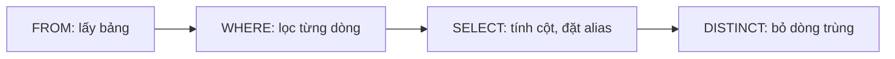

# Ngày 3: SELECT và WHERE, truy vấn và lọc dữ liệu

> **Tóm tắt:** `SELECT` chọn cột cần xem, `WHERE` chọn dòng cần giữ. Bài này đi từ câu `SELECT` đầu tiên tới các điều kiện lọc (so sánh, `AND`/`OR`/`NOT`, `IN`, `BETWEEN`, `LIKE`/`ILIKE`) và dành hẳn một phần cho `NULL` cùng logic ba trị, nguồn gây lỗi số 1 của người mới học SQL.

**Sau bài này bạn có thể:**

- Viết được câu `SELECT` lấy đúng các cột cần, thêm cột tính toán và đặt tên cột bằng `AS`.
- Dùng `DISTINCT` để xem một cột có những giá trị khác nhau nào.
- Lọc dòng bằng `WHERE` với so sánh, `AND`/`OR`/`NOT`, `IN`, `BETWEEN`, `LIKE`/`ILIKE`, có ngoặc đúng chỗ.
- Tìm dòng có hoặc không có giá trị bằng `IS NULL`/`IS NOT NULL`, và giải thích được vì sao `= NULL` không bao giờ khớp.
- Giải thích được thứ tự xử lý `FROM` → `WHERE` → `SELECT` và dùng nó để hiểu các thông báo lỗi.

**Cần biết trước:** [Ngày 1](01-intro-to-sql-and-dbms.md) (đã dựng môi trường và mở được `psql`), [Ngày 2](02-table-structure-and-data-types.md) (bảng, cột, kiểu dữ liệu).

Mọi ví dụ chạy trên bộ dữ liệu DSC Shop (xem [setup/README.md](../setup/README.md)). Bài này chỉ đọc dữ liệu, không sửa gì.

## 1. SELECT: chọn cột

Một bảng giống một trang tính: mỗi dòng là một bản ghi, mỗi cột là một thuộc tính. `SELECT` nói "tôi muốn xem cột nào", `FROM` nói "lấy từ bảng nào".

```text
SELECT cot_1, cot_2, ...
FROM ten_bang;
```

`SELECT *` lấy tất cả các cột. Bảng `employees` chỉ có 8 dòng nên xem hết được:

```sql
SELECT * FROM employees;
```

| employee_id | full_name | title | manager_id | hire_date | salary |
| --- | --- | --- | --- | --- | --- |
| 1 | Nguyễn Thành Long | Giám đốc | NULL | 2020-01-15 | 45000000 |
| 2 | Lê Thị Hạnh | Trưởng phòng Kinh doanh | 1 | 2021-03-01 | 28000000 |
| 3 | Trần Quốc Bảo | Trưởng phòng Kỹ thuật | 1 | 2021-06-15 | 27000000 |
| 4 | Phạm Thị Thu | Nhân viên bán hàng | 2 | 2022-02-10 | 12000000 |
| 5 | Đỗ Minh Tuấn | Nhân viên bán hàng | 2 | 2023-07-01 | 11000000 |
| 6 | Vũ Hoài Nam | Nhân viên bán hàng | 2 | 2024-09-01 | 10000000 |
| 7 | Lâm Gia Huy | Kỹ thuật viên | 3 | 2022-11-20 | 13000000 |
| 8 | Kiều Anh Thư | Thực tập sinh bán hàng | 4 | 2026-06-01 | 5000000 |

`SELECT *` tiện khi khám phá dữ liệu. Khi viết truy vấn thật (trong ứng dụng, báo cáo), hãy liệt kê đúng các cột cần: dễ đọc hơn, truyền ít dữ liệu hơn, và không bị vỡ khi ai đó thêm cột vào bảng.

```sql
SELECT full_name, city
FROM customers;
```

| full_name | city |
| --- | --- |
| Nguyễn Văn An | TP. Hồ Chí Minh |
| Trần Thị Bình | Hà Nội |
| Lê Hoàng Cường | Đà Nẵng |
| Phạm Minh Duy | TP. Hồ Chí Minh |
| Hoàng Thị Em | Cần Thơ |

(... tổng 18 dòng)

> **NULL hiển thị thế nào?** Trong bảng kết quả của bài, ô trống được ghi là `NULL`. Còn `psql` mặc định in `NULL` thành ô trống, rất dễ nhầm với chuỗi rỗng `''`. Gõ `\pset null 'NULL'` trong `psql` để thấy chữ `NULL` giống bài học.

### Cột tính toán và bí danh (alias)

Sau `SELECT` không chỉ là tên cột mà có thể là một **biểu thức**. Ví dụ tiền lãi mỗi sản phẩm là giá bán trừ giá nhập:

```sql
SELECT sku,
       name,
       price,
       cost_price,
       price - cost_price AS profit
FROM products;
```

| sku | name | price | cost_price | profit |
| --- | --- | --- | --- | --- |
| LAP-001 | ASUS ROG Strix G16 | 32990000 | 28500000 | 4490000 |
| LAP-002 | Lenovo Legion 5 | 29990000 | 26000000 | 3990000 |
| LAP-003 | Acer Nitro V 15 | 21990000 | 19000000 | 2990000 |
| LAP-004 | Dell Inspiron 14 | 18490000 | 16000000 | 2490000 |
| LAP-005 | MacBook Air M2 13 inch | 24990000 | 22000000 | 2990000 |
| LAP-006 | HP Pavilion 15 | 16990000 | NULL | NULL |

(... tổng 24 dòng)

Hai điều đáng để ý:

- `AS profit` đặt **bí danh (alias)** cho cột. Không có alias, PostgreSQL đặt tên cột là `?column?`.
- Sản phẩm `HP Pavilion 15` chưa có giá nhập (`cost_price` là `NULL`), nên `profit` cũng là `NULL`. Phép tính với `NULL` cho ra `NULL`. Mục 4 sẽ nói kỹ.

Alias có dấu cách, chữ hoa hoặc tiếng Việt có dấu thì bọc trong **ngoặc kép**:

```sql
SELECT name AS "Tên sản phẩm",
       price AS "Giá bán",
       price * 1.1 AS gia_co_vat
FROM products;
```

| Tên sản phẩm | Giá bán | gia_co_vat |
| --- | --- | --- |
| ASUS ROG Strix G16 | 32990000 | 36289000.0 |
| Lenovo Legion 5 | 29990000 | 32989000.0 |
| Acer Nitro V 15 | 21990000 | 24189000.0 |

(... tổng 24 dòng)

Trong PostgreSQL, **ngoặc đơn `'...'` là giá trị chuỗi, ngoặc kép `"..."` là tên** (tên cột, tên bảng, alias). Viết nhầm sẽ lỗi:

```sql
SELECT name AS 'Tên sản phẩm'
FROM products;
```

```text
ERROR:  syntax error at or near "'Tên sản phẩm'"
LINE 1: SELECT name AS 'Tên sản phẩm'
                       ^
```

> **Ghi chú dialect:** MySQL chấp nhận alias trong ngoặc đơn (`AS 'Tên'`) và dùng dấu backtick `` `...` `` cho tên; SQL Server dùng `[...]`. Viết `"..."` cho tên là cách chuẩn SQL.

### DISTINCT: các giá trị khác nhau

Cột `city` của khách hàng có những giá trị nào? `DISTINCT` bỏ các dòng trùng nhau trong kết quả:

```sql
SELECT DISTINCT city
FROM customers;
```

| city |
| --- |
| NULL |
| Hải Phòng |
| đà nẵng |
| Đà Nẵng |
| Cần Thơ |
| Hồ Chí Minh |
| Hà Nội |
| TP.HCM |
| TP. Hồ Chí Minh |
| Biên Hòa |

18 khách hàng nhưng chỉ có 10 giá trị khác nhau. Câu này còn lộ ra một vấn đề dữ liệu thật: TP. Hồ Chí Minh được viết 3 kiểu, Đà Nẵng 2 kiểu. Máy tính coi `'Đà Nẵng'` và `'đà nẵng'` là hai giá trị khác nhau. [Ngày 5](05-operators-expressions.md) sẽ làm sạch cột này bằng hàm chuỗi.

Thêm hai chi tiết:

- Các dòng `NULL` được gom thành **một** dòng `NULL` trong kết quả `DISTINCT`.
- Thứ tự dòng ở trên là ngẫu nhiên theo cách PostgreSQL xử lý, máy bạn có thể ra thứ tự khác. Muốn có thứ tự cố định phải dùng `ORDER BY` (học ở [Ngày 4](04-order-by-limit.md)).

`DISTINCT` áp dụng cho **cả bộ cột** sau nó, không phải chỉ cột đầu tiên. Đơn hàng có những cặp (trạng thái, kênh bán) nào?

```sql
SELECT DISTINCT status, channel
FROM orders;
```

| status | channel |
| --- | --- |
| paid | online |
| delivered | online |
| delivered | offline |
| cancelled | online |
| pending | online |
| shipped | online |

## 2. WHERE: lọc dòng

`WHERE` đặt một điều kiện. PostgreSQL xét điều kiện đó trên **từng dòng** và chỉ giữ những dòng mà điều kiện cho ra đúng (`TRUE`).

```text
SELECT cot_1, cot_2
FROM ten_bang
WHERE dieu_kien;
```

### Toán tử so sánh

| Toán tử | Ý nghĩa |
| --- | --- |
| `=` | bằng |
| `<>` hoặc `!=` | khác (hai cách viết như nhau, `<>` là chuẩn SQL) |
| `>`, `<` | lớn hơn, nhỏ hơn |
| `>=`, `<=` | lớn hơn hoặc bằng, nhỏ hơn hoặc bằng |

Sản phẩm giá trên 20 triệu:

```sql
SELECT sku, name, price
FROM products
WHERE price > 20000000;
```

| sku | name | price |
| --- | --- | --- |
| LAP-001 | ASUS ROG Strix G16 | 32990000 |
| LAP-002 | Lenovo Legion 5 | 29990000 |
| LAP-003 | Acer Nitro V 15 | 21990000 |
| LAP-005 | MacBook Air M2 13 inch | 24990000 |

So sánh chuỗi phải bọc giá trị trong ngoặc đơn. Các đơn chưa giao xong:

```sql
SELECT order_id, customer_id, status
FROM orders
WHERE status <> 'delivered';
```

| order_id | customer_id | status |
| --- | --- | --- |
| 5 | 4 | cancelled |
| 15 | 12 | cancelled |
| 28 | 5 | cancelled |
| 37 | 1 | shipped |
| 38 | 13 | paid |
| 39 | 15 | paid |
| 40 | 3 | pending |

Ngày giờ cũng so sánh được, viết dạng `'YYYY-MM-DD'`. Đơn đặt từ 01/09/2026 trở đi:

```sql
SELECT order_id, order_date, status
FROM orders
WHERE order_date >= '2026-09-01';
```

| order_id | order_date | status |
| --- | --- | --- |
| 37 | 2026-09-02 10:00:00+07 | shipped |
| 38 | 2026-09-20 16:30:00+07 | paid |
| 39 | 2026-10-05 09:00:00+07 | paid |
| 40 | 2026-10-14 22:00:00+07 | pending |

`order_date` có kiểu `TIMESTAMPTZ` (ngày giờ có múi giờ, xem [Ngày 2](02-table-structure-and-data-types.md)), nên `'2026-09-01'` được hiểu là `2026-09-01 00:00:00` theo múi giờ của phiên làm việc (database DSC Shop đặt `Asia/Ho_Chi_Minh`, tức `+07`).

### AND, OR, NOT

| Toán tử | Đúng khi |
| --- | --- |
| `A AND B` | cả A và B đều đúng |
| `A OR B` | ít nhất một trong A, B đúng |
| `NOT A` | A sai |

Điện thoại (`category_id = 7`) còn hàng:

```sql
SELECT sku, name, price, stock_quantity
FROM products
WHERE category_id = 7
  AND stock_quantity > 0;
```

| sku | name | price | stock_quantity |
| --- | --- | --- | --- |
| PHN-001 | iPhone 15 128GB | 19990000 | 15 |
| PHN-002 | Samsung Galaxy S24 | 18990000 | 9 |
| PHN-003 | Xiaomi Redmi Note 13 | 4890000 | 25 |

Đơn bị hủy hoặc đang chờ:

```sql
SELECT order_id, status, channel
FROM orders
WHERE status = 'cancelled'
   OR status = 'pending';
```

| order_id | status | channel |
| --- | --- | --- |
| 5 | cancelled | online |
| 15 | cancelled | online |
| 28 | cancelled | online |
| 40 | pending | online |

Cột `is_active` có kiểu `BOOLEAN` nên dùng thẳng làm điều kiện được. Sản phẩm đã ngừng kinh doanh:

```sql
SELECT sku, name, is_active
FROM products
WHERE NOT is_active;
```

| sku | name | is_active |
| --- | --- | --- |
| PHN-004 | Nokia 105 4G | f |

(`psql` in `TRUE`/`FALSE` thành `t`/`f`.)

#### Thứ tự ưu tiên: NOT trước, rồi AND, rồi OR

Giống phép nhân làm trước phép cộng, `AND` được tính trước `OR`. Muốn tìm "laptop gaming (`category_id = 3`) hoặc laptop văn phòng (`4`), giá dưới 20 triệu". Viết thẳng như câu nói:

```sql
SELECT sku, name, category_id, price
FROM products
WHERE category_id = 3 OR category_id = 4 AND price < 20000000;
```

| sku | name | category_id | price |
| --- | --- | --- | --- |
| LAP-001 | ASUS ROG Strix G16 | 3 | 32990000 |
| LAP-002 | Lenovo Legion 5 | 3 | 29990000 |
| LAP-003 | Acer Nitro V 15 | 3 | 21990000 |
| LAP-004 | Dell Inspiron 14 | 4 | 18490000 |
| LAP-006 | HP Pavilion 15 | 4 | 16990000 |

Sai: laptop gaming 33 triệu vẫn lọt vào. PostgreSQL đã hiểu là `category_id = 3 OR (category_id = 4 AND price < 20000000)`. Thêm ngoặc để nói đúng ý:

```sql
SELECT sku, name, category_id, price
FROM products
WHERE (category_id = 3 OR category_id = 4) AND price < 20000000;
```

| sku | name | category_id | price |
| --- | --- | --- | --- |
| LAP-004 | Dell Inspiron 14 | 4 | 18490000 |
| LAP-006 | HP Pavilion 15 | 4 | 16990000 |

Quy tắc dễ nhớ: **cứ trộn `AND` với `OR` là đặt ngoặc**, kể cả khi bạn chắc thứ tự ưu tiên đã đúng. Người đọc sau sẽ cảm ơn bạn.

### IN và NOT IN: thuộc một danh sách

`cot IN (a, b, c)` là cách viết gọn của `cot = a OR cot = b OR cot = c`.

```sql
SELECT order_id, status
FROM orders
WHERE status IN ('pending', 'paid', 'shipped');
```

| order_id | status |
| --- | --- |
| 37 | shipped |
| 38 | paid |
| 39 | paid |
| 40 | pending |

`NOT IN` lấy các giá trị nằm ngoài danh sách. Sản phẩm không thuộc nhóm máy tính và điện thoại, tức là các phụ kiện:

```sql
SELECT sku, name, category_id
FROM products
WHERE category_id NOT IN (3, 4, 5, 7, 8);
```

| sku | name | category_id |
| --- | --- | --- |
| ACC-001 | Chuột Logitech G102 | 10 |
| ACC-002 | Chuột Logitech MX Master 3S | 10 |
| ACC-003 | Bàn phím cơ Keychron K2 | 10 |
| ACC-004 | Tai nghe Sony WH-1000XM5 | 11 |

(... tổng 9 dòng)

`NOT IN` có một cái bẫy lớn khi danh sách chứa `NULL`, xem mục 4.

### BETWEEN: trong một khoảng, gồm cả hai đầu

`cot BETWEEN a AND b` tương đương `cot >= a AND cot <= b`. **Cả hai đầu mút đều được tính.**

```sql
SELECT sku, name, price
FROM products
WHERE price BETWEEN 1890000 AND 2690000;
```

| sku | name | price |
| --- | --- | --- |
| ACC-002 | Chuột Logitech MX Master 3S | 2490000 |
| ACC-003 | Bàn phím cơ Keychron K2 | 1890000 |
| ACC-006 | Loa JBL Flip 6 | 2690000 |

Bàn phím giá đúng 1.890.000 và loa giá đúng 2.690.000 đều có mặt. `NOT BETWEEN a AND b` lấy phần còn lại.

#### Cẩn thận BETWEEN với cột ngày giờ

Muốn lấy đơn hàng từ 01/11/2025 đến hết ngày 11/11/2025 (ngày sale lớn):

```sql
SELECT order_id, order_date
FROM orders
WHERE order_date BETWEEN '2025-11-01' AND '2025-11-11';
```

```text
 order_id | order_date
----------+------------
(0 rows)
```

Không có dòng nào, dù ngày 11/11 có 2 đơn. Lý do: `order_date` có cả giờ, còn `'2025-11-11'` được hiểu là `2025-11-11 00:00:00`. Đơn lúc 19:00 và 23:30 ngày 11/11 đều **lớn hơn** mốc đó nên bị loại. Cách đúng là dùng **khoảng nửa mở**: lớn hơn hoặc bằng ngày đầu, **nhỏ hơn** ngày ngay sau ngày cuối.

```sql
SELECT order_id, order_date
FROM orders
WHERE order_date >= '2025-11-01'
  AND order_date <  '2025-11-12';
```

| order_id | order_date |
| --- | --- |
| 21 | 2025-11-11 19:00:00+07 |
| 22 | 2025-11-11 23:30:00+07 |

Thói quen tốt: với cột `TIMESTAMP`/`TIMESTAMPTZ`, luôn lọc theo kiểu `>= đầu AND < cuối`. `BETWEEN` chỉ an toàn với cột `DATE` (chỉ có ngày) và với số.

### LIKE, ILIKE: tìm theo mẫu chuỗi

| Ký tự đại diện | Khớp với |
| --- | --- |
| `%` | một chuỗi bất kỳ, kể cả rỗng |
| `_` | đúng một ký tự bất kỳ |

Tên bắt đầu bằng "Samsung":

```sql
SELECT sku, name
FROM products
WHERE name LIKE 'Samsung%';
```

| sku | name |
| --- | --- |
| PHN-002 | Samsung Galaxy S24 |
| TAB-002 | Samsung Galaxy Tab S9 FE |

Tên chứa "Logitech" ở bất kỳ đâu:

```sql
SELECT sku, name
FROM products
WHERE name LIKE '%Logitech%';
```

| sku | name |
| --- | --- |
| ACC-001 | Chuột Logitech G102 |
| ACC-002 | Chuột Logitech MX Master 3S |

Mã SKU dạng `PC-00` cộng đúng một ký tự:

```sql
SELECT sku, name
FROM products
WHERE sku LIKE 'PC-00_';
```

| sku | name |
| --- | --- |
| PC-001 | Màn hình LG UltraGear 27 inch |
| PC-002 | Màn hình Dell P2422H |
| PC-003 | PC văn phòng DSC Basic |

Trong PostgreSQL, `LIKE` **phân biệt chữ hoa chữ thường**. Người dùng gõ "iphone" sẽ không tìm thấy gì:

```sql
SELECT sku, name
FROM products
WHERE name LIKE '%iphone%';
```

```text
 sku | name
-----+------
(0 rows)
```

`ILIKE` (chữ I là *insensitive*) bỏ qua hoa thường:

```sql
SELECT sku, name
FROM products
WHERE name ILIKE '%iphone%';
```

| sku | name |
| --- | --- |
| PHN-001 | iPhone 15 128GB |

`NOT LIKE` lấy các dòng không khớp mẫu. Khách không dùng Gmail:

```sql
SELECT full_name, email
FROM customers
WHERE email NOT LIKE '%@gmail.com';
```

| full_name | email |
| --- | --- |
| Lê Hoàng Cường | cuong.le@outlook.com |
| Võ Quốc Phong | phong.vo@student.hcmute.edu.vn |
| Bùi Văn Hùng | hung.bui@yahoo.com |
| Dương Minh Khoa | khoa.duong@student.hcmute.edu.vn |
| Phan Thị Oanh | oanh.phan@hotmail.com |
| Huỳnh Tấn Phát | phat.huynh@student.hcmute.edu.vn |

Có 18 khách, 10 người dùng Gmail, nhưng kết quả chỉ có 6 dòng chứ không phải 8. Hai khách còn lại (Hoàng Thị Em và Châu Ngọc Trâm) không có email, tức `email` là `NULL`. Vì sao họ biến mất? Đó chính là nội dung mục tiếp theo.

> **Ghi chú dialect:** `ILIKE` chỉ có trong PostgreSQL. Trong MySQL, `LIKE` thường đã không phân biệt hoa thường (tùy collation của cột, collation mặc định kết thúc bằng `_ci` là *case-insensitive*). Trong SQL Server cũng tùy collation. Cách viết chạy được ở mọi nơi: `LOWER(name) LIKE '%iphone%'` (hàm `LOWER` học ở [Ngày 5](05-operators-expressions.md)).

## 3. Thứ tự xử lý: FROM → WHERE → SELECT

Ta **viết** `SELECT ... FROM ... WHERE ...`, nhưng PostgreSQL **xử lý** theo thứ tự logic khác:



Thứ tự này giải thích một lỗi rất hay gặp: dùng alias của `SELECT` trong `WHERE`.

```sql
SELECT name, price - cost_price AS profit
FROM products
WHERE profit > 3000000;
```

```text
ERROR:  column "profit" does not exist
LINE 3: WHERE profit > 3000000;
              ^
```

Lúc `WHERE` chạy, `SELECT` chưa chạy nên chưa có cột nào tên `profit`. Cách sửa là viết lại biểu thức:

```sql
SELECT name, price - cost_price AS profit
FROM products
WHERE price - cost_price > 3000000;
```

| name | profit |
| --- | --- |
| ASUS ROG Strix G16 | 4490000 |
| Lenovo Legion 5 | 3990000 |

Bức tranh đầy đủ (thêm `GROUP BY`, `HAVING`, `ORDER BY`, `LIMIT`) sẽ được bổ sung dần ở [Ngày 4](04-order-by-limit.md) và [Ngày 9](09-group-by-having.md).

## 4. NULL và logic ba trị

### NULL là "không biết", không phải 0 hay chuỗi rỗng

`NULL` nghĩa là **giá trị chưa biết hoặc không có**. Khách hàng 3 có `phone` là `NULL`: ta không biết số điện thoại của họ. Điều đó khác với `''` (biết chắc là chuỗi rỗng) và khác với `0`.

Vì "không biết", mọi phép so sánh với `NULL` đều cho ra "không biết". SQL gọi giá trị thứ ba này là **UNKNOWN** (PostgreSQL hiển thị nó là `NULL`). Đây là **logic ba trị**: một điều kiện có thể `TRUE`, `FALSE` hoặc `UNKNOWN`.

```sql
SELECT NULL = NULL     AS null_bang_null,
       NULL <> 'Hà Nội' AS null_khac_hn,
       NULL IS NULL     AS null_is_null;
```

| null_bang_null | null_khac_hn | null_is_null |
| --- | --- | --- |
| NULL | NULL | t |

Ngay cả `NULL = NULL` cũng không phải `TRUE`: hai giá trị chưa biết thì không thể nói chúng bằng nhau. Chỉ có `IS NULL` trả lời chắc chắn được.

### Vì sao `= NULL` luôn sai

Tìm khách chưa có số điện thoại, viết theo trực giác:

```sql
SELECT full_name, phone
FROM customers
WHERE phone = NULL;
```

```text
 full_name | phone
-----------+-------
(0 rows)
```

Không lỗi, nhưng 0 dòng. Với mọi dòng, `phone = NULL` cho ra `UNKNOWN`, và `WHERE` chỉ giữ dòng `TRUE`. Cách đúng là `IS NULL`:

```sql
SELECT customer_id, full_name, phone
FROM customers
WHERE phone IS NULL;
```

| customer_id | full_name | phone |
| --- | --- | --- |
| 3 | Lê Hoàng Cường | NULL |
| 7 | Đặng Thu Giang | NULL |
| 13 | Phan Thị Oanh | NULL |
| 17 | Châu Ngọc Trâm | NULL |

Ngược lại, `IS NOT NULL` lấy các dòng có giá trị. Khách đã khai ngày sinh và sinh từ năm 2004:

```sql
SELECT customer_id, full_name, birth_date
FROM customers
WHERE birth_date IS NOT NULL
  AND birth_date >= '2004-01-01';
```

| customer_id | full_name | birth_date |
| --- | --- | --- |
| 6 | Võ Quốc Phong | 2004-05-12 |
| 10 | Dương Minh Khoa | 2005-02-14 |
| 14 | Huỳnh Tấn Phát | 2004-08-20 |

(Ở câu này `IS NOT NULL` thực ra thừa, vì `birth_date >= '2004-01-01'` đã cho `UNKNOWN` với dòng `NULL`. Viết ra cho rõ ý cũng không sao.)

### WHERE chỉ giữ dòng TRUE

Đây là ý quan trọng nhất của bài. Xem điều kiện `city <> 'Hà Nội'` chạy trên ba khách hàng:


<small>File gốc: [nền sáng](../diagrams/select-where/where-logic-ba-tri.html) · [nền tối](../diagrams/select-where/where-logic-ba-tri-dark.html)</small>

Chạy thật trên cả bảng: 18 khách, 4 người ở Hà Nội, vậy "khách không ở Hà Nội" phải là 14 người?

```sql
SELECT customer_id, full_name, city
FROM customers
WHERE city <> 'Hà Nội';
```

| customer_id | full_name | city |
| --- | --- | --- |
| 1 | Nguyễn Văn An | TP. Hồ Chí Minh |
| 3 | Lê Hoàng Cường | Đà Nẵng |
| 4 | Phạm Minh Duy | TP. Hồ Chí Minh |
| 5 | Hoàng Thị Em | Cần Thơ |
| 6 | Võ Quốc Phong | Hồ Chí Minh |
| 8 | Bùi Văn Hùng | đà nẵng |
| 9 | Ngô Thị Lan | Hải Phòng |
| 10 | Dương Minh Khoa | TP. Hồ Chí Minh |
| 12 | Trịnh Công Nam | Biên Hòa |
| 14 | Huỳnh Tấn Phát | TP.HCM |
| 16 | Tạ Quang Sơn | Cần Thơ |
| 18 | Mai Đức Uy | Đà Nẵng |

Chỉ 12. Khách 11 và 17 (chưa ghi thành phố) bị mất vì điều kiện của họ là `UNKNOWN`. Nếu đề bài muốn tính cả họ, phải nói rõ với SQL:

```sql
SELECT customer_id, full_name, city
FROM customers
WHERE city <> 'Hà Nội'
   OR city IS NULL;
```

| customer_id | full_name | city |
| --- | --- | --- |
| 1 | Nguyễn Văn An | TP. Hồ Chí Minh |
| 3 | Lê Hoàng Cường | Đà Nẵng |
| ... | ... | ... |
| 11 | Lý Thanh Mai | NULL |
| 12 | Trịnh Công Nam | Biên Hòa |
| 14 | Huỳnh Tấn Phát | TP.HCM |
| 16 | Tạ Quang Sơn | Cần Thơ |
| 17 | Châu Ngọc Trâm | NULL |
| 18 | Mai Đức Uy | Đà Nẵng |

(... tổng 14 dòng)

PostgreSQL còn có toán tử `IS DISTINCT FROM`, coi `NULL` như một giá trị bình thường khi so sánh. `city IS DISTINCT FROM 'Hà Nội'` cho đúng 14 dòng như trên.

```sql
SELECT customer_id, full_name, city
FROM customers
WHERE city IS DISTINCT FROM 'Hà Nội';
```

Kết quả: 14 dòng, giống hệt câu dùng `OR city IS NULL`.

### Bảng chân trị AND, OR, NOT với UNKNOWN

Khi điều kiện ghép bằng `AND`/`OR`, `UNKNOWN` lan truyền theo quy tắc sau (U là UNKNOWN):

| A | B | A AND B | A OR B |
| --- | --- | --- | --- |
| TRUE | U | U | TRUE |
| FALSE | U | FALSE | U |
| U | U | U | U |

| A | NOT A |
| --- | --- |
| TRUE | FALSE |
| FALSE | TRUE |
| U | U |

Cách nhớ: coi U là "có thể đúng, có thể sai". `FALSE AND U` chắc chắn sai dù U là gì; `TRUE OR U` chắc chắn đúng dù U là gì; các trường hợp còn lại không quyết được nên vẫn là U. Kiểm chứng:

```sql
SELECT TRUE AND NULL  AS true_and_null,
       FALSE AND NULL AS false_and_null,
       TRUE OR NULL   AS true_or_null,
       FALSE OR NULL  AS false_or_null,
       NOT NULL::boolean AS not_null;
```

| true_and_null | false_and_null | true_or_null | false_or_null | not_null |
| --- | --- | --- | --- | --- |
| NULL | f | t | NULL | NULL |

(`NULL::boolean` ép `NULL` về kiểu boolean, ép kiểu học ở [Ngày 5](05-operators-expressions.md).)

Hệ quả: `NOT` của `UNKNOWN` vẫn là `UNKNOWN`. Vì vậy cả `WHERE city = 'Hà Nội'` lẫn `WHERE NOT (city = 'Hà Nội')` đều không trả về khách có `city` là `NULL`. Cộng hai kết quả lại không ra đủ bảng.

### Bẫy NOT IN với NULL

`city NOT IN ('Hà Nội', NULL)` được hiểu là `city <> 'Hà Nội' AND city <> NULL`. Vế sau luôn là `UNKNOWN`, nên cả biểu thức không bao giờ là `TRUE`:

```sql
SELECT customer_id, full_name, city
FROM customers
WHERE city NOT IN ('Hà Nội', NULL);
```

```text
 customer_id | full_name | city
-------------+-----------+------
(0 rows)
```

Ở đây `NULL` được gõ thẳng vào nên dễ thấy. Ngoài đời nó thường đến từ một truy vấn con trả về danh sách có `NULL`, khiến cả câu trả về 0 dòng mà không báo lỗi. [Ngày 11](11-subquery.md) sẽ quay lại bẫy này với `NOT EXISTS`.

## Lỗi thường gặp

**1. So sánh với NULL bằng `=` hoặc `<>`.** Luôn trả về 0 dòng.

```sql
-- Sai: luôn 0 dòng
SELECT full_name FROM customers WHERE phone = NULL;
-- Đúng: 4 dòng
SELECT full_name FROM customers WHERE phone IS NULL;
```

**2. Quên rằng `<>`, `NOT LIKE`, `NOT IN` bỏ qua dòng NULL.** `WHERE city <> 'Hà Nội'` không trả về khách chưa ghi thành phố. Tự hỏi "dòng NULL có cần không?" mỗi khi viết điều kiện phủ định; cần thì thêm `OR city IS NULL` hoặc dùng `IS DISTINCT FROM`.

**3. BETWEEN với cột ngày giờ.** `order_date BETWEEN '2025-11-01' AND '2025-11-11'` bỏ mất cả ngày 11/11. Dùng `order_date >= '2025-11-01' AND order_date < '2025-11-12'`.

**4. Trộn AND và OR không có ngoặc.** `WHERE category_id = 3 OR category_id = 4 AND price < 20000000` thực ra là `3 OR (4 AND rẻ)`. Đặt ngoặc, hoặc dùng `category_id IN (3, 4) AND price < 20000000`.

**5. Nhầm ngoặc đơn và ngoặc kép.** Giá trị chuỗi dùng `'...'`. Viết `"Hà Nội"` thì PostgreSQL tìm **cột** tên `Hà Nội`:

```sql
SELECT full_name
FROM customers
WHERE city = "Hà Nội";
```

```text
ERROR:  column "Hà Nội" does not exist
LINE 3: WHERE city = "Hà Nội";
                     ^
```

**6. Dùng alias của SELECT trong WHERE.** Lỗi `column "..." does not exist` vì `WHERE` chạy trước `SELECT`. Viết lại biểu thức trong `WHERE`.

**7. Tưởng LIKE không phân biệt hoa thường.** Trong PostgreSQL, `LIKE '%iphone%'` không khớp `iPhone`. Dùng `ILIKE`.

## Bài tập

### Cơ bản

**Bài 1.** Liệt kê `sku`, `name`, `stock_quantity` của các sản phẩm đã hết hàng.

<details>
<summary>Đáp án</summary>

```sql
SELECT sku, name, stock_quantity
FROM products
WHERE stock_quantity = 0;
```

Kết quả:

| sku | name | stock_quantity |
| --- | --- | --- |
| LAP-003 | Acer Nitro V 15 | 0 |
| PHN-004 | Nokia 105 4G | 0 |
| ACC-006 | Loa JBL Flip 6 | 0 |

</details>

**Bài 2.** Bảng `orders` đang có những trạng thái (`status`) nào? Mỗi trạng thái chỉ hiện một lần.

<details>
<summary>Đáp án</summary>

```sql
SELECT DISTINCT status
FROM orders;
```

Kết quả (thứ tự dòng có thể khác trên máy bạn):

| status |
| --- |
| delivered |
| cancelled |
| pending |
| paid |
| shipped |

</details>

**Bài 3.** Tìm các khách dùng email sinh viên HCMUTE (đuôi `@student.hcmute.edu.vn`).

<details>
<summary>Đáp án</summary>

```sql
SELECT full_name, email
FROM customers
WHERE email LIKE '%@student.hcmute.edu.vn';
```

Kết quả:

| full_name | email |
| --- | --- |
| Võ Quốc Phong | phong.vo@student.hcmute.edu.vn |
| Dương Minh Khoa | khoa.duong@student.hcmute.edu.vn |
| Huỳnh Tấn Phát | phat.huynh@student.hcmute.edu.vn |

</details>

### Vận dụng

**Bài 4.** Tìm sản phẩm đang kinh doanh (`is_active`), giá từ 5 triệu đến 20 triệu (tính cả hai đầu) và còn hàng.

<details>
<summary>Đáp án</summary>

```sql
SELECT sku, name, price, stock_quantity
FROM products
WHERE is_active
  AND price BETWEEN 5000000 AND 20000000
  AND stock_quantity > 0;
```

Kết quả:

| sku | name | price | stock_quantity |
| --- | --- | --- | --- |
| LAP-004 | Dell Inspiron 14 | 18490000 | 8 |
| LAP-006 | HP Pavilion 15 | 16990000 | 4 |
| PC-001 | Màn hình LG UltraGear 27 inch | 6490000 | 12 |
| PC-003 | PC văn phòng DSC Basic | 9990000 | 2 |
| PHN-001 | iPhone 15 128GB | 19990000 | 15 |
| PHN-002 | Samsung Galaxy S24 | 18990000 | 9 |
| TAB-001 | iPad Air M2 11 inch | 16990000 | 5 |
| TAB-002 | Samsung Galaxy Tab S9 FE | 9490000 | 7 |
| ACC-004 | Tai nghe Sony WH-1000XM5 | 7990000 | 8 |
| ACC-005 | Tai nghe AirPods Pro 2 | 5990000 | 12 |

Dùng `BETWEEN` ở đây an toàn vì `price` là số, không phải ngày giờ.

</details>

**Bài 5.** Bộ phận chăm sóc khách hàng cần danh sách khách thiếu thông tin liên lạc: chưa có email **hoặc** chưa có số điện thoại.

<details>
<summary>Đáp án</summary>

```sql
SELECT customer_id, full_name, email, phone
FROM customers
WHERE email IS NULL
   OR phone IS NULL;
```

Kết quả:

| customer_id | full_name | email | phone |
| --- | --- | --- | --- |
| 3 | Lê Hoàng Cường | cuong.le@outlook.com | NULL |
| 5 | Hoàng Thị Em | NULL | 0934567890 |
| 7 | Đặng Thu Giang | giang.dang@gmail.com | NULL |
| 13 | Phan Thị Oanh | oanh.phan@hotmail.com | NULL |
| 17 | Châu Ngọc Trâm | NULL | NULL |

</details>

**Bài 6.** Liệt kê các đơn hàng đặt trong tháng 9/2025 (từ 01/09 đến hết 30/09).

<details>
<summary>Đáp án</summary>

```sql
SELECT order_id, customer_id, order_date, status
FROM orders
WHERE order_date >= '2025-09-01'
  AND order_date <  '2025-10-01';
```

Kết quả:

| order_id | customer_id | order_date | status |
| --- | --- | --- | --- |
| 17 | 13 | 2025-09-01 12:00:00+07 | delivered |
| 18 | 14 | 2025-09-05 08:00:00+07 | delivered |
| 19 | 6 | 2025-09-06 18:20:00+07 | delivered |

Khoảng nửa mở `>= 01/09 AND < 01/10` không cần biết tháng 9 có 30 hay 31 ngày, và không bỏ sót đơn đặt trong ngày cuối tháng.

</details>

**Bài 7.** Tìm các đơn hàng có ghi chú (`note`) và không bị hủy.

<details>
<summary>Đáp án</summary>

```sql
SELECT order_id, status, note
FROM orders
WHERE note IS NOT NULL
  AND status <> 'cancelled';
```

Kết quả:

| order_id | status | note |
| --- | --- | --- |
| 4 | delivered | Quà Valentine, gói giấy đỏ |
| 12 | delivered | Trả góp 2 lần |
| 18 | delivered | Mua đầu năm học |
| 22 | delivered | Săn sale 11/11 |
| 25 | delivered | Quà Giáng sinh |

`status` có ràng buộc `NOT NULL` nên `status <> 'cancelled'` không có bẫy NULL ở đây.

</details>

### Thử thách

**Bài 8.** Bộ phận mua hàng muốn rà soát giá nhập: liệt kê sản phẩm có tiền lãi (`price - cost_price`) từ 3 triệu trở lên, **cùng với** những sản phẩm chưa có giá nhập (vì chưa tính được lãi). Hiển thị cả cột tiền lãi với tên `profit`.

<details>
<summary>Đáp án</summary>

```sql
SELECT sku,
       name,
       price,
       cost_price,
       price - cost_price AS profit
FROM products
WHERE price - cost_price >= 3000000
   OR cost_price IS NULL;
```

Kết quả:

| sku | name | price | cost_price | profit |
| --- | --- | --- | --- | --- |
| LAP-001 | ASUS ROG Strix G16 | 32990000 | 28500000 | 4490000 |
| LAP-002 | Lenovo Legion 5 | 29990000 | 26000000 | 3990000 |
| LAP-006 | HP Pavilion 15 | 16990000 | NULL | NULL |
| ACC-009 | Lót chuột DSC XXL | 250000 | NULL | NULL |

Hai điểm cần để ý: không dùng được `WHERE profit >= 3000000` (alias chưa tồn tại lúc `WHERE` chạy), và nếu thiếu vế `OR cost_price IS NULL` thì hai sản phẩm chưa có giá nhập sẽ biến mất vì điều kiện của chúng là `UNKNOWN`.

</details>

**Bài 9.** Tìm tất cả khách hàng ở TP. Hồ Chí Minh, bất kể thành phố được viết theo kiểu nào trong dữ liệu.

<details>
<summary>Đáp án</summary>

Bước 1: xem có những cách viết nào bằng `SELECT DISTINCT city FROM customers;` (kết quả ở mục 1): `TP. Hồ Chí Minh`, `Hồ Chí Minh`, `TP.HCM`.

Bước 2: lọc theo đủ ba cách viết.

```sql
SELECT customer_id, full_name, city
FROM customers
WHERE city IN ('TP. Hồ Chí Minh', 'Hồ Chí Minh', 'TP.HCM');
```

Kết quả:

| customer_id | full_name | city |
| --- | --- | --- |
| 1 | Nguyễn Văn An | TP. Hồ Chí Minh |
| 4 | Phạm Minh Duy | TP. Hồ Chí Minh |
| 6 | Võ Quốc Phong | Hồ Chí Minh |
| 10 | Dương Minh Khoa | TP. Hồ Chí Minh |
| 14 | Huỳnh Tấn Phát | TP.HCM |

Cách khác, bắt theo mẫu để không phải liệt kê từng kiểu:

```sql
SELECT customer_id, full_name, city
FROM customers
WHERE city ILIKE '%chí minh%'
   OR city ILIKE '%hcm%';
```

Kết quả: cùng 5 khách như trên. Cả hai cách đều chỉ là chữa cháy. Cách bền vững là làm sạch dữ liệu ([Ngày 5](05-operators-expressions.md)) và ràng buộc dữ liệu nhập vào ([Ngày 27](27-database-design-best-practices.md)).

</details>

## Tóm tắt

- `SELECT` chọn cột, `FROM` chọn bảng. Hạn chế `SELECT *` trong truy vấn thật.
- Cột tính toán đặt tên bằng `AS`. Tên có dấu cách hoặc tiếng Việt dùng ngoặc kép `"..."`; giá trị chuỗi dùng ngoặc đơn `'...'`.
- `DISTINCT` bỏ dòng trùng trên cả bộ cột được chọn; các `NULL` gom thành một dòng.
- `WHERE` lọc từng dòng, chỉ giữ dòng có điều kiện là `TRUE`.
- Thứ tự ưu tiên `NOT` > `AND` > `OR`. Trộn `AND` với `OR` thì luôn đặt ngoặc.
- `IN` là nhiều `=` nối bằng `OR`; `BETWEEN` gồm cả hai đầu; với cột ngày giờ dùng `>= đầu AND < cuối`.
- `LIKE` phân biệt hoa thường trong PostgreSQL, `ILIKE` thì không. `%` là chuỗi bất kỳ, `_` là một ký tự.
- `NULL` là "không biết". So sánh với `NULL` cho `UNKNOWN`, nên phải dùng `IS NULL`/`IS NOT NULL`. Điều kiện phủ định (`<>`, `NOT IN`, `NOT LIKE`) âm thầm bỏ qua dòng `NULL`.
- Thứ tự xử lý logic: `FROM` → `WHERE` → `SELECT`, nên alias của `SELECT` chưa dùng được trong `WHERE`.

## Đọc thêm

- [Vì sao NOT IN của bạn trả về 0 dòng? Logic ba trị của SQL và cái bẫy NULL](https://tiennhm.io.vn/blog/sql-null-not-in-three-valued-logic) — Một câu NOT IN trả về đúng 0 dòng trong khi bảng có dữ liệu, còn NOT EXISTS cùng ý định lại trả về đủ.
- [LEFT JOIN của bạn đã thành INNER JOIN mà không ai báo](https://tiennhm.io.vn/blog/left-join-thanh-inner-join) — Thêm một điều kiện WHERE lên cột của bảng bên phải là LEFT JOIN âm thầm biến thành INNER JOIN, và những dòng bạn cố tình giữ lại biến mất (đọc sau khi học JOIN ở Ngày 10).
- Tài liệu PostgreSQL: [Comparison Functions and Operators](https://www.postgresql.org/docs/16/functions-comparison.html), [Pattern Matching](https://www.postgresql.org/docs/16/functions-matching.html).

---

[⬅️ Ngày 2: Bảng, kiểu dữ liệu và ràng buộc](02-table-structure-and-data-types.md) | [📚 Mục lục](../README.md) | [Ngày 4: ORDER BY và LIMIT, sắp xếp và phân trang ➡️](04-order-by-limit.md)
