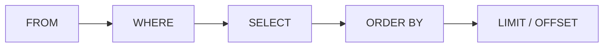

# Ngày 4: ORDER BY và LIMIT, sắp xếp và phân trang

> **Tóm tắt:** Không có `ORDER BY` thì thứ tự dòng trả về là không xác định. Bài này dạy sắp xếp theo một hay nhiều cột, xử lý `NULL` khi sắp xếp, lấy top N bằng `LIMIT`/`FETCH FIRST`, và phân trang bằng `OFFSET` cùng những cái bẫy của nó (trang bị lặp dòng, `OFFSET` lớn chạy chậm).

**Sau bài này bạn có thể:**

- Viết được `ORDER BY` nhiều cột, trộn `ASC`/`DESC`, và chọn chỗ đứng cho `NULL` bằng `NULLS FIRST`/`NULLS LAST`.
- Lấy được top N bằng `LIMIT` hoặc `FETCH FIRST`, biết khi nào cần `WITH TIES`.
- Viết được truy vấn phân trang `LIMIT ... OFFSET ...` với công thức `OFFSET = (trang - 1) * cỡ_trang` và cột phá hòa để trang không bị lặp dòng.
- Giải thích được vì sao `OFFSET` lớn chậm và viết được phân trang kiểu keyset ở mức cơ bản.

**Cần biết trước:** [Ngày 3](03-select-where.md) (`SELECT`, `WHERE`, `NULL`, thứ tự xử lý `FROM` → `WHERE` → `SELECT`).

## 1. ORDER BY: sắp xếp kết quả

Bảng trong database giống một cái túi đựng dòng: không có thứ tự nào được đảm bảo. Kết quả ở [Ngày 3](03-select-where.md) tình cờ ra theo thứ tự id vì dữ liệu mới nạp, nhưng sau vài lần sửa, xóa, hoặc khi PostgreSQL đổi cách thực thi, thứ tự đó có thể thay đổi. **Muốn kết quả có thứ tự thì phải viết `ORDER BY`.**

```text
SELECT cot_1, cot_2
FROM ten_bang
ORDER BY cot_sap_xep [ASC | DESC];
```

`ASC` (tăng dần) là mặc định, có thể bỏ. Sản phẩm từ rẻ đến đắt:

```sql
SELECT sku, name, price
FROM products
ORDER BY price;
```

| sku | name | price |
| --- | --- | --- |
| ACC-008 | Cáp USB-C to USB-C 1m | 150000 |
| ACC-009 | Lót chuột DSC XXL | 250000 |
| ACC-001 | Chuột Logitech G102 | 399000 |
| PHN-004 | Nokia 105 4G | 690000 |
| ACC-007 | Sạc Anker 65W | 890000 |

(... tổng 24 dòng)

`DESC` để giảm dần, từ đắt đến rẻ:

```sql
SELECT sku, name, price
FROM products
ORDER BY price DESC;
```

| sku | name | price |
| --- | --- | --- |
| LAP-001 | ASUS ROG Strix G16 | 32990000 |
| LAP-002 | Lenovo Legion 5 | 29990000 |
| LAP-005 | MacBook Air M2 13 inch | 24990000 |
| LAP-003 | Acer Nitro V 15 | 21990000 |
| PHN-001 | iPhone 15 128GB | 19990000 |

(... tổng 24 dòng)

### Sắp xếp theo nhiều cột

Mỗi cột trong `ORDER BY` có `ASC`/`DESC` riêng. Cột thứ hai chỉ được dùng để **phá hòa** khi cột thứ nhất bằng nhau. Xếp sản phẩm theo danh mục, trong mỗi danh mục thì đắt trước:

```sql
SELECT category_id, sku, name, price
FROM products
ORDER BY category_id ASC, price DESC;
```

| category_id | sku | name | price |
| --- | --- | --- | --- |
| 3 | LAP-001 | ASUS ROG Strix G16 | 32990000 |
| 3 | LAP-002 | Lenovo Legion 5 | 29990000 |
| 3 | LAP-003 | Acer Nitro V 15 | 21990000 |
| 4 | LAP-005 | MacBook Air M2 13 inch | 24990000 |
| 4 | LAP-004 | Dell Inspiron 14 | 18490000 |
| 4 | LAP-006 | HP Pavilion 15 | 16990000 |
| 5 | PC-003 | PC văn phòng DSC Basic | 9990000 |
| 5 | PC-001 | Màn hình LG UltraGear 27 inch | 6490000 |
| 5 | PC-002 | Màn hình Dell P2422H | 4290000 |

(... tổng 24 dòng)

MacBook (24,99 triệu) đứng sau Acer Nitro (21,99 triệu) vì `category_id` được so trước: 3 nhỏ hơn 4.

Một ví dụ khác: hai khách cùng tên `Nguyễn Văn An`. Sắp theo tên thì họ hòa nhau; thêm cột thứ hai để người đăng ký sau đứng trước:

```sql
SELECT customer_id, full_name, created_at
FROM customers
WHERE full_name LIKE 'Nguyễn%'
ORDER BY full_name, created_at DESC;
```

| customer_id | full_name | created_at |
| --- | --- | --- |
| 15 | Nguyễn Văn An | 2025-10-10 00:00:00+07 |
| 1 | Nguyễn Văn An | 2025-01-05 00:00:00+07 |

### Sắp xếp theo biểu thức, alias và cột không được chọn

`ORDER BY` chạy **sau** `SELECT`, nên khác với `WHERE`, nó dùng được alias. Thứ tự xử lý logic bây giờ là:



Sản phẩm lãi nhiều nhất trước:

```sql
SELECT sku, name, price - cost_price AS profit
FROM products
ORDER BY profit DESC;
```

| sku | name | profit |
| --- | --- | --- |
| LAP-006 | HP Pavilion 15 | NULL |
| ACC-009 | Lót chuột DSC XXL | NULL |
| LAP-001 | ASUS ROG Strix G16 | 4490000 |
| LAP-002 | Lenovo Legion 5 | 3990000 |
| PHN-002 | Samsung Galaxy S24 | 2990000 |

(... tổng 24 dòng)

Hai sản phẩm chưa có giá nhập (lãi là `NULL`) lại nằm đầu bảng. Mục 2 giải thích và sửa chuyện này.

Có thể sắp theo cột không xuất hiện trong `SELECT`. Khách ở Hà Nội, ai đăng ký gần đây nhất đứng đầu:

```sql
SELECT full_name, city
FROM customers
WHERE city = 'Hà Nội'
ORDER BY created_at DESC;
```

| full_name | city |
| --- | --- |
| Nguyễn Văn An | Hà Nội |
| Phan Thị Oanh | Hà Nội |
| Đặng Thu Giang | Hà Nội |
| Trần Thị Bình | Hà Nội |

(Ngoại lệ: khi có `SELECT DISTINCT`, cột trong `ORDER BY` phải nằm trong danh sách `SELECT`.)

PostgreSQL còn cho viết `ORDER BY 2` (sắp theo cột thứ 2 của `SELECT`). Cách này chạy được nhưng dễ sai khi ai đó thêm bớt cột, nên chỉ dùng khi gõ thử nhanh.

## 2. NULL khi sắp xếp: NULLS FIRST, NULLS LAST

PostgreSQL coi `NULL` **lớn hơn mọi giá trị**. Vì vậy:

- `ASC`: `NULL` đứng **cuối**.
- `DESC`: `NULL` đứng **đầu** (như ví dụ tiền lãi ở trên).

Muốn đổi, thêm `NULLS FIRST` hoặc `NULLS LAST` ngay sau cột:

```sql
SELECT sku, name, price - cost_price AS profit
FROM products
ORDER BY profit DESC NULLS LAST;
```

| sku | name | profit |
| --- | --- | --- |
| LAP-001 | ASUS ROG Strix G16 | 4490000 |
| LAP-002 | Lenovo Legion 5 | 3990000 |
| LAP-005 | MacBook Air M2 13 inch | 2990000 |
| PHN-002 | Samsung Galaxy S24 | 2990000 |
| LAP-003 | Acer Nitro V 15 | 2990000 |
| ... | ... | ... |
| ACC-008 | Cáp USB-C to USB-C 1m | 90000 |
| LAP-006 | HP Pavilion 15 | NULL |
| ACC-009 | Lót chuột DSC XXL | NULL |

(... tổng 24 dòng)

Khách sắp theo ngày sinh tăng dần: ba người không khai ngày sinh nằm cuối. Muốn đưa họ lên đầu để nhắc bổ sung:

```sql
SELECT full_name, birth_date
FROM customers
ORDER BY birth_date NULLS FIRST;
```

| full_name | birth_date |
| --- | --- |
| Hoàng Thị Em | NULL |
| Phan Thị Oanh | NULL |
| Châu Ngọc Trâm | NULL |
| Bùi Văn Hùng | 1985-04-18 |
| Trịnh Công Nam | 1990-10-10 |

(... tổng 18 dòng)

> **Ghi chú dialect:** MySQL và SQL Server làm ngược PostgreSQL: coi `NULL` **nhỏ hơn** mọi giá trị, nên `NULL` đứng đầu khi `ASC`. Cả hai không hỗ trợ cú pháp `NULLS FIRST`/`NULLS LAST`; trong MySQL thường viết `ORDER BY birth_date IS NULL, birth_date` để đẩy `NULL` xuống cuối.

### Chữ tiếng Việt được sắp theo collation

Thứ tự của chuỗi do **collation** của database quyết định. Database DSC Shop dùng collation `en_US.utf8`, khi so sánh nó tạm bỏ qua dấu ở vòng đầu, nên `Đ` được xếp gần `D`:

```sql
SELECT full_name
FROM customers
WHERE full_name LIKE 'D%' OR full_name LIKE 'Đ%'
ORDER BY full_name;
```

| full_name |
| --- |
| Đặng Thu Giang |
| Dương Minh Khoa |

Theo bảng chữ cái tiếng Việt thì `Đ` đứng sau `D`, nên đúng ra Dương phải trước Đặng. Có thể chỉ định collation tiếng Việt của thư viện ICU ngay trong `ORDER BY` (image Docker `postgres:16` có sẵn ICU):

```sql
SELECT full_name
FROM customers
WHERE full_name LIKE 'D%' OR full_name LIKE 'Đ%'
ORDER BY full_name COLLATE "vi-x-icu";
```

| full_name |
| --- |
| Dương Minh Khoa |
| Đặng Thu Giang |

Collation còn quyết định chữ thường hay chữ hoa đứng trước khi hai chuỗi chỉ khác nhau ở hoa thường. Với `en_US.utf8`, `đà nẵng` đứng **trước** `Đà Nẵng` (thấy rõ ở Bài tập 4 bên dưới); collation khác, ví dụ `"C"` (so theo mã byte), lại xếp `Đ` hoa trước.

Trong khóa học, bạn chỉ cần nhớ: thứ tự sắp xếp chuỗi tiếng Việt phụ thuộc collation của database, nên chạy cùng câu lệnh trên máy khác (database tạo với collation khác) có thể ra thứ tự lệch đôi chút so với bảng kết quả trong bài.

## 3. LIMIT và FETCH FIRST: lấy N dòng đầu

`LIMIT n` cắt kết quả sau `n` dòng. Đi cùng `ORDER BY` thì thành "top N". 5 sản phẩm đắt nhất:

```sql
SELECT sku, name, price
FROM products
ORDER BY price DESC
LIMIT 5;
```

| sku | name | price |
| --- | --- | --- |
| LAP-001 | ASUS ROG Strix G16 | 32990000 |
| LAP-002 | Lenovo Legion 5 | 29990000 |
| LAP-005 | MacBook Air M2 13 inch | 24990000 |
| LAP-003 | Acer Nitro V 15 | 21990000 |
| PHN-001 | iPhone 15 128GB | 19990000 |

3 đơn hàng mới nhất:

```sql
SELECT order_id, customer_id, order_date, status
FROM orders
ORDER BY order_date DESC
LIMIT 3;
```

| order_id | customer_id | order_date | status |
| --- | --- | --- | --- |
| 40 | 3 | 2026-10-14 22:00:00+07 | pending |
| 39 | 15 | 2026-10-05 09:00:00+07 | paid |
| 38 | 13 | 2026-09-20 16:30:00+07 | paid |

`LIMIT` không có `ORDER BY` vẫn chạy, nhưng "3 dòng đầu" lúc đó là 3 dòng bất kỳ:

```sql
SELECT order_id, status
FROM orders
WHERE status = 'delivered'
LIMIT 3;
```

| order_id | status |
| --- | --- |
| 1 | delivered |
| 2 | delivered |
| 3 | delivered |

Hôm nay ra đơn 1, 2, 3, nhưng không có gì bảo đảm ngày mai cũng vậy. Chỉ dùng `LIMIT` trần như thế để xem thử vài dòng của bảng.

### FETCH FIRST: cú pháp chuẩn SQL, và WITH TIES

Chuẩn SQL viết `FETCH FIRST n ROWS ONLY`. PostgreSQL hiểu cả hai cách, kết quả giống `LIMIT 5` ở trên:

```sql
SELECT sku, name, price
FROM products
ORDER BY price DESC
FETCH FIRST 5 ROWS ONLY;
```

Kết quả: 5 dòng, giống hệt câu `LIMIT 5`.

`FETCH FIRST` có thêm một khả năng `LIMIT` không có: **`WITH TIES`**. Lấy 8 sản phẩm đắt nhất:

```sql
SELECT sku, name, price
FROM products
ORDER BY price DESC
LIMIT 8;
```

| sku | name | price |
| --- | --- | --- |
| LAP-001 | ASUS ROG Strix G16 | 32990000 |
| LAP-002 | Lenovo Legion 5 | 29990000 |
| LAP-005 | MacBook Air M2 13 inch | 24990000 |
| LAP-003 | Acer Nitro V 15 | 21990000 |
| PHN-001 | iPhone 15 128GB | 19990000 |
| PHN-002 | Samsung Galaxy S24 | 18990000 |
| LAP-004 | Dell Inspiron 14 | 18490000 |
| LAP-006 | HP Pavilion 15 | 16990000 |

`iPad Air M2 11 inch` cũng giá 16.990.000, đồng hạng 8 với HP Pavilion, nhưng bị cắt mất (và bị cắt cái nào là tùy may rủi). `WITH TIES` lấy thêm mọi dòng hòa với dòng cuối:

```sql
SELECT sku, name, price
FROM products
ORDER BY price DESC
FETCH FIRST 8 ROWS WITH TIES;
```

| sku | name | price |
| --- | --- | --- |
| LAP-001 | ASUS ROG Strix G16 | 32990000 |
| LAP-002 | Lenovo Legion 5 | 29990000 |
| LAP-005 | MacBook Air M2 13 inch | 24990000 |
| LAP-003 | Acer Nitro V 15 | 21990000 |
| PHN-001 | iPhone 15 128GB | 19990000 |
| PHN-002 | Samsung Galaxy S24 | 18990000 |
| LAP-004 | Dell Inspiron 14 | 18490000 |
| TAB-001 | iPad Air M2 11 inch | 16990000 |
| LAP-006 | HP Pavilion 15 | 16990000 |

9 dòng. `WITH TIES` bắt buộc phải có `ORDER BY`.

> **Ghi chú dialect:** MySQL, PostgreSQL, SQLite dùng `LIMIT`. SQL Server **không có** `LIMIT`: viết `SELECT TOP 5 ... ORDER BY price DESC` hoặc `ORDER BY price DESC OFFSET 0 ROWS FETCH NEXT 5 ROWS ONLY`; `TOP 8 WITH TIES` cũng có. Oracle (từ bản 12c) và PostgreSQL hỗ trợ `FETCH FIRST` chuẩn SQL.

## 4. OFFSET: bỏ qua N dòng, phân trang

`OFFSET m` bỏ qua `m` dòng đầu rồi mới bắt đầu lấy. Sản phẩm xếp hạng giá **từ thứ 2 đến thứ 6** (bỏ 1 dòng đầu, lấy 5 dòng):

```sql
SELECT sku, name, price
FROM products
ORDER BY price DESC
LIMIT 5 OFFSET 1;
```

| sku | name | price |
| --- | --- | --- |
| LAP-002 | Lenovo Legion 5 | 29990000 |
| LAP-005 | MacBook Air M2 13 inch | 24990000 |
| LAP-003 | Acer Nitro V 15 | 21990000 |
| PHN-001 | iPhone 15 128GB | 19990000 |
| PHN-002 | Samsung Galaxy S24 | 18990000 |

### Phân trang

Trang web hiện đơn hàng mới nhất, mỗi trang 5 đơn. Công thức:

```text
LIMIT  = cỡ_trang
OFFSET = (số_trang - 1) * cỡ_trang
```

Trang 1 (`OFFSET 0`):

```sql
SELECT order_id, order_date, status
FROM orders
ORDER BY order_date DESC, order_id DESC
LIMIT 5 OFFSET 0;
```

| order_id | order_date | status |
| --- | --- | --- |
| 40 | 2026-10-14 22:00:00+07 | pending |
| 39 | 2026-10-05 09:00:00+07 | paid |
| 38 | 2026-09-20 16:30:00+07 | paid |
| 37 | 2026-09-02 10:00:00+07 | shipped |
| 36 | 2026-08-08 18:00:00+07 | delivered |

Trang 2 (`OFFSET 5`):

```sql
SELECT order_id, order_date, status
FROM orders
ORDER BY order_date DESC, order_id DESC
LIMIT 5 OFFSET 5;
```

| order_id | order_date | status |
| --- | --- | --- |
| 35 | 2026-07-07 07:07:00+07 | delivered |
| 34 | 2026-06-15 14:00:00+07 | delivered |
| 33 | 2026-05-20 19:30:00+07 | delivered |
| 32 | 2026-04-30 10:00:00+07 | delivered |
| 31 | 2026-04-01 08:15:00+07 | delivered |

Cùng ý đó, viết theo chuẩn SQL:

```sql
SELECT order_id, order_date, status
FROM orders
ORDER BY order_date DESC, order_id DESC
OFFSET 5 ROWS
FETCH NEXT 5 ROWS ONLY;
```

Kết quả: giống trang 2 ở trên.

> **Ghi chú dialect:** MySQL hiểu thêm cách viết `LIMIT 5, 5` (số đầu là offset, số sau là số dòng), rất dễ đọc nhầm. SQL Server chỉ có `OFFSET 5 ROWS FETCH NEXT 5 ROWS ONLY` và bắt buộc đi kèm `ORDER BY`.

### Phải có cột phá hòa thì trang mới ổn định

Vì sao ví dụ trên thêm `order_id DESC` sau `order_date DESC`? Hãy xem chuyện gì xảy ra khi sắp theo một cột có nhiều giá trị trùng. Phân trang khách hàng theo `city`, mỗi trang 4 người:

```sql
-- Trang 2
SELECT customer_id, full_name, city
FROM customers
ORDER BY city
LIMIT 4 OFFSET 4;
```

| customer_id | full_name | city |
| --- | --- | --- |
| 3 | Lê Hoàng Cường | Đà Nẵng |
| 18 | Mai Đức Uy | Đà Nẵng |
| 9 | Ngô Thị Lan | Hải Phòng |
| 7 | Đặng Thu Giang | Hà Nội |

```sql
-- Trang 3
SELECT customer_id, full_name, city
FROM customers
ORDER BY city
LIMIT 4 OFFSET 8;
```

| customer_id | full_name | city |
| --- | --- | --- |
| 15 | Nguyễn Văn An | Hà Nội |
| 2 | Trần Thị Bình | Hà Nội |
| 7 | Đặng Thu Giang | Hà Nội |
| 6 | Võ Quốc Phong | Hồ Chí Minh |

Đặng Thu Giang (id 7) xuất hiện **ở cả hai trang**, còn Phan Thị Oanh (id 13, cũng ở Hà Nội) **không có ở trang nào**. Đây là kết quả chạy thật trên dữ liệu gốc. Bốn khách Hà Nội hòa nhau về `city`, nên mỗi câu truy vấn được tự do xếp họ theo thứ tự bất kỳ, và hai câu với `OFFSET` khác nhau đã xếp khác nhau.

Cách sửa: thêm một cột **duy nhất** (thường là khóa chính) vào cuối `ORDER BY` để không còn hai dòng nào hòa nhau:

```sql
-- Trang 3, đã có cột phá hòa
SELECT customer_id, full_name, city
FROM customers
ORDER BY city, customer_id
LIMIT 4 OFFSET 8;
```

| customer_id | full_name | city |
| --- | --- | --- |
| 7 | Đặng Thu Giang | Hà Nội |
| 13 | Phan Thị Oanh | Hà Nội |
| 15 | Nguyễn Văn An | Hà Nội |
| 6 | Võ Quốc Phong | Hồ Chí Minh |

Bây giờ trang 2 kết thúc ở `2 · Trần Thị Bình` và trang 3 tiếp nối đúng từ id 7.

### OFFSET lớn thì chậm, và phân trang keyset

`OFFSET 900000` không có phép màu nào: database vẫn phải tìm ra 900.000 dòng đầu theo đúng thứ tự, rồi vứt chúng đi. Trang càng sâu càng chậm.

Thử trên schema `perf` (1.000.000 đơn hàng, tạo bằng [setup/perf_seed.sql](../setup/perf_seed.sql) nếu bạn chưa có). Lệnh `\timing on` của `psql` in thời gian chạy mỗi câu:

```sql
\timing on

-- Kiểu OFFSET: trang 90.001, mỗi trang 10 đơn
SELECT order_id, order_date, total_amount
FROM perf.orders
ORDER BY order_id
LIMIT 10 OFFSET 900000;

-- Kiểu keyset: "lấy 10 đơn có order_id lớn hơn đơn cuối của trang trước"
SELECT order_id, order_date, total_amount
FROM perf.orders
WHERE order_id > 900000
ORDER BY order_id
LIMIT 10;
```

Cả hai câu trả về cùng 10 đơn, `order_id` từ 900001 đến 900010:

| order_id | order_date | total_amount |
| --- | --- | --- |
| 900001 | 2025-08-01 18:24:33.505218+07 | 18149000 |
| 900002 | 2026-07-02 19:53:50.917696+07 | 28470000 |
| 900003 | 2025-03-15 06:17:49.022924+07 | 27826000 |

(... tổng 10 dòng)

Thời gian đo trên máy tác giả, mỗi câu chạy 3 lần (máy bạn sẽ ra số khác, nhưng chênh lệch tương tự):

| Cách | Lần 1 | Lần 2 | Lần 3 |
| --- | --- | --- | --- |
| `LIMIT 10 OFFSET 900000` | 500 ms | 89 ms | 63 ms |
| `WHERE order_id > 900000 ... LIMIT 10` | 0,4 ms | 0,2 ms | 0,1 ms |


<small>File gốc: [nền sáng](../diagrams/order-by-limit/offset-va-keyset.html) · [nền tối](../diagrams/order-by-limit/offset-va-keyset-dark.html)</small>

Câu keyset nhanh vì `order_id` là khóa chính, đã có sẵn một **chỉ mục (index)**, giống mục lục của cuốn sách: PostgreSQL tra thẳng tới chỗ `order_id > 900000` thay vì đọc từ đầu. Index học kỹ ở [Ngày 15](15-index.md).

Đổi lại, keyset có giới hạn: chỉ đi được "trang tiếp theo"/"trang trước", không nhảy thẳng tới trang 537 được; ứng dụng phải nhớ giá trị cuối của trang trước. Vì vậy:

- Danh sách ngắn, cần nút số trang (trang quản trị, vài nghìn dòng): `LIMIT ... OFFSET` là đủ.
- Danh sách dài, cuộn vô hạn (bảng tin, lịch sử giao dịch): dùng keyset.

[Ngày 28](28-sql-query-optimization.md) quay lại keyset với nhiều cột sắp xếp và đo bằng `EXPLAIN ANALYZE`.

## Lỗi thường gặp

**1. Dùng LIMIT mà không có ORDER BY.** "5 đơn mới nhất" mà không `ORDER BY order_date DESC` thì chỉ là 5 đơn bất kỳ.

```sql
-- Sai: không biết lấy 5 đơn nào
SELECT order_id FROM orders LIMIT 5;
-- Đúng
SELECT order_id FROM orders ORDER BY order_date DESC LIMIT 5;
```

**2. Phân trang không có cột phá hòa.** Dòng bị lặp ở hai trang hoặc biến mất (ví dụ khách id 7 và 13 ở mục 4). Luôn thêm khóa chính vào cuối `ORDER BY` khi phân trang.

**3. Quên NULL khi sắp giảm dần.** `ORDER BY profit DESC` đưa sản phẩm chưa có giá nhập lên đầu bảng xếp hạng lãi. Viết `DESC NULLS LAST`.

**4. Tính sai OFFSET.** Trang 3, mỗi trang 20 dòng là `LIMIT 20 OFFSET 40`, không phải `OFFSET 60` hay `OFFSET 3`.

**5. Nhầm "top 5 bỏ dòng đầu" thành 4 dòng.** `LIMIT 5 OFFSET 1` trả **5** dòng (hạng 2 đến 6). `LIMIT` luôn là số dòng lấy ra, `OFFSET` là số dòng bỏ qua.

**6. Cắt mất dòng đồng hạng.** "Top 3 sản phẩm lãi nhiều nhất" mà hạng 3 có ba sản phẩm bằng nhau thì `LIMIT 3` chọn bừa một cái. Cần lấy hết thì dùng `FETCH FIRST 3 ROWS WITH TIES`.

## Bài tập

### Cơ bản

**Bài 1.** Ba sản phẩm còn tồn kho nhiều nhất.

<details>
<summary>Đáp án</summary>

```sql
SELECT sku, name, stock_quantity
FROM products
ORDER BY stock_quantity DESC
LIMIT 3;
```

Kết quả:

| sku | name | stock_quantity |
| --- | --- | --- |
| ACC-008 | Cáp USB-C to USB-C 1m | 200 |
| ACC-001 | Chuột Logitech G102 | 60 |
| ACC-007 | Sạc Anker 65W | 40 |

</details>

**Bài 2.** Năm khách hàng đăng ký gần đây nhất.

<details>
<summary>Đáp án</summary>

```sql
SELECT customer_id, full_name, created_at
FROM customers
ORDER BY created_at DESC
LIMIT 5;
```

Kết quả:

| customer_id | full_name | created_at |
| --- | --- | --- |
| 17 | Châu Ngọc Trâm | 2026-01-15 00:00:00+07 |
| 18 | Mai Đức Uy | 2025-11-24 00:00:00+07 |
| 16 | Tạ Quang Sơn | 2025-11-20 00:00:00+07 |
| 15 | Nguyễn Văn An | 2025-10-10 00:00:00+07 |
| 14 | Huỳnh Tấn Phát | 2025-09-04 00:00:00+07 |

Khách 18 có id lớn hơn 17 nhưng đăng ký sớm hơn: id không phải lúc nào cũng phản ánh thời gian, muốn "mới nhất" thì sắp theo cột thời gian.

</details>

**Bài 3.** Ba chiếc laptop (danh mục 3 và 4) rẻ nhất.

<details>
<summary>Đáp án</summary>

```sql
SELECT sku, name, price
FROM products
WHERE category_id IN (3, 4)
ORDER BY price
LIMIT 3;
```

Kết quả:

| sku | name | price |
| --- | --- | --- |
| LAP-006 | HP Pavilion 15 | 16990000 |
| LAP-004 | Dell Inspiron 14 | 18490000 |
| LAP-003 | Acer Nitro V 15 | 21990000 |

Thứ tự viết là `WHERE` trước `ORDER BY` trước `LIMIT`, cũng đúng thứ tự xử lý.

</details>

### Vận dụng

**Bài 4.** In danh bạ khách hàng (`full_name`, `phone`, `city`) xếp theo thành phố, trong mỗi thành phố xếp theo tên. Khách chưa ghi thành phố đặt lên đầu để dễ bổ sung.

<details>
<summary>Đáp án</summary>

```sql
SELECT full_name, phone, city
FROM customers
ORDER BY city NULLS FIRST, full_name;
```

Kết quả:

| full_name | phone | city |
| --- | --- | --- |
| Châu Ngọc Trâm | NULL | NULL |
| Lý Thanh Mai | 0933444555 | NULL |
| Trịnh Công Nam | 0944555666 | Biên Hòa |
| Hoàng Thị Em | 0934567890 | Cần Thơ |
| Tạ Quang Sơn | 0977888999 | Cần Thơ |
| Bùi Văn Hùng | 0909876543 | đà nẵng |
| Lê Hoàng Cường | NULL | Đà Nẵng |
| Mai Đức Uy | 0988999000 | Đà Nẵng |
| Ngô Thị Lan | 0911222333 | Hải Phòng |
| Đặng Thu Giang | NULL | Hà Nội |
| Nguyễn Văn An | 0966777888 | Hà Nội |
| Phan Thị Oanh | NULL | Hà Nội |
| Trần Thị Bình | 0912345678 | Hà Nội |
| Võ Quốc Phong | 0976543210 | Hồ Chí Minh |
| Huỳnh Tấn Phát | 0955666777 | TP.HCM |
| Dương Minh Khoa | 0922333444 | TP. Hồ Chí Minh |
| Nguyễn Văn An | 0901234567 | TP. Hồ Chí Minh |
| Phạm Minh Duy | 0987654321 | TP. Hồ Chí Minh |

Để ý `đà nẵng` và `Đà Nẵng` là hai nhóm riêng, còn khách TP. Hồ Chí Minh bị chia làm ba nhóm. Dữ liệu bẩn làm hỏng cả việc sắp xếp; [Ngày 5](05-operators-expressions.md) sẽ làm sạch cột này.

</details>

**Bài 5.** Trang sản phẩm xếp theo giá giảm dần, mỗi trang 6 sản phẩm. Viết truy vấn lấy **trang 3**, bảo đảm thứ tự ổn định kể cả khi có sản phẩm cùng giá.

<details>
<summary>Đáp án</summary>

`OFFSET = (3 - 1) * 6 = 12`. Thêm `sku` (duy nhất) để phá hòa.

```sql
SELECT sku, name, price
FROM products
ORDER BY price DESC, sku
LIMIT 6 OFFSET 12;
```

Kết quả:

| sku | name | price |
| --- | --- | --- |
| PC-001 | Màn hình LG UltraGear 27 inch | 6490000 |
| ACC-005 | Tai nghe AirPods Pro 2 | 5990000 |
| PHN-003 | Xiaomi Redmi Note 13 | 4890000 |
| PC-002 | Màn hình Dell P2422H | 4290000 |
| ACC-006 | Loa JBL Flip 6 | 2690000 |
| ACC-002 | Chuột Logitech MX Master 3S | 2490000 |

</details>

**Bài 6.** Đơn hàng đầu tiên của cửa hàng mà không bị hủy là đơn nào?

<details>
<summary>Đáp án</summary>

```sql
SELECT order_id, order_date, status
FROM orders
WHERE status <> 'cancelled'
ORDER BY order_date
LIMIT 1;
```

Kết quả:

| order_id | order_date | status |
| --- | --- | --- |
| 1 | 2025-01-12 10:15:00+07 | delivered |

</details>

### Thử thách

**Bài 7.** Top 3 sản phẩm lãi nhiều nhất trên mỗi chiếc (`price - cost_price`). Nếu có sản phẩm đồng hạng 3 thì lấy hết. Sản phẩm chưa có giá nhập không được lọt vào top.

<details>
<summary>Đáp án</summary>

```sql
SELECT sku, name, price - cost_price AS profit
FROM products
ORDER BY profit DESC NULLS LAST
FETCH FIRST 3 ROWS WITH TIES;
```

Kết quả:

| sku | name | profit |
| --- | --- | --- |
| LAP-001 | ASUS ROG Strix G16 | 4490000 |
| LAP-002 | Lenovo Legion 5 | 3990000 |
| LAP-005 | MacBook Air M2 13 inch | 2990000 |
| PHN-002 | Samsung Galaxy S24 | 2990000 |
| LAP-003 | Acer Nitro V 15 | 2990000 |

Ba sản phẩm cùng lãi 2.990.000 đồng hạng 3 nên có 5 dòng. Thiếu `NULLS LAST` thì HP Pavilion và Lót chuột (lãi `NULL`) chiếm hai suất đầu. Cách khác là lọc bỏ hẳn bằng `WHERE cost_price IS NOT NULL`.

</details>

**Bài 8.** Một ứng dụng hiển thị đơn hàng mới nhất theo kiểu cuộn vô hạn, mỗi lần tải 4 đơn. Lần tải trước kết thúc ở đơn có `order_date = '2025-09-05 08:00:00+07'`. Viết truy vấn keyset cho lần tải tiếp theo (giả sử không có hai đơn trùng thời điểm).

<details>
<summary>Đáp án</summary>

```sql
SELECT order_id, order_date, status
FROM orders
WHERE order_date < '2025-09-05 08:00:00+07'
ORDER BY order_date DESC
LIMIT 4;
```

Kết quả:

| order_id | order_date | status |
| --- | --- | --- |
| 17 | 2025-09-01 12:00:00+07 | delivered |
| 16 | 2025-08-16 10:10:00+07 | delivered |
| 15 | 2025-08-02 20:00:00+07 | cancelled |
| 14 | 2025-07-19 17:30:00+07 | delivered |

Sắp giảm dần thì "trang sau" là các giá trị **nhỏ hơn** giá trị cuối. Nếu có thể trùng thời điểm, cần so sánh cả cặp `(order_date, order_id)`; cách viết đó học ở [Ngày 28](28-sql-query-optimization.md).

</details>

## Tóm tắt

- Không có `ORDER BY` thì thứ tự dòng không được bảo đảm. `ASC` là mặc định, `DESC` để giảm dần.
- Nhiều cột trong `ORDER BY`: cột sau chỉ dùng để phá hòa cột trước; mỗi cột có `ASC`/`DESC` riêng.
- `ORDER BY` chạy sau `SELECT`, nên dùng được alias; thứ tự xử lý: `FROM` → `WHERE` → `SELECT` → `ORDER BY` → `LIMIT`/`OFFSET`.
- PostgreSQL coi `NULL` lớn nhất: cuối khi `ASC`, đầu khi `DESC`. Đổi bằng `NULLS FIRST`/`NULLS LAST`.
- `LIMIT n` hoặc `FETCH FIRST n ROWS ONLY` lấy n dòng; `FETCH FIRST n ROWS WITH TIES` lấy thêm dòng đồng hạng.
- Phân trang: `LIMIT cỡ_trang OFFSET (trang - 1) * cỡ_trang`, luôn có cột duy nhất cuối `ORDER BY`.
- `OFFSET` lớn phải đọc rồi bỏ mọi dòng phía trước. Danh sách dài thì dùng keyset: `WHERE khóa > giá_trị_cuối ORDER BY khóa LIMIT n`.

## Đọc thêm

- Tài liệu PostgreSQL: [Sorting Rows (ORDER BY)](https://www.postgresql.org/docs/16/queries-order.html), [LIMIT and OFFSET](https://www.postgresql.org/docs/16/queries-limit.html).
- Markus Winand, [No Offset](https://use-the-index-luke.com/no-offset): bài viết giải thích vì sao nên tránh `OFFSET` cho danh sách dài.

---

[⬅️ Ngày 3: SELECT và WHERE, truy vấn và lọc dữ liệu](03-select-where.md) | [📚 Mục lục](../README.md) | [Ngày 5: Toán tử, biểu thức và hàm thường dùng ➡️](05-operators-expressions.md)
