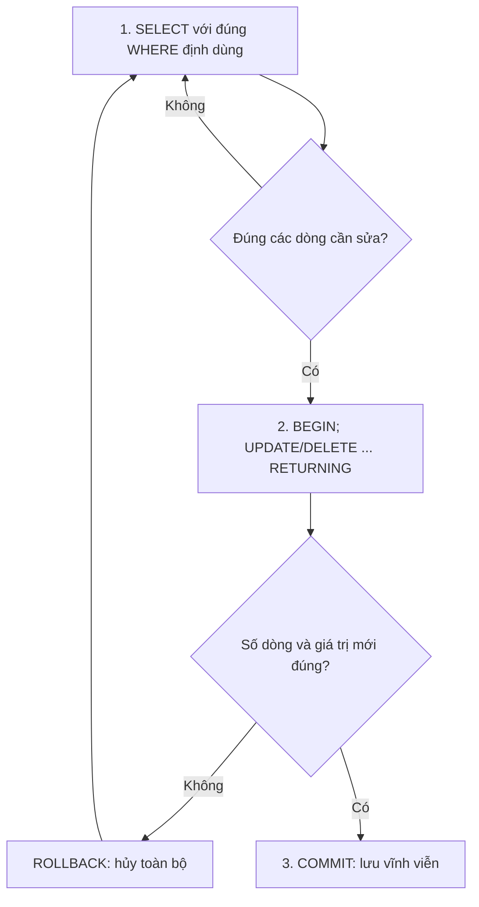

# Ngày 6: Thêm, sửa, xóa dữ liệu (INSERT, UPDATE, DELETE)

> **Tóm tắt:** Năm ngày trước bạn chỉ đọc dữ liệu. Hôm nay bạn học cách ghi: thêm dòng bằng `INSERT`, sửa bằng `UPDATE`, xóa bằng `DELETE`, gộp "thêm hoặc sửa" bằng `ON CONFLICT`, dọn sạch bảng bằng `TRUNCATE`. Quan trọng hơn cú pháp là một quy trình an toàn: xem trước bằng `SELECT`, chạy thử trong `BEGIN ... ROLLBACK`, rồi mới `COMMIT`.

**Sau bài này bạn có thể:**

- Viết được `INSERT` một dòng, nhiều dòng, `INSERT ... SELECT`, và dùng `RETURNING` để lấy id vừa sinh.
- Viết được `UPDATE` và `DELETE` có điều kiện theo khóa chính, kể cả `UPDATE ... FROM` khi điều kiện nằm ở bảng khác.
- Viết được UPSERT bằng `INSERT ... ON CONFLICT` để nhập hàng mà không bị lỗi trùng mã.
- Áp dụng quy trình "SELECT xem trước, chạy trong transaction, kiểm tra rồi mới COMMIT" cho mọi lệnh sửa/xóa.
- Đọc hiểu thông báo lỗi khi vi phạm ràng buộc (UNIQUE, NOT NULL, CHECK, khóa ngoại) và biết cách xử lý.

**Cần biết trước:** [Ngày 2](02-table-structure-and-data-types.md) (ràng buộc, IDENTITY), [Ngày 3](03-select-where.md) (WHERE, NULL), [Ngày 5](05-operators-expressions.md) (ROUND, hàm chuỗi).

## Trước khi bắt đầu: bài này sẽ sửa dữ liệu shop

Các ví dụ dưới đây thêm, sửa, xóa thật trên các bảng của DSC Shop. Có hai cách để không làm hỏng dữ liệu cho các bài sau:

1. Bọc lệnh trong `BEGIN; ... ROLLBACK;` (giải thích ở mục 4). Mọi thay đổi bị hủy khi gặp `ROLLBACK`.
2. Khi đã lỡ sửa, đưa schema `shop` về dữ liệu gốc bằng cách chạy lại hai file init (xem [setup/README.md](../setup/README.md), mục "Làm lại từ đầu"):

```sh
docker compose exec -T db psql -U postgres -d sql_challenge -f /docker-entrypoint-initdb.d/01_schema.sql -f /docker-entrypoint-initdb.d/02_seed.sql
```

Mọi kết quả trong bài là kết quả thật khi chạy từng ví dụ trên dữ liệu gốc (vừa chạy lại init). Nếu bạn chạy liên tiếp nhiều ví dụ, id sinh ra hoặc giá trị có thể khác một chút.

## 1. INSERT: thêm dòng mới

### Thêm một dòng

Cú pháp: liệt kê tên cột, rồi các giá trị theo đúng thứ tự đó.

```sql
INSERT INTO customers (full_name, email, phone, city, birth_date)
VALUES ('Lâm Thảo Vy', 'vy.lam@gmail.com', '0901112223', 'Cần Thơ', '2004-07-07');
```

psql trả về `INSERT 0 1`: đã thêm 1 dòng (số `0` ở giữa là di tích lịch sử, bỏ qua được).

Bạn không truyền `customer_id` và `created_at`, nhưng dòng mới vẫn có đủ:

```sql
SELECT customer_id, full_name, city, created_at IS NOT NULL AS has_created
FROM customers
WHERE email = 'vy.lam@gmail.com';
```

| customer_id | full_name | city | has_created |
| --- | --- | --- | --- |
| 19 | Lâm Thảo Vy | Cần Thơ | t |

- `customer_id` là cột `GENERATED ALWAYS AS IDENTITY` (Ngày 2) nên PostgreSQL tự sinh số tiếp theo: 19.
- `created_at` có `DEFAULT now()` nên tự điền thời điểm hiện tại.
- Cột không được nhắc tới và không có DEFAULT sẽ nhận `NULL`.

Luôn ghi rõ danh sách cột. Viết `INSERT INTO customers VALUES (...)` không có danh sách cột thì PostgreSQL ghép giá trị theo thứ tự cột trong bảng, bắt đầu từ `customer_id`, và báo lỗi:

```sql
-- SAI: thiếu danh sách cột
INSERT INTO customers VALUES ('Lâm Thảo Vy', 'vy2@gmail.com');
```

```text
ERROR:  invalid input syntax for type integer: "Lâm Thảo Vy"
```

Tự gán giá trị cho cột IDENTITY cũng bị chặn:

```sql
-- SAI: category_id do PostgreSQL sinh
INSERT INTO categories (category_id, name) VALUES (100, 'Thử');
```

```text
ERROR:  cannot insert a non-DEFAULT value into column "category_id"
DETAIL:  Column "category_id" is an identity column defined as GENERATED ALWAYS.
HINT:  Use OVERRIDING SYSTEM VALUE to override.
```

### RETURNING: lấy lại id vừa sinh

Thêm sản phẩm xong, ứng dụng thường cần biết `product_id` để làm bước tiếp theo. Thay vì `SELECT` lại, thêm `RETURNING` vào cuối lệnh:

```sql
INSERT INTO products (sku, name, category_id, price, cost_price)
VALUES ('ACC-010', 'Hub USB-C 7 in 1', 12, 790000, 520000)
RETURNING product_id, sku, stock_quantity, is_active;
```

| product_id | sku | stock_quantity | is_active |
| --- | --- | --- | --- |
| 25 | ACC-010 | 0 | t |

`stock_quantity` và `is_active` lấy từ DEFAULT (`0` và `TRUE`). `RETURNING` dùng được với cả `UPDATE` và `DELETE`, bạn sẽ gặp lại ngay bên dưới.

> **Ghi chú dialect:** MySQL không có `RETURNING` cho INSERT; lấy id vừa sinh bằng `LAST_INSERT_ID()`. SQL Server dùng mệnh đề `OUTPUT inserted.cot` hoặc `SCOPE_IDENTITY()`. MySQL dùng `AUTO_INCREMENT`, SQL Server dùng `IDENTITY(1,1)` thay cho `GENERATED ... AS IDENTITY`.

### Thêm nhiều dòng một lần

Viết nhiều bộ giá trị, cách nhau bởi dấu phẩy. Cả lệnh thành công hoặc thất bại cùng nhau: nếu một dòng lỗi, không dòng nào được thêm.

```sql
INSERT INTO categories (name, parent_id)
VALUES
    ('Router Wi-Fi', 13),
    ('Bộ phát 4G',   13)
RETURNING category_id, name, parent_id;
```

| category_id | name | parent_id |
| --- | --- | --- |
| 14 | Router Wi-Fi | 13 |
| 15 | Bộ phát 4G | 13 |

Hai danh mục con được gắn vào `Thiết bị mạng` (id 13).

### INSERT ... SELECT: thêm từ kết quả truy vấn

Thay `VALUES` bằng một câu `SELECT`, mỗi dòng kết quả thành một dòng mới. Ví dụ: bộ phận chăm sóc khách muốn danh sách khách có số điện thoại nhưng còn thiếu email, thành phố hoặc ngày sinh để gọi hỏi bổ sung. Ta tạo một bảng nháp riêng (không đụng cấu trúc bảng shop):

```sql
DROP TABLE IF EXISTS call_list;
CREATE TABLE call_list (
    call_id     INT GENERATED ALWAYS AS IDENTITY PRIMARY KEY,
    customer_id INT          NOT NULL,
    full_name   VARCHAR(100) NOT NULL,
    phone       VARCHAR(20)  NOT NULL,
    reason      TEXT
);

INSERT INTO call_list (customer_id, full_name, phone, reason)
SELECT customer_id, full_name, phone, 'Bổ sung thông tin còn thiếu'
FROM customers
WHERE (email IS NULL OR city IS NULL OR birth_date IS NULL)
  AND phone IS NOT NULL;

SELECT * FROM call_list;
```

| call_id | customer_id | full_name | phone | reason |
| --- | --- | --- | --- | --- |
| 1 | 5 | Hoàng Thị Em | 0934567890 | Bổ sung thông tin còn thiếu |
| 2 | 11 | Lý Thanh Mai | 0933444555 | Bổ sung thông tin còn thiếu |

Số cột và kiểu của `SELECT` phải khớp với danh sách cột sau `INSERT INTO`. Khách 13 và 17 cũng thiếu thông tin nhưng không có số điện thoại nên bị loại. Chú ý ngoặc quanh nhóm `OR` (Ngày 3): thiếu ngoặc thì `AND` được ưu tiên trước và kết quả sẽ sai.

### Khi INSERT vi phạm ràng buộc

Các ràng buộc học ở Ngày 2 chính là "người gác cổng". Đọc thông báo lỗi là biết dòng dữ liệu sai ở đâu.

```sql
-- Email đã có người dùng (UNIQUE)
INSERT INTO customers (full_name, email)
VALUES ('Nguyễn Văn Bình', 'an.nguyen@gmail.com');
```

```text
ERROR:  duplicate key value violates unique constraint "customers_email_key"
DETAIL:  Key (email)=(an.nguyen@gmail.com) already exists.
```

```sql
-- Thiếu tên (NOT NULL)
INSERT INTO customers (email) VALUES ('khach.moi@gmail.com');
```

```text
ERROR:  null value in column "full_name" of relation "customers" violates not-null constraint
```

```sql
-- Giá âm (CHECK price >= 0)
INSERT INTO products (sku, name, category_id, price)
VALUES ('ACC-011', 'Cáp HDMI 2m', 12, -150000);
```

```text
ERROR:  new row for relation "products" violates check constraint "products_price_check"
```

```sql
-- Danh mục 99 không tồn tại (khóa ngoại)
INSERT INTO products (sku, name, category_id, price)
VALUES ('ACC-011', 'Cáp HDMI 2m', 99, 150000);
```

```text
ERROR:  insert or update on table "products" violates foreign key constraint "products_category_id_fkey"
DETAIL:  Key (category_id)=(99) is not present in table "categories".
```

```sql
-- Kênh bán không nằm trong danh sách cho phép (CHECK channel IN ('online', 'offline'))
INSERT INTO orders (customer_id, order_date, channel)
VALUES (1, now(), 'shopee');
```

```text
ERROR:  new row for relation "orders" violates check constraint "orders_channel_check"
```

Một chi tiết hay gây thắc mắc: lệnh INSERT bị lỗi vẫn "tiêu" mất một số IDENTITY. Trên dữ liệu gốc (khách lớn nhất là 18), chạy hai lệnh lỗi trùng email và thiếu tên ở trên, rồi thêm một khách hợp lệ:

```sql
INSERT INTO customers (full_name, email)
VALUES ('Nguyễn Văn Bình', 'binh.nguyen@gmail.com')
RETURNING customer_id;
```

| customer_id |
| --- |
| 21 |

Khách mới nhận số 21 chứ không phải 19, vì số 19 và 20 đã bị hai lệnh lỗi lấy mất. Id có lỗ hổng là bình thường; đừng dùng id để đếm số dòng.

## 2. UPDATE: sửa dữ liệu có sẵn

```text
UPDATE ten_bang
SET cot_1 = gia_tri_1,
    cot_2 = gia_tri_2
WHERE dieu_kien;
```

`UPDATE` sửa mọi dòng thỏa `WHERE`. Không có `WHERE` nghĩa là sửa toàn bộ bảng.

### Sửa theo khóa chính

Cách an toàn nhất là lọc theo khóa chính, vì khóa chính chắc chắn chỉ khớp một dòng:

```sql
UPDATE customers
SET phone = '0939123456'
WHERE customer_id = 3
RETURNING customer_id, full_name, phone;
```

| customer_id | full_name | phone |
| --- | --- | --- |
| 3 | Lê Hoàng Cường | 0939123456 |

psql in thêm `UPDATE 1`: số dòng bị sửa. Luôn nhìn con số này. Bạn định sửa 1 khách mà thấy `UPDATE 2` là có chuyện.

### Sửa nhiều cột cùng lúc

```sql
UPDATE orders
SET status = 'cancelled',
    note   = 'Khách hủy qua điện thoại'
WHERE order_id = 40
RETURNING order_id, status, note;
```

| order_id | status | note |
| --- | --- | --- |
| 40 | cancelled | Khách hủy qua điện thoại |

### Giá trị mới tính từ giá trị cũ

Vế phải của `SET` là biểu thức, có thể dùng chính cột đang sửa. Tăng giá 5% cho danh mục `Tai nghe & Loa` (id 11), làm tròn đến hàng nghìn:

```sql
UPDATE products
SET price = ROUND(price * 1.05, -3)
WHERE category_id = 11
RETURNING sku, name, price;
```

| sku | name | price |
| --- | --- | --- |
| ACC-004 | Tai nghe Sony WH-1000XM5 | 8390000 |
| ACC-005 | Tai nghe AirPods Pro 2 | 6290000 |
| ACC-006 | Loa JBL Flip 6 | 2825000 |

`ROUND(x, -3)` làm tròn tới hàng nghìn (số âm nghĩa là làm tròn về bên trái dấu phẩy): `7990000 * 1.05 = 8389500.00` thành `8390000`. Trong vế phải, `price` là giá trị cũ của chính dòng đó.

Ví dụ làm sạch dữ liệu (nối tiếp Ngày 5): gộp các cách viết khác nhau của TP. Hồ Chí Minh về một dạng.

```sql
UPDATE customers
SET city = 'TP. Hồ Chí Minh'
WHERE city IN ('Hồ Chí Minh', 'TP.HCM')
RETURNING customer_id, full_name, city;
```

| customer_id | full_name | city |
| --- | --- | --- |
| 6 | Võ Quốc Phong | TP. Hồ Chí Minh |
| 14 | Huỳnh Tấn Phát | TP. Hồ Chí Minh |

### UPDATE ... FROM: điều kiện nằm ở bảng khác

Sếp nói "giảm 10% cho mọi sản phẩm thuộc danh mục Máy tính bảng". Bạn biết tên danh mục nhưng không nhớ `category_id`. PostgreSQL cho phép thêm bảng khác vào mệnh đề `FROM` của `UPDATE` và nối hai bảng trong `WHERE`:

```sql
UPDATE products
SET price = ROUND(products.price * 0.9, -3)
FROM categories
WHERE categories.category_id = products.category_id
  AND categories.name = 'Máy tính bảng'
RETURNING products.sku, products.name, products.price;
```

| sku | name | price |
| --- | --- | --- |
| TAB-001 | iPad Air M2 11 inch | 15291000 |
| TAB-002 | Samsung Galaxy Tab S9 FE | 8541000 |

Đọc như sau: với mỗi sản phẩm, tìm danh mục có cùng `category_id`; nếu tên danh mục là `Máy tính bảng` thì sửa giá. Vì có hai bảng nên viết rõ `products.price`, `categories.name` để khỏi nhầm cột. Cách ghép hai bảng theo cột chung này chính là JOIN, sẽ học kỹ ở [Ngày 10](10-join.md).

> **Ghi chú dialect:** `UPDATE ... FROM` là cú pháp của PostgreSQL (SQL Server cũng có dạng tương tự). MySQL viết `UPDATE products JOIN categories ON ... SET ...`.

## 3. DELETE: xóa dòng

```text
DELETE FROM ten_bang
WHERE dieu_kien;
```

Xóa sản phẩm `Lót chuột DSC XXL` (chưa bán được cái nào). Xem trước rồi mới xóa:

```sql
SELECT product_id, sku, name
FROM products
WHERE sku = 'ACC-009';
```

| product_id | sku | name |
| --- | --- | --- |
| 24 | ACC-009 | Lót chuột DSC XXL |

```sql
DELETE FROM products
WHERE sku = 'ACC-009'
RETURNING product_id, sku, name;
```

| product_id | sku | name |
| --- | --- | --- |
| 24 | ACC-009 | Lót chuột DSC XXL |

`sku` có ràng buộc UNIQUE nên cũng chỉ khớp tối đa một dòng, dùng làm điều kiện an toàn như khóa chính.

### Khóa ngoại chặn xóa (hoặc xóa lan)

Ngày 2 bạn đã học các hành vi `ON DELETE`. Giờ là lúc thấy chúng hoạt động.

Khách 1 đã có đơn hàng. Khóa ngoại `orders.customer_id` không khai báo `ON DELETE`, nên mặc định là chặn:

```sql
DELETE FROM customers WHERE customer_id = 1;
```

```text
ERROR:  update or delete on table "customers" violates foreign key constraint "orders_customer_id_fkey" on table "orders"
DETAIL:  Key (customer_id)=(1) is still referenced from table "orders".
```

Đây là điều tốt: không thể có đơn hàng "mồ côi" trỏ tới khách không tồn tại. Tương tự, không xóa được sản phẩm đã từng bán (`order_items` tham chiếu tới) và không xóa được đơn đã thanh toán (`payments` tham chiếu tới).

Ngược lại, `order_items.order_id` khai báo `ON DELETE CASCADE`: xóa đơn thì các dòng hàng của đơn bị xóa theo. Đơn 40 đang `pending`, chưa có thanh toán:

```sql
SELECT order_id, product_id, quantity FROM order_items WHERE order_id = 40;
```

| order_id | product_id | quantity |
| --- | --- | --- |
| 40 | 12 | 1 |

```sql
DELETE FROM orders WHERE order_id = 40;   -- DELETE 1

SELECT order_id, product_id, quantity FROM order_items WHERE order_id = 40;
```

(0 dòng: dòng hàng đã bị xóa lan theo đơn.)

Lưu ý `DELETE 1` chỉ đếm dòng trong bảng `orders`, không đếm các dòng bị xóa lan. Vì vậy CASCADE cần dùng có cân nhắc.

Thử xóa đơn 1 (đã thanh toán):

```sql
DELETE FROM orders WHERE order_id = 1;
```

```text
ERROR:  update or delete on table "orders" violates foreign key constraint "payments_order_id_fkey" on table "payments"
DETAIL:  Key (order_id)=(1) is still referenced from table "payments".
```

Trong thực tế, đơn đã thanh toán thường không bị xóa mà chuyển `status` sang `cancelled`: dữ liệu lịch sử vẫn còn để đối soát.

## 4. Quy trình sửa/xóa an toàn

Mặc định psql, Adminer và hầu hết công cụ chạy ở chế độ autocommit: mỗi lệnh tự lưu vĩnh viễn ngay khi chạy xong. Gõ nhầm một `DELETE` là mất dữ liệu, không có nút Undo. Quy trình dưới đây giúp bạn bắt lỗi trước khi quá muộn.



Ví dụ: ngừng kinh doanh (`is_active = FALSE`) mọi sản phẩm đã hết hàng.

Bước 1, xem trước bằng `SELECT` với đúng điều kiện `WHERE` sẽ dùng:

```sql
SELECT product_id, sku, name, stock_quantity, is_active
FROM products
WHERE stock_quantity = 0;
```

| product_id | sku | name | stock_quantity | is_active |
| --- | --- | --- | --- | --- |
| 3 | LAP-003 | Acer Nitro V 15 | 0 | t |
| 13 | PHN-004 | Nokia 105 4G | 0 | f |
| 21 | ACC-006 | Loa JBL Flip 6 | 0 | t |

3 dòng, đúng là các sản phẩm muốn sửa.

Bước 2, chạy thật nhưng trong một transaction:

```sql
BEGIN;

UPDATE products
SET is_active = FALSE
WHERE stock_quantity = 0
RETURNING product_id, sku, is_active;
```

| product_id | sku | is_active |
| --- | --- | --- |
| 3 | LAP-003 | f |
| 13 | PHN-004 | f |
| 21 | ACC-006 | f |

`BEGIN` mở một transaction (giao dịch): mọi thay đổi sau đó chỉ là "tạm", chưa ai khác thấy. `UPDATE 3` khớp với 3 dòng ở bước 1.

Bước 3, quyết định:

- Đúng như mong đợi: `COMMIT;` để lưu.
- Sai (số dòng lạ, giá trị lạ): `ROLLBACK;` để hủy mọi thay đổi từ `BEGIN`.

Thử `ROLLBACK` rồi kiểm tra lại:

```sql
ROLLBACK;

SELECT sku, is_active FROM products WHERE stock_quantity = 0;
```

| sku | is_active |
| --- | --- |
| LAP-003 | t |
| PHN-004 | f |
| ACC-006 | t |

Dữ liệu đã trở lại như cũ. Transaction cứu được cả lỗi nặng nhất là quên `WHERE`:

```sql
BEGIN;
DELETE FROM order_items;   -- quên WHERE: psql báo DELETE 60, tức xóa sạch bảng!
ROLLBACK;                  -- may quá

SELECT * FROM order_items LIMIT 3;
```

| order_id | product_id | quantity | unit_price | discount |
| --- | --- | --- | --- | --- |
| 1 | 16 | 1 | 399000 | 0.00 |
| 1 | 23 | 2 | 150000 | 0.00 |
| 2 | 5 | 1 | 26990000 | 0.00 |

Tóm lại ba thói quen:

1. Luôn `SELECT` với cùng `WHERE` trước khi `UPDATE`/`DELETE`.
2. Ưu tiên lọc theo khóa chính hoặc cột UNIQUE (`customer_id`, `sku`, `email`), không lọc theo tên vì tên có thể trùng (DSC Shop có hai khách `Nguyễn Văn An`).
3. Sửa dữ liệu quan trọng thì bọc trong `BEGIN ... COMMIT/ROLLBACK`, nhìn số dòng bị ảnh hưởng và `RETURNING` trước khi `COMMIT`.

Transaction còn nhiều điều để nói (ACID, nhiều người sửa cùng lúc, SAVEPOINT); bạn sẽ học kỹ ở [Ngày 16](16-transactions-acid.md).

> **Ghi chú dialect:** MySQL viết `START TRANSACTION` (cũng chấp nhận `BEGIN`), SQL Server viết `BEGIN TRANSACTION`. MySQL Workbench mặc định bật safe update mode: `UPDATE`/`DELETE` không lọc theo cột khóa sẽ bị chặn với lỗi 1175. PostgreSQL không có chế độ này, nên quy trình trên càng quan trọng.

## 5. UPSERT: thêm mới, nếu trùng thì cập nhật

Tình huống nhập hàng: nhà cung cấp gửi danh sách `sku` kèm số lượng. Mã nào đã có thì cộng thêm tồn kho, mã nào chưa có thì thêm sản phẩm mới. Một `INSERT` bình thường sẽ lỗi trùng `sku`. PostgreSQL có `ON CONFLICT`:

```sql
INSERT INTO products (sku, name, category_id, price, stock_quantity)
VALUES
    ('ACC-001', 'Chuột Logitech G102', 10, 399000, 20),
    ('ACC-012', 'Giá đỡ laptop nhôm',  9,  350000, 15)
ON CONFLICT (sku) DO UPDATE
SET stock_quantity = products.stock_quantity + EXCLUDED.stock_quantity
RETURNING product_id, sku, name, stock_quantity;
```

| product_id | sku | name | stock_quantity |
| --- | --- | --- | --- |
| 16 | ACC-001 | Chuột Logitech G102 | 80 |
| 26 | ACC-012 | Giá đỡ laptop nhôm | 15 |

- `ON CONFLICT (sku)`: xung đột được xét trên cột `sku` (cột này phải có UNIQUE hoặc là khóa chính).
- `ACC-001` đã có (tồn 60) nên nhánh `DO UPDATE` chạy: `60 + 20 = 80`.
- `ACC-012` chưa có nên được thêm mới bình thường.
- `products.stock_quantity` là giá trị đang có trong bảng; `EXCLUDED.stock_quantity` là giá trị bạn định chèn (dòng "bị loại" vì xung đột).

Nếu chỉ muốn bỏ qua dòng trùng, dùng `DO NOTHING`:

```sql
INSERT INTO categories (name) VALUES ('Phụ kiện')
ON CONFLICT (name) DO NOTHING;
```

psql báo `INSERT 0 0`: không thêm gì, cũng không lỗi. Bỏ `ON CONFLICT` đi thì lệnh trên báo `duplicate key value violates unique constraint "categories_name_key"`.

> **Ghi chú dialect:** MySQL viết `INSERT ... ON DUPLICATE KEY UPDATE stock_quantity = stock_quantity + VALUES(stock_quantity)`. SQL Server không có `ON CONFLICT`, thường dùng lệnh `MERGE`.

## 6. TRUNCATE: xóa sạch bảng

`TRUNCATE ten_bang` xóa toàn bộ dòng, nhanh hơn `DELETE` không `WHERE` nhiều với bảng lớn vì không duyệt từng dòng. Thử trên bảng nháp `call_list` ở mục 1 (đang có 2 dòng, `call_id` 1 và 2):

```sql
TRUNCATE call_list;

INSERT INTO call_list (customer_id, full_name, phone)
VALUES (5, 'Hoàng Thị Em', '0934567890')
RETURNING call_id;
```

| call_id |
| --- |
| 3 |

Bảng đã trống nhưng id vẫn đếm tiếp từ 3: trong PostgreSQL, `TRUNCATE` mặc định không đặt lại bộ đếm IDENTITY. Muốn đếm lại từ 1, thêm `RESTART IDENTITY`:

```sql
TRUNCATE call_list RESTART IDENTITY;

INSERT INTO call_list (customer_id, full_name, phone)
VALUES (5, 'Hoàng Thị Em', '0934567890')
RETURNING call_id;
```

| call_id |
| --- |
| 1 |

Trong PostgreSQL, `TRUNCATE` cũng nằm trong transaction được:

```sql
BEGIN;
TRUNCATE call_list;
ROLLBACK;

SELECT call_id, full_name FROM call_list;
```

| call_id | full_name |
| --- | --- |
| 1 | Hoàng Thị Em |

Bảng đang được khóa ngoại tham chiếu thì không `TRUNCATE` được:

```sql
TRUNCATE orders;
```

```text
ERROR:  cannot truncate a table referenced in a foreign key constraint
DETAIL:  Table "order_items" references "orders".
HINT:  Truncate table "order_items" at the same time, or use TRUNCATE ... CASCADE.
```

Đừng làm theo HINT một cách máy móc: `TRUNCATE orders CASCADE` sẽ xóa sạch cả `order_items` và `payments`.

Dọn bảng nháp khi xong:

```sql
DROP TABLE call_list;
```

So sánh `DELETE` và `TRUNCATE`:

| | `DELETE` | `TRUNCATE` (PostgreSQL) |
| --- | --- | --- |
| Có `WHERE` | Có, xóa một phần | Không, luôn xóa cả bảng |
| Hoàn tác được không | Chỉ khi chạy trong `BEGIN` và chưa `COMMIT`. Ở chế độ autocommit thì không | Giống `DELETE`: rollback được nếu nằm trong transaction |
| Bộ đếm IDENTITY | Không đổi | Không đổi, trừ khi thêm `RESTART IDENTITY` |
| `RETURNING` | Có | Không |
| Bảng bị khóa ngoại tham chiếu | Xét từng dòng theo `ON DELETE` | Báo lỗi, trừ khi thêm `CASCADE` |
| Tốc độ với bảng lớn | Chậm hơn (xóa từng dòng) | Rất nhanh |

> **Ghi chú dialect:** Trong MySQL, `TRUNCATE` tự động commit (không rollback được) và đặt lại `AUTO_INCREMENT`. Trong SQL Server, `TRUNCATE` rollback được nếu nằm trong transaction và có đặt lại IDENTITY.

## Lỗi thường gặp

**1. Quên `WHERE`.** `UPDATE products SET price = 0;` sửa cả 24 sản phẩm. Cách phòng: luôn viết `WHERE` trước rồi mới viết `SET`, và chạy trong `BEGIN`.

**2. Lọc theo cột không duy nhất.** Muốn sửa thành phố của "Nguyễn Văn An":

```sql
SELECT customer_id, full_name, city
FROM customers
WHERE full_name = 'Nguyễn Văn An';
```

| customer_id | full_name | city |
| --- | --- | --- |
| 1 | Nguyễn Văn An | TP. Hồ Chí Minh |
| 15 | Nguyễn Văn An | Hà Nội |

Hai người khác nhau. `UPDATE ... WHERE full_name = 'Nguyễn Văn An'` sẽ sửa cả hai. Đúng: xác định người cần sửa rồi dùng `WHERE customer_id = 15`.

**3. So sánh với NULL bằng `=`.** Như Ngày 3, `= NULL` không bao giờ đúng, nên lệnh sau sửa 0 dòng mà không báo lỗi:

```sql
-- SAI
UPDATE customers SET city = 'Hà Nội' WHERE email = NULL;   -- UPDATE 0
```

Đúng: `WHERE email IS NULL`. Đây là lý do cần nhìn số dòng psql báo.

**4. Không biết transaction đã "hỏng".** Trong `BEGIN`, một lệnh lỗi làm cả transaction bị hủy; các lệnh sau đều bị từ chối:

```sql
BEGIN;
UPDATE products SET price = -1 WHERE product_id = 1;     -- lỗi CHECK
UPDATE products SET price = 1000 WHERE product_id = 2;
```

```text
ERROR:  new row for relation "products" violates check constraint "products_price_check"
ERROR:  current transaction is aborted, commands ignored until end of transaction block
```

Gõ `ROLLBACK;` để thoát, sửa lệnh lỗi rồi làm lại từ `BEGIN`. Còn nếu bạn mở `BEGIN` rồi quên `COMMIT` và đóng cửa sổ, mọi thay đổi bị hủy; dấu nhắc psql có thêm dấu `*` (`sql_challenge=*#`) để nhắc bạn đang ở trong transaction.

**5. Xóa thay vì đổi trạng thái.** Xóa đơn hàng, sản phẩm đã bán sẽ bị khóa ngoại chặn (và nên như vậy). Với dữ liệu có lịch sử, hãy đổi `status`/`is_active` thay vì `DELETE`.

## Bài tập

Mỗi bài làm trên dữ liệu gốc. Làm xong bài nào có `COMMIT`, chạy lại script init (mục "Trước khi bắt đầu") trước khi sang bài sau nếu muốn kết quả khớp với đáp án.

### Cơ bản

**Bài 1.** Thêm khách hàng `Đoàn Minh Quân`, email `quan.doan@gmail.com`, thành phố `Huế`, không có số điện thoại. Trả về `customer_id`, `full_name`, `phone`, `city` của dòng vừa thêm.

<details>
<summary>Đáp án</summary>

```sql
INSERT INTO customers (full_name, email, city)
VALUES ('Đoàn Minh Quân', 'quan.doan@gmail.com', 'Huế')
RETURNING customer_id, full_name, phone, city;
```

Kết quả:

| customer_id | full_name | phone | city |
| --- | --- | --- | --- |
| 19 | Đoàn Minh Quân | NULL | Huế |

Không nhắc tới `phone` thì cột nhận `NULL` (psql hiện ô trống).
</details>

**Bài 2.** Khách `Hoàng Thị Em` (id 5) vừa cung cấp email `em.hoang@gmail.com`. Xem trước dòng cần sửa, rồi cập nhật theo khóa chính.

<details>
<summary>Đáp án</summary>

```sql
SELECT customer_id, full_name, email FROM customers WHERE customer_id = 5;

UPDATE customers
SET email = 'em.hoang@gmail.com'
WHERE customer_id = 5
RETURNING customer_id, full_name, email;
```

Kết quả (lệnh UPDATE, psql báo `UPDATE 1`):

| customer_id | full_name | email |
| --- | --- | --- |
| 5 | Hoàng Thị Em | em.hoang@gmail.com |
</details>

**Bài 3.** Thêm cùng lúc 3 sản phẩm vào danh mục `Sạc & Cáp` (id 12) và trả về id được sinh:

| sku | name | price | cost_price | stock_quantity |
| --- | --- | --- | --- | --- |
| ACC-013 | Sạc Ugreen 30W | 390000 | 250000 | 50 |
| ACC-014 | Cáp Lightning 1m | 190000 | 90000 | 80 |
| ACC-015 | Pin dự phòng 10000mAh | 590000 | 400000 | 30 |

<details>
<summary>Đáp án</summary>

```sql
INSERT INTO products (sku, name, category_id, price, cost_price, stock_quantity)
VALUES
    ('ACC-013', 'Sạc Ugreen 30W',        12, 390000, 250000, 50),
    ('ACC-014', 'Cáp Lightning 1m',      12, 190000,  90000, 80),
    ('ACC-015', 'Pin dự phòng 10000mAh', 12, 590000, 400000, 30)
RETURNING product_id, sku, name, price;
```

Kết quả:

| product_id | sku | name | price |
| --- | --- | --- | --- |
| 25 | ACC-013 | Sạc Ugreen 30W | 390000 |
| 26 | ACC-014 | Cáp Lightning 1m | 190000 |
| 27 | ACC-015 | Pin dự phòng 10000mAh | 590000 |
</details>

### Vận dụng

**Bài 4.** Cột `city` có khách ghi `đà nẵng` (chữ thường). Theo đúng quy trình an toàn (SELECT xem trước, `BEGIN`, `UPDATE ... RETURNING`, `COMMIT`), sửa thành `Đà Nẵng`. Sau đó kiểm tra bằng `SELECT DISTINCT city ... WHERE city ILIKE 'đà nẵng'`.

<details>
<summary>Đáp án</summary>

```sql
SELECT customer_id, full_name, city
FROM customers
WHERE city = 'đà nẵng';

BEGIN;

UPDATE customers
SET city = 'Đà Nẵng'
WHERE city = 'đà nẵng'
RETURNING customer_id, full_name, city;

COMMIT;

SELECT DISTINCT city FROM customers WHERE city ILIKE 'đà nẵng';
```

Kết quả SELECT xem trước:

| customer_id | full_name | city |
| --- | --- | --- |
| 8 | Bùi Văn Hùng | đà nẵng |

Kết quả `RETURNING` (`UPDATE 1`, đúng 1 dòng như lúc xem trước):

| customer_id | full_name | city |
| --- | --- | --- |
| 8 | Bùi Văn Hùng | Đà Nẵng |

Kết quả kiểm tra cuối:

| city |
| --- |
| Đà Nẵng |
</details>

**Bài 5.** Lô hàng mới về: 10 chiếc `LAP-003` (Acer Nitro V 15, đang hết hàng) và 5 chiếc `LAP-007` Lenovo IdeaPad Slim 5 (danh mục 4, giá 17.490.000, giá nhập 15.200.000, chưa có trong hệ thống). Viết một lệnh duy nhất: mã đã có thì cộng tồn kho, mã chưa có thì thêm mới.

<details>
<summary>Đáp án</summary>

```sql
INSERT INTO products (sku, name, category_id, price, cost_price, stock_quantity)
VALUES
    ('LAP-003', 'Acer Nitro V 15',       3, 21990000, 19000000, 10),
    ('LAP-007', 'Lenovo IdeaPad Slim 5', 4, 17490000, 15200000,  5)
ON CONFLICT (sku) DO UPDATE
SET stock_quantity = products.stock_quantity + EXCLUDED.stock_quantity
RETURNING product_id, sku, name, price, stock_quantity;
```

Kết quả:

| product_id | sku | name | price | stock_quantity |
| --- | --- | --- | --- | --- |
| 3 | LAP-003 | Acer Nitro V 15 | 21990000 | 10 |
| 26 | LAP-007 | Lenovo IdeaPad Slim 5 | 17490000 | 5 |

`LAP-003` giữ nguyên `product_id = 3`, tồn kho `0 + 10`. `LAP-007` là dòng mới. Id 26 chứ không phải 25 vì dòng `LAP-003` đi vào nhánh xung đột nhưng vẫn đã tiêu một số IDENTITY.
</details>

**Bài 6.** Giảm 10% (làm tròn nghìn) cho các sản phẩm danh mục `Laptop gaming`, dùng `UPDATE ... FROM categories` để lọc theo tên danh mục. Chạy trong `BEGIN`, xem `RETURNING`, rồi `ROLLBACK` (đây chỉ là chạy thử).

<details>
<summary>Đáp án</summary>

Xem trước:

```sql
SELECT category_id, name FROM categories WHERE name = 'Laptop gaming';   -- category_id = 3
SELECT sku, name, price FROM products WHERE category_id = 3;
```

| sku | name | price |
| --- | --- | --- |
| LAP-001 | ASUS ROG Strix G16 | 32990000 |
| LAP-002 | Lenovo Legion 5 | 29990000 |
| LAP-003 | Acer Nitro V 15 | 21990000 |

Chạy thử:

```sql
BEGIN;

UPDATE products
SET price = ROUND(products.price * 0.9, -3)
FROM categories
WHERE categories.category_id = products.category_id
  AND categories.name = 'Laptop gaming'
RETURNING products.sku, products.name, products.price;

ROLLBACK;
```

Kết quả `RETURNING` (`UPDATE 3`, sau `ROLLBACK` giá trở lại như cũ):

| sku | name | price |
| --- | --- | --- |
| LAP-001 | ASUS ROG Strix G16 | 29691000 |
| LAP-002 | Lenovo Legion 5 | 26991000 |
| LAP-003 | Acer Nitro V 15 | 19791000 |
</details>

**Bài 7.** Tạo bảng nháp `product_archive (product_id INT PRIMARY KEY, sku, name, price, archived_at TIMESTAMPTZ DEFAULT now())`, rồi dùng `INSERT ... SELECT` chép vào đó các sản phẩm đã ngừng kinh doanh hoặc hết hàng.

<details>
<summary>Đáp án</summary>

```sql
DROP TABLE IF EXISTS product_archive;
CREATE TABLE product_archive (
    product_id  INT           PRIMARY KEY,
    sku         VARCHAR(20)   NOT NULL,
    name        VARCHAR(200)  NOT NULL,
    price       NUMERIC(12,0) NOT NULL,
    archived_at TIMESTAMPTZ   NOT NULL DEFAULT now()
);

INSERT INTO product_archive (product_id, sku, name, price)
SELECT product_id, sku, name, price
FROM products
WHERE is_active = FALSE OR stock_quantity = 0
RETURNING product_id, sku, name, price;
```

Kết quả (`INSERT 0 3`):

| product_id | sku | name | price |
| --- | --- | --- | --- |
| 3 | LAP-003 | Acer Nitro V 15 | 21990000 |
| 13 | PHN-004 | Nokia 105 4G | 690000 |
| 21 | ACC-006 | Loa JBL Flip 6 | 2690000 |

Làm xong, dọn bảng nháp: `DROP TABLE product_archive;`
</details>

### Thử thách

**Bài 8.** Khách `Châu Ngọc Trâm` (id 17) và `Trần Thị Bình` (id 2) đều yêu cầu xóa tài khoản. Thử xóa cả hai theo khóa chính, mỗi người một lệnh. Lệnh nào thành công, lệnh nào lỗi, vì sao? Đề xuất cách xử lý cho trường hợp bị lỗi.

<details>
<summary>Đáp án</summary>

```sql
SELECT customer_id, full_name, email FROM customers WHERE customer_id IN (2, 17);

BEGIN;
DELETE FROM customers WHERE customer_id = 17 RETURNING customer_id, full_name;
COMMIT;

DELETE FROM customers WHERE customer_id = 2;
```

Kết quả lệnh xóa khách 17 (`DELETE 1`):

| customer_id | full_name |
| --- | --- |
| 17 | Châu Ngọc Trâm |

Lệnh xóa khách 2 lỗi:

```text
ERROR:  update or delete on table "customers" violates foreign key constraint "orders_customer_id_fkey" on table "orders"
DETAIL:  Key (customer_id)=(2) is still referenced from table "orders".
```

Khách 17 chưa mua đơn nào nên xóa được. Khách 2 đã có đơn, khóa ngoại chặn xóa để giữ lịch sử bán hàng. Cách xử lý thường gặp: không xóa dòng mà ẩn danh hóa thông tin cá nhân, ví dụ `UPDATE customers SET email = NULL, phone = NULL, birth_date = NULL WHERE customer_id = 2;`, hoặc thêm một cột trạng thái tài khoản (cần sửa cấu trúc bảng, chỉ làm trên bảng nháp).
</details>

**Bài 9.** Khách hủy đơn 39 (đang `paid`). Trong một transaction: (a) đổi `status` thành `cancelled`, ghi `note` là `Khách hủy, chờ hoàn tiền`; (b) cộng trả lại tồn kho cho mọi sản phẩm trong đơn, lấy số lượng từ `order_items` bằng `UPDATE ... FROM` (không gõ tay id sản phẩm). Xem trước đơn và các dòng hàng của nó trước khi sửa.

<details>
<summary>Đáp án</summary>

```sql
SELECT order_id, status, note FROM orders WHERE order_id = 39;
SELECT order_id, product_id, quantity FROM order_items WHERE order_id = 39;
```

| order_id | status | note |
| --- | --- | --- |
| 39 | paid | NULL |

| order_id | product_id | quantity |
| --- | --- | --- |
| 39 | 10 | 2 |

```sql
BEGIN;

UPDATE orders
SET status = 'cancelled',
    note   = 'Khách hủy, chờ hoàn tiền'
WHERE order_id = 39
RETURNING order_id, status, note;

UPDATE products
SET stock_quantity = products.stock_quantity + order_items.quantity
FROM order_items
WHERE order_items.product_id = products.product_id
  AND order_items.order_id = 39
RETURNING products.product_id, products.name, products.stock_quantity;

COMMIT;
```

Kết quả hai lệnh UPDATE:

| order_id | status | note |
| --- | --- | --- |
| 39 | cancelled | Khách hủy, chờ hoàn tiền |

| product_id | name | stock_quantity |
| --- | --- | --- |
| 10 | iPhone 15 128GB | 17 |

iPhone 15 từ 15 lên 17. Hai lệnh nằm trong cùng transaction nên hoặc cả hai được lưu, hoặc không lệnh nào: không thể có cảnh đơn đã hủy mà kho chưa được cộng lại. Đây là ý tưởng cốt lõi của [Ngày 16](16-transactions-acid.md). (Việc hoàn tiền trong `payments` chưa xét ở bài này.)
</details>

## Tóm tắt

- `INSERT INTO bang (cot, ...) VALUES (...), (...)` thêm một hoặc nhiều dòng; luôn ghi danh sách cột. Cột IDENTITY và cột có DEFAULT tự điền.
- `RETURNING` trả lại dòng vừa thêm/sửa/xóa, tiện để lấy id mới và kiểm tra kết quả.
- `INSERT ... SELECT` thêm dòng từ kết quả một truy vấn.
- `UPDATE ... SET ... WHERE` sửa các dòng thỏa điều kiện; `UPDATE ... FROM` khi điều kiện hoặc giá trị nằm ở bảng khác.
- `DELETE FROM ... WHERE` xóa dòng; khóa ngoại sẽ chặn xóa hoặc xóa lan (`ON DELETE CASCADE`) tùy cách khai báo.
- `INSERT ... ON CONFLICT (cot) DO UPDATE / DO NOTHING` là UPSERT của PostgreSQL; `EXCLUDED` chứa giá trị định chèn.
- `TRUNCATE` xóa sạch bảng rất nhanh; trong PostgreSQL nó rollback được và chỉ đặt lại IDENTITY khi có `RESTART IDENTITY`.
- Quy trình an toàn: SELECT xem trước, lọc theo khóa, chạy trong `BEGIN`, kiểm tra số dòng và `RETURNING`, rồi mới `COMMIT` (hoặc `ROLLBACK`).

## Đọc thêm

- [PostgreSQL: INSERT](https://www.postgresql.org/docs/16/sql-insert.html) (gồm `ON CONFLICT` và `RETURNING`)
- [PostgreSQL: UPDATE](https://www.postgresql.org/docs/16/sql-update.html)
- [PostgreSQL: DELETE](https://www.postgresql.org/docs/16/sql-delete.html)
- [PostgreSQL: TRUNCATE](https://www.postgresql.org/docs/16/sql-truncate.html)
- [PostgreSQL: Returning Data from Modified Rows](https://www.postgresql.org/docs/16/dml-returning.html)

---

[⬅️ Ngày 5: Toán tử, biểu thức và hàm thường dùng](05-operators-expressions.md) | [📚 Mục lục](../README.md) | [Ngày 7: Ôn tập 1 (Ngày 1 đến 6) ➡️](07-review-1.md)
