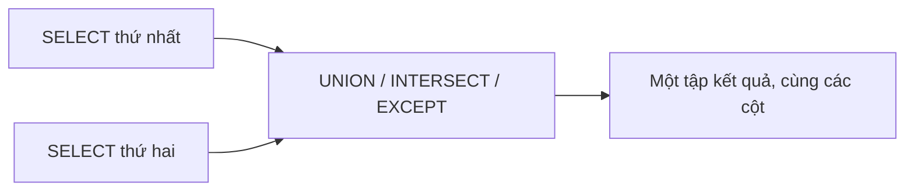

# Ngày 12: UNION, INTERSECT và EXCEPT

> **Tóm tắt:** JOIN ghép hai bảng theo chiều ngang (thêm cột), còn các phép toán tập hợp ghép kết quả của hai câu SELECT theo chiều dọc (thêm dòng). Bài này dạy UNION/UNION ALL để gộp, INTERSECT để lấy phần chung, EXCEPT để lấy phần "có ở A mà không có ở B", cùng các quy tắc về số cột, kiểu dữ liệu và ORDER BY.

**Sau bài này bạn có thể:**

- Gộp kết quả từ hai bảng khác nhau thành một danh sách bằng `UNION ALL`, có cột đánh dấu nguồn.
- Giải thích được khi nào `UNION` loại trùng làm mất dữ liệu và khi nào nên dùng `UNION ALL`.
- Viết được truy vấn tìm phần chung (`INTERSECT`) và phần chênh lệch (`EXCEPT`) giữa hai tập kết quả.
- Áp dụng đúng quy tắc số cột, kiểu dữ liệu, tên cột và vị trí `ORDER BY` khi kết hợp truy vấn.
- Chọn giữa `EXCEPT`, `NOT EXISTS` và `LEFT JOIN ... IS NULL` cho câu hỏi "có ở A nhưng không có ở B".

**Cần biết trước:** [Ngày 9](09-group-by-having.md), [Ngày 10](10-join.md), [Ngày 11](11-subquery.md) (CTE `WITH`)

## 1. Ghép theo chiều dọc khác gì ghép theo chiều ngang

Ở Ngày 10, `JOIN` đặt dòng của bảng này cạnh dòng của bảng kia: kết quả có **thêm cột**. Phép toán tập hợp làm việc khác: nó chạy hai câu `SELECT` độc lập rồi xếp kết quả của câu sau **bên dưới** kết quả câu trước: kết quả có **thêm dòng**.



Vì xếp chồng lên nhau, hai câu `SELECT` phải "khớp hình": cùng số cột, và cột thứ i của câu này phải cùng kiểu (hoặc chuyển được sang cùng kiểu) với cột thứ i của câu kia.

## 2. UNION ALL: gộp nguyên vẹn

Cửa hàng muốn in một danh bạ gồm cả khách hàng và nhân viên. Hai nhóm nằm ở hai bảng khác nhau, nên ta lấy từng bảng rồi xếp chồng lên:

```sql
SELECT full_name, 'Khách hàng' AS loai
FROM customers
UNION ALL
SELECT full_name, 'Nhân viên'
FROM employees
ORDER BY full_name
LIMIT 6;
```

| full_name | loai |
| --- | --- |
| Bùi Văn Hùng | Khách hàng |
| Châu Ngọc Trâm | Khách hàng |
| Đặng Thu Giang | Khách hàng |
| Đỗ Minh Tuấn | Nhân viên |
| Dương Minh Khoa | Khách hàng |
| Hoàng Thị Em | Khách hàng |

Bỏ `LIMIT 6` thì kết quả có đúng 18 + 8 = 26 dòng. Vài điều cần để ý:

- Cột hằng `'Khách hàng'`, `'Nhân viên'` giúp biết mỗi dòng đến từ đâu. Đây là mẹo rất hay dùng khi gộp nhiều nguồn.
- Tên cột của kết quả lấy từ câu `SELECT` **đầu tiên** (`full_name`, `loai`). Câu thứ hai không cần đặt alias.
- `ORDER BY` và `LIMIT` viết **một lần ở cuối** và áp dụng cho **cả kết quả gộp**, không phải cho riêng câu thứ hai.

`UNION ALL` không kiểm tra trùng: nó chỉ nối hai danh sách. Vì vậy nó nhanh và không bao giờ làm mất dòng.

## 3. UNION: gộp và loại trùng

`UNION` (không có `ALL`) gộp xong còn loại bỏ các dòng trùng nhau hoàn toàn, giống như chạy thêm `DISTINCT` trên kết quả. Thử gộp riêng cột tên:

```sql
SELECT full_name FROM customers
UNION
SELECT full_name FROM employees;
```

Kết quả có **25 dòng**, không phải 26. Bộ dữ liệu có hai khách khác nhau cùng tên `Nguyễn Văn An` (id 1 và 15). Vì kết quả chỉ có cột tên, hai dòng này giống hệt nhau và `UNION` giữ lại một. Một khách hàng thật đã biến mất khỏi danh bạ mà không có cảnh báo nào.

Quy tắc chọn:

- Hai nguồn không thể trùng nhau, hoặc trùng cũng là dữ liệu thật cần giữ: dùng `UNION ALL`. Đây là lựa chọn mặc định nên nghĩ đến trước.
- Bạn thật sự cần một danh sách giá trị khác nhau (ví dụ danh sách thành phố): dùng `UNION`, và kiểm tra các cột được chọn đã đủ để phân biệt hai đối tượng khác nhau chưa (thường là thêm cột khóa như `customer_id`).

`UNION` còn coi hai giá trị `NULL` là trùng nhau. Gộp thành phố của khách và thành phố giao hàng:

```sql
SELECT city FROM customers
UNION
SELECT shipping_city FROM orders
ORDER BY city NULLS FIRST;
```

| city |
| --- |
| *(NULL)* |
| Biên Hòa |
| Cần Thơ |
| đà nẵng |
| Đà Nẵng |
| Hải Phòng |
| Hà Nội |
| Hồ Chí Minh |
| TP.HCM |
| TP. Hồ Chí Minh |

Có nhiều khách và nhiều đơn mang `NULL`, nhưng kết quả chỉ còn một dòng `NULL`. Đây là chỗ khác với phép so sánh `=` ở Ngày 3 (`NULL = NULL` không đúng): khi loại trùng, `UNION`, `INTERSECT`, `EXCEPT` và `DISTINCT` đều coi các `NULL` là "giống nhau". Kết quả cũng cho thấy `UNION` không "làm sạch" dữ liệu: `đà nẵng` và `Đà Nẵng` vẫn là hai dòng vì chuỗi khác nhau.

## 4. Bốn phép toán trên cùng một câu hỏi

Để so sánh các phép toán, ta dùng một câu hỏi xuyên suốt: **sản phẩm nào bán qua kênh online, sản phẩm nào bán qua kênh offline?** CTE `ban_hang` (Ngày 11) trả mỗi dòng hàng một dòng, kèm kênh của đơn:

```sql
WITH ban_hang AS (
    SELECT o.channel, p.sku, p.name
    FROM order_items oi
    JOIN orders o   ON o.order_id = oi.order_id
    JOIN products p ON p.product_id = oi.product_id
)
SELECT channel,
       COUNT(*)            AS so_dong_hang,
       COUNT(DISTINCT sku) AS so_san_pham
FROM ban_hang
GROUP BY channel
ORDER BY channel;
```

| channel | so_dong_hang | so_san_pham |
| --- | --- | --- |
| offline | 23 | 18 |
| online | 37 | 19 |

Kênh online có 37 dòng hàng thuộc 19 sản phẩm khác nhau, kênh offline có 23 dòng hàng thuộc 18 sản phẩm.

### UNION: sản phẩm từng bán được ở ít nhất một kênh

```sql
WITH ban_hang AS (
    SELECT o.channel, p.sku, p.name
    FROM order_items oi
    JOIN orders o   ON o.order_id = oi.order_id
    JOIN products p ON p.product_id = oi.product_id
)
SELECT sku, name FROM ban_hang WHERE channel = 'online'
UNION
SELECT sku, name FROM ban_hang WHERE channel = 'offline'
ORDER BY sku;
```

| sku | name |
| --- | --- |
| ACC-001 | Chuột Logitech G102 |
| ACC-002 | Chuột Logitech MX Master 3S |
| ACC-003 | Bàn phím cơ Keychron K2 |
| ACC-004 | Tai nghe Sony WH-1000XM5 |
| ACC-005 | Tai nghe AirPods Pro 2 |

(... tổng 23 dòng)

Shop có 24 sản phẩm, thiếu đúng `ACC-009` (Lót chuột DSC XXL) là sản phẩm chưa bán được cái nào. Để ý: mỗi vế có rất nhiều dòng trùng (cáp USB-C xuất hiện 5 lần trong đơn online), nhưng `UNION` loại trùng trên **toàn bộ** kết quả, kể cả trùng trong cùng một vế.

Đổi `UNION` thành `UNION ALL` thì kết quả có 37 + 23 = 60 dòng, đúng bằng số dòng của `order_items`.

### INTERSECT: sản phẩm bán được ở cả hai kênh

`INTERSECT` chỉ giữ những dòng xuất hiện ở **cả hai** vế:

```sql
WITH ban_hang AS (
    SELECT o.channel, p.sku, p.name
    FROM order_items oi
    JOIN orders o   ON o.order_id = oi.order_id
    JOIN products p ON p.product_id = oi.product_id
)
SELECT sku, name FROM ban_hang WHERE channel = 'online'
INTERSECT
SELECT sku, name FROM ban_hang WHERE channel = 'offline'
ORDER BY sku;
```

| sku | name |
| --- | --- |
| ACC-001 | Chuột Logitech G102 |
| ACC-002 | Chuột Logitech MX Master 3S |
| ACC-003 | Bàn phím cơ Keychron K2 |
| ACC-004 | Tai nghe Sony WH-1000XM5 |
| ACC-005 | Tai nghe AirPods Pro 2 |
| ACC-007 | Sạc Anker 65W |
| ACC-008 | Cáp USB-C to USB-C 1m |
| LAP-001 | ASUS ROG Strix G16 |
| LAP-002 | Lenovo Legion 5 |
| LAP-004 | Dell Inspiron 14 |
| LAP-005 | MacBook Air M2 13 inch |
| PHN-003 | Xiaomi Redmi Note 13 |
| TAB-001 | iPad Air M2 11 inch |
| TAB-002 | Samsung Galaxy Tab S9 FE |

### EXCEPT: bán online nhưng chưa từng bán offline

`EXCEPT` lấy các dòng của vế trái, rồi bỏ đi những dòng cũng có ở vế phải. Đây là công cụ cho câu hỏi "có ở A nhưng không có ở B":

```sql
WITH ban_hang AS (
    SELECT o.channel, p.sku, p.name
    FROM order_items oi
    JOIN orders o   ON o.order_id = oi.order_id
    JOIN products p ON p.product_id = oi.product_id
)
SELECT sku, name FROM ban_hang WHERE channel = 'online'
EXCEPT
SELECT sku, name FROM ban_hang WHERE channel = 'offline'
ORDER BY sku;
```

| sku | name |
| --- | --- |
| ACC-006 | Loa JBL Flip 6 |
| LAP-003 | Acer Nitro V 15 |
| LAP-006 | HP Pavilion 15 |
| PHN-001 | iPhone 15 128GB |
| PHN-002 | Samsung Galaxy S24 |

Khác với `UNION` và `INTERSECT`, **thứ tự hai vế của `EXCEPT` quan trọng**. Đảo lại (offline `EXCEPT` online) cho một câu trả lời khác hẳn: những sản phẩm chỉ bán tại cửa hàng.

```sql
WITH ban_hang AS (
    SELECT o.channel, p.sku, p.name
    FROM order_items oi
    JOIN orders o   ON o.order_id = oi.order_id
    JOIN products p ON p.product_id = oi.product_id
)
SELECT sku, name FROM ban_hang WHERE channel = 'offline'
EXCEPT
SELECT sku, name FROM ban_hang WHERE channel = 'online'
ORDER BY sku;
```

| sku | name |
| --- | --- |
| PC-001 | Màn hình LG UltraGear 27 inch |
| PC-002 | Màn hình Dell P2422H |
| PC-003 | PC văn phòng DSC Basic |
| PHN-004 | Nokia 105 4G |

Kiểm tra lại các con số: 14 sản phẩm chung + 5 chỉ online + 4 chỉ offline = 23, đúng bằng kết quả `UNION`.


<small>File gốc: [nền sáng](../diagrams/union-intersect/union-intersect.html) · [nền tối](../diagrams/union-intersect/union-intersect-dark.html)</small>

| Phép toán | Lấy dòng nào | Loại trùng | Đảo hai vế có đổi kết quả |
| --- | --- | --- | --- |
| `UNION` | có ở ít nhất một vế | có | không |
| `UNION ALL` | mọi dòng của cả hai vế | không | chỉ đổi thứ tự dòng |
| `INTERSECT` | có ở cả hai vế | có | không |
| `EXCEPT` | có ở vế trái, không có ở vế phải | có | **có** |

> **Ghi chú dialect:** Oracle dùng từ khóa `MINUS` cho phép toán mà PostgreSQL gọi là `EXCEPT`. MySQL chỉ hỗ trợ `INTERSECT` và `EXCEPT` từ bản 8.0.31; ở bản cũ hơn phải viết lại bằng `EXISTS`/`NOT EXISTS` hoặc JOIN. SQL Server có `INTERSECT` và `EXCEPT`.

## 5. INTERSECT ALL và EXCEPT ALL

Giống `UNION ALL`, `INTERSECT` và `EXCEPT` cũng có dạng `ALL` không loại trùng. Khi đó PostgreSQL đếm số lần xuất hiện:

- `INTERSECT ALL`: một dòng xuất hiện m lần bên trái và n lần bên phải thì có mặt **min(m, n)** lần.
- `EXCEPT ALL`: dòng đó có mặt **max(m - n, 0)** lần.

Xét hai sản phẩm: chuột G102 (`ACC-001`) có 3 dòng hàng online và 2 dòng offline; cáp USB-C (`ACC-008`) có 5 dòng online và 1 dòng offline.

```sql
WITH ban_hang AS (
    SELECT o.channel, p.sku
    FROM order_items oi
    JOIN orders o   ON o.order_id = oi.order_id
    JOIN products p ON p.product_id = oi.product_id
    WHERE p.sku IN ('ACC-001', 'ACC-008')
)
SELECT sku FROM ban_hang WHERE channel = 'online'
INTERSECT ALL
SELECT sku FROM ban_hang WHERE channel = 'offline'
ORDER BY sku;
```

| sku |
| --- |
| ACC-001 |
| ACC-001 |
| ACC-008 |

`ACC-001` có mặt min(3, 2) = 2 lần, `ACC-008` có mặt min(5, 1) = 1 lần. Đổi thành `EXCEPT ALL` thì được `ACC-001` một lần (3 - 2) và `ACC-008` bốn lần (5 - 1).

Trong thực tế, dạng `ALL` của `INTERSECT`/`EXCEPT` ít dùng hơn nhiều so với `UNION ALL`. Bạn chỉ cần biết nó tồn tại và đếm theo quy tắc trên.

> **Ghi chú dialect:** PostgreSQL và MySQL (từ 8.0.31) có `INTERSECT ALL` và `EXCEPT ALL`. SQL Server chỉ có `INTERSECT` và `EXCEPT` dạng loại trùng.

## 6. Quy tắc khi kết hợp truy vấn

**Cùng số cột.** Thiếu hoặc thừa một cột là lỗi:

```sql
SELECT customer_id, full_name FROM customers
UNION
SELECT employee_id FROM employees;
```

```text
ERROR:  each UNION query must have the same number of columns
```

**Kiểu tương thích theo vị trí.** PostgreSQL ghép cột theo **vị trí**, không theo tên. Cột 1 là số, cột 1 của vế kia là chuỗi thì báo lỗi:

```sql
SELECT customer_id FROM customers
UNION
SELECT full_name FROM employees;
```

```text
ERROR:  UNION types integer and character varying cannot be matched
```

Muốn ghép thì đổi kiểu rõ ràng bằng `::` (Ngày 5):

```sql
SELECT customer_id::text AS ma FROM customers WHERE customer_id <= 2
UNION
SELECT 'NV-' || employee_id FROM employees WHERE employee_id <= 2
ORDER BY ma;
```

| ma |
| --- |
| 1 |
| 2 |
| NV-1 |
| NV-2 |

Vì ghép theo vị trí, nếu bạn lỡ viết `SELECT full_name, email ...` ở vế này và `SELECT email, full_name ...` ở vế kia (cả hai đều là chuỗi), PostgreSQL **không báo lỗi** mà trộn email vào cột tên. Luôn viết các cột theo cùng thứ tự.

**Tên cột lấy từ vế đầu.** `ORDER BY` ở cuối chỉ thấy tên cột của câu `SELECT` đầu tiên:

```sql
SELECT full_name AS ho_ten FROM customers
UNION
SELECT full_name AS ten_nv FROM employees
ORDER BY ten_nv;
```

```text
ERROR:  column "ten_nv" does not exist
DETAIL:  There is a column named "ten_nv" in table "*SELECT* 2", but it cannot be referenced from this part of the query.
```

Sửa: `ORDER BY ho_ten`.

**ORDER BY chỉ đặt ở cuối.** Viết `ORDER BY` giữa hai vế là lỗi cú pháp (`syntax error at or near "UNION"`). Nếu thật sự muốn sắp xếp và cắt từng vế riêng (ví dụ "2 khách mới nhất và 2 nhân viên mới nhất"), bọc từng vế trong ngoặc:

```sql
(SELECT full_name, 'KH' AS loai FROM customers ORDER BY created_at DESC LIMIT 2)
UNION ALL
(SELECT full_name, 'NV' FROM employees ORDER BY hire_date DESC LIMIT 2);
```

| full_name | loai |
| --- | --- |
| Châu Ngọc Trâm | KH |
| Mai Đức Uy | KH |
| Kiều Anh Thư | NV |
| Vũ Hoài Nam | NV |

**Thứ tự ưu tiên.** Khi trộn nhiều phép trong một câu, PostgreSQL làm `INTERSECT` trước, rồi mới đến `UNION` và `EXCEPT` theo thứ tự từ trái sang phải. Đừng bắt người đọc nhớ quy tắc này: hễ trộn hai loại phép toán thì thêm ngoặc cho rõ.

## 7. Một ứng dụng thực tế: dòng thời gian của khách hàng

Đơn hàng nằm ở `orders`, thanh toán nằm ở `payments`. Muốn xem mọi hoạt động của khách 1 theo thời gian, ta biến mỗi bảng thành cùng một "hình" (thời điểm, mô tả) rồi xếp chồng:

```sql
SELECT order_date AS thoi_diem, 'Đặt đơn ' || order_id AS su_kien
FROM orders
WHERE customer_id = 1
UNION ALL
SELECT pm.paid_at, 'Thanh toán ' || pm.amount || ' đ (' || pm.method || ')'
FROM payments pm
JOIN orders o ON o.order_id = pm.order_id
WHERE o.customer_id = 1
ORDER BY thoi_diem;
```

| thoi_diem | su_kien |
| --- | --- |
| 2025-01-12 10:15:00+07 | Đặt đơn 1 |
| 2025-01-12 10:20:00+07 | Thanh toán 699000 đ (momo) |
| 2025-02-14 19:45:00+07 | Đặt đơn 4 |
| 2025-02-14 19:50:00+07 | Thanh toán 7881000 đ (cash) |
| 2025-07-08 09:50:00+07 | Đặt đơn 13 |
| 2025-07-08 09:55:00+07 | Thanh toán 2230000 đ (momo) |
| 2025-12-24 16:00:00+07 | Đặt đơn 25 |
| 2025-12-24 16:05:00+07 | Thanh toán 24980000 đ (card) |
| 2026-09-02 10:00:00+07 | Đặt đơn 37 |
| 2026-09-02 10:05:00+07 | Thanh toán 9640000 đ (momo) |

Dùng `UNION ALL` vì một sự kiện đặt đơn và một sự kiện thanh toán không bao giờ là "trùng nhau", nên không cần tốn công loại trùng.

## 8. EXCEPT, NOT EXISTS hay LEFT JOIN?

Câu hỏi "khách nào chưa từng đặt đơn" có ít nhất ba cách viết (hai cách sau đã học ở Ngày 10 và 11):

```sql
SELECT customer_id FROM customers
EXCEPT
SELECT customer_id FROM orders
ORDER BY customer_id;
```

| customer_id |
| --- |
| 16 |
| 17 |

```sql
SELECT c.customer_id, c.full_name, c.created_at::date AS ngay_dang_ky
FROM customers c
WHERE NOT EXISTS (SELECT 1 FROM orders o WHERE o.customer_id = c.customer_id)
ORDER BY c.customer_id;
```

| customer_id | full_name | ngay_dang_ky |
| --- | --- | --- |
| 16 | Tạ Quang Sơn | 2025-11-20 |
| 17 | Châu Ngọc Trâm | 2026-01-15 |

`EXCEPT` gọn khi bạn chỉ cần so sánh đúng các cột chung của hai bên. Nhưng nó chỉ trả về các cột đem ra so sánh: muốn có thêm tên, ngày đăng ký thì phải JOIN ngược lại `customers`. Nếu đưa luôn `full_name` vào cả hai vế, bạn lại phải JOIN `orders` với `customers` ở vế phải. `NOT EXISTS` linh hoạt hơn vì so sánh theo khóa nhưng vẫn lấy được mọi cột của `customers`. Khác với `NOT IN`, cả `EXCEPT` lẫn `NOT EXISTS` đều không bị bẫy `NULL` của Ngày 11.

## Lỗi thường gặp

**1. Dùng `UNION` làm mất dòng thật.** Như ở mục 3, gộp danh sách tên bằng `UNION` làm hai khách `Nguyễn Văn An` khác nhau nhập làm một.

```sql
-- Sai: 25 dòng, mất một người
SELECT full_name FROM customers
UNION
SELECT full_name FROM employees;
```

```sql
-- Đúng: giữ mọi người, có thêm cột phân biệt nguồn
SELECT full_name, 'Khách hàng' AS loai FROM customers
UNION ALL
SELECT full_name, 'Nhân viên' FROM employees;
```

Câu đúng trả 26 dòng.

**2. Dùng `UNION` "cho chắc" khi biết chắc không có trùng.** Kết quả vẫn đúng nhưng database tốn công sắp xếp hoặc băm toàn bộ để tìm dòng trùng. Với vài chục dòng thì không sao, với hàng triệu dòng thì chậm thấy rõ. Không cần loại trùng thì viết `UNION ALL`.

**3. Đặt cột lệch thứ tự giữa hai vế.** PostgreSQL ghép theo vị trí. Hai cột cùng kiểu chuỗi bị đảo chỗ thì không có lỗi nào, chỉ có dữ liệu sai.

**4. Nghĩ `ORDER BY`/`LIMIT` cuối câu chỉ áp dụng cho vế cuối.** Chúng áp dụng cho cả kết quả gộp. Muốn giới hạn từng vế thì dùng ngoặc như ở mục 6.

**5. Đảo vế `EXCEPT`.** "Bán online nhưng chưa bán offline" và "bán offline nhưng chưa bán online" là hai câu hỏi khác nhau. Đọc to câu hỏi, vế đứng trước chữ "nhưng không" là vế trái.

**6. Kỳ vọng `UNION` làm sạch dữ liệu.** `UNION` so khớp chính xác từng ký tự, nên `Đà Nẵng` và `đà nẵng` vẫn là hai dòng. Muốn gộp thì chuẩn hóa trước (Ngày 5, và `CASE` ở Ngày 13).

## Bài tập

Các bài dưới đây chỉ đọc dữ liệu, không sửa bảng của shop.

### Cơ bản

**Bài 1.** Lấy danh sách mọi thành phố xuất hiện trong hệ thống: thành phố của khách (`customers.city`) và thành phố giao hàng (`orders.shipping_city`). Không lặp, bỏ `NULL`, sắp xếp theo tên.

<details>
<summary>Đáp án</summary>

```sql
SELECT city AS thanh_pho FROM customers WHERE city IS NOT NULL
UNION
SELECT shipping_city FROM orders WHERE shipping_city IS NOT NULL
ORDER BY thanh_pho;
```

Kết quả:

| thanh_pho |
| --- |
| Biên Hòa |
| Cần Thơ |
| đà nẵng |
| Đà Nẵng |
| Hải Phòng |
| Hà Nội |
| Hồ Chí Minh |
| TP.HCM |
| TP. Hồ Chí Minh |

Ở đây cần loại trùng nên `UNION` là đúng. Điều kiện `IS NOT NULL` phải đặt ở **cả hai** vế.

</details>

**Bài 2.** Lập danh sách "sản phẩm cần chú ý" gồm sản phẩm hết hàng (`stock_quantity = 0`) và sản phẩm ngừng kinh doanh (`is_active = FALSE`), có cột `ly_do`. Sắp xếp theo `sku`, rồi `ly_do`. Một sản phẩm vừa hết hàng vừa ngừng kinh doanh thì hiện cả hai lý do.

<details>
<summary>Đáp án</summary>

```sql
SELECT sku, name, 'Hết hàng' AS ly_do
FROM products
WHERE stock_quantity = 0
UNION ALL
SELECT sku, name, 'Ngừng kinh doanh'
FROM products
WHERE is_active = FALSE
ORDER BY sku, ly_do;
```

Kết quả:

| sku | name | ly_do |
| --- | --- | --- |
| ACC-006 | Loa JBL Flip 6 | Hết hàng |
| LAP-003 | Acer Nitro V 15 | Hết hàng |
| PHN-004 | Nokia 105 4G | Hết hàng |
| PHN-004 | Nokia 105 4G | Ngừng kinh doanh |

Hai dòng của Nokia khác nhau ở `ly_do` nên dùng `UNION` cũng không mất dòng, nhưng `UNION ALL` nói rõ ý định hơn và không tốn công loại trùng.

</details>

**Bài 3.** Tìm khách đã mua hàng (đơn không bị hủy) trong **cả** năm 2025 **và** năm 2026. Hiện `customer_id`, `full_name`.

<details>
<summary>Đáp án</summary>

```sql
SELECT c.customer_id, c.full_name
FROM customers c JOIN orders o ON o.customer_id = c.customer_id
WHERE o.order_date >= '2025-01-01' AND o.order_date < '2026-01-01'
  AND o.status <> 'cancelled'
INTERSECT
SELECT c.customer_id, c.full_name
FROM customers c JOIN orders o ON o.customer_id = c.customer_id
WHERE o.order_date >= '2026-01-01' AND o.order_date < '2027-01-01'
  AND o.status <> 'cancelled'
ORDER BY customer_id;
```

Kết quả:

| customer_id | full_name |
| --- | --- |
| 1 | Nguyễn Văn An |
| 2 | Trần Thị Bình |
| 3 | Lê Hoàng Cường |
| 4 | Phạm Minh Duy |
| 6 | Võ Quốc Phong |

(... tổng 13 dòng)

Có `customer_id` trong kết quả nên hai khách `Nguyễn Văn An` (1 và 15) được tính riêng.

</details>

### Vận dụng

**Bài 4.** Tìm khách đã mua (đơn không bị hủy) trong năm 2025 nhưng **không quay lại** mua trong năm 2026.

<details>
<summary>Đáp án</summary>

```sql
SELECT c.customer_id, c.full_name
FROM customers c JOIN orders o ON o.customer_id = c.customer_id
WHERE o.order_date >= '2025-01-01' AND o.order_date < '2026-01-01'
  AND o.status <> 'cancelled'
EXCEPT
SELECT c.customer_id, c.full_name
FROM customers c JOIN orders o ON o.customer_id = c.customer_id
WHERE o.order_date >= '2026-01-01' AND o.order_date < '2027-01-01'
  AND o.status <> 'cancelled'
ORDER BY customer_id;
```

Kết quả:

| customer_id | full_name |
| --- | --- |
| 5 | Hoàng Thị Em |
| 9 | Ngô Thị Lan |

Khách 5 có đặt một đơn năm 2026 (đơn 28) nhưng đơn đó bị hủy, nên vẫn tính là "không quay lại". Bỏ điều kiện `status <> 'cancelled'` thì chỉ còn khách 9.

</details>

**Bài 5.** Tìm sản phẩm chưa từng xuất hiện trong đơn hàng nào bằng `EXCEPT`. Sau đó viết lại bằng `NOT EXISTS` để hiện thêm `sku` và `name`.

<details>
<summary>Đáp án</summary>

```sql
SELECT product_id FROM products
EXCEPT
SELECT product_id FROM order_items;
```

| product_id |
| --- |
| 24 |

```sql
SELECT p.product_id, p.sku, p.name
FROM products p
WHERE NOT EXISTS (SELECT 1 FROM order_items oi WHERE oi.product_id = p.product_id);
```

| product_id | sku | name |
| --- | --- | --- |
| 24 | ACC-009 | Lót chuột DSC XXL |

</details>

**Bài 6.** Viết một báo cáo doanh thu theo kênh có thêm **dòng tổng cộng** ở cuối. Doanh thu là tổng tiền dòng hàng (`quantity * unit_price * (1 - discount)`) của các đơn đã thanh toán, tức `status` không phải `pending` hay `cancelled` (quy ước chung của khóa, khớp với bảng `payments`).

<details>
<summary>Đáp án</summary>

```sql
SELECT o.channel AS kenh,
       ROUND(SUM(oi.quantity * oi.unit_price * (1 - oi.discount))) AS doanh_thu
FROM orders o
JOIN order_items oi ON oi.order_id = o.order_id
WHERE o.status NOT IN ('pending', 'cancelled')
GROUP BY o.channel
UNION ALL
SELECT 'TỔNG CỘNG',
       ROUND(SUM(oi.quantity * oi.unit_price * (1 - oi.discount)))
FROM orders o
JOIN order_items oi ON oi.order_id = o.order_id
WHERE o.status NOT IN ('pending', 'cancelled');
```

Kết quả:

| kenh | doanh_thu |
| --- | --- |
| offline | 211648500 |
| online | 324642500 |
| TỔNG CỘNG | 536291000 |

Không có `ORDER BY`, PostgreSQL không hứa thứ tự dòng. Trong thực tế với `UNION ALL` đơn giản như trên, dòng tổng thường nằm cuối, nhưng muốn chắc chắn thì thêm một cột thứ tự (ví dụ `0` cho các kênh, `1` cho dòng tổng) rồi `ORDER BY` theo cột đó. PostgreSQL có sẵn `GROUP BY ROLLUP` để làm việc này gọn hơn (đã nhắc ở Ngày 9).

</details>

### Thử thách

**Bài 7.** MySQL không có `FULL JOIN`. Hãy mô phỏng `categories FULL JOIN products` bằng `LEFT JOIN` và `RIGHT JOIN` nối với nhau bằng `UNION`, hiện tên danh mục và tên sản phẩm. Kiểm tra số dòng có bằng `FULL JOIN` thật không.

<details>
<summary>Đáp án</summary>

```sql
SELECT c.name AS danh_muc, p.name AS san_pham
FROM categories c
LEFT JOIN products p ON p.category_id = c.category_id
UNION
SELECT c.name, p.name
FROM categories c
RIGHT JOIN products p ON p.category_id = c.category_id
ORDER BY danh_muc, san_pham;
```

Kết quả: 29 dòng, bằng `SELECT COUNT(*) FROM categories c FULL JOIN products p ON p.category_id = c.category_id`. Các dòng có `san_pham` là `NULL` là danh mục không trực tiếp chứa sản phẩm:

| danh_muc | san_pham |
| --- | --- |
| Điện thoại & Tablet | *(NULL)* |
| Laptop | *(NULL)* |
| Máy tính | *(NULL)* |
| Phụ kiện | *(NULL)* |
| Thiết bị mạng | *(NULL)* |

Cách này dựa vào `UNION` để bỏ các dòng ghép được mà cả hai vế đều trả về. Nó chỉ đúng khi bản thân kết quả JOIN không có hai dòng giống hệt nhau (ở đây đúng, vì mỗi sản phẩm có tên khác nhau). An toàn hơn là vế thứ hai chỉ lấy dòng không ghép được: `RIGHT JOIN ... WHERE c.category_id IS NULL` rồi nối bằng `UNION ALL`.

</details>

**Bài 8.** Một bạn viết truy vấn sau để đếm "tổng số người trong hệ thống" và nhận được 25. Giải thích vì sao sai và sửa lại.

```sql
SELECT COUNT(*) FROM (
    SELECT full_name FROM customers
    UNION
    SELECT full_name FROM employees
) AS t;
```

<details>
<summary>Đáp án</summary>

`UNION` loại trùng theo cột `full_name`, nên hai khách hàng khác nhau cùng tên `Nguyễn Văn An` chỉ còn một dòng. Sửa bằng `UNION ALL` (hoặc thêm cột khóa và cột nguồn vào mỗi vế để các dòng không bao giờ trùng):

```sql
SELECT COUNT(*) AS so_nguoi FROM (
    SELECT full_name FROM customers
    UNION ALL
    SELECT full_name FROM employees
) AS t;
```

Kết quả:

| so_nguoi |
| --- |
| 26 |

</details>

## Tóm tắt

- Phép toán tập hợp xếp kết quả của hai câu `SELECT` chồng lên nhau (thêm dòng), còn `JOIN` ghép cạnh nhau (thêm cột).
- `UNION ALL` nối nguyên vẹn, nhanh, không mất dòng. `UNION` loại trùng trên toàn bộ kết quả và có thể nhập hai đối tượng khác nhau nếu cột chọn ra không đủ phân biệt.
- `INTERSECT` lấy dòng có ở cả hai vế, `EXCEPT` lấy dòng có ở vế trái mà không có ở vế phải; thứ tự vế của `EXCEPT` quan trọng.
- Dạng `INTERSECT ALL`/`EXCEPT ALL` đếm số lần xuất hiện: min(m, n) và max(m - n, 0).
- Hai vế phải cùng số cột, cột cùng vị trí phải tương thích kiểu. Tên cột lấy từ vế đầu. `ORDER BY`/`LIMIT` đặt một lần ở cuối và áp dụng cho cả kết quả.
- Khi loại trùng, các `NULL` được coi là bằng nhau.
- "Có ở A nhưng không có ở B": `EXCEPT` gọn khi chỉ cần các cột so sánh; `NOT EXISTS` linh hoạt hơn khi cần thêm cột.

## Đọc thêm

- [PostgreSQL: Combining Queries (UNION, INTERSECT, EXCEPT)](https://www.postgresql.org/docs/16/queries-union.html)
- [Ngày 10: JOIN](10-join.md) để so sánh ghép ngang và ghép dọc, và [Ngày 11: Subquery](11-subquery.md) cho `NOT EXISTS`.

---

[⬅️ Ngày 11: Truy vấn con (subquery) và CTE](11-subquery.md) | [📚 Mục lục](../README.md) | [Ngày 13: CASE và tổng hợp có điều kiện ➡️](13-case-when.md)
