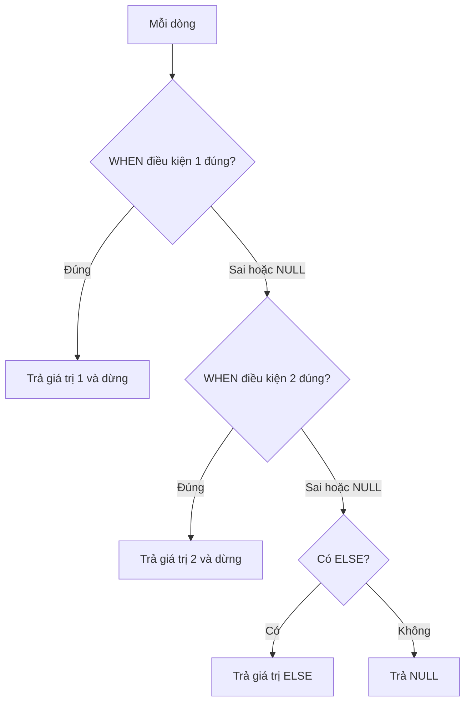

# Ngày 13: CASE và tổng hợp có điều kiện

> **Tóm tắt:** `CASE` là "if-else" của SQL: nó trả về một giá trị tùy theo điều kiện, và dùng được ở hầu hết mọi chỗ một biểu thức được phép xuất hiện (SELECT, ORDER BY, GROUP BY, UPDATE, WHERE). Ứng dụng quan trọng nhất của `CASE` trong báo cáo là đặt nó bên trong hàm tổng hợp để đếm, cộng có điều kiện và xoay dòng thành cột (pivot).

**Sau bài này bạn có thể:**

- Viết được `CASE` dạng tìm kiếm (searched) và dạng đơn giản (simple) để gắn nhãn, phân loại dữ liệu.
- Dùng `CASE` trong `ORDER BY` để sắp xếp theo thứ tự nghiệp vụ, và trong `GROUP BY` để gom nhóm theo phân khúc tự định nghĩa.
- Viết được truy vấn đếm và cộng có điều kiện bằng `SUM(CASE ...)`, `COUNT(CASE ...)` và `FILTER (WHERE ...)`.
- Xoay dữ liệu thành bảng chéo (pivot) đơn giản, ví dụ doanh thu theo tháng và kênh trên cùng một dòng.
- Tránh được các bẫy: sai thứ tự `WHEN`, `CASE x WHEN NULL`, các nhánh khác kiểu, thiếu `ELSE`.

**Cần biết trước:** [Ngày 3](03-select-where.md) (NULL và logic ba trị), [Ngày 5](05-operators-expressions.md), [Ngày 6](06-insert-update-delete.md), [Ngày 9](09-group-by-having.md), [Ngày 11](11-subquery.md) (CTE)

## 1. CASE là gì

`CASE` hoạt động giống câu lệnh if-else trong lập trình: kiểm tra lần lượt từng điều kiện, gặp điều kiện đúng đầu tiên thì trả về giá trị tương ứng và **dừng**, không xét các điều kiện sau.

```text
CASE
    WHEN dieu_kien_1 THEN gia_tri_1
    WHEN dieu_kien_2 THEN gia_tri_2
    ELSE gia_tri_mac_dinh
END
```



Ba điều cần nhớ ngay từ đầu:

- `CASE ... END` là **một biểu thức**, trả về **một giá trị** cho mỗi dòng. Nó không phải câu lệnh điều khiển luồng chạy.
- Điều kiện cho kết quả `NULL` (chưa biết, theo logic ba trị của Ngày 3) được xử lý như sai: chuyển sang `WHEN` tiếp theo.
- Không có `ELSE` mà không điều kiện nào đúng thì kết quả là `NULL`.

## 2. CASE dạng tìm kiếm (searched CASE)

Đây là dạng phổ biến nhất: mỗi `WHEN` là một điều kiện bất kỳ. Phân khúc sản phẩm theo giá:

```sql
SELECT sku, name, price,
       CASE
           WHEN price < 1000000  THEN 'Dưới 1 triệu'
           WHEN price < 10000000 THEN '1 - 10 triệu'
           WHEN price < 20000000 THEN '10 - 20 triệu'
           ELSE 'Từ 20 triệu'
       END AS phan_khuc
FROM products
ORDER BY price
LIMIT 8;
```

| sku | name | price | phan_khuc |
| --- | --- | --- | --- |
| ACC-008 | Cáp USB-C to USB-C 1m | 150000 | Dưới 1 triệu |
| ACC-009 | Lót chuột DSC XXL | 250000 | Dưới 1 triệu |
| ACC-001 | Chuột Logitech G102 | 399000 | Dưới 1 triệu |
| PHN-004 | Nokia 105 4G | 690000 | Dưới 1 triệu |
| ACC-007 | Sạc Anker 65W | 890000 | Dưới 1 triệu |
| ACC-003 | Bàn phím cơ Keychron K2 | 1890000 | 1 - 10 triệu |
| ACC-002 | Chuột Logitech MX Master 3S | 2490000 | 1 - 10 triệu |
| ACC-006 | Loa JBL Flip 6 | 2690000 | 1 - 10 triệu |

Nhánh thứ hai chỉ viết `price < 10000000` mà không cần `price >= 1000000`, vì dòng nào đến được nhánh này thì chắc chắn đã trượt nhánh đầu. Đó là lợi ích của việc "dừng ở điều kiện đúng đầu tiên", nhưng cũng là nguồn của lỗi hay gặp nhất. Đảo ngược thứ tự các nhánh:

```sql
SELECT sku, price,
       CASE
           WHEN price < 20000000 THEN '10 - 20 triệu'
           WHEN price < 10000000 THEN '1 - 10 triệu'
           WHEN price < 1000000  THEN 'Dưới 1 triệu'
           ELSE 'Từ 20 triệu'
       END AS phan_khuc
FROM products
ORDER BY price
LIMIT 3;
```

| sku | price | phan_khuc |
| --- | --- | --- |
| ACC-008 | 150000 | 10 - 20 triệu |
| ACC-009 | 250000 | 10 - 20 triệu |
| ACC-001 | 399000 | 10 - 20 triệu |

Cáp 150.000 đ bị xếp vào "10 - 20 triệu" vì `150000 < 20000000` đúng ngay ở nhánh đầu. Câu lệnh không báo lỗi, chỉ trả sai. Khi các khoảng dùng `<`, hãy xếp từ ngưỡng nhỏ đến ngưỡng lớn (hoặc dùng `>=` và xếp từ lớn đến nhỏ).

## 3. CASE dạng đơn giản (simple CASE)

Khi mọi điều kiện đều là "cột này **bằng** giá trị nào", viết gọn hơn bằng cách đặt biểu thức ngay sau `CASE`:

```sql
SELECT order_id, status,
       CASE status
           WHEN 'pending'   THEN 'Chờ xác nhận'
           WHEN 'paid'      THEN 'Đã thanh toán'
           WHEN 'shipped'   THEN 'Đang giao'
           WHEN 'delivered' THEN 'Đã giao'
           WHEN 'cancelled' THEN 'Đã hủy'
       END AS trang_thai
FROM orders
WHERE order_id IN (5, 36, 37, 38, 40)
ORDER BY order_id;
```

| order_id | status | trang_thai |
| --- | --- | --- |
| 5 | cancelled | Đã hủy |
| 36 | delivered | Đã giao |
| 37 | shipped | Đang giao |
| 38 | paid | Đã thanh toán |
| 40 | pending | Chờ xác nhận |

`CASE status WHEN 'pending' THEN ...` tương đương `CASE WHEN status = 'pending' THEN ...`. Vì bên trong là phép `=`, dạng đơn giản **không bắt được `NULL`** (xem mục Lỗi thường gặp). Cột `status` có ràng buộc `CHECK` nên chỉ có 5 giá trị trên; ở đây không cần `ELSE`.

## 4. Điều kiện phức tạp: AND, OR, LIKE

Mỗi `WHEN` của dạng tìm kiếm nhận mọi điều kiện bạn viết được ở `WHERE`. Ví dụ cảnh báo tồn kho, ưu tiên từ nghiêm trọng đến nhẹ:

```sql
SELECT sku, name, price, stock_quantity,
       CASE
           WHEN NOT is_active                            THEN 'Ngừng bán'
           WHEN stock_quantity = 0                       THEN 'Hết hàng'
           WHEN stock_quantity < 5 AND price >= 15000000 THEN 'Sắp hết, hàng đắt: nhập gấp'
           WHEN stock_quantity < 5                       THEN 'Sắp hết'
           WHEN sku LIKE 'ACC%' AND stock_quantity >= 50 THEN 'Tồn nhiều'
           ELSE 'Ổn'
       END AS canh_bao_kho
FROM products
WHERE stock_quantity < 5 OR stock_quantity >= 50 OR NOT is_active
ORDER BY stock_quantity, sku;
```

| sku | name | price | stock_quantity | canh_bao_kho |
| --- | --- | --- | --- | --- |
| ACC-006 | Loa JBL Flip 6 | 2690000 | 0 | Hết hàng |
| LAP-003 | Acer Nitro V 15 | 21990000 | 0 | Hết hàng |
| PHN-004 | Nokia 105 4G | 690000 | 0 | Ngừng bán |
| PC-003 | PC văn phòng DSC Basic | 9990000 | 2 | Sắp hết |
| LAP-002 | Lenovo Legion 5 | 29990000 | 3 | Sắp hết, hàng đắt: nhập gấp |
| LAP-006 | HP Pavilion 15 | 16990000 | 4 | Sắp hết, hàng đắt: nhập gấp |
| ACC-001 | Chuột Logitech G102 | 399000 | 60 | Tồn nhiều |
| ACC-008 | Cáp USB-C to USB-C 1m | 150000 | 200 | Tồn nhiều |

Nokia 105 4G vừa hết hàng vừa ngừng bán, nhưng chỉ nhận nhãn "Ngừng bán" vì nhánh đó đứng trước. Thứ tự nhánh chính là thứ tự ưu tiên của nghiệp vụ.

`WHERE` ở đây không dùng được alias `canh_bao_kho` (Ngày 3: `WHERE` chạy trước `SELECT`), nên phải viết lại điều kiện lọc.

## 5. CASE trong ORDER BY: sắp xếp theo thứ tự nghiệp vụ

Sắp xếp theo `status` bằng chữ cái sẽ cho `cancelled, delivered, paid, pending, shipped`, không theo vòng đời đơn hàng. `CASE` biến mỗi trạng thái thành một con số thứ tự:

```sql
SELECT order_id, status, order_date::date AS ngay_dat
FROM orders
WHERE order_date >= '2026-08-01' OR status = 'cancelled'
ORDER BY CASE status
             WHEN 'pending'   THEN 1
             WHEN 'paid'      THEN 2
             WHEN 'shipped'   THEN 3
             ELSE 4
         END,
         order_date DESC;
```

| order_id | status | ngay_dat |
| --- | --- | --- |
| 40 | pending | 2026-10-14 |
| 39 | paid | 2026-10-05 |
| 38 | paid | 2026-09-20 |
| 37 | shipped | 2026-09-02 |
| 36 | delivered | 2026-08-08 |
| 28 | cancelled | 2026-02-02 |
| 15 | cancelled | 2025-08-02 |
| 5 | cancelled | 2025-03-02 |

Đơn cần xử lý (chờ xác nhận, đã thanh toán chưa giao) nổi lên đầu, đơn đã xong xuống cuối. Đây là cách các màn hình quản trị thường sắp xếp.

## 6. CASE trong GROUP BY: gom nhóm theo phân khúc tự định nghĩa

Bảng không có cột "phân khúc giá", nhưng ta có thể tạo nó bằng `CASE` rồi gom nhóm theo chính biểu thức đó:

```sql
SELECT CASE
           WHEN price < 1000000  THEN 'Dưới 1 triệu'
           WHEN price < 10000000 THEN '1 - 10 triệu'
           WHEN price < 20000000 THEN '10 - 20 triệu'
           ELSE 'Từ 20 triệu'
       END AS phan_khuc,
       COUNT(*)   AS so_san_pham,
       MIN(price) AS gia_thap_nhat,
       MAX(price) AS gia_cao_nhat
FROM products
GROUP BY phan_khuc
ORDER BY MIN(price);
```

| phan_khuc | so_san_pham | gia_thap_nhat | gia_cao_nhat |
| --- | --- | --- | --- |
| Dưới 1 triệu | 5 | 150000 | 890000 |
| 1 - 10 triệu | 10 | 1890000 | 9990000 |
| 10 - 20 triệu | 5 | 16990000 | 19990000 |
| Từ 20 triệu | 4 | 21990000 | 32990000 |

PostgreSQL cho phép `GROUP BY phan_khuc` dùng alias của `SELECT`. `ORDER BY MIN(price)` sắp các phân khúc theo đúng thứ tự giá thay vì thứ tự chữ cái.

> **Ghi chú dialect:** MySQL cũng cho `GROUP BY` theo alias. SQL Server thì không: phải chép lại nguyên biểu thức `CASE` vào `GROUP BY`. Cách viết `GROUP BY 1` (theo vị trí cột) chạy được ở PostgreSQL và MySQL.

Cùng kỹ thuật này dùng để **chuẩn hóa dữ liệu bẩn** trước khi đếm. Cột `city` có nhiều cách viết cho cùng một thành phố:

```sql
SELECT CASE
           WHEN city IN ('TP. Hồ Chí Minh', 'Hồ Chí Minh', 'TP.HCM') THEN 'TP. Hồ Chí Minh'
           WHEN LOWER(city) = 'đà nẵng'                              THEN 'Đà Nẵng'
           WHEN city IS NULL                                         THEN '(chưa rõ)'
           ELSE city
       END AS thanh_pho,
       COUNT(*) AS so_khach
FROM customers
GROUP BY 1
ORDER BY so_khach DESC, thanh_pho;
```

| thanh_pho | so_khach |
| --- | --- |
| TP. Hồ Chí Minh | 5 |
| Hà Nội | 4 |
| Đà Nẵng | 3 |
| Cần Thơ | 2 |
| (chưa rõ) | 2 |
| Biên Hòa | 1 |
| Hải Phòng | 1 |

Không chuẩn hóa thì TP. Hồ Chí Minh bị chia làm ba nhóm (3 + 1 + 1) và Đà Nẵng làm hai nhóm.

## 7. Tổng hợp có điều kiện

Đây là phần quan trọng nhất của bài. Ý tưởng: đặt `CASE` **bên trong** hàm tổng hợp, để mỗi dòng chỉ "góp phần" vào kết quả khi thỏa điều kiện.

### Đếm có điều kiện

Một câu truy vấn, một lần đọc bảng, ra nhiều con số:

```sql
SELECT COUNT(*) AS tong_don,
       SUM(CASE WHEN channel = 'online'  THEN 1 ELSE 0 END) AS don_online,
       SUM(CASE WHEN channel = 'offline' THEN 1 ELSE 0 END) AS don_offline,
       COUNT(CASE WHEN status = 'cancelled' THEN 1 END)     AS don_huy
FROM orders;
```

| tong_don | don_online | don_offline | don_huy |
| --- | --- | --- | --- |
| 40 | 25 | 15 | 3 |

Có hai cách đếm:

- `SUM(CASE WHEN ... THEN 1 ELSE 0 END)`: dòng thỏa góp 1, dòng không thỏa góp 0.
- `COUNT(CASE WHEN ... THEN 1 END)`: dòng không thỏa nhận `NULL` (vì không có `ELSE`), mà `COUNT(biểu_thức)` bỏ qua `NULL` (Ngày 8).

Nếu không dùng `CASE`, bạn phải viết ba câu `SELECT COUNT(*) ... WHERE ...` riêng, hoặc `GROUP BY` rồi nhận kết quả theo dòng thay vì theo cột.

### FILTER: cú pháp gọn của PostgreSQL

PostgreSQL có mệnh đề `FILTER (WHERE ...)` gắn sau hàm tổng hợp, làm đúng việc trên nhưng dễ đọc hơn:

```sql
SELECT COUNT(*) AS tong_don,
       COUNT(*) FILTER (WHERE channel = 'online')   AS don_online,
       COUNT(*) FILTER (WHERE channel = 'offline')  AS don_offline,
       COUNT(*) FILTER (WHERE status = 'cancelled') AS don_huy
FROM orders;
```

| tong_don | don_online | don_offline | don_huy |
| --- | --- | --- | --- |
| 40 | 25 | 15 | 3 |

`FILTER` dùng được với mọi hàm tổng hợp (`SUM`, `AVG`, `MIN`, `MAX`, ...). Kết hợp với `GROUP BY`, ta tính được tỷ lệ hủy đơn theo kênh:

```sql
SELECT channel,
       COUNT(*) AS tong_don,
       COUNT(*) FILTER (WHERE status = 'cancelled') AS don_huy,
       ROUND(100.0 * COUNT(*) FILTER (WHERE status = 'cancelled') / COUNT(*), 1) AS ty_le_huy_pct
FROM orders
GROUP BY channel
ORDER BY channel;
```

| channel | tong_don | don_huy | ty_le_huy_pct |
| --- | --- | --- | --- |
| offline | 15 | 0 | 0.0 |
| online | 25 | 3 | 12.0 |

Nhân `100.0` (số thập phân) trước khi chia để tránh phép chia nguyên của Ngày 5.

> **Ghi chú dialect:** MySQL và SQL Server không có `FILTER`; hãy dùng `SUM(CASE ...)`/`COUNT(CASE ...)`, cách này chạy ở mọi hệ quản trị. MySQL còn có hàm `IF(dieu_kien, a, b)` và SQL Server có `IIF(dieu_kien, a, b)` cho trường hợp chỉ có hai nhánh; PostgreSQL không có hai hàm này, chỉ dùng `CASE`.

### Pivot: xoay dòng thành cột

`GROUP BY thang, channel` cho mỗi cặp (tháng, kênh) một **dòng**. Báo cáo thường muốn mỗi tháng một dòng, mỗi kênh một **cột**. Đó là pivot, và `SUM(CASE ...)` làm được việc này. Ví dụ doanh thu quý 1/2025 theo tháng và kênh, tính trên đơn đã thanh toán:

```sql
WITH don_hang AS (
    SELECT o.order_id,
           EXTRACT(MONTH FROM o.order_date) AS thang,
           o.channel,
           ROUND(SUM(oi.quantity * oi.unit_price * (1 - oi.discount))) AS tien
    FROM orders o
    JOIN order_items oi ON oi.order_id = o.order_id
    WHERE o.status NOT IN ('pending', 'cancelled')
      AND o.order_date >= '2025-01-01' AND o.order_date < '2025-04-01'
    GROUP BY o.order_id, thang, o.channel
)
SELECT thang,
       SUM(CASE WHEN channel = 'online'  THEN tien ELSE 0 END) AS online,
       SUM(CASE WHEN channel = 'offline' THEN tien ELSE 0 END) AS offline,
       SUM(tien) AS tong
FROM don_hang
GROUP BY thang
ORDER BY thang;
```

| thang | online | offline | tong |
| --- | --- | --- | --- |
| 1 | 699000 | 26990000 | 27689000 |
| 2 | 5780000 | 7881000 | 13661000 |
| 3 | 0 | 1380000 | 1380000 |

CTE `don_hang` có 5 dòng (đơn 1, 2, 3, 4, 6; đơn 5 bị hủy nên bị loại). Sơ đồ dưới cho thấy từng dòng đi đâu:

![Ba bước của tổng hợp có điều kiện. Bước 1: CTE don_hang có 5 dòng của quý 1/2025: đơn 1 tháng 1 online 699.000; đơn 2 tháng 1 offline 26.990.000; đơn 3 tháng 2 online 5.780.000; đơn 4 tháng 2 offline 7.881.000; đơn 6 tháng 3 offline 1.380.000. Bước 2: CASE tách mỗi dòng thành hai cột online và offline, cột không đúng kênh nhận 0. Bước 3: GROUP BY tháng và SUM gom 5 dòng còn 3: tháng 1 online 699.000, offline 26.990.000; tháng 2 online 5.780.000, offline 7.881.000; tháng 3 online 0, offline 1.380.000.](img/tong-hop-co-dieu-kien.png#gh-light-mode-only)
![Ba bước của tổng hợp có điều kiện. Bước 1: CTE don_hang có 5 dòng của quý 1/2025: đơn 1 tháng 1 online 699.000; đơn 2 tháng 1 offline 26.990.000; đơn 3 tháng 2 online 5.780.000; đơn 4 tháng 2 offline 7.881.000; đơn 6 tháng 3 offline 1.380.000. Bước 2: CASE tách mỗi dòng thành hai cột online và offline, cột không đúng kênh nhận 0. Bước 3: GROUP BY tháng và SUM gom 5 dòng còn 3: tháng 1 online 699.000, offline 26.990.000; tháng 2 online 5.780.000, offline 7.881.000; tháng 3 online 0, offline 1.380.000.](img/tong-hop-co-dieu-kien-dark.png#gh-dark-mode-only)

<small>File gốc: [nền sáng](../diagrams/case-when/tong-hop-co-dieu-kien.html) · [nền tối](../diagrams/case-when/tong-hop-co-dieu-kien-dark.html)</small>

Tháng 3 không có đơn online nào, nhưng cột `online` vẫn là `0` chứ không phải `NULL` nhờ `ELSE 0`. Giới hạn của cách này: danh sách cột (online, offline) phải viết sẵn trong câu lệnh. Nếu có kênh mới, bạn phải thêm cột bằng tay.

## 8. CASE trong UPDATE

`CASE` giúp một câu `UPDATE` áp dụng nhiều quy tắc khác nhau cho từng nhóm dòng. Giả sử shop muốn: tăng giá 5% cho laptop gaming (`category_id = 3`), giảm 10% cho phụ kiện tồn từ 30 cái trở lên (danh mục 10, 11, 12), làm tròn đến nghìn đồng.

Theo quy trình an toàn ở Ngày 6, luôn **xem trước bằng SELECT** với đúng biểu thức sẽ dùng:

```sql
SELECT sku, name, category_id, stock_quantity, price AS gia_cu,
       CASE
           WHEN category_id = 3 THEN ROUND(price * 1.05, -3)
           ELSE ROUND(price * 0.90, -3)
       END AS gia_moi
FROM products
WHERE category_id = 3
   OR (category_id IN (10, 11, 12) AND stock_quantity >= 30)
ORDER BY sku;
```

| sku | name | category_id | stock_quantity | gia_cu | gia_moi |
| --- | --- | --- | --- | --- | --- |
| ACC-001 | Chuột Logitech G102 | 10 | 60 | 399000 | 359000 |
| ACC-007 | Sạc Anker 65W | 12 | 40 | 890000 | 801000 |
| ACC-008 | Cáp USB-C to USB-C 1m | 12 | 200 | 150000 | 135000 |
| ACC-009 | Lót chuột DSC XXL | 10 | 30 | 250000 | 225000 |
| LAP-001 | ASUS ROG Strix G16 | 3 | 5 | 32990000 | 34640000 |
| LAP-002 | Lenovo Legion 5 | 3 | 3 | 29990000 | 31490000 |
| LAP-003 | Acer Nitro V 15 | 3 | 0 | 21990000 | 23090000 |

`ROUND(x, -3)` làm tròn đến hàng nghìn (số chữ số âm nghĩa là làm tròn bên trái dấu thập phân). Thấy đúng rồi mới chạy `UPDATE`, và ở đây ta bọc trong `BEGIN ... ROLLBACK` để không làm thay đổi dữ liệu gốc:

```sql
BEGIN;

UPDATE products
SET price = CASE
                WHEN category_id = 3 THEN ROUND(price * 1.05, -3)
                ELSE ROUND(price * 0.90, -3)
            END
WHERE category_id = 3
   OR (category_id IN (10, 11, 12) AND stock_quantity >= 30);
-- UPDATE 7

SELECT sku, price FROM products WHERE product_id IN (1, 16, 22) ORDER BY sku;

ROLLBACK;
```

| sku | price |
| --- | --- |
| ACC-001 | 359000 |
| ACC-007 | 801000 |
| LAP-001 | 34640000 |

Sau `ROLLBACK`, giá trở lại như cũ. Nếu lỡ `COMMIT`, chạy lại script init theo mục "Làm lại từ đầu" trong [setup/README.md](../setup/README.md).

Điều quan trọng nhất: **`WHERE` của `UPDATE` phải khớp với các nhánh `CASE`**. Nếu bỏ `WHERE`, mọi dòng không thuộc laptop gaming sẽ rơi vào `ELSE` và bị giảm giá 10%, kể cả iPhone. Một cách phòng thủ khác là viết `ELSE price` để dòng không thuộc nhánh nào giữ nguyên giá.

## 9. CASE trong WHERE

`CASE` cũng dùng được trong `WHERE`, khi điều kiện lọc phụ thuộc vào giá trị của một cột khác. Ví dụ kiểm tra chất lượng dữ liệu: đơn online phải có `shipping_city`, đơn offline phải có `employee_id`:

```sql
SELECT order_id, channel, employee_id, shipping_city
FROM orders
WHERE CASE
          WHEN channel = 'online' THEN shipping_city IS NULL
          ELSE employee_id IS NULL
      END;
```

Kết quả: 0 dòng, nghĩa là dữ liệu hợp lệ. Tuy nhiên điều kiện này viết bằng `AND`/`OR` thường dễ đọc hơn và để database tối ưu tốt hơn:

```sql
SELECT order_id, channel, employee_id, shipping_city
FROM orders
WHERE (channel = 'online'  AND shipping_city IS NULL)
   OR (channel = 'offline' AND employee_id IS NULL);
```

Hãy ưu tiên `AND`/`OR` trong `WHERE`, chỉ dùng `CASE` khi logic thật sự khó diễn đạt.

## Lỗi thường gặp

**1. Sai thứ tự `WHEN`.** Nhánh đúng đầu tiên thắng. Đặt điều kiện rộng (`price < 20000000`) trước điều kiện hẹp (`price < 1000000`) thì nhánh hẹp không bao giờ được chạy (mục 2).

**2. `CASE cot WHEN NULL` không bao giờ đúng.** Dạng đơn giản so sánh bằng `=`, mà `NULL = NULL` không phải `TRUE`.

```sql
SELECT customer_id, full_name, city,
       CASE city
           WHEN NULL THEN 'Chưa rõ'
           ELSE city
       END AS thanh_pho_sai,
       CASE
           WHEN city IS NULL THEN 'Chưa rõ'
           ELSE city
       END AS thanh_pho_dung
FROM customers
WHERE customer_id IN (10, 11, 17)
ORDER BY customer_id;
```

| customer_id | full_name | city | thanh_pho_sai | thanh_pho_dung |
| --- | --- | --- | --- | --- |
| 10 | Dương Minh Khoa | TP. Hồ Chí Minh | TP. Hồ Chí Minh | TP. Hồ Chí Minh |
| 11 | Lý Thanh Mai | *(NULL)* | *(NULL)* | Chưa rõ |
| 17 | Châu Ngọc Trâm | *(NULL)* | *(NULL)* | Chưa rõ |

Muốn bắt `NULL` thì dùng dạng tìm kiếm với `IS NULL`. Với trường hợp đơn giản "thay NULL bằng giá trị mặc định", `COALESCE(city, 'Chưa rõ')` (Ngày 5) còn gọn hơn.

**3. Các nhánh trả về khác kiểu.** Mọi nhánh `THEN`/`ELSE` phải chuyển được về cùng một kiểu:

```sql
SELECT sku,
       CASE WHEN stock_quantity = 0 THEN 'Hết hàng' ELSE stock_quantity END AS ton_kho
FROM products;
```

```text
ERROR:  invalid input syntax for type integer: "Hết hàng"
```

PostgreSQL thấy nhánh `ELSE` là số nguyên nên cố đổi `'Hết hàng'` thành số và thất bại. Sửa bằng cách đổi nhánh số sang chuỗi:

```sql
SELECT sku,
       CASE WHEN stock_quantity = 0 THEN 'Hết hàng' ELSE stock_quantity::text END AS ton_kho
FROM products
WHERE product_id IN (3, 4);
```

| sku | ton_kho |
| --- | --- |
| LAP-003 | Hết hàng |
| LAP-004 | 8 |

**4. Thiếu `ELSE` trong `SUM(CASE ...)`.** Nếu không dòng nào thỏa điều kiện, `SUM` của toàn `NULL` là `NULL` chứ không phải 0:

```sql
SELECT SUM(CASE WHEN status = 'cancelled' AND channel = 'offline' THEN 1 END)        AS khong_else,
       SUM(CASE WHEN status = 'cancelled' AND channel = 'offline' THEN 1 ELSE 0 END) AS co_else_0,
       COUNT(*) FILTER (WHERE status = 'cancelled' AND channel = 'offline')          AS dung_filter
FROM orders;
```

| khong_else | co_else_0 | dung_filter |
| --- | --- | --- |
| *(NULL)* | 0 | 0 |

Quy tắc dễ nhớ: đếm thì dùng `COUNT(*) FILTER (...)` hoặc `COUNT(CASE ... THEN 1 END)`; cộng tiền thì `SUM(CASE ... THEN tien ELSE 0 END)`, hoặc bọc `COALESCE(SUM(...), 0)`.

**5. Quên `WHERE` khi `UPDATE ... SET cot = CASE ...`.** Mọi dòng không khớp nhánh nào rơi vào `ELSE` (hoặc thành `NULL` nếu không có `ELSE`, và vi phạm `NOT NULL` nếu cột có ràng buộc). Luôn xem trước bằng `SELECT`, giới hạn bằng `WHERE`, và chạy trong `BEGIN`.

**6. Chia cho 0 trong nhánh tính tỷ lệ.** `CASE` không tự bảo vệ phép chia. Mẫu số có thể bằng 0 thì dùng `NULLIF(mau_so, 0)` (Ngày 5) để kết quả là `NULL` thay vì lỗi `division by zero`.

## Bài tập

Bài 1-6 chỉ đọc dữ liệu. Bài 7 sửa dữ liệu nên phải chạy trong `BEGIN ... ROLLBACK`.

### Cơ bản

**Bài 1.** Phân loại khách theo độ đầy đủ thông tin liên hệ: "Thiếu cả email và SĐT", "Thiếu email", "Thiếu SĐT", "Đủ thông tin". Đếm số khách mỗi loại, nhiều nhất lên đầu.

<details>
<summary>Đáp án</summary>

```sql
SELECT CASE
           WHEN email IS NULL AND phone IS NULL THEN 'Thiếu cả email và SĐT'
           WHEN email IS NULL                   THEN 'Thiếu email'
           WHEN phone IS NULL                   THEN 'Thiếu SĐT'
           ELSE 'Đủ thông tin'
       END AS lien_he,
       COUNT(*) AS so_khach
FROM customers
GROUP BY lien_he
ORDER BY so_khach DESC;
```

Kết quả:

| lien_he | so_khach |
| --- | --- |
| Đủ thông tin | 13 |
| Thiếu SĐT | 3 |
| Thiếu email | 1 |
| Thiếu cả email và SĐT | 1 |

Nhánh "thiếu cả hai" phải đứng đầu, nếu không khách 17 sẽ bị xếp vào "Thiếu email".

</details>

**Bài 2.** Thống kê thanh toán theo hình thức, hiển thị tên tiếng Việt: `cash` là "Tiền mặt", `card` là "Thẻ", `momo` là "Ví MoMo", `bank_transfer` là "Chuyển khoản". Hiện số lần và tổng tiền, sắp theo tổng tiền giảm dần. Dùng `CASE` dạng đơn giản.

<details>
<summary>Đáp án</summary>

```sql
SELECT CASE method
           WHEN 'cash'          THEN 'Tiền mặt'
           WHEN 'card'          THEN 'Thẻ'
           WHEN 'momo'          THEN 'Ví MoMo'
           WHEN 'bank_transfer' THEN 'Chuyển khoản'
       END AS hinh_thuc,
       COUNT(*)    AS so_lan,
       SUM(amount) AS tong_tien
FROM payments
GROUP BY method
ORDER BY tong_tien DESC;
```

Kết quả:

| hinh_thuc | so_lan | tong_tien |
| --- | --- | --- |
| Chuyển khoản | 8 | 166691500 |
| Ví MoMo | 14 | 157951000 |
| Thẻ | 7 | 112317500 |
| Tiền mặt | 8 | 99331000 |

`GROUP BY method` rồi mới đổi tên trong `SELECT` là hợp lệ, vì `CASE` chỉ dùng cột `method` đã có trong `GROUP BY`.

</details>

**Bài 3.** Đếm khách theo nhóm năm sinh: "Trước 1990", "1990 - 1999", "Từ 2000", "Chưa rõ" (không có `birth_date`). Sắp từ nhóm lớn tuổi nhất, "Chưa rõ" ở cuối.

<details>
<summary>Đáp án</summary>

```sql
SELECT CASE
           WHEN birth_date IS NULL        THEN 'Chưa rõ'
           WHEN birth_date < '1990-01-01' THEN 'Trước 1990'
           WHEN birth_date < '2000-01-01' THEN '1990 - 1999'
           ELSE 'Từ 2000'
       END AS nhom_nam_sinh,
       COUNT(*) AS so_khach
FROM customers
GROUP BY nhom_nam_sinh
ORDER BY MIN(birth_date) NULLS LAST;
```

Kết quả:

| nhom_nam_sinh | so_khach |
| --- | --- |
| Trước 1990 | 1 |
| 1990 - 1999 | 5 |
| Từ 2000 | 9 |
| Chưa rõ | 3 |

Nếu bỏ nhánh `IS NULL`, ba khách không có ngày sinh sẽ trượt mọi so sánh (kết quả `NULL`) và rơi vào `ELSE`, bị tính nhầm là "Từ 2000".

</details>

### Vận dụng

**Bài 4.** Xếp hạng khách theo tổng chi tiêu trên đơn đã thanh toán (`status NOT IN ('pending', 'cancelled')`): từ 50 triệu là "VIP", từ 20 triệu là "Thân thiết", có mua là "Thường", chưa có đơn đã thanh toán nào là "Chưa mua". Hiện mọi khách, kể cả khách chưa mua, sắp theo chi tiêu giảm dần.

<details>
<summary>Đáp án</summary>

```sql
WITH chi_tieu AS (
    SELECT o.customer_id,
           SUM(oi.quantity * oi.unit_price * (1 - oi.discount)) AS tong_chi
    FROM orders o
    JOIN order_items oi ON oi.order_id = o.order_id
    WHERE o.status NOT IN ('pending', 'cancelled')
    GROUP BY o.customer_id
)
SELECT c.customer_id, c.full_name,
       COALESCE(ROUND(ct.tong_chi), 0) AS tong_chi,
       CASE
           WHEN ct.tong_chi IS NULL     THEN 'Chưa mua'
           WHEN ct.tong_chi >= 50000000 THEN 'VIP'
           WHEN ct.tong_chi >= 20000000 THEN 'Thân thiết'
           ELSE 'Thường'
       END AS hang
FROM customers c
LEFT JOIN chi_tieu ct ON ct.customer_id = c.customer_id
ORDER BY tong_chi DESC, c.customer_id;
```

Kết quả:

| customer_id | full_name | tong_chi | hang |
| --- | --- | --- | --- |
| 10 | Dương Minh Khoa | 63220500 | VIP |
| 15 | Nguyễn Văn An | 58970000 | VIP |
| 2 | Trần Thị Bình | 58262500 | VIP |
| 18 | Mai Đức Uy | 46980000 | Thân thiết |
| 14 | Huỳnh Tấn Phát | 45880500 | Thân thiết |
| ... | ... | ... | ... |
| 16 | Tạ Quang Sơn | 0 | Chưa mua |
| 17 | Châu Ngọc Trâm | 0 | Chưa mua |

(tổng 18 dòng: 3 VIP, 8 Thân thiết, 5 Thường, 2 Chưa mua)

Tính tổng trong CTE trước rồi mới `LEFT JOIN` để khách chưa mua vẫn có mặt. Nhánh `IS NULL` phải đứng đầu: so sánh `NULL >= 50000000` cho `NULL` nên khách chưa mua sẽ trượt xuống `ELSE` và bị gắn nhầm "Thường".

</details>

**Bài 5.** Lập bảng doanh thu (đơn đã thanh toán) theo năm và quý: mỗi năm một dòng, mỗi quý một cột `q1` đến `q4`. Dùng `FILTER`. Gợi ý: `EXTRACT(QUARTER FROM ...)`.

<details>
<summary>Đáp án</summary>

```sql
SELECT EXTRACT(YEAR FROM o.order_date) AS nam,
       ROUND(SUM(oi.quantity * oi.unit_price * (1 - oi.discount))
             FILTER (WHERE EXTRACT(QUARTER FROM o.order_date) = 1)) AS q1,
       ROUND(SUM(oi.quantity * oi.unit_price * (1 - oi.discount))
             FILTER (WHERE EXTRACT(QUARTER FROM o.order_date) = 2)) AS q2,
       ROUND(SUM(oi.quantity * oi.unit_price * (1 - oi.discount))
             FILTER (WHERE EXTRACT(QUARTER FROM o.order_date) = 3)) AS q3,
       ROUND(SUM(oi.quantity * oi.unit_price * (1 - oi.discount))
             FILTER (WHERE EXTRACT(QUARTER FROM o.order_date) = 4)) AS q4
FROM orders o
JOIN order_items oi ON oi.order_id = o.order_id
WHERE o.status NOT IN ('pending', 'cancelled')
GROUP BY nam
ORDER BY nam;
```

Kết quả:

| nam | q1 | q2 | q3 | q4 |
| --- | --- | --- | --- | --- |
| 2025 | 42730000 | 109718500 | 64268500 | 109413500 |
| 2026 | 64080500 | 41389000 | 64711000 | 39980000 |

Quý 4/2026 mới có nửa tháng 10 nên còn thấp. Quý nào không có đơn thì `SUM ... FILTER` cho `NULL`; muốn hiện 0 thì bọc `COALESCE`.

</details>

**Bài 6.** Với mỗi danh mục có sản phẩm, cho biết: số sản phẩm, số sản phẩm hết hàng, số sản phẩm chưa có giá nhập (`cost_price` là `NULL`), và giá trị tồn kho tính theo giá bán của các sản phẩm còn kinh doanh. Sắp theo giá trị tồn kho giảm dần.

<details>
<summary>Đáp án</summary>

```sql
SELECT c.name AS danh_muc,
       COUNT(*) AS so_sp,
       COUNT(*) FILTER (WHERE p.stock_quantity = 0) AS het_hang,
       COUNT(*) FILTER (WHERE p.cost_price IS NULL) AS thieu_gia_nhap,
       SUM(CASE WHEN p.is_active THEN p.stock_quantity * p.price ELSE 0 END) AS gia_tri_ton
FROM products p
JOIN categories c ON c.category_id = p.category_id
GROUP BY c.category_id, c.name
ORDER BY gia_tri_ton DESC;
```

Kết quả:

| danh_muc | so_sp | het_hang | thieu_gia_nhap | gia_tri_ton |
| --- | --- | --- | --- | --- |
| Điện thoại | 4 | 1 | 0 | 593010000 |
| Laptop văn phòng | 3 | 0 | 1 | 365820000 |
| Laptop gaming | 3 | 1 | 0 | 254920000 |
| Máy tính bảng | 2 | 0 | 0 | 151380000 |
| PC & Màn hình | 3 | 0 | 0 | 140760000 |
| Tai nghe & Loa | 3 | 1 | 0 | 135800000 |
| Chuột & Bàn phím | 4 | 0 | 1 | 109590000 |
| Sạc & Cáp | 2 | 0 | 0 | 65600000 |

</details>

### Thử thách

**Bài 7.** Shop chạy khuyến mãi: điện thoại (`category_id = 7`) giảm 5%, máy tính bảng (`category_id = 8`) giảm 8%, làm tròn đến nghìn đồng; sản phẩm ngừng kinh doanh không đổi giá. Viết câu `SELECT` xem trước giá cũ và giá mới, rồi viết `UPDATE` dùng `CASE`, chạy trong `BEGIN ... ROLLBACK`.

<details>
<summary>Đáp án</summary>

```sql
SELECT sku, name, price AS gia_cu,
       CASE category_id
           WHEN 7 THEN ROUND(price * 0.95, -3)
           WHEN 8 THEN ROUND(price * 0.92, -3)
       END AS gia_moi
FROM products
WHERE category_id IN (7, 8) AND is_active
ORDER BY sku;
```

Kết quả:

| sku | name | gia_cu | gia_moi |
| --- | --- | --- | --- |
| PHN-001 | iPhone 15 128GB | 19990000 | 18991000 |
| PHN-002 | Samsung Galaxy S24 | 18990000 | 18041000 |
| PHN-003 | Xiaomi Redmi Note 13 | 4890000 | 4646000 |
| TAB-001 | iPad Air M2 11 inch | 16990000 | 15631000 |
| TAB-002 | Samsung Galaxy Tab S9 FE | 9490000 | 8731000 |

```sql
BEGIN;

UPDATE products
SET price = CASE category_id
                WHEN 7 THEN ROUND(price * 0.95, -3)
                WHEN 8 THEN ROUND(price * 0.92, -3)
                ELSE price
            END
WHERE category_id IN (7, 8) AND is_active;
-- UPDATE 5

ROLLBACK;
```

`ELSE price` là lưới an toàn: kể cả khi `WHERE` bị sửa sai, dòng không thuộc nhánh nào vẫn giữ giá cũ thay vì thành `NULL`. Nokia 105 4G (`is_active = FALSE`) bị `WHERE` loại nên không đổi giá.

</details>

**Bài 8.** Tính biên lợi nhuận `(price - cost_price) / price` (phần trăm, 1 chữ số thập phân) cho từng sản phẩm và xếp mức: "Cao (từ 30%)", "Trung bình (15-30%)", "Thấp (dưới 15%)", "Chưa có giá nhập". Sắp theo biên lợi nhuận giảm dần, sản phẩm chưa có giá nhập ở cuối. Có cần `CASE` để xử lý `cost_price` `NULL` trong cột phần trăm không?

<details>
<summary>Đáp án</summary>

```sql
SELECT sku, name, price, cost_price,
       ROUND(100.0 * (price - cost_price) / price, 1) AS bien_ln_pct,
       CASE
           WHEN cost_price IS NULL                   THEN 'Chưa có giá nhập'
           WHEN (price - cost_price) >= 0.30 * price THEN 'Cao (từ 30%)'
           WHEN (price - cost_price) >= 0.15 * price THEN 'Trung bình (15-30%)'
           ELSE 'Thấp (dưới 15%)'
       END AS muc_bien
FROM products
ORDER BY bien_ln_pct DESC NULLS LAST, sku;
```

Kết quả:

| sku | name | price | cost_price | bien_ln_pct | muc_bien |
| --- | --- | --- | --- | --- | --- |
| ACC-008 | Cáp USB-C to USB-C 1m | 150000 | 60000 | 60.0 | Cao (từ 30%) |
| ACC-001 | Chuột Logitech G102 | 399000 | 250000 | 37.3 | Cao (từ 30%) |
| ACC-007 | Sạc Anker 65W | 890000 | 600000 | 32.6 | Cao (từ 30%) |
| PHN-004 | Nokia 105 4G | 690000 | 500000 | 27.5 | Trung bình (15-30%) |
| ... | ... | ... | ... | ... | ... |
| TAB-001 | iPad Air M2 11 inch | 16990000 | 15000000 | 11.7 | Thấp (dưới 15%) |
| ACC-009 | Lót chuột DSC XXL | 250000 | *(NULL)* | *(NULL)* | Chưa có giá nhập |
| LAP-006 | HP Pavilion 15 | 16990000 | *(NULL)* | *(NULL)* | Chưa có giá nhập |

(tổng 24 dòng: 3 Cao, 9 Trung bình, 10 Thấp, 2 Chưa có giá nhập)

Cột phần trăm không cần `CASE`: phép tính có `NULL` tự cho `NULL`. Cột `muc_bien` thì cần nhánh `IS NULL` đứng đầu, nếu không các so sánh với `NULL` đều không đúng và hai sản phẩm này rơi vào `ELSE` thành "Thấp".

</details>

## Tóm tắt

- `CASE` là biểu thức trả về một giá trị cho mỗi dòng; dừng ở `WHEN` đúng đầu tiên; không có `ELSE` thì trả `NULL`.
- Dạng tìm kiếm (`CASE WHEN dieu_kien ...`) nhận mọi điều kiện; dạng đơn giản (`CASE cot WHEN gia_tri ...`) gọn hơn nhưng chỉ so sánh bằng và không bắt được `NULL`.
- `CASE` dùng được trong `SELECT`, `ORDER BY` (thứ tự nghiệp vụ), `GROUP BY` (phân khúc, chuẩn hóa dữ liệu), `UPDATE` (nhiều quy tắc trong một lệnh) và `WHERE` (ít khi cần).
- Tổng hợp có điều kiện: `SUM(CASE ... THEN x ELSE 0 END)`, `COUNT(CASE ... THEN 1 END)`, hoặc `FILTER (WHERE ...)` của PostgreSQL. Một lần đọc bảng ra nhiều con số.
- Pivot: `GROUP BY` theo chiều dòng, mỗi giá trị của chiều cột là một `SUM(CASE ...)` hoặc `... FILTER`.
- Các nhánh phải cùng kiểu; thứ tự `WHEN` là thứ tự ưu tiên; luôn nghĩ đến `NULL` và nhánh `ELSE`.

## Đọc thêm

- [PostgreSQL: Conditional Expressions (CASE, COALESCE, NULLIF)](https://www.postgresql.org/docs/16/functions-conditional.html)
- [PostgreSQL: Aggregate Expressions (FILTER)](https://www.postgresql.org/docs/16/sql-expressions.html#SYNTAX-AGGREGATES)

---

[⬅️ Ngày 12: UNION, INTERSECT và EXCEPT](12-union-intersect.md) | [📚 Mục lục](../README.md) | [Ngày 14: Ôn tập 2 - Báo cáo trên DSC Shop ➡️](14-review-2.md)
