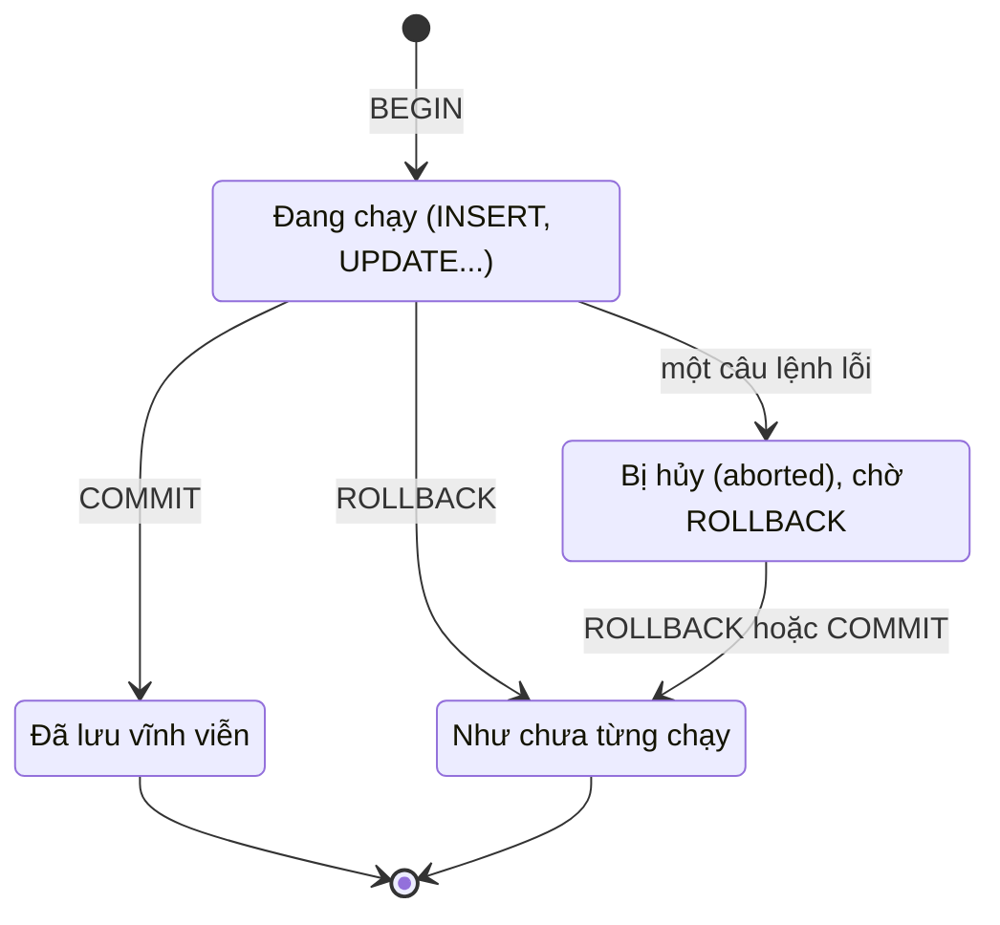

# Ngày 16: Transaction và ACID

> **Tóm tắt:** Một đơn hàng ở DSC Shop cần ba việc: tạo `orders`, thêm `order_items`, trừ `products.stock_quantity`. Transaction (giao dịch) gói các việc đó thành một khối "được cả hoặc mất cả". Bài này dạy BEGIN/COMMIT/ROLLBACK, SAVEPOINT, các mức cô lập (isolation level) qua demo hai phiên psql chạy song song, khóa dòng bằng `SELECT ... FOR UPDATE` và cách tránh deadlock.

**Sau bài này bạn có thể:**

- Viết được transaction đặt hàng (tạo đơn, thêm dòng hàng, trừ tồn kho) và biết lúc nào nó COMMIT, lúc nào bị ROLLBACK.
- Dùng SAVEPOINT để bỏ một phần công việc mà không hủy cả transaction.
- Giải thích được dirty read, non-repeatable read, phantom read, lost update và chọn isolation level phù hợp trong PostgreSQL.
- Viết được câu trừ tồn kho an toàn khi nhiều người mua cùng lúc (UPDATE có điều kiện hoặc `SELECT ... FOR UPDATE`).
- Nhận ra deadlock và tránh nó bằng cách khóa theo một thứ tự cố định.

**Cần biết trước:** [Ngày 6](06-insert-update-delete.md) (INSERT/UPDATE/DELETE, RETURNING, ràng buộc CHECK), [Ngày 2](02-table-structure-and-data-types.md) (ràng buộc).

> Bài này có sửa dữ liệu shop. Muốn đưa dữ liệu về như cũ, chạy lại hai file init như trong [setup/README.md](../setup/README.md) mục "Làm lại từ đầu". Mọi kết quả trong bài được chạy trên dữ liệu gốc.

---

## 1. Transaction là gì?

Transaction là một nhóm câu lệnh mà database coi như **một đơn vị công việc**: hoặc tất cả cùng có hiệu lực, hoặc không câu nào có hiệu lực.

Ví dụ đời thường ở DSC Shop: khách 16 (Tạ Quang Sơn) mua 2 con chuột Logitech G102. Hệ thống phải:

1. Thêm một dòng vào `orders`.
2. Thêm một dòng vào `order_items`.
3. Trừ 2 vào `products.stock_quantity` của sản phẩm 16.

Nếu bước 3 hỏng mà bước 1, 2 vẫn lưu, shop có một đơn hàng "ma": đã bán nhưng kho không giảm. Transaction giải quyết đúng chuyện này.

Vòng đời của một transaction:



## 2. Autocommit: khi bạn không viết BEGIN

Từ Ngày 1 tới giờ bạn chưa viết `BEGIN` lần nào, nhưng thật ra mọi câu lệnh đều chạy trong transaction. PostgreSQL mặc định ở chế độ **autocommit**: mỗi câu lệnh đứng riêng là một transaction, chạy xong là tự COMMIT.

Hệ quả: `ROLLBACK` sau một câu lệnh lẻ không cứu được gì.

```sql
UPDATE products SET price = 22990000 WHERE product_id = 5;
ROLLBACK;
SELECT name, price FROM products WHERE product_id = 5;
```

```text
UPDATE 1
WARNING:  there is no transaction in progress
```

| name | price |
| --- | --- |
| MacBook Air M2 13 inch | 22990000 |

Giá đã đổi thật, `ROLLBACK` chỉ nhận lại một cảnh báo. Muốn có quyền hối hận, phải mở transaction bằng `BEGIN` **trước** khi sửa.

> Trong psql, dấu nhắc cho bạn biết đang ở đâu: `sql_challenge=#` là ngoài transaction, `sql_challenge=*#` là đang trong transaction, `sql_challenge=!#` là transaction đã bị lỗi và đang chờ bạn ROLLBACK.

## 3. BEGIN, COMMIT, ROLLBACK

### 3.1. Đặt hàng thành công

```sql
BEGIN;

INSERT INTO orders (customer_id, order_date, status, channel, shipping_city)
VALUES (16, '2026-10-17 09:00+07', 'pending', 'online', 'Cần Thơ')
RETURNING order_id;
```

| order_id |
| --- |
| 41 |

Các câu sau cần đúng `order_id` vừa sinh. Trên dữ liệu gốc đó là 41, nhưng nếu bạn đã chạy thử vài lần thì id sẽ khác (mục 3.2 giải thích vì sao), nên đừng gõ cứng số 41. Hàm `currval('orders_order_id_seq')` trả về id mà bảng `orders` vừa sinh **trong chính phiên làm việc của bạn**, dù đó là số mấy:

```sql
INSERT INTO order_items (order_id, product_id, quantity, unit_price)
VALUES (currval('orders_order_id_seq'), 16, 2, 399000);

UPDATE products SET stock_quantity = stock_quantity - 2 WHERE product_id = 16;

COMMIT;
```

Kiểm tra lại:

```sql
SELECT o.order_id, o.customer_id, oi.product_id, oi.quantity, p.stock_quantity
FROM orders o
JOIN order_items oi ON oi.order_id = o.order_id
JOIN products p ON p.product_id = oi.product_id
WHERE o.order_id = currval('orders_order_id_seq');
```

| order_id | customer_id | product_id | quantity | stock_quantity |
| --- | --- | --- | --- | --- |
| 41 | 16 | 16 | 2 | 58 |

Tồn kho chuột G102 giảm từ 60 xuống 58, đơn và dòng hàng đều đã lưu.

### 3.2. Một câu lỗi, cả transaction bị hủy

Bây giờ khách 16 muốn mua 10 chiếc ASUS ROG Strix G16 (sản phẩm 1), trong khi kho chỉ còn 5. Bảng `products` có ràng buộc `CHECK (stock_quantity >= 0)`, nên câu trừ kho sẽ lỗi.

```sql
BEGIN;

INSERT INTO orders (customer_id, order_date, status, channel, shipping_city)
VALUES (16, '2026-10-17 09:00+07', 'pending', 'online', 'Cần Thơ')
RETURNING order_id;   -- 41 trên dữ liệu gốc

INSERT INTO order_items (order_id, product_id, quantity, unit_price)
VALUES (currval('orders_order_id_seq'), 1, 10, 32990000);

UPDATE products SET stock_quantity = stock_quantity - 10 WHERE product_id = 1;
```

```text
ERROR:  new row for relation "products" violates check constraint "products_stock_quantity_check"
DETAIL:  Failing row contains (1, LAP-001, ASUS ROG Strix G16, 3, 32990000, 28500000, -5, ...).
```

Sau lỗi này, PostgreSQL đưa transaction vào trạng thái **aborted**. Mọi câu lệnh tiếp theo đều bị từ chối:

```sql
SELECT * FROM orders WHERE order_id = currval('orders_order_id_seq');
```

```text
ERROR:  current transaction is aborted, commands ignored until end of transaction block
```

Bạn chỉ còn cách kết thúc transaction. Kể cả gõ `COMMIT`, PostgreSQL cũng trả về `ROLLBACK`:

```sql
COMMIT;
```

```text
ROLLBACK
```

Kiểm tra: đơn 41 không tồn tại, kho ASUS vẫn là 5. Đó là **tính nguyên tử**: dòng `orders` và `order_items` đã chèn thành công trước đó cũng bị hủy theo.

```sql
SELECT count(*) AS so_don,
       (SELECT stock_quantity FROM products WHERE product_id = 1) AS ton_kho_asus
FROM orders;
```

| so_don | ton_kho_asus |
| --- | --- |
| 40 | 5 |

> Một chi tiết hay bị hỏi: nếu bạn đặt lại đơn ngay sau đó, `order_id` mới là **42**, không phải 41. Bộ sinh số IDENTITY không quay lui khi ROLLBACK, nên dãy id có thể bị "lủng lỗ". Đó là bình thường, đừng dựa vào id liên tục.

> **Ghi chú dialect:** MySQL viết `START TRANSACTION` (cũng nhận `BEGIN`), SQL Server viết `BEGIN TRANSACTION`. Khi một câu lệnh lỗi, MySQL và SQL Server (mặc định) thường chỉ hủy câu lệnh đó và cho transaction chạy tiếp, còn PostgreSQL hủy cả transaction như trên.

### 3.3. UPDATE trúng 0 dòng không phải là lỗi

Đây là bẫy rất hay gặp. Database chỉ tự hủy transaction khi có **lỗi thật** (vi phạm ràng buộc, sai cú pháp, ...). Câu UPDATE không tìm thấy dòng nào vẫn là câu chạy thành công.

```sql
BEGIN;
UPDATE products SET stock_quantity = stock_quantity - 1 WHERE product_id = 999;
UPDATE products SET stock_quantity = stock_quantity - 10 WHERE product_id = 1 AND stock_quantity >= 10;
ROLLBACK;
```

```text
UPDATE 0
UPDATE 0
```

Không có lỗi nào. Nếu sau hai câu này bạn gõ `COMMIT`, phần còn lại của transaction (tạo đơn, ...) vẫn được lưu. Vì vậy **người viết transaction phải tự kiểm tra số dòng bị ảnh hưởng** (`UPDATE 0` trong psql, `rowcount` trong code ứng dụng ở Ngày 23, `FOUND` trong PL/pgSQL ở Ngày 17) rồi quyết định ROLLBACK. Còn ràng buộc `CHECK` là chốt chặn cuối cùng: nó biến "số âm" thành lỗi thật.

## 4. SAVEPOINT: lùi một bước, không hủy cả đơn

Khách đặt chuột G102, rồi muốn thêm loa JBL Flip 6 (sản phẩm 21, đã hết hàng), sau đó đổi ý lấy sạc Anker 65W (sản phẩm 22). Ta không muốn mất cả đơn chỉ vì món loa.

`SAVEPOINT ten` đánh dấu một điểm trong transaction. `ROLLBACK TO SAVEPOINT ten` hủy mọi thứ sau điểm đó, kể cả trạng thái lỗi, và transaction chạy tiếp được.

```sql
BEGIN;

INSERT INTO orders (customer_id, order_date, status, channel, shipping_city)
VALUES (16, '2026-10-17 09:00+07', 'pending', 'online', 'Cần Thơ')
RETURNING order_id;   -- 41 trên dữ liệu gốc

INSERT INTO order_items (order_id, product_id, quantity, unit_price)
VALUES (currval('orders_order_id_seq'), 16, 2, 399000);
UPDATE products SET stock_quantity = stock_quantity - 2 WHERE product_id = 16;

SAVEPOINT them_loa;
INSERT INTO order_items (order_id, product_id, quantity, unit_price)
VALUES (currval('orders_order_id_seq'), 21, 1, 2690000);
UPDATE products SET stock_quantity = stock_quantity - 1 WHERE product_id = 21;
-- ERROR:  new row for relation "products" violates check constraint "products_stock_quantity_check"

ROLLBACK TO SAVEPOINT them_loa;

INSERT INTO order_items (order_id, product_id, quantity, unit_price)
VALUES (currval('orders_order_id_seq'), 22, 1, 890000);
UPDATE products SET stock_quantity = stock_quantity - 1 WHERE product_id = 22;

COMMIT;
```

```sql
SELECT oi.product_id, p.name, oi.quantity, p.stock_quantity
FROM order_items oi
JOIN products p ON p.product_id = oi.product_id
WHERE oi.order_id = currval('orders_order_id_seq')
ORDER BY oi.product_id;
```

| product_id | name | quantity | stock_quantity |
| --- | --- | --- | --- |
| 16 | Chuột Logitech G102 | 2 | 58 |
| 22 | Sạc Anker 65W | 1 | 39 |

Dòng loa JBL biến mất (đã bị lùi về savepoint), hai món còn lại được lưu.

## 5. ACID: bốn lời hứa của transaction

| Tính chất | Ý nghĩa | Ở DSC Shop |
| --- | --- | --- |
| **A**tomicity (nguyên tử) | Được cả hoặc mất cả | Mục 3.2: lỗi trừ kho thì đơn và dòng hàng cũng bị hủy |
| **C**onsistency (nhất quán) | Sau transaction, dữ liệu vẫn thỏa mọi ràng buộc | `CHECK (stock_quantity >= 0)`, khóa ngoại `order_items → orders` không bao giờ bị vi phạm khi COMMIT |
| **I**solation (cô lập) | Các transaction chạy song song không thấy "nửa chừng" của nhau, mức độ tùy isolation level | Mục 6, 7 |
| **D**urability (bền vững) | Đã COMMIT thì không mất, kể cả khi mất điện ngay sau đó | PostgreSQL ghi nhật ký WAL xuống đĩa trước khi báo COMMIT thành công |

Chữ C phụ thuộc vào chính bạn: database chỉ giữ được những ràng buộc bạn đã khai báo. Nếu không có `CHECK (stock_quantity >= 0)`, ví dụ ở mục 3.2 sẽ COMMIT vui vẻ với tồn kho âm 5.

## 6. Hai người mua cùng lúc: lost update

Phần này cần **hai phiên psql** chạy song song. Mở hai cửa sổ terminal, mỗi cửa sổ chạy:

```sh
docker compose exec db psql -U postgres -d sql_challenge
```

Gọi cửa sổ thứ nhất là **phiên A**, cửa sổ thứ hai là **phiên B**, rồi gõ lệnh theo đúng thứ tự từng bước trong bảng. (Adminer không dùng được cho demo này, vì mỗi lần bấm "Execute" nó mở một kết nối mới.)

### 6.1. Kiểu viết sai: đọc ra, tính ở ứng dụng, ghi lại

Nhiều người viết code đặt hàng như sau: đọc tồn kho lên, trừ trong code, rồi ghi con số mới xuống. Hai khách cùng mua ASUS ROG Strix G16 (tồn kho 5):

| Bước | Phiên A | Phiên B |
| --- | --- | --- |
| 1 | `BEGIN;`<br>`SELECT stock_quantity FROM products WHERE product_id = 1;` → **5** | |
| 2 | | `BEGIN;`<br>`SELECT stock_quantity FROM products WHERE product_id = 1;` → **5** |
| 3 | `UPDATE products SET stock_quantity = 4 WHERE product_id = 1;`<br>`COMMIT;` | |
| 4 | | `UPDATE products SET stock_quantity = 4 WHERE product_id = 1;`<br>`COMMIT;` |
| 5 | | `SELECT stock_quantity FROM products WHERE product_id = 1;` → **4** |

Bán 2 máy nhưng kho chỉ giảm 1. Lần ghi của B đè lên lần ghi của A. Hiện tượng này gọi là **lost update** (mất cập nhật). Transaction không tự cứu bạn: cả hai đều COMMIT thành công.


<small>File gốc: [nền sáng](../diagrams/transactions-acid/hai-phien-ban-mot-laptop.html) · [nền tối](../diagrams/transactions-acid/hai-phien-ban-mot-laptop-dark.html)</small>

### 6.2. Cách 1: để database tự trừ, kèm điều kiện

Đừng mang con số ra ngoài. Viết phép trừ ngay trong câu UPDATE, kèm điều kiện "còn đủ hàng":

```sql
UPDATE products
SET stock_quantity = stock_quantity - 1
WHERE product_id = 1 AND stock_quantity >= 1
RETURNING stock_quantity;
```

| stock_quantity |
| --- |
| 4 |

Vì sao an toàn? Câu UPDATE **khóa dòng** nó sửa cho tới khi transaction kết thúc. Nếu phiên B cũng UPDATE dòng đó, B phải chờ. Khi A COMMIT, B đọc lại phiên bản mới nhất của dòng, kiểm tra lại điều kiện `WHERE` rồi mới trừ.

| Bước | Phiên A | Phiên B |
| --- | --- | --- |
| 1 | `BEGIN;`<br>`UPDATE products SET stock_quantity = stock_quantity - 1 WHERE product_id = 1 AND stock_quantity >= 1 RETURNING stock_quantity;` → **4** | |
| 2 | | `BEGIN;`<br>cùng câu UPDATE đó → **đứng chờ** |
| 3 | `COMMIT;` | UPDATE chạy tiếp, trả về **3** |
| 4 | | `COMMIT;` |

Khi hàng chỉ còn đủ cho một người, người đến sau nhận `UPDATE 0`. Thử với PC văn phòng DSC Basic (sản phẩm 9, tồn kho 2), hai phiên cùng mua 2 cái:

| Bước | Phiên A | Phiên B |
| --- | --- | --- |
| 1 | `BEGIN;`<br>`UPDATE products SET stock_quantity = stock_quantity - 2 WHERE product_id = 9 AND stock_quantity >= 2 RETURNING stock_quantity;` → **0** | |
| 2 | | `BEGIN;`<br>cùng câu UPDATE đó → **đứng chờ** |
| 3 | `COMMIT;` | trả về `(0 rows)`, `UPDATE 0` |
| 4 | | `ROLLBACK;` (báo khách hết hàng) |

`UPDATE 0` chính là tín hiệu để ứng dụng ROLLBACK, như đã nói ở mục 3.3.

### 6.3. Cách 2: khóa dòng trước bằng SELECT ... FOR UPDATE

Khi bạn thật sự cần đọc giá trị lên để quyết định (ví dụ kiểm tra nhiều điều kiện rồi mới ghi), hãy đọc kèm `FOR UPDATE`. Câu SELECT này khóa các dòng nó trả về, giống như đã UPDATE chúng.

| Bước | Phiên A | Phiên B |
| --- | --- | --- |
| 1 | `BEGIN;`<br>`SELECT stock_quantity FROM products WHERE product_id = 1 FOR UPDATE;` → **5** | |
| 2 | | `BEGIN;`<br>`SELECT stock_quantity FROM products WHERE product_id = 1 FOR UPDATE;` → **đứng chờ** |
| 3 | `UPDATE products SET stock_quantity = 4 WHERE product_id = 1;`<br>`COMMIT;` | SELECT chạy tiếp, trả về **4** |
| 4 | | `UPDATE products SET stock_quantity = 3 WHERE product_id = 1;`<br>`COMMIT;` |

Kết quả cuối là 3, đúng.

Chú ý: SELECT thường (không có `FOR UPDATE`) **không bao giờ bị chặn** và cũng không chặn ai. Đó là lý do cách viết ở 6.1 hỏng.

## 7. Isolation level: transaction thấy gì của nhau?

Isolation level quyết định một transaction được thấy thay đổi của transaction khác tới mức nào. Chuẩn SQL định nghĩa bốn mức, dựa trên các hiện tượng đọc bất thường:

- **Dirty read**: đọc được dữ liệu mà transaction khác **chưa COMMIT** (và có thể sẽ ROLLBACK).
- **Non-repeatable read**: trong một transaction, đọc lại **cùng một dòng** hai lần mà ra hai giá trị khác nhau.
- **Phantom read**: chạy lại **cùng một điều kiện WHERE** mà tập dòng trả về khác đi (có dòng mới "hiện ra").
- **Lost update**: hai transaction cùng đọc rồi ghi, lần ghi sau đè lần ghi trước (mục 6).

Trong PostgreSQL 16:

| Mức | Dirty read | Non-repeatable read | Phantom read | Lost update kiểu 6.1 |
| --- | --- | --- | --- | --- |
| READ UNCOMMITTED | Không xảy ra (PostgreSQL xử lý như READ COMMITTED) | Có thể | Có thể | Có thể |
| READ COMMITTED (**mặc định**) | Không | Có thể | Có thể | Có thể |
| REPEATABLE READ | Không | Không | Không (chặt hơn chuẩn SQL, chuẩn cho phép) | Không: phiên ghi sau bị lỗi |
| SERIALIZABLE | Không | Không | Không | Không: phiên ghi sau bị lỗi |

> **Ghi chú dialect:** mức mặc định khác nhau giữa các hệ: PostgreSQL và SQL Server là READ COMMITTED, MySQL (InnoDB) là REPEATABLE READ. Cùng một tên mức nhưng mỗi hệ cài đặt hơi khác, nên đừng mang nguyên kinh nghiệm từ hệ này sang hệ khác.

### 7.1. Cách đặt isolation level trong PostgreSQL

Đặt ngay khi mở transaction:

```sql
BEGIN ISOLATION LEVEL REPEATABLE READ;
SHOW transaction_isolation;
COMMIT;
```

| transaction_isolation |
| --- |
| repeatable read |

Hoặc dùng `SET TRANSACTION` làm câu **đầu tiên sau BEGIN**:

```sql
BEGIN;
SET TRANSACTION ISOLATION LEVEL SERIALIZABLE;
SHOW transaction_isolation;
COMMIT;
```

| transaction_isolation |
| --- |
| serializable |

Viết `SET TRANSACTION` **trước** `BEGIN` là sai trong PostgreSQL: lệnh chỉ in cảnh báo rồi bị bỏ qua, transaction sau đó vẫn là READ COMMITTED.

```sql
SET TRANSACTION ISOLATION LEVEL SERIALIZABLE;
BEGIN;
SHOW transaction_isolation;
COMMIT;
```

```text
WARNING:  SET TRANSACTION can only be used in transaction blocks
```

| transaction_isolation |
| --- |
| read committed |

> **Ghi chú dialect:** trong MySQL, `SET TRANSACTION ISOLATION LEVEL ...` đặt **trước** `START TRANSACTION` mới đúng (nó áp dụng cho transaction kế tiếp). Đây là chỗ dễ nhầm khi chuyển qua lại.

### 7.2. Demo: không có dirty read

Phiên A đổi giá MacBook Air (sản phẩm 5) nhưng chưa COMMIT. Phiên B cố tình chọn mức thấp nhất:

| Bước | Phiên A | Phiên B |
| --- | --- | --- |
| 1 | `BEGIN;`<br>`UPDATE products SET price = 23990000 WHERE product_id = 5;`<br>`SELECT price FROM products WHERE product_id = 5;` → **23990000** | |
| 2 | | `BEGIN ISOLATION LEVEL READ UNCOMMITTED;`<br>`SELECT price FROM products WHERE product_id = 5;` → **24990000** |
| 3 | `ROLLBACK;` | `COMMIT;` |

B chỉ thấy giá đã COMMIT. Trong PostgreSQL không có cách nào đọc dữ liệu chưa COMMIT của phiên khác.

### 7.3. Demo: non-repeatable read và phantom ở READ COMMITTED

Phiên A làm báo cáo: xem giá MacBook và đếm số sản phẩm hết hàng (dữ liệu gốc có 3). Giữa hai lần đọc, phiên B đổi giá và thêm một sản phẩm mới hết hàng (danh mục 13 "Thiết bị mạng"):

| Bước | Phiên A | Phiên B |
| --- | --- | --- |
| 1 | `BEGIN ISOLATION LEVEL READ COMMITTED;`<br>`SELECT price FROM products WHERE product_id = 5;` → **24990000**<br>`SELECT count(*) FROM products WHERE stock_quantity = 0;` → **3** | |
| 2 | | `UPDATE products SET price = 23990000 WHERE product_id = 5;`<br>`INSERT INTO products (sku, name, category_id, price, stock_quantity) VALUES ('NET-001', 'Router TP-Link Archer AX23', 13, 1290000, 0);`<br>(autocommit, có hiệu lực ngay) |
| 3 | `SELECT price FROM products WHERE product_id = 5;` → **23990000**<br>`SELECT count(*) FROM products WHERE stock_quantity = 0;` → **4**<br>`COMMIT;` | |

Trong cùng một transaction, A đọc hai lần ra hai giá khác nhau (**non-repeatable read**) và đếm hai lần ra hai con số (**phantom read**). Ở READ COMMITTED, **mỗi câu lệnh** nhìn thấy dữ liệu đã COMMIT tính tới lúc câu lệnh đó bắt đầu.

### 7.4. Demo: REPEATABLE READ giữ nguyên "ảnh chụp"

Chạy lại đúng kịch bản trên (sau khi khôi phục dữ liệu), chỉ đổi bước 1 thành `BEGIN ISOLATION LEVEL REPEATABLE READ;`:

| Bước | Phiên A | Phiên B |
| --- | --- | --- |
| 1 | `BEGIN ISOLATION LEVEL REPEATABLE READ;`<br>đọc giá → **24990000**, đếm → **3** | |
| 2 | | cùng câu UPDATE và INSERT như trên |
| 3 | đọc giá → **24990000**, đếm → **3**<br>`COMMIT;` | |

Ở REPEATABLE READ, cả transaction nhìn thấy một **ảnh chụp (snapshot)** dữ liệu lấy ở câu lệnh đầu tiên. Rất hợp cho báo cáo cần số liệu khớp nhau từ đầu tới cuối.

### 7.5. REPEATABLE READ chặn lost update bằng lỗi

Chạy lại kịch bản lost update ở mục 6.1 nhưng cả hai phiên mở bằng `BEGIN ISOLATION LEVEL REPEATABLE READ;`:

| Bước | Phiên A | Phiên B |
| --- | --- | --- |
| 1 | `BEGIN ISOLATION LEVEL REPEATABLE READ;`<br>đọc tồn kho → **5** | |
| 2 | | `BEGIN ISOLATION LEVEL REPEATABLE READ;`<br>đọc tồn kho → **5** |
| 3 | `UPDATE products SET stock_quantity = 4 WHERE product_id = 1;`<br>`COMMIT;` | |
| 4 | | `UPDATE products SET stock_quantity = 4 WHERE product_id = 1;`<br>`ERROR:  could not serialize access due to concurrent update`<br>`COMMIT;` → `ROLLBACK` |

PostgreSQL phát hiện B định sửa một dòng đã bị transaction khác sửa sau khi B chụp ảnh, nên từ chối. Đây là **serialization failure** (mã lỗi SQLSTATE `40001`). Ứng dụng phải bắt lỗi này và **chạy lại cả transaction từ đầu**, lần chạy lại sẽ đọc được 4.

SERIALIZABLE còn chặt hơn: nó bảo đảm kết quả giống hệt như khi các transaction chạy lần lượt từng cái một, và cũng báo lỗi `40001` khi không bảo đảm được. Cái giá là bạn phải viết sẵn logic thử lại.

### 7.6. Chọn mức nào?

- Mặc định READ COMMITTED là đủ cho phần lớn thao tác, **với điều kiện** bạn ghi bằng UPDATE có điều kiện hoặc khóa bằng `FOR UPDATE` (mục 6).
- Báo cáo nhiều câu cần số liệu nhất quán: REPEATABLE READ.
- Logic phức tạp mà bạn không chắc đã khóa đủ: SERIALIZABLE, kèm vòng thử lại khi gặp lỗi `40001`.

## 8. Deadlock

Deadlock (khóa chết) xảy ra khi hai transaction chờ nhau theo vòng tròn: A giữ khóa X và chờ Y, B giữ khóa Y và chờ X. Không ai nhường, nên PostgreSQL phải chọn một bên để hủy.

Hai đơn hàng cùng có ASUS (sản phẩm 1) và Lenovo Legion 5 (sản phẩm 2), nhưng thứ tự trừ kho ngược nhau:

| Bước | Phiên A | Phiên B |
| --- | --- | --- |
| 1 | `BEGIN;`<br>`UPDATE products SET stock_quantity = stock_quantity - 1 WHERE product_id = 1;` | |
| 2 | | `BEGIN;`<br>`UPDATE products SET stock_quantity = stock_quantity - 1 WHERE product_id = 2;` |
| 3 | `UPDATE products SET stock_quantity = stock_quantity - 1 WHERE product_id = 2;` → chờ B | |
| 4 | | `UPDATE products SET stock_quantity = stock_quantity - 1 WHERE product_id = 1;` → chờ A |
| 5 | Sau khoảng 1 giây (`deadlock_timeout`), một phiên nhận lỗi (dưới đây là A) | phiên còn lại chạy tiếp |

```text
ERROR:  deadlock detected
DETAIL:  Process 3673 waits for ShareLock on transaction 2144; blocked by process 3681.
Process 3681 waits for ShareLock on transaction 2143; blocked by process 3673.
HINT:  See server log for query details.
CONTEXT:  while updating tuple (0,2) in relation "products"
```

Phiên bị hủy phải ROLLBACK (gõ `COMMIT` cũng chỉ nhận `ROLLBACK`), phiên kia `COMMIT` bình thường. Số process và số transaction trên máy bạn sẽ khác.

**Cách tránh:** mọi transaction khóa các dòng theo **cùng một thứ tự**, ví dụ tăng dần theo `product_id`. Cách gọn nhất là khóa trước tất cả sản phẩm của đơn bằng một câu:

```sql
BEGIN;

SELECT product_id, stock_quantity
FROM products
WHERE product_id IN (1, 2)
ORDER BY product_id
FOR UPDATE;

UPDATE products SET stock_quantity = stock_quantity - 1 WHERE product_id IN (1, 2);

COMMIT;
```

| product_id | stock_quantity |
| --- | --- |
| 1 | 5 |
| 2 | 3 |

Chạy câu này ở hai phiên cùng lúc: phiên thứ hai chỉ phải chờ phiên thứ nhất COMMIT rồi đọc được 4 và 2, không còn deadlock. Dù vậy, ứng dụng vẫn nên bắt lỗi deadlock (SQLSTATE `40P01`) và thử lại, vì deadlock có thể đến từ những chỗ bạn không ngờ.

Giữ transaction **ngắn** cũng giảm deadlock: đừng mở transaction rồi chờ người dùng bấm nút, hay gọi API bên ngoài khi đang giữ khóa.

## 9. Chuyển tiền an toàn

Bài toán kinh điển của transaction là chuyển tiền. DSC Shop chưa có bảng ví, ta tạo một bảng riêng để thực hành (không đụng tới bảng gốc):

```sql
DROP TABLE IF EXISTS wallets;

CREATE TABLE wallets (
    customer_id INT PRIMARY KEY REFERENCES customers (customer_id),
    balance     NUMERIC(12,0) NOT NULL CHECK (balance >= 0)
);

INSERT INTO wallets (customer_id, balance) VALUES
    (1, 1000000),
    (2,  500000),
    (3,       0);
```

Chuyển 300.000 đ từ khách 2 sang khách 1. Bốn nguyên tắc:

1. Cả hai câu UPDATE nằm trong **một transaction**.
2. **Khóa hai ví theo thứ tự `customer_id` tăng dần** trước khi sửa, để hai lệnh chuyển ngược chiều nhau (2 → 1 và 1 → 2) không deadlock.
3. Phép trừ nằm trong câu UPDATE (`balance = balance - 300000`), không tính ở ngoài.
4. `CHECK (balance >= 0)` biến "không đủ tiền" thành lỗi thật; ngoài ra kiểm tra mỗi UPDATE phải trúng đúng 1 dòng.

```sql
BEGIN;

SELECT customer_id, balance
FROM wallets
WHERE customer_id IN (1, 2)
ORDER BY customer_id
FOR UPDATE;

UPDATE wallets SET balance = balance - 300000 WHERE customer_id = 2;
UPDATE wallets SET balance = balance + 300000 WHERE customer_id = 1;

COMMIT;

SELECT * FROM wallets ORDER BY customer_id;
```

| customer_id | balance |
| --- | --- |
| 1 | 1300000 |
| 2 | 200000 |
| 3 | 0 |

Giờ khách 2 chỉ còn 200.000 đ mà muốn chuyển 300.000 đ cho khách 3:

```sql
BEGIN;
SELECT customer_id, balance FROM wallets WHERE customer_id IN (2, 3) ORDER BY customer_id FOR UPDATE;
UPDATE wallets SET balance = balance - 300000 WHERE customer_id = 2;
```

```text
ERROR:  new row for relation "wallets" violates check constraint "wallets_balance_check"
DETAIL:  Failing row contains (2, -100000).
```

```sql
ROLLBACK;
```

Số dư không đổi. Trong psql bạn tự nhìn `UPDATE 1` / `UPDATE 0` để quyết định; ở [Ngày 17](17-stored-procedures-functions.md) ta sẽ gói toàn bộ logic này vào một procedure để database tự kiểm tra và báo lỗi rõ ràng.

## Lỗi thường gặp

**1. Tưởng ROLLBACK cứu được câu lệnh đã chạy ở chế độ autocommit.** Không có `BEGIN` thì mỗi câu tự COMMIT ngay (mục 2). Thói quen tốt khi sửa dữ liệu thật: luôn `BEGIN`, chạy, `SELECT` kiểm tra, rồi mới `COMMIT`.

**2. Coi `UPDATE 0` là lỗi.** Sai:

```sql
BEGIN;
UPDATE wallets SET balance = balance + 300000 WHERE customer_id = 99;  -- không có ví 99: UPDATE 0
COMMIT;  -- vẫn COMMIT, tiền "biến mất" nếu trước đó đã trừ ví người gửi
```

Đúng: kiểm tra số dòng bị ảnh hưởng sau mỗi câu và tự `ROLLBACK` khi không như mong đợi.

**3. Đọc rồi ghi mà không khóa.** `SELECT stock_quantity ...` rồi `UPDATE ... SET stock_quantity = <số tính ở ngoài>` gây lost update (mục 6.1). Đúng: `SET stock_quantity = stock_quantity - n WHERE ... AND stock_quantity >= n`, hoặc `SELECT ... FOR UPDATE` trước.

**4. Đặt `SET TRANSACTION` trước `BEGIN`** trong PostgreSQL: bị bỏ qua (mục 7.1). Đúng: `BEGIN ISOLATION LEVEL ...;` hoặc `SET TRANSACTION` ngay sau `BEGIN`.

**5. Cố chạy tiếp sau khi transaction đã lỗi.** PostgreSQL từ chối mọi câu với thông báo `current transaction is aborted`. Đúng: `ROLLBACK` (hoặc `ROLLBACK TO SAVEPOINT` nếu đã đặt savepoint trước đó).

**6. Dùng REPEATABLE READ / SERIALIZABLE mà không thử lại.** Hai mức này chủ động báo lỗi `40001` thay vì để dữ liệu sai. Không có vòng thử lại thì người dùng chỉ thấy lỗi.

**7. Transaction quá dài.** Mở `BEGIN` rồi đi uống cà phê là đang giữ khóa, chặn người khác. Mở muộn, đóng sớm.

## Bài tập

Nhớ khôi phục dữ liệu gốc trước mỗi bài (xem [setup/README.md](../setup/README.md) mục "Làm lại từ đầu").

### Cơ bản

**Bài 1.** Khách 17 (Châu Ngọc Trâm) đặt online, giao về Hà Nội, 1 bàn phím cơ Keychron K2 (sản phẩm 18, giá 1.890.000) và 1 lót chuột DSC XXL (sản phẩm 24, giá 250.000). Viết transaction tạo đơn, thêm hai dòng hàng, trừ tồn kho, rồi kiểm tra tồn kho hai sản phẩm.

<details>
<summary>Đáp án</summary>

```sql
BEGIN;

INSERT INTO orders (customer_id, order_date, status, channel, shipping_city)
VALUES (17, '2026-10-17 10:00+07', 'pending', 'online', 'Hà Nội')
RETURNING order_id;   -- 41 trên dữ liệu gốc

INSERT INTO order_items (order_id, product_id, quantity, unit_price) VALUES
    (currval('orders_order_id_seq'), 18, 1, 1890000),
    (currval('orders_order_id_seq'), 24, 1,  250000);

UPDATE products SET stock_quantity = stock_quantity - 1 WHERE product_id IN (18, 24);  -- UPDATE 2

COMMIT;

SELECT product_id, name, stock_quantity
FROM products
WHERE product_id IN (18, 24)
ORDER BY product_id;
```

Kết quả:

| product_id | name | stock_quantity |
| --- | --- | --- |
| 18 | Bàn phím cơ Keychron K2 | 14 |
| 24 | Lót chuột DSC XXL | 29 |

</details>

**Bài 2.** Trong một transaction, giảm giá MacBook Air M2 (sản phẩm 5) 10%, xem giá mới, rồi đổi ý và hủy. Chứng minh giá đã về như cũ.

<details>
<summary>Đáp án</summary>

```sql
BEGIN;
UPDATE products SET price = price * 0.9 WHERE product_id = 5;
SELECT name, price FROM products WHERE product_id = 5;
ROLLBACK;
SELECT name, price FROM products WHERE product_id = 5;
```

Kết quả (trong transaction):

| name | price |
| --- | --- |
| MacBook Air M2 13 inch | 22491000 |

Kết quả (sau ROLLBACK):

| name | price |
| --- | --- |
| MacBook Air M2 13 inch | 24990000 |

</details>

**Bài 3.** Dự đoán thông báo của từng câu, rồi chạy thử. Acer Nitro V 15 (sản phẩm 3) đang hết hàng.

```sql
BEGIN;
UPDATE products SET stock_quantity = stock_quantity - 1 WHERE product_id = 3;
SELECT name, stock_quantity FROM products WHERE product_id = 3;
COMMIT;
```

<details>
<summary>Đáp án</summary>

```text
BEGIN
ERROR:  new row for relation "products" violates check constraint "products_stock_quantity_check"
ERROR:  current transaction is aborted, commands ignored until end of transaction block
ROLLBACK
```

Câu UPDATE vi phạm `CHECK (stock_quantity >= 0)`. Từ đó transaction ở trạng thái aborted nên câu SELECT bị từ chối, và `COMMIT` thực chất trở thành `ROLLBACK`. Tồn kho vẫn là 0.

</details>

### Vận dụng

**Bài 4.** Khách 5 mua tại cửa hàng (nhân viên 4, trạng thái `paid`) ba món: iPad Air M2 (sản phẩm 14, 16.990.000), Nokia 105 4G (sản phẩm 13, 690.000, đang hết hàng) và sạc Anker 65W (sản phẩm 22, 890.000). Dùng SAVEPOINT để món nào hết hàng thì bỏ món đó, các món còn lại vẫn được lưu.

<details>
<summary>Đáp án</summary>

```sql
BEGIN;

INSERT INTO orders (customer_id, employee_id, order_date, status, channel)
VALUES (5, 4, '2026-10-17 14:00+07', 'paid', 'offline')
RETURNING order_id;   -- 41 trên dữ liệu gốc

SAVEPOINT mon_1;
INSERT INTO order_items (order_id, product_id, quantity, unit_price) VALUES (currval('orders_order_id_seq'), 14, 1, 16990000);
UPDATE products SET stock_quantity = stock_quantity - 1 WHERE product_id = 14;

SAVEPOINT mon_2;
INSERT INTO order_items (order_id, product_id, quantity, unit_price) VALUES (currval('orders_order_id_seq'), 13, 1, 690000);
UPDATE products SET stock_quantity = stock_quantity - 1 WHERE product_id = 13;
-- ERROR: ... violates check constraint "products_stock_quantity_check"
ROLLBACK TO SAVEPOINT mon_2;

SAVEPOINT mon_3;
INSERT INTO order_items (order_id, product_id, quantity, unit_price) VALUES (currval('orders_order_id_seq'), 22, 1, 890000);
UPDATE products SET stock_quantity = stock_quantity - 1 WHERE product_id = 22;

COMMIT;

SELECT oi.product_id, p.name, oi.quantity, p.stock_quantity
FROM order_items oi
JOIN products p ON p.product_id = oi.product_id
WHERE oi.order_id = currval('orders_order_id_seq')
ORDER BY oi.product_id;
```

Kết quả:

| product_id | name | quantity | stock_quantity |
| --- | --- | --- | --- |
| 14 | iPad Air M2 11 inch | 1 | 4 |
| 22 | Sạc Anker 65W | 1 | 39 |

Trong thực tế, ứng dụng chỉ chạy `ROLLBACK TO SAVEPOINT` khi thấy lỗi; ở đây ta biết trước Nokia hết hàng.

</details>

**Bài 5.** Tạo lại bảng `wallets` như mục 9 (1: 1.000.000, 2: 500.000, 3: 0). Viết transaction chuyển 200.000 đ từ khách 1 sang khách 3, có khóa hai ví theo đúng thứ tự. Vì sao phải khóa theo thứ tự `customer_id` mà không khóa "người gửi trước, người nhận sau"?

<details>
<summary>Đáp án</summary>

```sql
BEGIN;

SELECT customer_id, balance
FROM wallets
WHERE customer_id IN (1, 3)
ORDER BY customer_id
FOR UPDATE;

UPDATE wallets SET balance = balance - 200000 WHERE customer_id = 1;
UPDATE wallets SET balance = balance + 200000 WHERE customer_id = 3;

COMMIT;

SELECT * FROM wallets ORDER BY customer_id;
```

Kết quả:

| customer_id | balance |
| --- | --- |
| 1 | 800000 |
| 2 | 500000 |
| 3 | 200000 |

Nếu khóa "người gửi trước", lệnh chuyển 1 → 3 khóa ví 1 rồi ví 3, còn lệnh chuyển 3 → 1 chạy cùng lúc khóa ví 3 rồi ví 1: đúng kịch bản deadlock ở mục 8. Khóa theo `customer_id` tăng dần thì mọi lệnh chuyển đều khóa ví 1 trước ví 3, nên không thể chờ vòng tròn.

</details>

**Bài 6.** Hai phiên. Phiên A mở transaction rồi đếm số đơn `pending` (dữ liệu gốc có 1). Phiên B (autocommit) thêm một đơn `pending` mới cho khách 16. Phiên A đếm lại rồi COMMIT. Dự đoán kết quả lần đếm thứ hai khi A dùng READ COMMITTED và khi A dùng REPEATABLE READ. Sau khi A COMMIT, đếm lại thì được bao nhiêu?

<details>
<summary>Đáp án</summary>

| Bước | Phiên A | Phiên B |
| --- | --- | --- |
| 1 | `BEGIN ISOLATION LEVEL READ COMMITTED;` (hoặc `REPEATABLE READ`)<br>`SELECT count(*) FROM orders WHERE status = 'pending';` → **1** | |
| 2 | | `INSERT INTO orders (customer_id, order_date, status, channel, shipping_city) VALUES (16, '2026-10-17 11:00+07', 'pending', 'online', 'Cần Thơ');` |
| 3 | đếm lại, rồi `COMMIT;` | |

Kết quả lần đếm thứ hai:

| Mức của phiên A | Lần đếm 2 | Đếm sau COMMIT |
| --- | --- | --- |
| READ COMMITTED | 2 (phantom read) | 2 |
| REPEATABLE READ | 1 (vẫn dùng ảnh chụp cũ) | 2 |

</details>

### Thử thách

**Bài 7.** Flash sale: Lenovo Legion 5 (sản phẩm 2) chỉ còn 3 máy, mỗi khách mua 1. Viết **một câu lệnh** trừ kho cho một lượt mua sao cho: không bao giờ âm, hai khách bấm cùng lúc không làm mất lượt trừ, và ứng dụng biết lượt đó thành công hay hết hàng. Chạy câu đó 4 lần liên tiếp và giải thích kết quả.

<details>
<summary>Đáp án</summary>

```sql
UPDATE products
SET stock_quantity = stock_quantity - 1
WHERE product_id = 2 AND stock_quantity >= 1
RETURNING stock_quantity;
```

Kết quả bốn lần chạy:

| Lần | Kết quả |
| --- | --- |
| 1 | `stock_quantity = 2`, `UPDATE 1` |
| 2 | `stock_quantity = 1`, `UPDATE 1` |
| 3 | `stock_quantity = 0`, `UPDATE 1` |
| 4 | `(0 rows)`, `UPDATE 0` |

- Phép trừ nằm trong UPDATE nên dòng bị khóa trong lúc trừ; lượt đến sau phải chờ rồi đọc lại giá trị mới (mục 6.2), không mất lượt trừ.
- Điều kiện `stock_quantity >= 1` làm lượt thứ 4 không trúng dòng nào. `UPDATE 0` (hoặc không có dòng RETURNING) là tín hiệu "hết hàng" để ứng dụng ROLLBACK cả đơn.
- `CHECK (stock_quantity >= 0)` là lưới an toàn thứ hai nếu ai đó quên điều kiện.

</details>

**Bài 8.** Một đơn mua ASUS (1) và Lenovo (2), đơn khác mua Lenovo (2) và ASUS (1), cả hai trừ kho theo thứ tự các món trong giỏ. Giải thích vì sao có thể deadlock, và viết lại phần trừ kho để không còn deadlock giữa các đơn.

<details>
<summary>Đáp án</summary>

Đơn thứ nhất khóa dòng 1 rồi chờ dòng 2, đơn thứ hai khóa dòng 2 rồi chờ dòng 1: chờ vòng tròn (mục 8). Sửa bằng cách khóa mọi sản phẩm của đơn trong một câu, theo thứ tự `product_id` tăng dần, trước khi trừ:

```sql
BEGIN;

SELECT product_id, stock_quantity
FROM products
WHERE product_id IN (1, 2)
ORDER BY product_id
FOR UPDATE;

UPDATE products SET stock_quantity = stock_quantity - 1 WHERE product_id IN (1, 2);

COMMIT;
```

Kết quả của câu SELECT (dữ liệu gốc):

| product_id | stock_quantity |
| --- | --- |
| 1 | 5 |
| 2 | 3 |

Dù giỏ hàng xếp theo thứ tự nào, mọi đơn đều khóa dòng 1 trước dòng 2, nên đơn đến sau chỉ chờ chứ không deadlock. Ứng dụng vẫn nên thử lại khi gặp SQLSTATE `40P01`.

</details>

## Tóm tắt

- Transaction gói nhiều câu lệnh thành một khối: `BEGIN` ... `COMMIT` để lưu, `ROLLBACK` để hủy. Không có `BEGIN` thì mỗi câu tự COMMIT (autocommit).
- Trong PostgreSQL, một câu lỗi làm cả transaction bị hủy; chỉ còn cách `ROLLBACK` hoặc lùi về `SAVEPOINT`.
- `UPDATE 0` không phải lỗi. Tự kiểm tra số dòng, và dùng ràng buộc `CHECK` làm chốt chặn cuối.
- ACID: nguyên tử, nhất quán (nhờ ràng buộc bạn khai báo), cô lập (tùy isolation level), bền vững (WAL).
- PostgreSQL mặc định READ COMMITTED: không có dirty read, nhưng có non-repeatable read, phantom read và lost update nếu bạn đọc rồi ghi.
- Chống lost update: trừ ngay trong UPDATE có điều kiện, hoặc `SELECT ... FOR UPDATE`, hoặc REPEATABLE READ / SERIALIZABLE kèm thử lại khi gặp lỗi `40001`.
- Tránh deadlock: khóa theo cùng một thứ tự, giữ transaction ngắn, thử lại khi gặp lỗi `40P01`.

## Đọc thêm

- [Hai giao dịch cùng cộng 100, số dư chỉ tăng 100: isolation level qua thí nghiệm thật](https://tiennhm.io.vn/blog/sql-isolation-level-lost-update-phantom-read) — Hai phiên cùng đọc số dư 1000 rồi cùng ghi 1100.
- [Thêm 4 index làm INSERT chậm 6 lần: cái giá không ai nhắc khi bảo bạn đánh index](https://tiennhm.io.vn/blog/chi-phi-ghi-cua-index) — Mọi hướng dẫn tối ưu đều bảo thêm index, rất ít bài nói về hoá đơn.
- Tài liệu PostgreSQL: [Transaction Isolation](https://www.postgresql.org/docs/16/transaction-iso.html), [Explicit Locking](https://www.postgresql.org/docs/16/explicit-locking.html).

---

[⬅️ Ngày 15: Chỉ mục (index)](15-index.md) | [📚 Mục lục](../README.md) | [Ngày 17: Function và Stored Procedure ➡️](17-stored-procedures-functions.md)
