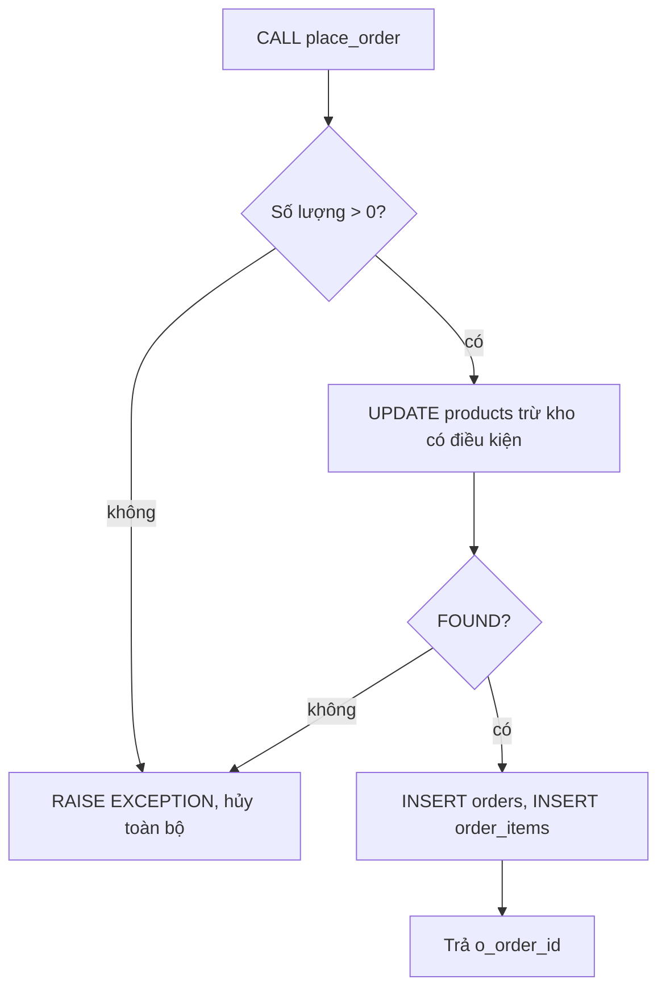

# Ngày 17: Function và Stored Procedure

> **Tóm tắt:** Function (hàm) và procedure (thủ tục) cho phép bạn đặt một đoạn logic có tên vào trong database rồi gọi lại nhiều lần. Bài này viết chúng bằng SQL và PL/pgSQL trên DSC Shop: tính tổng tiền đơn, xếp hạng khách, trả về bảng, và một procedure đặt hàng an toàn có xử lý lỗi thật.

**Sau bài này bạn có thể:**

- Viết được function bằng `LANGUAGE sql` và `LANGUAGE plpgsql` có tham số, giá trị mặc định, trả về một giá trị hoặc một bảng (`RETURNS TABLE`).
- Viết được procedure và gọi bằng `CALL`, trả kết quả qua tham số `OUT`.
- Báo lỗi có mã bằng `RAISE EXCEPTION ... USING ERRCODE`, bắt lỗi bằng khối `EXCEPTION WHEN ...`.
- Viết được procedure đặt hàng trừ tồn kho an toàn khi nhiều người mua cùng lúc.
- Chọn đúng giữa function và procedure, biết khi nào không nên đẩy logic vào database.

**Cần biết trước:** [Ngày 16](16-transactions-acid.md) (transaction, khóa dòng), [Ngày 6](06-insert-update-delete.md) (INSERT/UPDATE, RETURNING), [Ngày 8](08-aggregate-functions.md) (hàm tổng hợp).

> Bài này tạo function, procedure và sửa dữ liệu shop. Muốn dọn sạch và đưa dữ liệu về như cũ, chạy lại hai file init như trong [setup/README.md](../setup/README.md) mục "Làm lại từ đầu" (file init xóa cả schema `shop`, nên các function bạn tạo cũng mất theo).

---

## 1. Vì sao cần function và procedure?

Từ Ngày 8 tới giờ, mỗi lần cần tổng tiền một đơn, bạn lại viết:

```sql
SELECT SUM(quantity * unit_price * (1 - discount))
FROM order_items
WHERE order_id = 4;
```

Công thức này xuất hiện ở hàng chục truy vấn. Nếu một ngày shop thêm phí vận chuyển, bạn phải sửa tất cả. Đặt công thức vào một function `order_total(order_id)` thì chỉ sửa một chỗ.

Lợi ích thực sự:

- **Một nguồn sự thật**: logic nghiệp vụ (tính tiền, đặt hàng, chuyển trạng thái) nằm một chỗ, mọi ứng dụng gọi chung.
- **Ít vòng đi về qua mạng**: procedure đặt hàng chạy cả chục câu lệnh trong database, ứng dụng chỉ gửi một lệnh `CALL`.
- **Phân quyền**: có thể cho một tài khoản quyền gọi procedure mà không cho quyền sửa trực tiếp bảng (Ngày 30).

Cái giá phải trả:

- Code nằm trong database nên khó quản lý phiên bản, khó debug, khó viết test hơn code ứng dụng. Cần lưu file `.sql` trong git và có quy trình triển khai.
- **Không tự nhanh hơn.** PL/pgSQL có giữ kế hoạch thực thi (plan) của các câu lệnh bên trong trong phạm vi một phiên kết nối, nhưng truy vấn có tham số gửi từ ứng dụng cũng được tối ưu tương tự. Function đặt trong `WHERE` còn có thể làm truy vấn chậm hơn vì chạy trên từng dòng và che mất index (mục "Lỗi thường gặp").
- **Không tự an toàn.** Procedure vẫn có thể bị SQL injection nếu ghép chuỗi SQL động (mục 8), và vẫn có race condition nếu đọc rồi ghi không khóa (Ngày 16).

## 2. Function đầu tiên: LANGUAGE sql

Cú pháp:

```text
CREATE [OR REPLACE] FUNCTION ten_ham(tham_so kieu, ...)
RETURNS kieu_tra_ve
LANGUAGE sql
AS $$
    <một hoặc nhiều câu SQL; kết quả câu cuối là giá trị trả về>
$$;
```

`$$ ... $$` là cách PostgreSQL viết một chuỗi dài mà không phải nhân đôi dấu nháy đơn bên trong (gọi là dollar quoting). Thân hàm là một chuỗi như vậy.

```sql
CREATE OR REPLACE FUNCTION order_total(p_order_id INT)
RETURNS NUMERIC
LANGUAGE sql
STABLE
AS $$
    SELECT COALESCE(ROUND(SUM(quantity * unit_price * (1 - discount))), 0)
    FROM order_items
    WHERE order_id = p_order_id;
$$;
```

- Tên tham số có tiền tố `p_` để không trùng tên cột (lý do ở mục "Lỗi thường gặp").
- `COALESCE(..., 0)`: đơn không có dòng hàng thì `SUM` ra NULL (Ngày 8), ta đổi thành 0.
- `STABLE` giải thích ở mục 5.

Gọi function như mọi hàm có sẵn (`UPPER`, `ROUND`, ...):

```sql
SELECT order_id, order_date::DATE, status, order_total(order_id) AS tong_tien
FROM orders
WHERE customer_id = 1
ORDER BY order_id;
```

| order_id | order_date | status | tong_tien |
| --- | --- | --- | --- |
| 1 | 2025-01-12 | delivered | 699000 |
| 4 | 2025-02-14 | delivered | 7881000 |
| 13 | 2025-07-08 | delivered | 2230000 |
| 25 | 2025-12-24 | delivered | 24980000 |
| 37 | 2026-09-02 | shipped | 9640000 |

```sql
SELECT order_total(999);
```

| order_total |
| --- |
| 0 |

### Doanh thu theo tháng, viết đúng cách

```sql
CREATE OR REPLACE FUNCTION monthly_revenue(p_year INT, p_month INT)
RETURNS NUMERIC
LANGUAGE sql
STABLE
AS $$
    SELECT COALESCE(ROUND(SUM(oi.quantity * oi.unit_price * (1 - oi.discount))), 0)
    FROM orders o
    JOIN order_items oi ON oi.order_id = o.order_id
    WHERE o.status <> 'cancelled'
      AND o.order_date >= make_date(p_year, p_month, 1)
      AND o.order_date <  make_date(p_year, p_month, 1) + INTERVAL '1 month';
$$;

SELECT monthly_revenue(2025, 11) AS thang_11_2025,
       monthly_revenue(2025, 3)  AS thang_3_2025,
       monthly_revenue(2024, 12) AS thang_12_2024;
```

| thang_11_2025 | thang_3_2025 | thang_12_2024 |
| --- | --- | --- |
| 40762500 | 1380000 | 0 |

Hai chi tiết đáng học:

- Lọc theo **khoảng** `>= ngày đầu tháng AND < ngày đầu tháng sau`, thay vì `EXTRACT(MONTH FROM order_date) = p_month`. Cách viết khoảng cho phép dùng index trên `order_date` (Ngày 15), còn bọc cột trong hàm thì không.
- Tháng không có đơn trả về 0 nhờ `COALESCE`, không phải NULL.

## 3. PL/pgSQL: biến, IF, báo lỗi

`LANGUAGE sql` chỉ chạy các câu SQL nối nhau. Khi cần biến, rẽ nhánh, vòng lặp, báo lỗi, ta dùng **PL/pgSQL**, ngôn ngữ thủ tục có sẵn trong PostgreSQL.

Khung một function PL/pgSQL:

```text
CREATE OR REPLACE FUNCTION ten_ham(...)
RETURNS kieu
LANGUAGE plpgsql
AS $$
DECLARE
    -- khai báo biến
BEGIN
    -- các câu lệnh
    RETURN ...;
END;
$$;
```

> `BEGIN ... END` ở đây chỉ là khối lệnh của PL/pgSQL, **không** mở transaction như `BEGIN;` ở Ngày 16.

Ví dụ: xếp hạng khách theo tổng chi tiêu (không tính đơn đã hủy). Từ 50 triệu là Vàng, từ 20 triệu là Bạc, có mua là Đồng, chưa mua là Mới.

```sql
CREATE OR REPLACE FUNCTION customer_tier(p_customer_id INT)
RETURNS TEXT
LANGUAGE plpgsql
STABLE
AS $$
DECLARE
    v_spent NUMERIC := 0;
BEGIN
    IF NOT EXISTS (SELECT 1 FROM customers WHERE customer_id = p_customer_id) THEN
        RAISE EXCEPTION 'Không có khách hàng %', p_customer_id;
    END IF;

    SELECT COALESCE(SUM(oi.quantity * oi.unit_price * (1 - oi.discount)), 0)
    INTO v_spent
    FROM orders o
    JOIN order_items oi ON oi.order_id = o.order_id
    WHERE o.customer_id = p_customer_id
      AND o.status <> 'cancelled';

    IF v_spent >= 50000000 THEN
        RETURN 'Vàng';
    ELSIF v_spent >= 20000000 THEN
        RETURN 'Bạc';
    ELSIF v_spent > 0 THEN
        RETURN 'Đồng';
    ELSE
        RETURN 'Mới';
    END IF;
END;
$$;
```

Những thứ mới:

- `DECLARE v_spent NUMERIC := 0;` khai báo biến, `:=` là phép gán.
- `SELECT ... INTO v_spent` đưa kết quả truy vấn vào biến. (Khác hẳn `SELECT ... INTO ten_bang` ngoài PL/pgSQL, vốn tạo bảng mới.)
- `IF ... ELSIF ... ELSE ... END IF;` rẽ nhánh.
- `RAISE EXCEPTION 'thông điệp %', gia_tri;` dừng hàm và báo lỗi, `%` được thay bằng giá trị.

```sql
SELECT customer_id, full_name, customer_tier(customer_id) AS hang
FROM customers
ORDER BY customer_id;
```

| customer_id | full_name | hang |
| --- | --- | --- |
| 1 | Nguyễn Văn An | Bạc |
| 2 | Trần Thị Bình | Vàng |
| 3 | Lê Hoàng Cường | Bạc |
| 4 | Phạm Minh Duy | Đồng |
| 5 | Hoàng Thị Em | Đồng |
| ... | ... | ... |
| 15 | Nguyễn Văn An | Vàng |
| 16 | Tạ Quang Sơn | Mới |
| 17 | Châu Ngọc Trâm | Mới |
| 18 | Mai Đức Uy | Bạc |

(... tổng 18 dòng)

```sql
SELECT customer_tier(99);
```

```text
ERROR:  Không có khách hàng 99
CONTEXT:  PL/pgSQL function customer_tier(integer) line 6 at RAISE
```

## 4. Tham số: mặc định, gọi theo tên, OUT

### 4.1. Giá trị mặc định và gọi theo tên

```sql
CREATE OR REPLACE FUNCTION price_after_discount(
    p_price    NUMERIC,
    p_percent  NUMERIC DEFAULT 10,
    p_round_to INT     DEFAULT -3
)
RETURNS NUMERIC
LANGUAGE sql
IMMUTABLE
AS $$
    SELECT ROUND(p_price * (100 - p_percent) / 100, p_round_to);
$$;

SELECT price_after_discount(24990000)                   AS giam_10,
       price_after_discount(24990000, 15)               AS giam_15,
       price_after_discount(24990000, p_round_to => -5) AS giam_10_lam_tron_tram_nghin;
```

| giam_10 | giam_15 | giam_10_lam_tron_tram_nghin |
| --- | --- | --- |
| 22491000 | 21242000 | 22500000 |

`ROUND(x, -3)` làm tròn tới hàng nghìn. Cú pháp `ten_tham_so => gia_tri` cho phép bỏ qua tham số ở giữa.

### 4.2. Tham số OUT: trả về nhiều giá trị

```sql
CREATE OR REPLACE FUNCTION product_sales(
    p_product_id INT,
    OUT total_sold BIGINT,
    OUT revenue NUMERIC
)
LANGUAGE sql
STABLE
AS $$
    SELECT COALESCE(SUM(oi.quantity), 0),
           COALESCE(ROUND(SUM(oi.quantity * oi.unit_price * (1 - oi.discount))), 0)
    FROM order_items oi
    JOIN orders o ON o.order_id = oi.order_id
    WHERE oi.product_id = p_product_id
      AND o.status <> 'cancelled';
$$;

SELECT * FROM product_sales(16);
```

| total_sold | revenue |
| --- | --- |
| 6 | 2394000 |

Có tham số OUT thì không cần `RETURNS`: kết quả là một dòng gồm các cột OUT.

## 5. Function trả về bảng: RETURNS TABLE

```sql
CREATE OR REPLACE FUNCTION products_in_category(p_category_id INT)
RETURNS TABLE (sku VARCHAR, name VARCHAR, price NUMERIC, stock_quantity INT)
LANGUAGE sql
STABLE
AS $$
    SELECT p.sku, p.name, p.price, p.stock_quantity
    FROM products p
    WHERE p.category_id = p_category_id
    ORDER BY p.price DESC;
$$;

SELECT * FROM products_in_category(3);
```

| sku | name | price | stock_quantity |
| --- | --- | --- | --- |
| LAP-001 | ASUS ROG Strix G16 | 32990000 | 5 |
| LAP-002 | Lenovo Legion 5 | 29990000 | 3 |
| LAP-003 | Acer Nitro V 15 | 21990000 | 0 |

Function trả về bảng được dùng ở `FROM` như một bảng thật, lọc tiếp được:

```sql
SELECT name, price
FROM products_in_category(10)
WHERE stock_quantity > 20;
```

| name | price |
| --- | --- |
| Chuột Logitech G102 | 399000 |
| Lót chuột DSC XXL | 250000 |

Muốn trả về nguyên cấu trúc một bảng có sẵn, viết `RETURNS SETOF products`.

### Mức biến động: IMMUTABLE, STABLE, VOLATILE

Mỗi function khai báo nó "ổn định" tới đâu, để bộ tối ưu biết được phép gọi ít lần hơn hay không:

| Mức | Ý nghĩa | Ví dụ trong bài |
| --- | --- | --- |
| `IMMUTABLE` | Cùng đầu vào luôn cùng kết quả, không đọc bảng | `price_after_discount` |
| `STABLE` | Đọc bảng nhưng không sửa; trong một câu lệnh, cùng đầu vào cùng kết quả | `order_total`, `customer_tier` |
| `VOLATILE` (mặc định) | Có thể sửa dữ liệu hoặc ra kết quả khác mỗi lần (như `random()`) | function sửa bảng |

Khai báo sai (ví dụ đánh dấu `IMMUTABLE` cho hàm đọc bảng) có thể làm kết quả cũ bị dùng lại. Không chắc thì để mặc định.

## 6. Procedure: CALL và đặt hàng an toàn

Procedure khác function ở chỗ: không có giá trị trả về (kết quả đi qua tham số `OUT`), gọi bằng `CALL`, và được phép `COMMIT`/`ROLLBACK` bên trong (mục 9).

Ta viết procedure `place_order` thay cho đoạn đặt hàng gõ tay ở Ngày 16. Yêu cầu:

- Số lượng phải lớn hơn 0.
- Trừ kho **an toàn khi nhiều người mua cùng lúc**: dùng một câu UPDATE có điều kiện để vừa khóa dòng vừa trừ (Ngày 16, mục 6.2), không đọc rồi mới ghi.
- Sản phẩm không tồn tại, hết hàng hoặc ngừng bán (`is_active = FALSE`): báo lỗi rõ ràng, có mã lỗi.
- Bất kỳ lỗi nào cũng làm mọi thay đổi bị hủy.

```sql
CREATE OR REPLACE PROCEDURE place_order(
    p_customer_id INT,
    p_product_id  INT,
    p_quantity    INT,
    OUT o_order_id INT
)
LANGUAGE plpgsql
AS $$
DECLARE
    v_price NUMERIC(12,0);
BEGIN
    IF p_quantity IS NULL OR p_quantity <= 0 THEN
        RAISE EXCEPTION 'Số lượng phải lớn hơn 0, nhận được %', p_quantity
            USING ERRCODE = 'check_violation';
    END IF;

    -- Trừ kho và khóa dòng trong cùng một câu (Ngày 16, mục 6.2)
    UPDATE products
    SET stock_quantity = stock_quantity - p_quantity
    WHERE product_id = p_product_id
      AND is_active
      AND stock_quantity >= p_quantity
    RETURNING price INTO v_price;

    IF NOT FOUND THEN
        IF NOT EXISTS (SELECT 1 FROM products WHERE product_id = p_product_id) THEN
            RAISE EXCEPTION 'Không có sản phẩm %', p_product_id
                USING ERRCODE = 'no_data_found';
        END IF;
        RAISE EXCEPTION 'Sản phẩm % không đủ hàng hoặc đã ngừng bán', p_product_id
            USING ERRCODE = 'check_violation',
                  HINT = 'Xem products.stock_quantity và products.is_active';
    END IF;

    INSERT INTO orders (customer_id, order_date, status, channel)
    VALUES (p_customer_id, now(), 'pending', 'online')
    RETURNING order_id INTO o_order_id;

    INSERT INTO order_items (order_id, product_id, quantity, unit_price)
    VALUES (o_order_id, p_product_id, p_quantity, v_price);

    RAISE NOTICE 'Đã tạo đơn % cho khách %', o_order_id, p_customer_id;
END;
$$;
```

Điểm mấu chốt:

- `FOUND` là biến có sẵn trong PL/pgSQL: `TRUE` nếu câu lệnh vừa chạy tác động ít nhất một dòng. Đây chính là cách "tự kiểm tra `UPDATE 0`" mà Ngày 16 nhắc tới.
- `RETURNING price INTO v_price` lấy giá bán hiện tại ngay trong câu trừ kho, làm `unit_price` cho dòng hàng.
- `USING ERRCODE = 'check_violation'` gắn mã lỗi SQLSTATE chuẩn (`23514`), ứng dụng dựa vào mã để xử lý thay vì đọc chữ. `HINT` thêm gợi ý.
- `RAISE NOTICE` chỉ in thông báo, không dừng.

Gọi procedure. Với tham số `OUT`, truyền `NULL` vào vị trí đó:

```sql
CALL place_order(16, 16, 2, NULL);
```

```text
NOTICE:  Đã tạo đơn 41 cho khách 16
```

| o_order_id |
| --- |
| 41 |

```sql
SELECT o.order_id, o.customer_id, o.status, oi.product_id, oi.quantity, oi.unit_price, p.stock_quantity
FROM orders o
JOIN order_items oi ON oi.order_id = o.order_id
JOIN products p ON p.product_id = oi.product_id
WHERE o.order_id = currval('orders_order_id_seq');
```

| order_id | customer_id | status | product_id | quantity | unit_price | stock_quantity |
| --- | --- | --- | --- | --- | --- | --- |
| 41 | 16 | pending | 16 | 2 | 399000 | 58 |

Các trường hợp lỗi:

```sql
CALL place_order(16, 3, 1, NULL);    -- Acer Nitro V 15 đang hết hàng
```

```text
ERROR:  Sản phẩm 3 không đủ hàng hoặc đã ngừng bán
HINT:  Xem products.stock_quantity và products.is_active
CONTEXT:  PL/pgSQL function place_order(integer,integer,integer) line 23 at RAISE
```

```sql
CALL place_order(16, 13, 1, NULL);   -- Nokia 105 4G đã ngừng kinh doanh
CALL place_order(16, 999, 1, NULL);  -- không có sản phẩm này
CALL place_order(16, 16, 0, NULL);   -- số lượng 0
```

```text
ERROR:  Sản phẩm 13 không đủ hàng hoặc đã ngừng bán
ERROR:  Không có sản phẩm 999
ERROR:  Số lượng phải lớn hơn 0, nhận được 0
```

Trường hợp thú vị nhất: khách 99 không tồn tại. Câu UPDATE trừ kho **đã chạy xong**, rồi câu INSERT vào `orders` mới vi phạm khóa ngoại:

```sql
CALL place_order(99, 16, 1, NULL);
```

```text
ERROR:  insert or update on table "orders" violates foreign key constraint "orders_customer_id_fkey"
DETAIL:  Key (customer_id)=(99) is not present in table "customers".
```

```sql
SELECT stock_quantity FROM products WHERE product_id = 16;
```

| stock_quantity |
| --- |
| 58 |

Tồn kho vẫn là 58 (sau đơn 41), không bị trừ thêm. Một lệnh `CALL` chạy ngoài `BEGIN` là một transaction riêng, lỗi ở bất kỳ câu nào cũng hủy toàn bộ.

Luồng xử lý của `place_order`:



> **Ghi chú dialect:** SQL Server viết `CREATE PROCEDURE ten @p INT AS BEGIN ... END` và gọi bằng `EXEC ten 1`. MySQL phải đổi dấu kết thúc bằng `DELIMITER //` trước khi viết procedure và gọi bằng `CALL`. PostgreSQL trước bản 11 chưa có `CREATE PROCEDURE`, mọi thứ đều viết bằng function, nên tài liệu cũ hay gọi function là "stored procedure".

## 7. Bắt lỗi: khối EXCEPTION

Mặc định, lỗi trong PL/pgSQL dừng mọi thứ và đẩy lên người gọi. Khi muốn **tự xử lý** lỗi, thêm phần `EXCEPTION` vào cuối khối `BEGIN ... END`:

```text
BEGIN
    ...
EXCEPTION
    WHEN ten_loi_1 OR ten_loi_2 THEN
        ...
    WHEN others THEN
        ...
END;
```

Ví dụ: một function gọi `place_order` nhưng không bao giờ ném lỗi ra ngoài, mà trả về một câu mô tả (hợp cho màn hình báo kết quả hàng loạt):

```sql
CREATE OR REPLACE FUNCTION try_place_order(p_customer_id INT, p_product_id INT, p_quantity INT)
RETURNS TEXT
LANGUAGE plpgsql
AS $$
DECLARE
    v_order_id INT;
    v_state    TEXT;
    v_msg      TEXT;
BEGIN
    CALL place_order(p_customer_id, p_product_id, p_quantity, v_order_id);
    RETURN format('OK: đơn %s', v_order_id);
EXCEPTION
    WHEN check_violation OR no_data_found THEN
        RETURN 'Từ chối: ' || SQLERRM;
    WHEN foreign_key_violation THEN
        GET STACKED DIAGNOSTICS v_state = RETURNED_SQLSTATE, v_msg = MESSAGE_TEXT;
        RETURN format('Lỗi dữ liệu [%s]: %s', v_state, v_msg);
END;
$$;
```

```sql
SELECT try_place_order(16, 22, 1) AS lan_1,
       try_place_order(16, 21, 1) AS lan_2,
       try_place_order(99, 22, 1) AS lan_3;
```

| lan_1 | lan_2 | lan_3 |
| --- | --- | --- |
| OK: đơn 41 | Từ chối: Sản phẩm 21 không đủ hàng hoặc đã ngừng bán | Lỗi dữ liệu [23503]: insert or update on table "orders" violates foreign key constraint "orders_customer_id_fkey" |

(Chạy trên dữ liệu gốc, chưa tạo đơn nào ở mục 6.)

```sql
SELECT stock_quantity FROM products WHERE product_id = 22;
```

| stock_quantity |
| --- |
| 39 |

Sạc Anker ban đầu có 40, lần 1 trừ 1 còn 39. Lần 3 cũng đã trừ kho trước khi gặp lỗi khóa ngoại, nhưng phần đó được hoàn tác. Lý do: khối có `EXCEPTION` hoạt động như một **SAVEPOINT** (Ngày 16, mục 4). Khi lỗi xảy ra, mọi thay đổi bên trong khối bị lùi về savepoint rồi mới chạy nhánh `WHEN`.

Ghi nhớ:

- `SQLERRM` là thông điệp lỗi, `SQLSTATE` là mã lỗi. `GET STACKED DIAGNOSTICS` lấy thêm chi tiết (bảng, ràng buộc, ...).
- Tên lỗi (`check_violation`, `foreign_key_violation`, `no_data_found`, `unique_violation`, ...) ứng với mã SQLSTATE, xem đủ ở bảng "PostgreSQL Error Codes" trong tài liệu.
- Mỗi lần vào khối có `EXCEPTION` là tạo một savepoint, có chi phí. Đừng bọc mọi thứ trong `EXCEPTION WHEN others` rồi nuốt lỗi: lỗi bị giấu đi còn nguy hiểm hơn lỗi hiện ra.

## 8. SQL động và SQL injection

Đôi khi tên bảng hoặc tên cột chỉ biết lúc chạy. PL/pgSQL có `EXECUTE chuoi_sql` để chạy một câu SQL ghép lúc chạy. Đây là chỗ SQL injection có thể lọt vào ngay trong database.

Quy tắc:

- Tên đối tượng (bảng, cột): ghép bằng `format('%I', ten)`, PostgreSQL tự bọc dấu nháy kép an toàn.
- Giá trị: **không bao giờ ghép chuỗi**, truyền bằng `USING` với chỗ giữ chỗ `$1`, `$2`.

```sql
CREATE OR REPLACE FUNCTION count_rows(p_table TEXT)
RETURNS BIGINT
LANGUAGE plpgsql
STABLE
AS $$
DECLARE
    v_count BIGINT;
BEGIN
    EXECUTE format('SELECT count(*) FROM %I', p_table) INTO v_count;
    RETURN v_count;
END;
$$;

SELECT count_rows('orders') AS orders, count_rows('order_items') AS order_items;
```

| orders | order_items |
| --- | --- |
| 40 | 60 |

Thử "tấn công":

```sql
SELECT count_rows('orders; DROP TABLE payments');
```

```text
ERROR:  relation "orders; DROP TABLE payments" does not exist
```

Cả chuỗi bị coi là **một tên bảng**, không có câu `DROP` nào chạy.

```sql
CREATE OR REPLACE FUNCTION count_orders_by_status(p_status TEXT)
RETURNS BIGINT
LANGUAGE plpgsql
STABLE
AS $$
DECLARE
    v_count BIGINT;
BEGIN
    EXECUTE 'SELECT count(*) FROM orders WHERE status = $1'
    INTO v_count
    USING p_status;
    RETURN v_count;
END;
$$;

SELECT count_orders_by_status('delivered') AS delivered,
       count_orders_by_status('x'' OR ''1''=''1') AS thu_tan_cong;
```

| delivered | thu_tan_cong |
| --- | --- |
| 33 | 0 |

Chuỗi `x' OR '1'='1` chỉ là một giá trị để so sánh, không trạng thái nào tên như vậy. Nếu viết `EXECUTE 'SELECT ... WHERE status = ''' || p_status || ''''`, chuỗi đó sẽ biến điều kiện thành luôn đúng. SQL injection từ phía ứng dụng sẽ học kỹ ở Ngày 23 và Ngày 30.

## 9. Transaction bên trong procedure

Function luôn chạy bên trong transaction của câu lệnh gọi nó, không được `COMMIT`. Procedure thì được, **với điều kiện** lệnh `CALL` không nằm trong một `BEGIN ... COMMIT` do bạn mở.

Khi nào cần? Khi xử lý hàng loạt dài, ta muốn lưu từng phần để không giữ khóa quá lâu và không mất hết công sức khi lỗi ở giữa. Ví dụ: nhập thêm hàng cho mọi sản phẩm đang bán có tồn kho dưới ngưỡng, lưu sau từng sản phẩm.

```sql
CREATE OR REPLACE PROCEDURE restock_low_stock(p_threshold INT, p_add INT)
LANGUAGE plpgsql
AS $$
DECLARE
    r RECORD;
    v_count INT := 0;
BEGIN
    FOR r IN
        SELECT product_id, sku
        FROM products
        WHERE is_active AND stock_quantity < p_threshold
        ORDER BY product_id
    LOOP
        UPDATE products
        SET stock_quantity = stock_quantity + p_add
        WHERE product_id = r.product_id;

        COMMIT;   -- lưu từng sản phẩm, nhả khóa ngay
        v_count := v_count + 1;
        RAISE NOTICE 'Đã nhập thêm % cho %', p_add, r.sku;
    END LOOP;
    RAISE NOTICE 'Xong: % sản phẩm', v_count;
END;
$$;
```

`FOR r IN <truy vấn> LOOP ... END LOOP;` duyệt từng dòng kết quả, `r` là biến kiểu `RECORD` giữ dòng hiện tại.

```sql
CALL restock_low_stock(3, 10);
```

```text
NOTICE:  Đã nhập thêm 10 cho LAP-003
NOTICE:  Đã nhập thêm 10 cho PC-003
NOTICE:  Đã nhập thêm 10 cho ACC-006
NOTICE:  Xong: 3 sản phẩm
```

```sql
SELECT product_id, sku, stock_quantity
FROM products
WHERE product_id IN (3, 9, 21)
ORDER BY product_id;
```

| product_id | sku | stock_quantity |
| --- | --- | --- |
| 3 | LAP-003 | 10 |
| 9 | PC-003 | 12 |
| 21 | ACC-006 | 10 |

Nokia 105 4G (tồn kho 0) không được nhập vì `is_active = FALSE`. Nếu gọi bên trong một transaction bạn tự mở:

```sql
BEGIN;
CALL restock_low_stock(15, 5);
ROLLBACK;
```

```text
ERROR:  invalid transaction termination
CONTEXT:  PL/pgSQL function restock_low_stock(integer,integer) line 16 at COMMIT
```

Ngược lại, procedure **không** có `COMMIT` (như `place_order`) gọi trong `BEGIN ... COMMIT` hoàn toàn bình thường, và trở thành một phần của transaction lớn hơn.

## 10. Function hay procedure?

| | Function | Procedure |
| --- | --- | --- |
| Cách gọi | Trong câu lệnh: `SELECT f(...)`, `WHERE`, `FROM f(...)` | Lệnh riêng: `CALL p(...)` |
| Kết quả | `RETURNS` một giá trị, một dòng (OUT) hoặc một bảng | Không có `RETURNS`; trả qua tham số `OUT`/`INOUT` |
| `COMMIT`/`ROLLBACK` bên trong | Không được | Được, nếu `CALL` không nằm trong `BEGIN` |
| Hợp với | Tính toán, tra cứu, dùng lại trong truy vấn | Nghiệp vụ nhiều bước: đặt hàng, chuyển tiền, xử lý hàng loạt |
| Có từ | Rất lâu | PostgreSQL 11 |

Quy tắc ngắn: cần dùng kết quả **trong một truy vấn** thì viết function; cần **làm một việc** có nhiều bước thay đổi dữ liệu thì viết procedure.

## 11. Xem, sửa, xóa

| Việc | Lệnh |
| --- | --- |
| Liệt kê function/procedure trong psql | `\df` (thêm `+` để xem chi tiết) |
| Xem mã nguồn | `\sf order_total` |
| Sửa thân hàm (giữ nguyên tham số và kiểu trả về) | `CREATE OR REPLACE FUNCTION ...` |
| Xóa | `DROP FUNCTION IF EXISTS order_total(INT);` / `DROP PROCEDURE IF EXISTS place_order(INT, INT, INT);` |

Ví dụ `\df` sau khi tạo vài đối tượng ở mục 8 và 9:

```text
                                          List of functions
 Schema |          Name          | Result data type |           Argument data types            | Type
--------+------------------------+------------------+------------------------------------------+------
 shop   | count_orders_by_status | bigint           | p_status text                            | func
 shop   | count_rows             | bigint           | p_table text                             | func
 shop   | restock_low_stock      |                  | IN p_threshold integer, IN p_add integer | proc
```

`CREATE OR REPLACE` không đổi được kiểu trả về:

```sql
CREATE OR REPLACE FUNCTION order_total(p_order_id INT)
RETURNS BIGINT
LANGUAGE sql
STABLE
AS $$
    SELECT COALESCE(ROUND(SUM(quantity * unit_price * (1 - discount))), 0)::BIGINT
    FROM order_items
    WHERE order_id = p_order_id;
$$;
```

```text
ERROR:  cannot change return type of existing function
HINT:  Use DROP FUNCTION order_total(integer) first.
```

PostgreSQL cho phép nhiều function **cùng tên khác kiểu tham số** (overloading), nên khi `DROP` nên ghi kèm kiểu tham số để chỉ đúng hàm cần xóa.

## Lỗi thường gặp

**1. Tên biến/tham số trùng tên cột.** Trong PL/pgSQL, các cột của `RETURNS TABLE` cũng là biến. Viết như sau sẽ lỗi khi chạy:

```sql
CREATE OR REPLACE FUNCTION products_in_category_v2(p_category_id INT)
RETURNS TABLE (sku VARCHAR, name VARCHAR, price NUMERIC, stock_quantity INT)
LANGUAGE plpgsql
AS $$
BEGIN
    RETURN QUERY
    SELECT sku, name, price, stock_quantity
    FROM products
    WHERE category_id = p_category_id;
END;
$$;

SELECT * FROM products_in_category_v2(3);
```

```text
ERROR:  column reference "sku" is ambiguous
DETAIL:  It could refer to either a PL/pgSQL variable or a table column.
```

Cách đúng: luôn đặt bí danh bảng và ghi `p.sku, p.name, ...`, đặt tiền tố `p_` cho tham số và `v_` cho biến.

**2. `SELECT ... INTO` không tìm thấy dòng thì biến thành NULL, không báo lỗi.**

```sql
CREATE OR REPLACE FUNCTION stock_by_sku(p_sku VARCHAR)
RETURNS INT
LANGUAGE plpgsql
STABLE
AS $$
DECLARE
    v_stock INT;
BEGIN
    SELECT stock_quantity INTO v_stock
    FROM products
    WHERE sku = p_sku;
    RETURN v_stock;
END;
$$;

SELECT stock_by_sku('LAP-001') AS co, stock_by_sku('LAP-999') AS khong_co;
```

| co | khong_co |
| --- | --- |
| 5 | NULL |

Mã sai lặng lẽ trả NULL, nơi gọi dễ hiểu nhầm. Cách đúng: kiểm tra `IF NOT FOUND THEN RAISE ...`, hoặc dùng `INTO STRICT` để PostgreSQL tự báo lỗi khi không có dòng (hay có nhiều hơn một dòng):

```sql
CREATE OR REPLACE FUNCTION stock_by_sku(p_sku VARCHAR)
RETURNS INT
LANGUAGE plpgsql
STABLE
AS $$
DECLARE
    v_stock INT;
BEGIN
    SELECT stock_quantity INTO STRICT v_stock
    FROM products
    WHERE sku = p_sku;
    RETURN v_stock;
EXCEPTION
    WHEN no_data_found THEN
        RAISE EXCEPTION 'Không có sản phẩm mã %', p_sku
            USING ERRCODE = 'no_data_found';
END;
$$;

SELECT stock_by_sku('LAP-999');
```

```text
ERROR:  Không có sản phẩm mã LAP-999
CONTEXT:  PL/pgSQL function stock_by_sku(character varying) line 11 at RAISE
```

**3. Gọi procedure bằng SELECT.**

```sql
SELECT place_order(16, 16, 2);
```

```text
ERROR:  place_order(integer, integer, integer) is a procedure
HINT:  To call a procedure, use CALL.
```

**4. `COMMIT` trong procedure được gọi bên trong `BEGIN`**, hoặc trong function: lỗi `invalid transaction termination` (mục 9).

**5. Đọc rồi ghi trong procedure mà tưởng là an toàn.** Đặt logic vào procedure không làm nó tự khóa dòng. `SELECT stock_quantity INTO v_stock ...` rồi `UPDATE ... SET stock_quantity = v_stock - p_quantity` vẫn bị lost update như Ngày 16. Dùng UPDATE có điều kiện như `place_order`, hoặc `SELECT ... FOR UPDATE`.

**6. Bọc cột trong function ở WHERE.** `WHERE EXTRACT(MONTH FROM order_date) = 11` hay `WHERE customer_tier(customer_id) = 'Vàng'` phải tính hàm cho **từng dòng**, không dùng được index. Với bảng lớn, ưu tiên điều kiện dạng khoảng trên cột gốc như `monthly_revenue`.

**7. Ghép chuỗi giá trị vào `EXECUTE`.** Mở cửa cho SQL injection. Dùng `format('%I')` cho tên, `USING` cho giá trị (mục 8).

## Bài tập

Nhớ khôi phục dữ liệu gốc trước khi làm (file init cũng xóa các function của bài trước). Bài nào dùng `order_total` thì tạo lại nó theo mục 2.

### Cơ bản

**Bài 1.** Viết function `line_total(p_quantity, p_unit_price, p_discount)` tính tiền một dòng hàng, `p_discount` mặc định 0, làm tròn tới đồng. Dùng nó để liệt kê các dòng hàng của đơn 22.

<details>
<summary>Đáp án</summary>

```sql
CREATE OR REPLACE FUNCTION line_total(
    p_quantity   INT,
    p_unit_price NUMERIC,
    p_discount   NUMERIC DEFAULT 0
)
RETURNS NUMERIC
LANGUAGE sql
IMMUTABLE
AS $$
    SELECT ROUND(p_quantity * p_unit_price * (1 - p_discount));
$$;

SELECT line_total(2, 399000) AS khong_giam, line_total(1, 5990000, 0.15) AS giam_15;

SELECT product_id, quantity, unit_price, discount,
       line_total(quantity, unit_price, discount) AS thanh_tien
FROM order_items
WHERE order_id = 22;
```

Kết quả:

| khong_giam | giam_15 |
| --- | --- |
| 798000 | 5091500 |

| product_id | quantity | unit_price | discount | thanh_tien |
| --- | --- | --- | --- | --- |
| 20 | 1 | 5990000 | 0.15 | 5091500 |
| 12 | 1 | 4890000 | 0.10 | 4401000 |

`IMMUTABLE` vì kết quả chỉ phụ thuộc tham số, không đọc bảng.

</details>

**Bài 2.** Viết function `customer_order_count(p_customer_id)` đếm số đơn của một khách (tính cả đơn hủy). Dùng nó để tìm những khách chưa có đơn nào.

<details>
<summary>Đáp án</summary>

```sql
CREATE OR REPLACE FUNCTION customer_order_count(p_customer_id INT)
RETURNS BIGINT
LANGUAGE sql
STABLE
AS $$
    SELECT count(*) FROM orders WHERE customer_id = p_customer_id;
$$;

SELECT customer_id, full_name
FROM customers
WHERE customer_order_count(customer_id) = 0
ORDER BY customer_id;
```

Kết quả:

| customer_id | full_name |
| --- | --- |
| 16 | Tạ Quang Sơn |
| 17 | Châu Ngọc Trâm |

Chạy được, nhưng hàm bị gọi 18 lần, mỗi lần một truy vấn. Với bảng lớn, `NOT EXISTS` (Ngày 11) hay `LEFT JOIN ... IS NULL` (Ngày 10) hiệu quả hơn.

</details>

**Bài 3.** Viết function `orders_of_customer(p_customer_id)` trả về bảng gồm `order_id`, `order_day` (ngày đặt, kiểu DATE), `status`, `total` (dùng `order_total`), xếp theo ngày đặt. Liệt kê đơn của khách 4, rồi tính tổng tiền các đơn không bị hủy của khách này bằng chính function đó.

<details>
<summary>Đáp án</summary>

```sql
CREATE OR REPLACE FUNCTION orders_of_customer(p_customer_id INT)
RETURNS TABLE (order_id INT, order_day DATE, status VARCHAR, total NUMERIC)
LANGUAGE sql
STABLE
AS $$
    SELECT o.order_id, o.order_date::DATE, o.status, order_total(o.order_id)
    FROM orders o
    WHERE o.customer_id = p_customer_id
    ORDER BY o.order_date;
$$;

SELECT * FROM orders_of_customer(4);

SELECT SUM(total) AS tong_khong_huy
FROM orders_of_customer(4)
WHERE status <> 'cancelled';
```

Kết quả:

| order_id | order_day | status | total |
| --- | --- | --- | --- |
| 5 | 2025-03-02 | cancelled | 32990000 |
| 16 | 2025-08-16 | delivered | 8980000 |
| 31 | 2026-04-01 | delivered | 4779000 |

| tong_khong_huy |
| --- |
| 13759000 |

</details>

### Vận dụng

**Bài 4.** Viết function PL/pgSQL `shipping_fee(p_order_id)`: đơn `offline` hoặc đơn có tổng tiền từ 5.000.000 đ được miễn phí, còn lại 30.000 đ. Đơn không tồn tại thì báo lỗi với mã `no_data_found`. Thử với các đơn 1, 2, 3, 8 và 999.

<details>
<summary>Đáp án</summary>

```sql
CREATE OR REPLACE FUNCTION shipping_fee(p_order_id INT)
RETURNS NUMERIC
LANGUAGE plpgsql
STABLE
AS $$
DECLARE
    v_channel VARCHAR;
BEGIN
    SELECT channel INTO v_channel
    FROM orders
    WHERE order_id = p_order_id;

    IF NOT FOUND THEN
        RAISE EXCEPTION 'Không có đơn %', p_order_id
            USING ERRCODE = 'no_data_found';
    END IF;

    IF v_channel = 'offline' OR order_total(p_order_id) >= 5000000 THEN
        RETURN 0;
    END IF;
    RETURN 30000;
END;
$$;

SELECT order_id, channel, order_total(order_id) AS tong_tien, shipping_fee(order_id) AS phi_ship
FROM orders
WHERE order_id IN (1, 2, 3, 8)
ORDER BY order_id;

SELECT shipping_fee(999);
```

Kết quả:

| order_id | channel | tong_tien | phi_ship |
| --- | --- | --- | --- |
| 1 | online | 699000 | 30000 |
| 2 | offline | 26990000 | 0 |
| 3 | online | 5780000 | 0 |
| 8 | online | 20140000 | 0 |

```text
ERROR:  Không có đơn 999
CONTEXT:  PL/pgSQL function shipping_fee(integer) line 10 at RAISE
```

</details>

**Bài 5.** Viết procedure `update_order_status(p_order_id, p_new_status)` chỉ cho phép các bước chuyển: `pending → paid`, `pending → cancelled`, `paid → shipped`, `paid → cancelled`, `shipped → delivered`. Bước chuyển khác thì báo lỗi `check_violation`. Khóa dòng đơn hàng trong lúc kiểm tra để hai người không cùng đổi trạng thái. Thử: đơn 40 sang `paid`, rồi đơn 40 sang `delivered`, rồi đơn 1 sang `pending`.

<details>
<summary>Đáp án</summary>

```sql
CREATE OR REPLACE PROCEDURE update_order_status(p_order_id INT, p_new_status VARCHAR)
LANGUAGE plpgsql
AS $$
DECLARE
    v_old VARCHAR;
BEGIN
    SELECT status INTO v_old
    FROM orders
    WHERE order_id = p_order_id
    FOR UPDATE;

    IF NOT FOUND THEN
        RAISE EXCEPTION 'Không có đơn %', p_order_id USING ERRCODE = 'no_data_found';
    END IF;

    IF NOT (
           (v_old = 'pending' AND p_new_status IN ('paid', 'cancelled'))
        OR (v_old = 'paid'    AND p_new_status IN ('shipped', 'cancelled'))
        OR (v_old = 'shipped' AND p_new_status = 'delivered')
    ) THEN
        RAISE EXCEPTION 'Không thể chuyển đơn % từ % sang %', p_order_id, v_old, p_new_status
            USING ERRCODE = 'check_violation';
    END IF;

    UPDATE orders SET status = p_new_status WHERE order_id = p_order_id;
    RAISE NOTICE 'Đơn %: % -> %', p_order_id, v_old, p_new_status;
END;
$$;

CALL update_order_status(40, 'paid');
CALL update_order_status(40, 'delivered');
CALL update_order_status(1, 'pending');

SELECT order_id, status FROM orders WHERE order_id IN (1, 40) ORDER BY order_id;
```

Kết quả:

```text
NOTICE:  Đơn 40: pending -> paid
ERROR:  Không thể chuyển đơn 40 từ paid sang delivered
ERROR:  Không thể chuyển đơn 1 từ delivered sang pending
```

| order_id | status |
| --- | --- |
| 1 | delivered |
| 40 | paid |

</details>

**Bài 6.** Viết procedure `restock(p_sku, p_add, OUT o_new_stock)` nhập thêm hàng theo mã SKU và trả về tồn kho mới. Báo lỗi khi số lượng nhập không dương hoặc không có SKU đó. Thử với `('ACC-006', 20)`, `('ACC-999', 5)` và `('ACC-006', -1)`.

<details>
<summary>Đáp án</summary>

```sql
CREATE OR REPLACE PROCEDURE restock(p_sku VARCHAR, p_add INT, OUT o_new_stock INT)
LANGUAGE plpgsql
AS $$
BEGIN
    IF p_add IS NULL OR p_add <= 0 THEN
        RAISE EXCEPTION 'Số lượng nhập phải lớn hơn 0' USING ERRCODE = 'check_violation';
    END IF;

    UPDATE products
    SET stock_quantity = stock_quantity + p_add
    WHERE sku = p_sku
    RETURNING stock_quantity INTO o_new_stock;

    IF NOT FOUND THEN
        RAISE EXCEPTION 'Không có sản phẩm mã %', p_sku USING ERRCODE = 'no_data_found';
    END IF;
END;
$$;

CALL restock('ACC-006', 20, NULL);
CALL restock('ACC-999', 5, NULL);
CALL restock('ACC-006', -1, NULL);
```

Kết quả:

| o_new_stock |
| --- |
| 20 |

```text
ERROR:  Không có sản phẩm mã ACC-999
ERROR:  Số lượng nhập phải lớn hơn 0
```

</details>

### Thử thách

**Bài 7.** Tạo lại bảng `wallets` của Ngày 16 (1: 1.000.000, 2: 500.000, 3: 0). Viết procedure `transfer(p_from, p_to, p_amount)` chuyển tiền an toàn: số tiền phải dương, không tự chuyển cho mình, cả hai ví phải tồn tại, khóa hai ví theo thứ tự `customer_id` để tránh deadlock, không đủ tiền thì báo lỗi rõ ràng. Thử: 2 → 1 300.000; 2 → 3 300.000; 1 → 99 1.000; 1 → 1 1.000.

<details>
<summary>Đáp án</summary>

```sql
DROP TABLE IF EXISTS wallets;

CREATE TABLE wallets (
    customer_id INT PRIMARY KEY REFERENCES customers (customer_id),
    balance     NUMERIC(12,0) NOT NULL CHECK (balance >= 0)
);

INSERT INTO wallets (customer_id, balance) VALUES (1, 1000000), (2, 500000), (3, 0);

CREATE OR REPLACE PROCEDURE transfer(p_from INT, p_to INT, p_amount NUMERIC)
LANGUAGE plpgsql
AS $$
DECLARE
    v_locked  INT;
    v_balance NUMERIC;
BEGIN
    IF p_amount IS NULL OR p_amount <= 0 THEN
        RAISE EXCEPTION 'Số tiền phải lớn hơn 0' USING ERRCODE = 'check_violation';
    END IF;
    IF p_from = p_to THEN
        RAISE EXCEPTION 'Không thể tự chuyển cho chính mình' USING ERRCODE = 'check_violation';
    END IF;

    -- Khóa cả hai ví theo thứ tự customer_id để tránh deadlock
    PERFORM 1
    FROM wallets
    WHERE customer_id IN (p_from, p_to)
    ORDER BY customer_id
    FOR UPDATE;
    GET DIAGNOSTICS v_locked = ROW_COUNT;
    IF v_locked <> 2 THEN
        RAISE EXCEPTION 'Không tìm thấy ví % hoặc ví %', p_from, p_to
            USING ERRCODE = 'no_data_found';
    END IF;

    SELECT balance INTO v_balance FROM wallets WHERE customer_id = p_from;
    IF v_balance < p_amount THEN
        RAISE EXCEPTION 'Ví % chỉ còn %, không đủ chuyển %', p_from, v_balance, p_amount
            USING ERRCODE = 'check_violation';
    END IF;

    UPDATE wallets SET balance = balance - p_amount WHERE customer_id = p_from;
    UPDATE wallets SET balance = balance + p_amount WHERE customer_id = p_to;
END;
$$;

CALL transfer(2, 1, 300000);
CALL transfer(2, 3, 300000);
CALL transfer(1, 99, 1000);
CALL transfer(1, 1, 1000);

SELECT * FROM wallets ORDER BY customer_id;
```

Kết quả:

```text
CALL
ERROR:  Ví 2 chỉ còn 200000, không đủ chuyển 300000
ERROR:  Không tìm thấy ví 1 hoặc ví 99
ERROR:  Không thể tự chuyển cho chính mình
```

| customer_id | balance |
| --- | --- |
| 1 | 1300000 |
| 2 | 200000 |
| 3 | 0 |

- `PERFORM` chạy một câu SELECT mà bỏ kết quả (PL/pgSQL không cho `SELECT` trần không có `INTO`). Ở đây ta chỉ cần nó để khóa dòng.
- `GET DIAGNOSTICS v_locked = ROW_COUNT` lấy số dòng câu vừa rồi tác động: phải đúng 2 ví.
- Đọc số dư **sau** khi đã khóa nên không ai chen vào giữa lúc kiểm tra và lúc trừ. `CHECK (balance >= 0)` vẫn là lưới an toàn cuối.

</details>

**Bài 8.** Viết procedure `cancel_order(p_order_id)`: chỉ hủy được đơn `pending` hoặc `paid`; khi hủy phải trả lại tồn kho cho mọi sản phẩm trong đơn (gợi ý: `UPDATE ... FROM`, Ngày 6) và đổi trạng thái thành `cancelled`, tất cả trong một transaction. Thử với đơn 39 (`paid`) và đơn 37 (`shipped`), so sánh tồn kho trước và sau.

<details>
<summary>Đáp án</summary>

```sql
CREATE OR REPLACE PROCEDURE cancel_order(p_order_id INT)
LANGUAGE plpgsql
AS $$
DECLARE
    v_status VARCHAR;
BEGIN
    SELECT status INTO v_status
    FROM orders
    WHERE order_id = p_order_id
    FOR UPDATE;

    IF NOT FOUND THEN
        RAISE EXCEPTION 'Không có đơn %', p_order_id USING ERRCODE = 'no_data_found';
    END IF;
    IF v_status NOT IN ('pending', 'paid') THEN
        RAISE EXCEPTION 'Đơn % đang ở trạng thái %, không hủy được', p_order_id, v_status
            USING ERRCODE = 'check_violation';
    END IF;

    UPDATE products p
    SET stock_quantity = p.stock_quantity + oi.quantity
    FROM order_items oi
    WHERE oi.order_id = p_order_id
      AND oi.product_id = p.product_id;

    UPDATE orders SET status = 'cancelled' WHERE order_id = p_order_id;
END;
$$;

CALL cancel_order(39);
CALL cancel_order(37);

SELECT o.order_id, o.status, oi.product_id, oi.quantity, p.stock_quantity
FROM orders o
JOIN order_items oi ON oi.order_id = o.order_id
JOIN products p ON p.product_id = oi.product_id
WHERE o.order_id IN (37, 39)
ORDER BY o.order_id;
```

Kết quả:

```text
ERROR:  Đơn 37 đang ở trạng thái shipped, không hủy được
CONTEXT:  PL/pgSQL function cancel_order(integer) line 14 at RAISE
```

| order_id | status | product_id | quantity | stock_quantity |
| --- | --- | --- | --- | --- |
| 37 | shipped | 15 | 1 | 7 |
| 37 | shipped | 23 | 1 | 200 |
| 39 | cancelled | 10 | 2 | 17 |

Trước khi hủy, iPhone 15 (sản phẩm 10) có tồn kho 15, đơn 39 trả lại 2 nên còn 17. Đơn 39 đã thanh toán, nên ngoài đời còn phải hoàn tiền (bảng `payments`); bài này bỏ qua phần đó.

</details>

## Tóm tắt

- Function gọi trong câu lệnh và trả về giá trị hoặc bảng; procedure gọi bằng `CALL`, trả kết quả qua `OUT`, và được `COMMIT` bên trong.
- `LANGUAGE sql` cho logic chỉ gồm câu SQL; `LANGUAGE plpgsql` khi cần biến, `IF`, vòng lặp, báo và bắt lỗi.
- `RAISE EXCEPTION ... USING ERRCODE = ...` báo lỗi có mã; khối `EXCEPTION WHEN ...` bắt lỗi và hoạt động như một savepoint.
- `FOUND`, `GET DIAGNOSTICS ... ROW_COUNT`, `INTO STRICT` giúp phát hiện "không có dòng nào", thứ database không tự coi là lỗi.
- Đưa logic vào procedure không tự làm nó an toàn: vẫn phải trừ kho bằng UPDATE có điều kiện hoặc khóa bằng `FOR UPDATE`.
- SQL động: `format('%I')` cho tên, `USING` cho giá trị, không bao giờ ghép chuỗi giá trị.
- Function không tự nhanh hơn; bọc cột trong function ở `WHERE` còn có thể làm mất index.

## Đọc thêm

- Tài liệu PostgreSQL: [CREATE FUNCTION](https://www.postgresql.org/docs/16/sql-createfunction.html), [CREATE PROCEDURE](https://www.postgresql.org/docs/16/sql-createprocedure.html), [PL/pgSQL](https://www.postgresql.org/docs/16/plpgsql.html), [Error Codes](https://www.postgresql.org/docs/16/errcodes-appendix.html).

---

[⬅️ Ngày 16: Transaction và ACID](16-transactions-acid.md) | [📚 Mục lục](../README.md) | [Ngày 18: Trigger ➡️](18-triggers.md)
