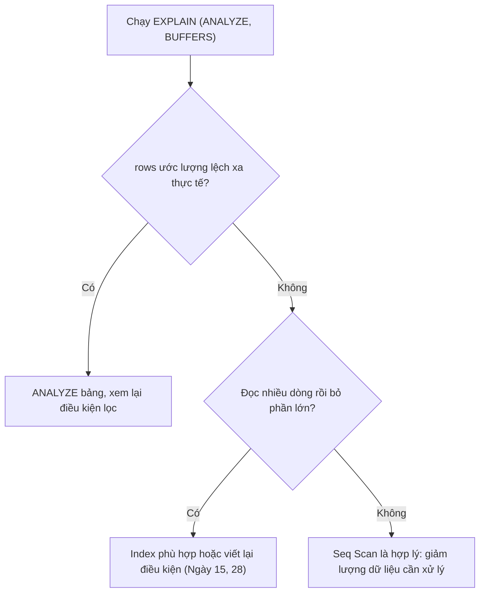

# Ngày 20: Đọc kế hoạch thực thi với EXPLAIN

> **Tóm tắt:** Trước khi chạy một câu SQL, PostgreSQL lập một kế hoạch thực thi (plan): đọc bảng bằng cách nào, nối bảng theo thuật toán nào, sắp xếp ra sao. Bài này dạy cách đọc plan bằng `EXPLAIN`, `EXPLAIN ANALYZE` và `BUFFERS`, nhận ra các kiểu scan, kiểu join, Sort, và hiểu vì sao thống kê (`ANALYZE`) quyết định plan tốt hay tệ.

**Sau bài này bạn có thể:**

- Đọc được `cost`, `rows`, `width`, `actual time`, `loops`, `Rows Removed by Filter`, `Buffers` trong một plan.
- Phân biệt Seq Scan, Index Scan, Index Only Scan, Bitmap Heap Scan và biết khi nào mỗi loại được chọn.
- Nhận ra Nested Loop, Hash Join, Merge Join và đọc một cây plan nhiều tầng từ dưới lên.
- So sánh số dòng ước lượng với thực tế để phát hiện thống kê sai, và sửa bằng `ANALYZE`.
- Dùng `EXPLAIN ANALYZE` an toàn với `UPDATE`/`DELETE`.

**Cần biết trước:** [Ngày 9](09-group-by-having.md), [Ngày 10](10-join.md), [Ngày 15](15-index.md), [Ngày 16](16-transactions-acid.md).

## Planner và plan

Câu SQL chỉ nói bạn **muốn gì** ("tổng doanh thu theo thành phố"), không nói **làm thế nào**. Bộ lập kế hoạch (planner) của PostgreSQL liệt kê nhiều cách chạy có thể (đọc cả bảng hay dùng index, nối bảng bằng thuật toán nào, theo thứ tự nào), ước lượng chi phí từng cách dựa trên **thống kê** về dữ liệu, rồi chọn cách rẻ nhất. Cách được chọn gọi là **plan**.

Ngày 15 ta đã dùng `EXPLAIN ANALYZE` để xem truy vấn có dùng index không. Hôm nay ta học đọc từng con số trong đó, để tự trả lời câu hỏi "chậm ở đâu, vì sao".

Quy ước giống Ngày 15:

- Ví dụ chạy trên schema `perf` (100.000 khách, 1.000.000 đơn, xem [setup/README.md](../setup/README.md)), bắt đầu từ trạng thái chỉ có index của khóa chính. Ví dụ nào tạo index thì tự xóa ở cuối.
- Tắt chạy song song để plan gọn (mục [Chạy song song](#chạy-song-song-gather) giải thích nó):

```sql
SET max_parallel_workers_per_gather = 0;
```

- Thời gian là số đo thật trên máy tác giả (PostgreSQL 16 trong Docker). Máy bạn sẽ ra số khác; hãy so sánh kiểu plan, số dòng và cỡ chênh lệch.

## EXPLAIN: plan dự kiến

`EXPLAIN` chỉ lập plan, **không chạy** câu lệnh, nên luôn nhanh và an toàn.

```sql
EXPLAIN
SELECT * FROM perf.orders WHERE total_amount > 29000000;
```

```text
                          QUERY PLAN
---------------------------------------------------------------
 Seq Scan on orders  (cost=0.00..20697.00 rows=38838 width=31)
   Filter: (total_amount > '29000000'::numeric)
```

Mỗi dòng có tên thao tác là một **nút** (node) của plan. Trong ngoặc là ước lượng của planner:

| Phần | Ý nghĩa |
| --- | --- |
| `Seq Scan on orders` | Thao tác: đọc tuần tự cả bảng `orders` |
| `cost=0.00..20697.00` | Chi phí **khởi động** (trước khi trả được dòng đầu tiên) .. chi phí **tổng** (trả hết các dòng). Đơn vị là đơn vị tương đối, không phải mili giây |
| `rows=38838` | Số dòng **ước lượng** nút này trả ra |
| `width=31` | Độ rộng trung bình ước lượng của một dòng, tính bằng byte |
| `Filter: ...` | Điều kiện được kiểm tra trên từng dòng đọc lên |

Con số cost không phải phép màu. Với Seq Scan, PostgreSQL tính: số trang của bảng × `seq_page_cost` + số dòng × (`cpu_tuple_cost` + `cpu_operator_cost` cho mỗi phép so sánh).

```sql
SELECT relpages, reltuples
FROM pg_class
WHERE oid = 'perf.orders'::regclass;

SELECT name, setting
FROM pg_settings
WHERE name IN ('seq_page_cost', 'cpu_tuple_cost', 'cpu_operator_cost');
```

| relpages | reltuples |
| --- | --- |
| 8197 | 1e+06 |

| name | setting |
| --- | --- |
| cpu_operator_cost | 0.0025 |
| cpu_tuple_cost | 0.01 |
| seq_page_cost | 1 |

8197 × 1 + 1.000.000 × (0,01 + 0,0025) = 8197 + 12500 = **20697**, đúng con số trong plan. Bảng nằm trên 8197 trang (mỗi trang 8 kB).

Vì cost là đơn vị tương đối, chỉ nên dùng nó để so sánh các plan **của cùng một câu truy vấn**, không so sánh cost của hai câu khác nhau.

## EXPLAIN ANALYZE: chạy thật và đo

Thêm `ANALYZE` thì PostgreSQL **chạy thật** câu lệnh, rồi in plan kèm số đo thực tế:

```sql
EXPLAIN ANALYZE
SELECT * FROM perf.orders WHERE total_amount > 29000000;
```

```text
                                                  QUERY PLAN
--------------------------------------------------------------------------------------------------------------
 Seq Scan on orders  (cost=0.00..20697.00 rows=38838 width=31) (actual time=0.023..78.909 rows=36473 loops=1)
   Filter: (total_amount > '29000000'::numeric)
   Rows Removed by Filter: 963527
 Planning Time: 0.039 ms
 Execution Time: 79.980 ms
```

| Phần | Ý nghĩa |
| --- | --- |
| `actual time=0.023..78.909` | Thời gian thật (ms) tới khi nút trả dòng **đầu tiên** .. trả xong **dòng cuối** |
| `rows=36473` (trong ngoặc thứ hai) | Số dòng **thực tế** nút trả ra. So với ước lượng 38838: rất sát |
| `loops=1` | Nút được chạy bao nhiêu lần. Khi `loops` > 1, `actual time` và `rows` là **trung bình mỗi lần**, phải nhân với `loops` để ra tổng |
| `Rows Removed by Filter: 963527` | Số dòng đã đọc nhưng bị điều kiện loại bỏ. Con số này lớn so với số dòng giữ lại là dấu hiệu đang đọc thừa |
| `Planning Time` | Thời gian lập plan |
| `Execution Time` | Thời gian chạy trong server, **không gồm** thời gian gửi kết quả qua mạng về máy bạn |

### BUFFERS: đọc bao nhiêu trang

Thời gian dao động theo tải của máy, còn số trang dữ liệu phải đọc thì ổn định hơn. Thêm `BUFFERS`:

```sql
EXPLAIN (ANALYZE, BUFFERS)
SELECT * FROM perf.orders WHERE total_amount > 29000000;
```

```text
 Seq Scan on orders  (cost=0.00..20697.00 rows=38838 width=31) (actual time=0.019..67.731 rows=36473 loops=1)
   Filter: (total_amount > '29000000'::numeric)
   Rows Removed by Filter: 963527
   Buffers: shared hit=6132 read=2065
 Planning Time: 0.098 ms
 Execution Time: 68.961 ms
```

- `shared hit=6132`: số trang tìm thấy sẵn trong bộ nhớ đệm (shared buffers) của PostgreSQL.
- `read=2065`: số trang phải đọc từ hệ điều hành (có thể từ đĩa, có thể từ cache của hệ điều hành).

6132 + 2065 = 8197, đúng bằng số trang của bảng: Seq Scan đọc mọi trang. Chạy lại lần nữa, tỷ lệ hit/read thay đổi tùy bộ nhớ đệm đang chứa gì, nhưng tổng vẫn là 8197. Lần chạy đầu tiên thường chậm hơn các lần sau vì dữ liệu chưa nằm trong bộ nhớ ("cache lạnh"), nên khi so sánh hãy chạy vài lần.

## Các kiểu đọc bảng (scan)

**Seq Scan** bạn đã thấy ở trên: đọc mọi trang, kiểm tra mọi dòng. Rẻ nhất khi cần phần lớn bảng hoặc bảng nhỏ.

**Index Scan**: đi theo index tới từng dòng khớp, rồi đọc dòng đó trong bảng. Tốt khi lấy ít dòng.

```sql
EXPLAIN ANALYZE
SELECT * FROM perf.orders WHERE order_id = 123456;
```

```text
 Index Scan using orders_pkey on orders  (cost=0.42..8.44 rows=1 width=31) (actual time=0.551..0.553 rows=1 loops=1)
   Index Cond: (order_id = 123456)
 Planning Time: 0.140 ms
 Execution Time: 0.566 ms
```

`Index Cond` là điều kiện được dùng để **tra index** (khác với `Filter` là điều kiện kiểm tra sau khi đã đọc dòng).

**Index Only Scan**: nếu mọi cột cần lấy đều có sẵn trong index, PostgreSQL không cần đọc bảng nữa.

```sql
EXPLAIN ANALYZE
SELECT order_id FROM perf.orders WHERE order_id BETWEEN 1000 AND 1100;
```

```text
 Index Only Scan using orders_pkey on orders  (cost=0.42..6.49 rows=103 width=4) (actual time=0.008..0.018 rows=101 loops=1)
   Index Cond: ((order_id >= 1000) AND (order_id <= 1100))
   Heap Fetches: 0
 Planning Time: 0.133 ms
 Execution Time: 0.027 ms
```

`Heap Fetches: 0` nghĩa là không phải mở bảng lần nào. PostgreSQL chỉ bỏ qua được bảng với những trang đã được `VACUUM` đánh dấu "mọi dòng đều nhìn thấy được"; nếu bạn vừa nạp dữ liệu xong, `Heap Fetches` có thể lớn hơn 0 cho tới khi autovacuum (tiến trình dọn dẹp tự động) chạy, hoặc bạn tự chạy `VACUUM perf.orders;`.

**Bitmap Heap Scan**: khi số dòng khớp ở mức vừa phải, PostgreSQL tra index trước để lấy **danh sách vị trí** (một "bitmap" các trang cần đọc), sắp theo thứ tự trang, rồi mới đọc bảng. Nhờ vậy mỗi trang chỉ đọc một lần, theo thứ tự, thay vì nhảy qua lại.

```sql
CREATE INDEX idx_orders_order_date ON perf.orders (order_date);

EXPLAIN ANALYZE
SELECT * FROM perf.orders WHERE order_date >= '2026-10-01';

DROP INDEX perf.idx_orders_order_date;
```

```text
 Bitmap Heap Scan on orders  (cost=148.94..8657.12 rows=7808 width=31) (actual time=3.063..33.207 rows=7874 loops=1)
   Recheck Cond: (order_date >= '2026-10-01 00:00:00+07'::timestamp with time zone)
   Heap Blocks: exact=5093
   ->  Bitmap Index Scan on idx_orders_order_date  (cost=0.00..146.99 rows=7808 width=0) (actual time=2.435..2.436 rows=7874 loops=1)
         Index Cond: (order_date >= '2026-10-01 00:00:00+07'::timestamp with time zone)
 Planning Time: 0.331 ms
 Execution Time: 33.503 ms
```

Đây là plan hai tầng: dòng bắt đầu bằng `->` là nút con. `Bitmap Index Scan` (con) chạy trước, đưa danh sách vị trí lên `Bitmap Heap Scan` (cha). `Heap Blocks: exact=5093`: 7874 dòng nằm rải trên 5093 trang. `Recheck Cond` là điều kiện kiểm tra lại trên dòng thật.

| Kiểu scan | Đọc gì | Thường được chọn khi |
| --- | --- | --- |
| Seq Scan | Mọi trang của bảng | Lấy phần lớn bảng, bảng nhỏ, hoặc không có index phù hợp |
| Index Scan | Index rồi từng dòng khớp | Lấy rất ít dòng, hoặc cần thứ tự của index (`ORDER BY ... LIMIT`) |
| Index Only Scan | Chỉ index | Mọi cột cần đều nằm trong index |
| Bitmap Heap Scan | Index, rồi các trang chứa dòng khớp theo thứ tự trang | Số dòng khớp vừa phải; hoặc kết hợp nhiều index |

## Đọc một cây plan

Truy vấn thật thường có nhiều nút lồng nhau. Ví dụ: doanh thu năm 2026 (đơn đã giao) theo thành phố của khách.

```sql
EXPLAIN ANALYZE
SELECT c.city, SUM(o.total_amount) AS doanh_thu
FROM perf.orders o
JOIN perf.customers c ON c.customer_id = o.customer_id
WHERE o.order_date >= '2026-01-01' AND o.status = 'delivered'
GROUP BY c.city
ORDER BY doanh_thu DESC;
```

```text
                                                                QUERY PLAN
-------------------------------------------------------------------------------------------------------------------------------------------
 Sort  (cost=27922.59..27922.61 rows=10 width=43) (actual time=108.040..108.043 rows=10 loops=1)
   Sort Key: (sum(o.total_amount)) DESC
   Sort Method: quicksort  Memory: 25kB
   ->  HashAggregate  (cost=27922.30..27922.42 rows=10 width=43) (actual time=108.018..108.022 rows=10 loops=1)
         Group Key: c.city
         Batches: 1  Memory Usage: 24kB
         ->  Hash Join  (cost=3411.00..27060.48 rows=172364 width=17) (actual time=16.928..87.932 rows=174865 loops=1)
               Hash Cond: (o.customer_id = c.customer_id)
               ->  Seq Scan on orders o  (cost=0.00..23197.00 rows=172364 width=10) (actual time=0.013..41.553 rows=174865 loops=1)
                     Filter: ((order_date >= '2026-01-01 00:00:00+07'::timestamp with time zone) AND ((status)::text = 'delivered'::text))
                     Rows Removed by Filter: 825135
               ->  Hash  (cost=2161.00..2161.00 rows=100000 width=15) (actual time=16.369..16.370 rows=100000 loops=1)
                     Buckets: 131072  Batches: 1  Memory Usage: 5790kB
                     ->  Seq Scan on customers c  (cost=0.00..2161.00 rows=100000 width=15) (actual time=0.003..6.140 rows=100000 loops=1)
 Planning Time: 0.481 ms
 Execution Time: 108.169 ms
```

![Cây plan của truy vấn doanh thu 2026 theo thành phố, vẽ thành sáu nút. Nút 1 Seq Scan on customers c trả 100.000 dòng (ước lượng 100000, thực tế 100000, xong sau 6,1 ms) lên nút 2 Hash, nơi dựng bảng băm 5790kB (xong 16,4 ms). Nút 3 Seq Scan on orders o, được tô nổi bật, đọc 1 triệu đơn, bỏ 825135 dòng, giữ 174865 (ước lượng 172364), xong sau 41,6 ms. Hai nhánh đi lên nút 4 Hash Join (xong 87,9 ms), trả 174.865 dòng lên nút 5 HashAggregate gom theo c.city còn 10 nhóm, rồi nút 6 Sort sắp theo doanh_thu giảm dần, cả cây xong sau 108,0 ms. Bên phải là ba ghi chú cách đọc: đọc từ dưới lên, từ trong ra; so sánh rows ước lượng với thực tế; thời gian của nút cha đã gồm nút con, nên tìm nút làm thời gian tăng vọt.](img/cach-doc-cay-plan.png#gh-light-mode-only)
![Cây plan của truy vấn doanh thu 2026 theo thành phố, vẽ thành sáu nút. Nút 1 Seq Scan on customers c trả 100.000 dòng (ước lượng 100000, thực tế 100000, xong sau 6,1 ms) lên nút 2 Hash, nơi dựng bảng băm 5790kB (xong 16,4 ms). Nút 3 Seq Scan on orders o, được tô nổi bật, đọc 1 triệu đơn, bỏ 825135 dòng, giữ 174865 (ước lượng 172364), xong sau 41,6 ms. Hai nhánh đi lên nút 4 Hash Join (xong 87,9 ms), trả 174.865 dòng lên nút 5 HashAggregate gom theo c.city còn 10 nhóm, rồi nút 6 Sort sắp theo doanh_thu giảm dần, cả cây xong sau 108,0 ms. Bên phải là ba ghi chú cách đọc: đọc từ dưới lên, từ trong ra; so sánh rows ước lượng với thực tế; thời gian của nút cha đã gồm nút con, nên tìm nút làm thời gian tăng vọt.](img/cach-doc-cay-plan-dark.png#gh-dark-mode-only)

<small>File gốc: [nền sáng](../diagrams/query-performance/cach-doc-cay-plan.html) · [nền tối](../diagrams/query-performance/cach-doc-cay-plan-dark.html)</small>

Cách đọc:

1. **Từ dưới lên, từ trong ra.** Nút thụt lề sâu nhất chạy trước và đưa dữ liệu lên nút cha (dòng có `->` ngay phía trên, thụt lề ít hơn). Ở đây: đọc `customers`, dựng bảng băm (`Hash`); đọc `orders` và lọc; nối hai bên (`Hash Join`); gom nhóm (`HashAggregate`); sắp xếp (`Sort`).
2. **So sánh rows ước lượng với thực tế** ở từng nút. Ở đây rất sát (172.364 so với 174.865), nghĩa là thống kê tốt.
3. **Thời gian cộng dồn lên trên.** `actual time` của nút cha đã gồm thời gian của các nút con. Muốn biết nút nào tốn, nhìn chỗ thời gian **tăng vọt** giữa con và cha: Seq Scan on orders xong lúc 41,6 ms, Hash Join xong lúc 87,9 ms (thêm khoảng 46 ms để dò bảng băm cho 174.865 dòng), HashAggregate xong lúc 108,0 ms (thêm khoảng 20 ms để cộng dồn). Sort trên 10 dòng gần như không tốn gì.

Plan này đọc cả hai bảng và đó là hợp lý: truy vấn cần 17% số đơn và mọi khách.

## Ba thuật toán nối bảng

PostgreSQL có ba cách thực hiện một phép JOIN.

### Nested Loop

Với **mỗi dòng** của bảng ngoài (nút con thứ nhất), tìm các dòng khớp ở bảng trong (nút con thứ hai). Rất nhanh khi bảng ngoài ít dòng và bảng trong có index trên cột nối; rất chậm nếu bảng trong phải quét toàn bộ cho mỗi dòng.

Lấy đơn của 3 khách đầu tiên. Khi `orders.customer_id` chưa có index, planner không dùng Nested Loop mà chọn Hash Join, phải đọc cả triệu đơn:

```sql
EXPLAIN ANALYZE
SELECT c.full_name, o.order_id, o.total_amount
FROM perf.customers c
JOIN perf.orders o ON o.customer_id = c.customer_id
WHERE c.customer_id BETWEEN 1 AND 3;
```

```text
 Hash Join  (cost=8.39..20830.50 rows=30 width=28) (actual time=1.036..72.026 rows=34 loops=1)
   Hash Cond: (o.customer_id = c.customer_id)
   ->  Seq Scan on orders o  (cost=0.00..18197.00 rows=1000000 width=14) (actual time=0.003..36.825 rows=1000000 loops=1)
   ->  Hash  (cost=8.35..8.35 rows=3 width=22) (actual time=0.006..0.007 rows=3 loops=1)
         Buckets: 1024  Batches: 1  Memory Usage: 9kB
         ->  Index Scan using customers_pkey on customers c  (cost=0.29..8.35 rows=3 width=22) (actual time=0.003..0.004 rows=3 loops=1)
               Index Cond: ((customer_id >= 1) AND (customer_id <= 3))
 Planning Time: 0.134 ms
 Execution Time: 72.047 ms
```

Có index cho cột nối thì Nested Loop trở nên rẻ:

```sql
CREATE INDEX idx_orders_customer_id ON perf.orders (customer_id);

EXPLAIN ANALYZE
SELECT c.full_name, o.order_id, o.total_amount
FROM perf.customers c
JOIN perf.orders o ON o.customer_id = c.customer_id
WHERE c.customer_id BETWEEN 1 AND 3;
```

```text
 Nested Loop  (cost=4.80..151.00 rows=30 width=28) (actual time=0.055..0.123 rows=34 loops=1)
   ->  Index Scan using customers_pkey on customers c  (cost=0.29..8.35 rows=3 width=22) (actual time=0.004..0.005 rows=3 loops=1)
         Index Cond: ((customer_id >= 1) AND (customer_id <= 3))
   ->  Bitmap Heap Scan on orders o  (cost=4.51..47.44 rows=11 width=14) (actual time=0.019..0.037 rows=11 loops=3)
         Recheck Cond: (c.customer_id = customer_id)
         Heap Blocks: exact=34
         ->  Bitmap Index Scan on idx_orders_customer_id  (cost=0.00..4.51 rows=11 width=0) (actual time=0.002..0.002 rows=11 loops=3)
               Index Cond: (customer_id = c.customer_id)
 Planning Time: 0.252 ms
 Execution Time: 0.140 ms
```

Để ý `loops=3` ở nhánh `orders`: nhánh trong chạy 3 lần, mỗi khách một lần. `rows=11` là trung bình mỗi lần; tổng thực tế khoảng 3 × 11 = 33 dòng (chính xác là 34, vì 11 là số đã làm tròn). Tương tự, thời gian thật của nhánh này là khoảng 3 × 0,037 ms.

### Hash Join

Đọc bảng nhỏ hơn, dựng **bảng băm** (hash table) trong bộ nhớ theo cột nối (nút `Hash`), rồi đọc bảng còn lại và với mỗi dòng tra bảng băm. Mỗi bảng chỉ đọc một lần. Đây là lựa chọn thường gặp khi nối hai tập lớn bằng điều kiện `=`, như ở mục [Đọc một cây plan](#đọc-một-cây-plan). Bảng băm cần bộ nhớ (`Memory Usage: 5790kB`); nếu vượt giới hạn `work_mem` thì phải chia nhiều lượt (`Batches` lớn hơn 1) và chậm đi.

### Merge Join

Nếu cả hai bên đã **được sắp xếp** theo cột nối (ví dụ đọc theo thứ tự của index), PostgreSQL chỉ cần đi song song hai danh sách như trộn hai bộ bài đã xếp. Index `idx_orders_customer_id` vẫn còn từ ví dụ trên:

```sql
EXPLAIN ANALYZE
SELECT c.customer_id, c.city, COUNT(*) AS so_don
FROM perf.customers c
JOIN perf.orders o ON o.customer_id = c.customer_id
GROUP BY c.customer_id;

DROP INDEX perf.idx_orders_customer_id;
```

```text
 GroupAggregate  (cost=0.94..42062.06 rows=100000 width=23) (actual time=0.013..172.204 rows=99993 loops=1)
   Group Key: c.customer_id
   ->  Merge Join  (cost=0.94..36062.06 rows=1000000 width=15) (actual time=0.008..126.045 rows=1000000 loops=1)
         Merge Cond: (c.customer_id = o.customer_id)
         ->  Index Scan using customers_pkey on customers c  (cost=0.29..3768.29 rows=100000 width=15) (actual time=0.002..23.751 rows=100000 loops=1)
         ->  Index Only Scan using idx_orders_customer_id on orders o  (cost=0.42..19544.42 rows=1000000 width=4) (actual time=0.003..42.101 rows=1000000 loops=1)
               Heap Fetches: 0
 Planning Time: 0.076 ms
 Execution Time: 174.253 ms
```

Cả hai bên được đọc theo thứ tự `customer_id` của index, nên nối bằng Merge Join, và dữ liệu ra đã sắp sẵn theo `customer_id` nên gom nhóm bằng `GroupAggregate` (gom các dòng liền nhau) thay vì `HashAggregate` (gom bằng bảng băm). Kết quả có 99.993 nhóm: 7 khách chưa từng đặt đơn bị JOIN loại ra.

| Thuật toán | Cách làm | Hợp khi |
| --- | --- | --- |
| Nested Loop | Mỗi dòng bên ngoài, tìm khớp bên trong | Bên ngoài ít dòng, bên trong có index trên cột nối |
| Hash Join | Dựng bảng băm từ một bên, dò bằng bên kia | Hai tập lớn, điều kiện `=`, đủ bộ nhớ |
| Merge Join | Trộn hai danh sách đã sắp xếp | Hai bên đã sắp theo cột nối (có index) hoặc đằng nào cũng cần sắp |

## Sort và LIMIT

Sắp xếp cả triệu dòng:

```sql
EXPLAIN ANALYZE
SELECT order_id, total_amount
FROM perf.orders
ORDER BY total_amount DESC;
```

```text
 Sort  (cost=134945.34..137445.34 rows=1000000 width=10) (actual time=361.391..418.090 rows=1000000 loops=1)
   Sort Key: total_amount DESC
   Sort Method: external merge  Disk: 20368kB
   ->  Seq Scan on orders  (cost=0.00..18197.00 rows=1000000 width=10) (actual time=2.450..52.968 rows=1000000 loops=1)
 Planning Time: 0.197 ms
 JIT:
   Functions: 2
   Options: Inlining false, Optimization false, Expressions true, Deforming true
   Timing: Generation 0.096 ms, Inlining 0.000 ms, Optimization 0.138 ms, Emission 2.291 ms, Total 2.526 ms
 Execution Time: 452.109 ms
```

- `Sort Method: external merge  Disk: 20368kB`: dữ liệu cần sắp lớn hơn bộ nhớ cho phép (`work_mem`, mặc định 4MB), nên PostgreSQL ghi tạm ra đĩa khoảng 20 MB rồi trộn lại.
- Phần `JIT`: với truy vấn có cost lớn, PostgreSQL biên dịch một số biểu thức thành mã máy (Just-In-Time) để chạy nhanh hơn. Ở đây nó chỉ tốn khoảng 2,5 ms, bạn có thể bỏ qua.

Chỉ lấy 10 đơn lớn nhất:

```sql
EXPLAIN ANALYZE
SELECT order_id, total_amount
FROM perf.orders
ORDER BY total_amount DESC
LIMIT 10;
```

```text
 Limit  (cost=39806.64..39806.67 rows=10 width=10) (actual time=103.159..103.161 rows=10 loops=1)
   ->  Sort  (cost=39806.64..42306.64 rows=1000000 width=10) (actual time=103.157..103.158 rows=10 loops=1)
         Sort Key: total_amount DESC
         Sort Method: top-N heapsort  Memory: 25kB
         ->  Seq Scan on orders  (cost=0.00..18197.00 rows=1000000 width=10) (actual time=0.006..46.890 rows=1000000 loops=1)
 Planning Time: 0.070 ms
 Execution Time: 103.175 ms
```

Với `LIMIT 10`, PostgreSQL chỉ giữ 10 giá trị lớn nhất trong lúc đọc (`top-N heapsort`, 25 kB bộ nhớ), không cần sắp cả triệu dòng. Vẫn phải đọc hết bảng; muốn khỏi đọc hết thì cần index trên `total_amount` (bài tập 3 làm điều tương tự với `order_date`).

Tăng `work_mem` thì Sort chạy trong bộ nhớ:

```sql
SET work_mem = '128MB';

EXPLAIN ANALYZE
SELECT order_id, total_amount
FROM perf.orders
ORDER BY total_amount DESC;

RESET work_mem;
```

```text
 Sort  (cost=117854.84..120354.84 rows=1000000 width=10) (actual time=360.823..514.481 rows=1000000 loops=1)
   Sort Key: total_amount DESC
   Sort Method: quicksort  Memory: 63639kB
   ->  Seq Scan on orders  (cost=0.00..18197.00 rows=1000000 width=10) (actual time=1.154..50.508 rows=1000000 loops=1)
 Planning Time: 0.043 ms
 JIT:
   Functions: 2
   Options: Inlining false, Optimization false, Expressions true, Deforming true
   Timing: Generation 0.107 ms, Inlining 0.000 ms, Optimization 0.119 ms, Emission 1.028 ms, Total 1.254 ms
 Execution Time: 535.059 ms
```

`Sort Method` đổi thành `quicksort`, dùng 62 MB RAM, nhưng trên máy tác giả lần này **không nhanh hơn** (535 ms so với 452 ms). Thao tác ghi tạm 20 MB ra đĩa rẻ hơn ta tưởng vì hệ điều hành đệm nó trong RAM. Bài học: đừng đoán, hãy đo. Và đừng tăng `work_mem` của cả server tùy tiện: mỗi phép Sort/Hash của mỗi kết nối đều có thể dùng tới mức đó.

## Chạy song song (Gather)

Từ đầu bài ta tắt chạy song song. Bật lại về mặc định:

```sql
RESET max_parallel_workers_per_gather;

EXPLAIN ANALYZE
SELECT * FROM perf.orders WHERE total_amount > 29000000;
```

```text
 Gather  (cost=1000.00..18289.13 rows=38838 width=31) (actual time=0.263..29.862 rows=36473 loops=1)
   Workers Planned: 2
   Workers Launched: 2
   ->  Parallel Seq Scan on orders  (cost=0.00..13405.33 rows=16182 width=31) (actual time=0.009..17.440 rows=12158 loops=3)
         Filter: (total_amount > '29000000'::numeric)
         Rows Removed by Filter: 321176
 Planning Time: 0.076 ms
 Execution Time: 30.591 ms
```

PostgreSQL chia bảng cho 2 tiến trình phụ (worker) cùng với tiến trình chính, tổng cộng 3 tiến trình cùng quét (`loops=3`), mỗi tiến trình trả khoảng 12.158 dòng; nút `Gather` gom kết quả lại. Truy vấn nhanh hơn (khoảng 30 ms so với 68-80 ms khi chạy một mình), đổi lại tốn nhiều CPU hơn. Nhớ: với nút `Parallel ...`, `rows` là **trung bình mỗi tiến trình**.

Phần còn lại của bài vẫn tắt chạy song song:

```sql
SET max_parallel_workers_per_gather = 0;
```

## Thống kê và ANALYZE

Planner không đếm dữ liệu mỗi lần lập plan. Nó dựa vào **thống kê** lưu sẵn: số dòng, số trang, số giá trị khác nhau của từng cột, các giá trị phổ biến nhất và tần suất của chúng, phân bố giá trị. Lệnh `ANALYZE` lấy mẫu bảng để cập nhật các thống kê này; tiến trình autovacuum cũng tự chạy `ANALYZE` khi bảng thay đổi đủ nhiều.

Xem thống kê của cột `status`:

```sql
SELECT attname, n_distinct, most_common_vals, most_common_freqs
FROM pg_stats
WHERE schemaname = 'perf' AND tablename = 'orders' AND attname = 'status';
```

| attname | n_distinct | most_common_vals | most_common_freqs |
| --- | --- | --- | --- |
| status | 5 | {delivered,cancelled,shipped,paid,pending} | {0.84826666,0.0819,0.040466666,0.019733334,0.009633333} |

Nhờ đó planner biết `status = 'delivered'` khớp khoảng 84,8% bảng (đó là lý do ở Ngày 15 nó không dùng index cho giá trị này). Các tần suất là ước lượng từ mẫu, nên hơi khác số đếm thật (849.692 dòng, tức 84,97%).

### Khi thống kê sai

Tạo một bảng mới, chép đơn năm 2026 vào, và tắt autovacuum trên bảng này để mô phỏng tình huống vừa nạp dữ liệu mà chưa ai chạy `ANALYZE`:

```sql
DROP TABLE IF EXISTS perf.orders_2026;
CREATE TABLE perf.orders_2026 (LIKE perf.orders)
    WITH (autovacuum_enabled = false);   -- tắt tự động ANALYZE để thấy rõ hiện tượng
CREATE INDEX ON perf.orders_2026 (status);
INSERT INTO perf.orders_2026
SELECT * FROM perf.orders WHERE order_date >= '2026-01-01';

EXPLAIN ANALYZE
SELECT * FROM perf.orders_2026 WHERE status = 'delivered';
```

```text
 Bitmap Heap Scan on orders_2026  (cost=8.81..1196.86 rows=583 width=90) (actual time=4.130..26.575 rows=174865 loops=1)
   Recheck Cond: ((status)::text = 'delivered'::text)
   Heap Blocks: exact=1689
   ->  Bitmap Index Scan on orders_2026_status_idx  (cost=0.00..8.66 rows=583 width=0) (actual time=3.823..3.824 rows=174865 loops=1)
         Index Cond: ((status)::text = 'delivered'::text)
 Planning Time: 0.095 ms
 Execution Time: 34.887 ms
```

Không có thống kê, planner đoán chỉ 583 dòng khớp, thực tế là 174.865 (lệch 300 lần), nên chọn dùng index. Cập nhật thống kê rồi chạy lại:

```sql
ANALYZE perf.orders_2026;

EXPLAIN ANALYZE
SELECT * FROM perf.orders_2026 WHERE status = 'delivered';

DROP TABLE perf.orders_2026;
```

```text
 Seq Scan on orders_2026  (cost=0.00..4263.55 rows=174699 width=31) (actual time=0.012..25.528 rows=174865 loops=1)
   Filter: ((status)::text = 'delivered'::text)
   Rows Removed by Filter: 31099
 Planning Time: 0.173 ms
 Execution Time: 34.542 ms
```

Ước lượng bây giờ là 174.699, gần đúng, và planner đổi sang Seq Scan. Trên bảng nhỏ này hai plan nhanh ngang nhau, nhưng với truy vấn nhiều bảng, một ước lượng sai 300 lần ở nút dưới có thể khiến planner chọn Nested Loop cho hàng trăm nghìn dòng và chậm đi hàng trăm lần. Vì vậy, **ước lượng lệch xa thực tế là thứ đầu tiên cần tìm** khi đọc một plan chậm.

Các bảng của schema `shop` cũng là ví dụ. Mỗi bảng chỉ vài chục dòng, chưa đủ để autovacuum tự chạy `ANALYZE` (ngưỡng mặc định là 50 dòng thay đổi cộng 10% kích thước bảng). Sau khi chạy script init, chúng chưa có thống kê (`reltuples = -1`), và planner giả định bảng lớn hơn thực tế nhiều:

```sql
EXPLAIN
SELECT * FROM orders WHERE customer_id = 3;
```

```text
 Index Scan using orders_customer_id_idx on orders  (cost=0.14..8.16 rows=1 width=366)
   Index Cond: (customer_id = 3)
```

Sau `ANALYZE orders;` thì planner biết bảng chỉ có 40 dòng trong 1 trang và chuyển sang Seq Scan, như bạn đã thấy ở [Ngày 15](15-index.md#độ-chọn-lọc-khi-index-không-được-dùng). Sau khi nạp hoặc thay đổi nhiều dữ liệu, hãy chạy `ANALYZE ten_bang;`.

## EXPLAIN ANALYZE với UPDATE và DELETE

`EXPLAIN ANALYZE` **chạy thật** câu lệnh. Với `UPDATE`, `DELETE`, `INSERT`, dữ liệu sẽ bị thay đổi thật. Muốn đo mà không đổi dữ liệu, bọc trong transaction và `ROLLBACK`:

```sql
BEGIN;
EXPLAIN ANALYZE
UPDATE perf.orders SET status = 'cancelled' WHERE order_id = 123456;
ROLLBACK;

SELECT status FROM perf.orders WHERE order_id = 123456;
```

```text
 Update on orders  (cost=0.42..8.44 rows=0 width=0) (actual time=1.119..1.120 rows=0 loops=1)
   ->  Index Scan using orders_pkey on orders  (cost=0.42..8.44 rows=1 width=64) (actual time=0.016..0.018 rows=1 loops=1)
         Index Cond: (order_id = 123456)
 Planning Time: 0.060 ms
 Execution Time: 1.201 ms
```

| status |
| --- |
| delivered |

Đơn 123456 vẫn là `delivered`: thay đổi đã bị hoàn tác.

## Quy trình chẩn đoán một truy vấn chậm



Thấy Seq Scan **không** có nghĩa là phải thêm index. Câu hỏi đúng là: nút nào chiếm thời gian, nó đọc bao nhiêu dòng để giữ lại bao nhiêu, và ước lượng có đúng không. Ngày 28 sẽ dùng plan để tối ưu từng kiểu truy vấn cụ thể.

> **Ghi chú dialect:** `EXPLAIN ANALYZE` với định dạng như trên là của PostgreSQL. MySQL có `EXPLAIN` (dạng bảng) và `EXPLAIN ANALYZE` từ bản 8.0.18 (dạng cây, các con số khác). SQL Server không có `EXPLAIN`: dùng "Display Estimated/Actual Execution Plan" trong SSMS, hoặc `SET STATISTICS IO ON; SET STATISTICS TIME ON;` để xem số trang đọc và thời gian. SQLite có `EXPLAIN QUERY PLAN`.

## Lỗi thường gặp

**1. Thấy Seq Scan là thêm index.** Seq Scan là đúng khi cần phần lớn bảng hoặc bảng nhỏ. Hãy xem `Rows Removed by Filter` so với số dòng giữ lại trước khi kết luận.

**2. So sánh cost giữa hai câu truy vấn khác nhau.** Cost là đơn vị tương đối của một lần lập plan. Muốn so sánh hai cách viết, dùng `EXPLAIN ANALYZE` và so `Execution Time` (chạy vài lần) cùng `Buffers`.

**3. Quên nhân với `loops`.** Nút có `actual time=0.019..0.037 rows=11 loops=3` thực chất trả khoảng 33 dòng và tốn khoảng 0,11 ms, không phải 0,037 ms. Với nút chạy hàng nghìn lần, sai số này rất lớn.

**4. Chạy `EXPLAIN ANALYZE` với `DELETE`/`UPDATE` ngoài transaction.** Dữ liệu bị đổi thật.

```sql
-- Sai: đơn bị xóa thật
-- EXPLAIN ANALYZE DELETE FROM perf.orders WHERE status = 'pending';
-- Đúng:
BEGIN;
EXPLAIN ANALYZE DELETE FROM perf.orders WHERE status = 'pending';
ROLLBACK;
```

**5. Đo một lần duy nhất.** Lần đầu chạy dữ liệu có thể chưa nằm trong bộ nhớ; máy có thể đang bận việc khác. Chạy vài lần, nhìn thêm `Buffers`.

**6. Tin `Execution Time` là thời gian người dùng chờ.** Nó không gồm thời gian truyền kết quả qua mạng và thời gian ứng dụng xử lý. Câu trả 1 triệu dòng có thể chạy 400 ms trong server nhưng mất vài giây mới tới ứng dụng.

## Bài tập

Chạy trên schema `perf` từ trạng thái chỉ có khóa chính, với `SET max_parallel_workers_per_gather = 0;`. Thời gian trên máy bạn sẽ khác đáp án.

### Cơ bản

**Bài 1.** Chạy `EXPLAIN (ANALYZE, BUFFERS)` cho câu tìm khách ở `'Đà Nẵng'` trong `perf.customers`. Trả lời: kiểu scan là gì? Ước lượng bao nhiêu dòng, thực tế bao nhiêu? Bao nhiêu dòng bị loại? Bảng có bao nhiêu trang?

<details>
<summary>Đáp án</summary>

```sql
EXPLAIN (ANALYZE, BUFFERS)
SELECT * FROM perf.customers WHERE city = 'Đà Nẵng';
```

Kết quả:

```text
 Seq Scan on customers  (cost=0.00..2411.00 rows=10133 width=62) (actual time=0.011..13.438 rows=10046 loops=1)
   Filter: ((city)::text = 'Đà Nẵng'::text)
   Rows Removed by Filter: 89954
   Buffers: shared hit=1161
 Planning:
   Buffers: shared hit=72
 Planning Time: 0.582 ms
 Execution Time: 14.144 ms
```

Seq Scan; ước lượng 10.133 dòng, thực tế 10.046; loại 89.954 dòng; bảng có 1161 trang (`shared hit=1161`, mọi trang đều đã nằm trong bộ nhớ đệm). Phần `Planning: Buffers` là số trang planner đọc (từ bảng hệ thống) khi lập plan.

</details>

**Bài 2.** `EXPLAIN SELECT * FROM perf.customers;` cho cost tổng là bao nhiêu? Tự tính lại con số đó từ `relpages`, `reltuples` của bảng. Vì sao cost ở bài 1 (có `WHERE`) lại cao hơn?

<details>
<summary>Đáp án</summary>

```sql
SELECT relpages, reltuples FROM pg_class WHERE oid = 'perf.customers'::regclass;

EXPLAIN SELECT * FROM perf.customers;
```

Kết quả:

| relpages | reltuples |
| --- | --- |
| 1161 | 100000 |

```text
 Seq Scan on customers  (cost=0.00..2161.00 rows=100000 width=62)
```

1161 × 1 (`seq_page_cost`) + 100.000 × 0,01 (`cpu_tuple_cost`) = 2161. Bài 1 có thêm một phép so sánh trên mỗi dòng: + 100.000 × 0,0025 (`cpu_operator_cost`) = 2411. Điều kiện lọc không làm giảm số trang phải đọc, chỉ thêm việc kiểm tra.

</details>

### Vận dụng

**Bài 3.** Màn hình "20 đơn mới nhất" chạy câu dưới đây. Đọc plan khi chưa có index, rồi tạo index trên `order_date` và đọc lại. Giải thích vì sao plan thứ hai không cần nút `Sort`.

```sql
SELECT order_id, order_date, total_amount
FROM perf.orders
ORDER BY order_date DESC
LIMIT 20;
```

<details>
<summary>Đáp án</summary>

```sql
EXPLAIN ANALYZE
SELECT order_id, order_date, total_amount
FROM perf.orders
ORDER BY order_date DESC
LIMIT 20;

CREATE INDEX idx_orders_order_date ON perf.orders (order_date);

EXPLAIN ANALYZE
SELECT order_id, order_date, total_amount
FROM perf.orders
ORDER BY order_date DESC
LIMIT 20;

DROP INDEX perf.idx_orders_order_date;
```

Kết quả, trước:

```text
 Limit  (cost=44806.64..44806.69 rows=20 width=18) (actual time=255.356..255.363 rows=20 loops=1)
   ->  Sort  (cost=44806.64..47306.64 rows=1000000 width=18) (actual time=255.353..255.356 rows=20 loops=1)
         Sort Key: order_date DESC
         Sort Method: top-N heapsort  Memory: 27kB
         ->  Seq Scan on orders  (cost=0.00..18197.00 rows=1000000 width=18) (actual time=0.029..134.402 rows=1000000 loops=1)
 Planning Time: 0.202 ms
 Execution Time: 255.385 ms
```

Sau:

```text
 Limit  (cost=0.42..1.60 rows=20 width=18) (actual time=0.030..0.073 rows=20 loops=1)
   ->  Index Scan Backward using idx_orders_order_date on orders  (cost=0.42..58768.00 rows=1000000 width=18) (actual time=0.029..0.069 rows=20 loops=1)
 Planning Time: 0.258 ms
 Execution Time: 0.131 ms
```

Index đã lưu `order_date` theo thứ tự, nên đọc ngược từ cuối index là có ngay các đơn mới nhất; `Limit` dừng sau 20 dòng (`actual rows=20` ở nút Index Scan dù ước lượng cả 1.000.000). Không cần đọc cả bảng, không cần sắp xếp.

</details>

**Bài 4.** Hai câu sau trả cùng kết quả (36.473 dòng). Chạy `EXPLAIN ANALYZE` câu thứ hai và so sánh `rows` ước lượng với thực tế. Vì sao ước lượng lệch nhiều như vậy?

```sql
SELECT * FROM perf.orders WHERE total_amount > 29000000;
SELECT * FROM perf.orders WHERE total_amount / 1000 > 29000;
```

<details>
<summary>Đáp án</summary>

```sql
EXPLAIN ANALYZE
SELECT * FROM perf.orders WHERE total_amount / 1000 > 29000;
```

Kết quả:

```text
 Seq Scan on orders  (cost=0.00..23197.00 rows=333333 width=31) (actual time=0.025..236.536 rows=36473 loops=1)
   Filter: ((total_amount / '1000'::numeric) > '29000'::numeric)
   Rows Removed by Filter: 963527
 Planning Time: 0.115 ms
 Execution Time: 238.695 ms
```

Ước lượng 333.333 dòng (đúng 1/3 bảng), thực tế 36.473. Planner có thống kê cho cột `total_amount`, nhưng không có thống kê cho biểu thức `total_amount / 1000`, nên dùng tỷ lệ mặc định 1/3 cho phép so sánh `>`. Câu thứ nhất được ước lượng 38.838 dòng, sát hơn nhiều (mục [EXPLAIN ANALYZE](#explain-analyze-chạy-thật-và-đo)). Đây cũng là lý do nên viết điều kiện trên cột "trần", không bọc phép tính quanh cột (Ngày 28).

</details>

**Bài 5.** Đo câu xóa các đơn `pending` đặt trước ngày 01/02/2023 mà không làm mất dữ liệu. Có bao nhiêu đơn sẽ bị xóa? Plan đọc bảng bằng cách nào?

<details>
<summary>Đáp án</summary>

```sql
BEGIN;
EXPLAIN ANALYZE
DELETE FROM perf.orders
WHERE status = 'pending' AND order_date < '2023-02-01';
ROLLBACK;

SELECT COUNT(*) FROM perf.orders WHERE status = 'pending' AND order_date < '2023-02-01';
```

Kết quả:

```text
 Delete on orders  (cost=0.00..23197.00 rows=0 width=0) (actual time=67.357..67.360 rows=0 loops=1)
   ->  Seq Scan on orders  (cost=0.00..23197.00 rows=222 width=6) (actual time=0.138..65.325 rows=236 loops=1)
         Filter: ((order_date < '2023-02-01 00:00:00+07'::timestamp with time zone) AND ((status)::text = 'pending'::text))
         Rows Removed by Filter: 999764
 Planning Time: 0.207 ms
 Execution Time: 67.513 ms
```

| count |
| --- |
| 236 |

236 đơn (nút Seq Scan trả 236 dòng cho nút `Delete`; bản thân nút `Delete` luôn ghi `rows=0` vì nó không trả dòng nào ra ngoài). Không có index trên `status` hay `order_date` nên phải Seq Scan. Sau `ROLLBACK`, `COUNT(*)` vẫn là 236: không đơn nào bị xóa.

</details>

### Thử thách

**Bài 6.** Đọc plan của truy vấn "5 khách ở Huế chi tiêu nhiều nhất" và trả lời: (a) thứ tự các nút chạy; (b) nút nào làm thời gian tăng nhiều nhất; (c) Hash Join dựng bảng băm từ bảng nào, vì sao planner chọn bảng đó?

```sql
SELECT c.customer_id, c.full_name, SUM(o.total_amount) AS tong_chi
FROM perf.customers c
JOIN perf.orders o ON o.customer_id = c.customer_id
WHERE c.city = 'Huế'
GROUP BY c.customer_id, c.full_name
ORDER BY tong_chi DESC
LIMIT 5;
```

<details>
<summary>Đáp án</summary>

```sql
EXPLAIN ANALYZE
SELECT c.customer_id, c.full_name, SUM(o.total_amount) AS tong_chi
FROM perf.customers c
JOIN perf.orders o ON o.customer_id = c.customer_id
WHERE c.city = 'Huế'
GROUP BY c.customer_id, c.full_name
ORDER BY tong_chi DESC
LIMIT 5;
```

Kết quả:

```text
 Limit  (cost=24148.93..24148.95 rows=5 width=54) (actual time=372.411..372.419 rows=5 loops=1)
   ->  Sort  (cost=24148.93..24173.93 rows=9997 width=54) (actual time=372.408..372.414 rows=5 loops=1)
         Sort Key: (sum(o.total_amount)) DESC
         Sort Method: top-N heapsort  Memory: 25kB
         ->  HashAggregate  (cost=23857.92..23982.89 rows=9997 width=54) (actual time=364.599..369.012 rows=9885 loops=1)
               Group Key: c.customer_id
               Batches: 1  Memory Usage: 4497kB
               ->  Hash Join  (cost=2535.96..23358.07 rows=99970 width=28) (actual time=9.564..299.233 rows=98865 loops=1)
                     Hash Cond: (o.customer_id = c.customer_id)
                     ->  Seq Scan on orders o  (cost=0.00..18197.00 rows=1000000 width=10) (actual time=0.007..102.828 rows=1000000 loops=1)
                     ->  Hash  (cost=2411.00..2411.00 rows=9997 width=22) (actual time=9.535..9.537 rows=9886 loops=1)
                           Buckets: 16384  Batches: 1  Memory Usage: 658kB
                           ->  Seq Scan on customers c  (cost=0.00..2411.00 rows=9997 width=22) (actual time=0.010..7.854 rows=9886 loops=1)
                                 Filter: ((city)::text = 'Huế'::text)
                                 Rows Removed by Filter: 90114
 Planning Time: 2.216 ms
 Execution Time: 372.512 ms
```

(a) Seq Scan on customers (lọc Huế) → Hash → Seq Scan on orders → Hash Join → HashAggregate → Sort (top-N) → Limit.

(b) Hash Join: từ khi hai con xong (Seq Scan on orders xong lúc 102,8 ms) tới khi nó xong (299,2 ms) mất khoảng 200 ms để dò bảng băm cho 1.000.000 đơn. Tiếp theo là Seq Scan on orders (khoảng 100 ms) và HashAggregate (khoảng 70 ms).

(c) Bảng băm dựng từ `customers` đã lọc (9.886 khách, 658 kB): planner luôn chọn bên nhỏ hơn để dựng bảng băm cho vừa bộ nhớ, rồi đưa bên lớn (1 triệu đơn) đi dò. Truy vấn cần đơn của khoảng 10% khách, rải đều khắp bảng `orders`, nên đọc cả bảng đơn là hợp lý; Ngày 28 sẽ đo xem index trên `orders.customer_id` có giúp được không.

</details>

**Bài 7.** Một bạn đo một truy vấn được `Execution Time: 0.2 ms` nhưng ứng dụng báo mất 3 giây. Kể ít nhất hai lý do có thể, dựa trên những gì `EXPLAIN ANALYZE` đo và không đo.

<details>
<summary>Đáp án</summary>

- `Execution Time` không gồm thời gian truyền kết quả qua mạng và thời gian ứng dụng đọc, chuyển đổi dữ liệu (ví dụ dựng hàng nghìn đối tượng).
- Ứng dụng có thể chạy truy vấn đó **nhiều lần** (vấn đề N+1 ở [Ngày 23](23-sql-connect-apps.md)): 0,2 ms × hàng nghìn lần cộng thời gian đi về mỗi lần.
- Thời gian chờ lấy kết nối từ pool, hoặc chờ khóa do transaction khác đang giữ (Ngày 16): `EXPLAIN ANALYZE` chạy lúc không bị chặn nên không thấy.
- Giá trị tham số thật trong ứng dụng khác giá trị bạn thử (ví dụ `status = 'delivered'` khớp 85% bảng thay vì `'pending'`).

(Câu hỏi tư duy, không có truy vấn để chạy.)

</details>

## Tóm tắt

- `EXPLAIN` cho plan dự kiến; `EXPLAIN ANALYZE` chạy thật và thêm số đo; `BUFFERS` cho biết số trang đọc từ bộ nhớ đệm (`hit`) và từ hệ điều hành (`read`).
- `cost=khởi động..tổng` là đơn vị tương đối, chỉ so sánh giữa các plan của cùng một câu. `rows` ước lượng, `actual rows` thực tế, nhân với `loops` để ra tổng.
- Đọc cây plan từ dưới lên, từ trong ra; thời gian nút cha gồm nút con, tìm chỗ thời gian tăng vọt.
- Kiểu scan: Seq, Index, Index Only, Bitmap Heap. Kiểu join: Nested Loop, Hash Join, Merge Join. Mỗi loại đúng trong hoàn cảnh riêng.
- Ước lượng lệch xa thực tế là dấu hiệu thống kê cũ hoặc điều kiện khó ước lượng; `ANALYZE` cập nhật thống kê.
- Bọc `EXPLAIN ANALYZE` của `UPDATE`/`DELETE` trong `BEGIN ... ROLLBACK`.

## Đọc thêm

- [Có index rồi mà truy vấn vẫn quét toàn bảng? Sargability và một hàm bọc quanh cột](https://tiennhm.io.vn/blog/sql-index-khong-duoc-dung-sargable) — Cột đã có index, câu WHERE lọc đúng cột đó, nhưng execution plan vẫn là Seq Scan.
- [Thêm 4 index làm INSERT chậm 6 lần: cái giá không ai nhắc khi bảo bạn đánh index](https://tiennhm.io.vn/blog/chi-phi-ghi-cua-index) — Mọi hướng dẫn tối ưu đều bảo thêm index, rất ít bài nói về hoá đơn.
- [LEFT JOIN của bạn đã thành INNER JOIN mà không ai báo](https://tiennhm.io.vn/blog/left-join-thanh-inner-join) — Thêm một điều kiện WHERE lên cột của bảng bên phải là LEFT JOIN âm thầm biến thành INNER JOIN, và những dòng bạn cố tình giữ lại biến mất.
- Tài liệu PostgreSQL: [Using EXPLAIN](https://www.postgresql.org/docs/16/using-explain.html), [Statistics Used by the Planner](https://www.postgresql.org/docs/16/planner-stats.html).

---

[⬅️ Ngày 19: View và materialized view](19-views.md) | [📚 Mục lục](../README.md) | [Ngày 21: Ôn tập 3 (Ngày 15-20) ➡️](21-review-3.md)
