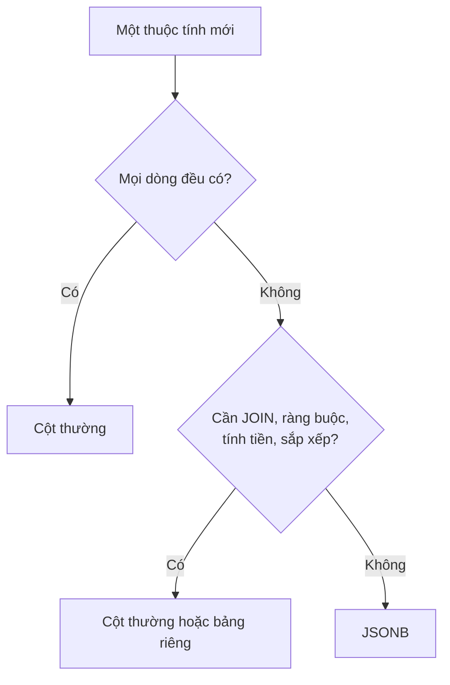

# Ngày 22: Làm việc với JSON và JSONB

> **Tóm tắt:** PostgreSQL lưu được dữ liệu JSON ngay trong một cột và truy vấn nó bằng SQL. Bài này dùng cột `products.attributes` (kiểu JSONB) của DSC Shop để học cách đọc giá trị, lọc, tách mảng, sửa JSON, tạo JSON từ bảng, tăng tốc bằng chỉ mục GIN, và quan trọng nhất: khi nào nên dùng JSONB, khi nào nên tách thành cột hoặc bảng riêng.

**Sau bài này bạn có thể:**

- Viết được truy vấn lấy giá trị trong JSONB bằng `->`, `->>`, `#>>` và ép kiểu để so sánh số.
- Lọc sản phẩm theo thông số bằng `@>` và `?`, và giải thích chúng xử lý NULL thế nào.
- Tách mảng JSON thành nhiều dòng bằng `jsonb_array_elements_text` để đếm, nhóm.
- Sửa JSONB bằng `jsonb_set`, `||`, `-` mà không làm mất dữ liệu.
- Tạo chỉ mục GIN cho cột JSONB, đo hiệu quả bằng `EXPLAIN ANALYZE`, và quyết định một thuộc tính nên nằm trong JSONB hay thành cột riêng.

**Cần biết trước:** [Ngày 2](02-table-structure-and-data-types.md) (kiểu dữ liệu), [Ngày 9](09-group-by-having.md) (GROUP BY), [Ngày 15](15-index.md) (index), [Ngày 20](20-query-performance.md) (EXPLAIN ANALYZE).

## Vì sao cần JSON trong database?

DSC Shop bán laptop, điện thoại, chuột, loa... Mỗi loại có thông số riêng: laptop có `cpu`, `ram_gb`, `gpu`; điện thoại có `colors`; chuột có `wireless`; sạc có `watt`. Nếu mỗi thông số là một cột trong `products`, bảng sẽ có hàng chục cột mà phần lớn là NULL, và mỗi lần bán thêm loại hàng mới lại phải `ALTER TABLE`.

DSC Shop chọn cách khác: các cột chung cho mọi sản phẩm (`sku`, `name`, `price`, `stock_quantity`...) là cột thường, còn thông số kỹ thuật thay đổi theo loại hàng nằm trong một cột `attributes` kiểu `JSONB`:

```sql
SELECT sku, name, attributes
FROM products
WHERE category_id = 3;
```

| sku | name | attributes |
| --- | --- | --- |
| LAP-001 | ASUS ROG Strix G16 | {"cpu": "Intel Core i7-13650HX", "gpu": "RTX 4060", "brand": "ASUS", "ram_gb": 16, "storage_gb": 512} |
| LAP-002 | Lenovo Legion 5 | {"cpu": "AMD Ryzen 7 7840HS", "gpu": "RTX 4060", "brand": "Lenovo", "ram_gb": 16, "storage_gb": 1024} |
| LAP-003 | Acer Nitro V 15 | {"cpu": "Intel Core i5-13420H", "gpu": "RTX 3050", "brand": "Acer", "ram_gb": 8, "storage_gb": 512} |

Ba sản phẩm (`PC-003`, `ACC-008`, `ACC-009`) có `attributes` là NULL: chưa nhập thông số. Bạn sẽ thấy NULL gây bẫy ở vài chỗ trong bài.

### JSON và JSONB

PostgreSQL có hai kiểu:

| | `JSON` | `JSONB` |
| --- | --- | --- |
| Lưu thế nào | Nguyên văn chuỗi bạn nhập | Dạng nhị phân đã phân tích |
| Khoảng trắng, thứ tự khóa | Giữ nguyên | Không giữ (khóa được sắp xếp lại) |
| Khóa trùng | Giữ cả hai | Chỉ giữ giá trị cuối |
| Toán tử `@>`, `?`, index GIN | Không | Có |
| Đọc từng phần tử | Chậm hơn (phải phân tích lại mỗi lần) | Nhanh |

```sql
SELECT '{"brand": "ASUS", "ram_gb": 16, "brand": "Asus"}'::json  AS kieu_json,
       '{"brand": "ASUS", "ram_gb": 16, "brand": "Asus"}'::jsonb AS kieu_jsonb;
```

| kieu_json | kieu_jsonb |
| --- | --- |
| {"brand": "ASUS", "ram_gb": 16, "brand": "Asus"} | {"brand": "Asus", "ram_gb": 16} |

Trong thực tế hầu như luôn chọn `JSONB`. Dù kiểu nào, PostgreSQL đều kiểm tra JSON có hợp lệ không khi ghi:

```sql
SELECT '{"brand": "ASUS", ram_gb: 16}'::jsonb;
```

```text
ERROR:  invalid input syntax for type json
LINE 1: SELECT '{"brand": "ASUS", ram_gb: 16}'::jsonb;
               ^
DETAIL:  Token "ram_gb" is invalid.
CONTEXT:  JSON data, line 1: {"brand": "ASUS", ram_gb...
```

(Tên khóa JSON phải nằm trong dấu nháy kép.)

## Đọc giá trị: `->`, `->>`, `#>>`

- `cot -> 'khoa'` trả về giá trị dưới dạng **JSONB** (chuỗi vẫn còn dấu nháy kép).
- `cot ->> 'khoa'` trả về giá trị dưới dạng **TEXT**.

```sql
SELECT sku,
       attributes -> 'brand'  AS brand_json,
       attributes ->> 'brand' AS brand_text,
       attributes -> 'ram_gb' AS ram_json,
       pg_typeof(attributes -> 'brand')  AS kieu_1,
       pg_typeof(attributes ->> 'brand') AS kieu_2
FROM products
WHERE sku IN ('LAP-001', 'PC-003');
```

| sku | brand_json | brand_text | ram_json | kieu_1 | kieu_2 |
| --- | --- | --- | --- | --- | --- |
| LAP-001 | "ASUS" | ASUS | 16 | jsonb | text |
| PC-003 |  |  |  | jsonb | text |

Khóa không tồn tại (hoặc cả cột là NULL như `PC-003`) thì kết quả là NULL, không báo lỗi.

Quy tắc dễ nhớ: muốn **hiển thị hoặc so sánh** thì dùng `->>`; muốn **đi sâu tiếp** vào JSON lồng nhau thì dùng `->`.

### So sánh số: phải ép kiểu

`->>` trả về text, nên muốn so sánh số phải ép kiểu (Ngày 5):

```sql
SELECT sku, name,
       (attributes ->> 'ram_gb')::INT     AS ram_gb,
       (attributes ->> 'storage_gb')::INT AS storage_gb
FROM products
WHERE (attributes ->> 'ram_gb')::INT >= 16
ORDER BY price DESC;
```

| sku | name | ram_gb | storage_gb |
| --- | --- | --- | --- |
| LAP-001 | ASUS ROG Strix G16 | 16 | 512 |
| LAP-002 | Lenovo Legion 5 | 16 | 1024 |
| LAP-006 | HP Pavilion 15 | 16 | 512 |

Quên ép kiểu là một lỗi rất hay gặp (xem mục "Lỗi thường gặp").

### Mảng và đường dẫn lồng nhau

Điện thoại có khóa `colors` là một mảng. `-> 0` lấy phần tử đầu (đánh số từ 0), `#>> '{colors,1}'` đi theo đường dẫn `colors` → phần tử thứ 1 và trả về text:

```sql
SELECT sku,
       attributes -> 'colors'        AS colors,
       attributes -> 'colors' -> 0   AS mau_dau,
       attributes -> 'colors' ->> 0  AS mau_dau_text,
       attributes #>> '{colors,1}'   AS mau_thu_hai
FROM products
WHERE attributes ? 'colors';
```

| sku | colors | mau_dau | mau_dau_text | mau_thu_hai |
| --- | --- | --- | --- | --- |
| PHN-001 | ["Đen", "Hồng", "Xanh"] | "Đen" | Đen | Hồng |
| PHN-002 | ["Đen", "Tím"] | "Đen" | Đen | Tím |
| PHN-003 | ["Đen", "Xanh", "Vàng"] | "Đen" | Đen | Xanh |

## Lọc: `@>` và `?`

### `@>`: "chứa"

`a @> b` đúng khi JSON `a` chứa mọi cặp khóa-giá trị của `b`. Đây là cách lọc gọn nhất, và dùng được chỉ mục GIN (phần sau):

```sql
SELECT sku, name, price
FROM products
WHERE attributes @> '{"brand": "Apple"}'
ORDER BY price DESC;
```

| sku | name | price |
| --- | --- | --- |
| LAP-005 | MacBook Air M2 13 inch | 24990000 |
| PHN-001 | iPhone 15 128GB | 19990000 |
| TAB-001 | iPad Air M2 11 inch | 16990000 |
| ACC-005 | Tai nghe AirPods Pro 2 | 5990000 |

Nhiều điều kiện cùng lúc, và so sánh đúng kiểu (`true` là boolean JSON, không phải chuỗi `"true"`):

```sql
SELECT sku, name
FROM products
WHERE attributes @> '{"wireless": true, "brand": "Logitech"}';
```

| sku | name |
| --- | --- |
| ACC-002 | Chuột Logitech MX Master 3S |

Với mảng, `@>` kiểm tra mảng có chứa các phần tử cho trước:

```sql
SELECT sku, name
FROM products
WHERE attributes @> '{"colors": ["Xanh"]}';
```

| sku | name |
| --- | --- |
| PHN-001 | iPhone 15 128GB |
| PHN-003 | Xiaomi Redmi Note 13 |

### `?`, `?|`, `?&`: có khóa không

```sql
SELECT sku, name, attributes ->> 'gpu' AS gpu
FROM products
WHERE attributes ? 'gpu';
```

| sku | name | gpu |
| --- | --- | --- |
| LAP-001 | ASUS ROG Strix G16 | RTX 4060 |
| LAP-002 | Lenovo Legion 5 | RTX 4060 |
| LAP-003 | Acer Nitro V 15 | RTX 3050 |

`?|` là "có ít nhất một trong các khóa", `?&` là "có đủ mọi khóa":

```sql
SELECT sku, name FROM products WHERE attributes ?| ARRAY['watt', 'refresh_hz'];
```

| sku | name |
| --- | --- |
| PC-001 | Màn hình LG UltraGear 27 inch |
| PC-002 | Màn hình Dell P2422H |
| ACC-007 | Sạc Anker 65W |

```sql
SELECT sku, name FROM products WHERE attributes ?& ARRAY['ram_gb', 'gpu'];
```

| sku | name |
| --- | --- |
| LAP-001 | ASUS ROG Strix G16 |
| LAP-002 | Lenovo Legion 5 |
| LAP-003 | Acer Nitro V 15 |

Áp lên một phần tử mảng, `?` kiểm tra mảng có chứa chuỗi đó không: `attributes -> 'colors' ? 'Xanh'` (bài tập 3).

## Mảng thành dòng: `jsonb_array_elements_text`

Muốn đếm có bao nhiêu điện thoại theo từng màu, cần biến mỗi phần tử mảng thành một dòng. `jsonb_array_elements_text(mảng)` là một hàm trả về **nhiều dòng**, dùng được trong `FROM` như một bảng:

```sql
SELECT p.sku, c.color
FROM products AS p
CROSS JOIN jsonb_array_elements_text(p.attributes -> 'colors') AS c(color)
ORDER BY p.sku, c.color;
```

| sku | color |
| --- | --- |
| PHN-001 | Đen |
| PHN-001 | Hồng |
| PHN-001 | Xanh |
| PHN-002 | Đen |
| PHN-002 | Tím |
| PHN-003 | Đen |
| PHN-003 | Vàng |
| PHN-003 | Xanh |

Với mỗi dòng `p`, hàm chạy trên mảng `colors` của chính dòng đó và sinh ra các dòng màu, rồi `CROSS JOIN` ghép chúng lại. Sản phẩm không có `colors` (hàm nhận NULL) sinh 0 dòng nên tự biến mất. `AS c(color)` đặt tên cho "bảng" kết quả và cột của nó.

Từ đây, GROUP BY như bình thường:

```sql
SELECT c.color, COUNT(*) AS so_dien_thoai
FROM products AS p
CROSS JOIN jsonb_array_elements_text(p.attributes -> 'colors') AS c(color)
GROUP BY c.color
ORDER BY so_dien_thoai DESC, c.color;
```

| color | so_dien_thoai |
| --- | --- |
| Đen | 3 |
| Xanh | 2 |
| Hồng | 1 |
| Tím | 1 |
| Vàng | 1 |

Hàm cùng họ: `jsonb_array_elements` (trả phần tử dạng JSONB, dùng khi phần tử là object), `jsonb_array_length` (số phần tử).

### Khám phá cấu trúc: `jsonb_object_keys`, `jsonb_each`

Khi nhận một cột JSONB lạ, câu hỏi đầu tiên là "có những khóa nào, xuất hiện bao nhiêu lần?":

```sql
SELECT k.key, COUNT(*) AS so_san_pham
FROM products AS p
CROSS JOIN jsonb_object_keys(p.attributes) AS k(key)
GROUP BY k.key
ORDER BY so_san_pham DESC, k.key;
```

| key | so_san_pham |
| --- | --- |
| brand | 21 |
| storage_gb | 12 |
| cpu | 6 |
| ram_gb | 6 |
| wireless | 6 |
| colors | 3 |
| gpu | 3 |
| refresh_hz | 2 |
| size_inch | 2 |
| switch | 1 |
| watt | 1 |

`jsonb_each` tách thành cặp khóa-giá trị, kèm `jsonb_typeof` để biết kiểu từng giá trị:

```sql
SELECT e.key, e.value, jsonb_typeof(e.value) AS kieu
FROM products AS p
CROSS JOIN jsonb_each(p.attributes) AS e
WHERE p.sku = 'ACC-003';
```

| key | value | kieu |
| --- | --- | --- |
| brand | "Keychron" | string |
| switch | "Brown" | string |
| wireless | true | boolean |

## Sửa JSONB

Các ví dụ sửa dữ liệu đều bọc trong `BEGIN ... ROLLBACK` để giữ dữ liệu gốc.

### `jsonb_set`: đặt giá trị tại một đường dẫn

`jsonb_set(cot, '{duong,dan}', gia_tri_moi)`. Giá trị mới phải là **JSONB**, nên chuỗi phải có dấu nháy kép bên trong dấu nháy đơn:

```sql
BEGIN;

UPDATE products
SET attributes = jsonb_set(attributes, '{ram_gb}', '32')
WHERE sku = 'LAP-001';

UPDATE products
SET attributes = jsonb_set(attributes, '{cpu}', '"Intel Core i7-14650HX"')
WHERE sku = 'LAP-001';

SELECT attributes FROM products WHERE sku = 'LAP-001';

ROLLBACK;
```

| attributes |
| --- |
| {"cpu": "Intel Core i7-14650HX", "gpu": "RTX 4060", "brand": "ASUS", "ram_gb": 32, "storage_gb": 512} |

Quên dấu nháy kép thì PostgreSQL không hiểu đó là JSON:

```sql
UPDATE products
SET attributes = jsonb_set(attributes, '{cpu}', 'Intel Core i9')
WHERE sku = 'LAP-001';
```

```text
ERROR:  invalid input syntax for type json
LINE 2: SET attributes = jsonb_set(attributes, '{cpu}', 'Intel Core ...
                                                        ^
DETAIL:  Token "Intel" is invalid.
CONTEXT:  JSON data, line 1: Intel...
```

Khi giá trị đến từ một biến hoặc cột text, dùng `to_jsonb(...)` để PostgreSQL tự thêm nháy:

```sql
BEGIN;

UPDATE products
SET attributes = jsonb_set(attributes, '{cpu}', to_jsonb('Intel Core i9'::TEXT))
WHERE sku = 'LAP-001';

SELECT attributes ->> 'cpu' AS cpu FROM products WHERE sku = 'LAP-001';

ROLLBACK;
```

| cpu |
| --- |
| Intel Core i9 |

> **Ghi chú dialect:** MySQL có `JSON_SET(cot, '$.cpu', 'Intel Core i9')`, nhận chuỗi SQL bình thường. Nếu viết `'"Intel Core i9"'` như PostgreSQL thì MySQL lưu cả dấu nháy kép vào giá trị. MySQL cũng có `->` và `->>` nhưng đường dẫn viết dạng `'$.cpu'`; SQL Server dùng hàm `JSON_VALUE(cot, '$.cpu')`.

### `||` và `-`: gộp và xóa khóa

`a || b` gộp hai object, khóa trùng thì lấy của `b`. `cot - 'khoa'` xóa một khóa:

```sql
BEGIN;

UPDATE products
SET attributes = attributes || '{"warranty_months": 24}'
WHERE category_id IN (3, 4);

UPDATE products
SET attributes = attributes - 'warranty_months'
WHERE sku = 'LAP-006';

SELECT sku, attributes ->> 'warranty_months' AS warranty_months
FROM products
WHERE category_id IN (3, 4)
ORDER BY sku;

ROLLBACK;
```

| sku | warranty_months |
| --- | --- |
| LAP-001 | 24 |
| LAP-002 | 24 |
| LAP-003 | 24 |
| LAP-004 | 24 |
| LAP-005 | 24 |
| LAP-006 |  |

Thêm phần tử vào mảng: lấy mảng cũ `||` phần tử mới, rồi `jsonb_set` lại:

```sql
BEGIN;

UPDATE products
SET attributes = jsonb_set(attributes, '{colors}', (attributes -> 'colors') || '"Trắng"')
WHERE sku = 'PHN-002';

SELECT attributes FROM products WHERE sku = 'PHN-002';

ROLLBACK;
```

| attributes |
| --- |
| {"brand": "Samsung", "colors": ["Đen", "Tím", "Trắng"], "storage_gb": 256} |

## Tạo JSON từ bảng

Ứng dụng web (Ngày 23) thường cần trả về JSON. PostgreSQL tự dựng được: `jsonb_build_object('khoa', gia_tri, ...)` tạo một object, `jsonb_agg(...)` gom nhiều dòng thành một mảng (là một hàm tổng hợp như `SUM`):

```sql
SELECT jsonb_build_object(
    'order_id', o.order_id,
    'status',   o.status,
    'items',    jsonb_agg(
                    jsonb_build_object('sku', p.sku, 'quantity', oi.quantity, 'unit_price', oi.unit_price)
                    ORDER BY p.sku)
) AS order_json
FROM orders AS o
JOIN order_items AS oi ON oi.order_id = o.order_id
JOIN products AS p ON p.product_id = oi.product_id
WHERE o.order_id = 31
GROUP BY o.order_id, o.status;
```

```json
{"items": [{"sku": "ACC-001", "quantity": 1, "unit_price": 399000}, {"sku": "ACC-002", "quantity": 1, "unit_price": 2490000}, {"sku": "ACC-003", "quantity": 1, "unit_price": 1890000}], "status": "delivered", "order_id": 31}
```

`to_jsonb(dong)` biến cả một dòng thành object, `jsonb_pretty` in đẹp nhiều dòng:

```sql
SELECT jsonb_pretty(to_jsonb(c)) AS customer_json
FROM customers AS c
WHERE customer_id = 3;
```

```json
{
    "city": "Đà Nẵng",
    "email": "cuong.le@outlook.com",
    "phone": null,
    "full_name": "Lê Hoàng Cường",
    "birth_date": "1999-11-02",
    "created_at": "2025-01-28T00:00:00+07:00",
    "customer_id": 3
}
```

SQL NULL trở thành `null` của JSON.

## Tăng tốc bằng chỉ mục GIN

24 sản phẩm thì quét cả bảng cũng nhanh. Để thấy tác dụng của index, ta tạo một bảng tin đăng bán hàng riêng với 300.000 dòng, mỗi dòng có `attributes` gồm mã cửa hàng (`shop_id`, 20.000 giá trị khác nhau), hãng, RAM, không dây, màu:

```sql
DROP TABLE IF EXISTS listings;

CREATE TABLE listings (
    listing_id INT GENERATED ALWAYS AS IDENTITY PRIMARY KEY,
    title      TEXT  NOT NULL,
    attributes JSONB NOT NULL
);

SELECT setseed(0.22);

INSERT INTO listings (title, attributes)
SELECT
    'Tin đăng ' || i,
    jsonb_build_object(
        'shop_id',  1 + floor(random() * 20000)::INT,
        'brand',    (ARRAY['Apple', 'Samsung', 'Xiaomi', 'ASUS', 'Lenovo', 'Dell',
                           'HP', 'Acer', 'Sony', 'Logitech', 'Oppo', 'Vivo'])[1 + floor(random() * 12)::INT],
        'ram_gb',   (ARRAY[4, 8, 12, 16, 32])[1 + floor(random() * 5)::INT],
        'wireless', random() < 0.3,
        'colors',   (ARRAY['["Đen"]', '["Đen", "Trắng"]', '["Xanh", "Hồng"]', '["Vàng"]'])[1 + floor(random() * 4)::INT]::JSONB
    )
FROM generate_series(1, 300000) AS i;

ANALYZE listings;

SELECT * FROM listings ORDER BY listing_id LIMIT 3;
```

| listing_id | title | attributes |
| --- | --- | --- |
| 1 | Tin đăng 1 | {"brand": "Oppo", "colors": ["Xanh", "Hồng"], "ram_gb": 4, "shop_id": 9290, "wireless": false} |
| 2 | Tin đăng 2 | {"brand": "Samsung", "colors": ["Xanh", "Hồng"], "ram_gb": 4, "shop_id": 12046, "wireless": true} |
| 3 | Tin đăng 3 | {"brand": "HP", "colors": ["Đen", "Trắng"], "ram_gb": 8, "shop_id": 18061, "wireless": true} |

(`setseed` giúp mọi người sinh ra cùng một bộ dữ liệu.)

Tìm tin đăng của cửa hàng 777, chưa có index:

```sql
EXPLAIN ANALYZE
SELECT listing_id, title
FROM listings
WHERE attributes @> '{"shop_id": 777}';
```

```text
 Gather  (cost=1000.00..8934.50 rows=30 width=21) (actual time=5.903..46.779 rows=12 loops=1)
   Workers Planned: 2
   Workers Launched: 2
   ->  Parallel Seq Scan on listings  (cost=0.00..7931.50 rows=12 width=21) (actual time=6.263..38.280 rows=4 loops=3)
         Filter: (attributes @> '{"shop_id": 777}'::jsonb)
         Rows Removed by Filter: 99996
 Planning Time: 0.134 ms
 Execution Time: 46.813 ms
```

Index B-tree (Ngày 15) không giúp được `@>`, vì B-tree sắp xếp **cả giá trị JSON** chứ không biết bên trong có khóa nào. **GIN** (Generalized Inverted Index, chỉ mục đảo) thì tách mỗi JSON thành các khóa và giá trị bên trong, rồi ghi lại "khóa/giá trị này xuất hiện ở những dòng nào", giống mục lục cuối sách:

```sql
CREATE INDEX idx_listings_attributes ON listings USING GIN (attributes);

EXPLAIN ANALYZE
SELECT listing_id, title
FROM listings
WHERE attributes @> '{"shop_id": 777}';
```

```text
 Bitmap Heap Scan on listings  (cost=21.69..135.89 rows=30 width=21) (actual time=0.268..0.297 rows=12 loops=1)
   Recheck Cond: (attributes @> '{"shop_id": 777}'::jsonb)
   Heap Blocks: exact=12
   ->  Bitmap Index Scan on idx_listings_attributes  (cost=0.00..21.68 rows=30 width=0) (actual time=0.256..0.257 rows=12 loops=1)
         Index Cond: (attributes @> '{"shop_id": 777}'::jsonb)
 Planning Time: 0.107 ms
 Execution Time: 0.316 ms
```

Từ khoảng 45-65 ms xuống 0,3-0,6 ms qua vài lần chạy trên máy mình (số trên máy bạn sẽ khác). Bảng nặng khoảng 50 MB, index GIN khoảng 6 MB.

Với điều kiện kém chọn lọc hơn, lợi ích nhỏ đi. `{"brand": "Apple", "ram_gb": 32, "colors": ["Vàng"]}` khớp 1.248 tin: không index khoảng 45 ms, có GIN khoảng 15 ms. Còn điều kiện khớp phần lớn bảng (như `{"wireless": false}`, khoảng 70% số dòng) thì PostgreSQL vẫn chọn quét cả bảng, giống mọi loại index khác.

GIN mặc định (`jsonb_ops`) hỗ trợ `@>`, `?`, `?|`, `?&`. Nó **không** giúp `->>` với `=`:

```sql
EXPLAIN ANALYZE
SELECT listing_id, title
FROM listings
WHERE (attributes ->> 'shop_id')::INT = 777;
```

```text
 Gather  (cost=1000.00..10019.00 rows=1500 width=21) (actual time=14.256..42.963 rows=12 loops=1)
   Workers Planned: 2
   Workers Launched: 2
   ->  Parallel Seq Scan on listings  (cost=0.00..8869.00 rows=625 width=21) (actual time=5.685..33.158 rows=4 loops=3)
         Filter: (((attributes ->> 'shop_id'::text))::integer = 777)
         Rows Removed by Filter: 99996
 Planning Time: 0.096 ms
 Execution Time: 42.992 ms
```

Cùng một câu hỏi, viết bằng `@>` thì dùng được index, viết bằng `->>` thì không. Nếu một khóa nào đó hay được lọc bằng `=`, `<`, `>` hoặc sắp xếp, có hai lựa chọn: tạo expression index B-tree trên đúng biểu thức đó (`CREATE INDEX ... ON listings (((attributes ->> 'shop_id')::INT))`), hoặc tốt hơn là đưa nó ra thành một cột thường.

> **Ghi chú dialect:** MySQL không đánh index trực tiếp trên cột JSON; cách thường dùng là tạo cột sinh (generated column) từ biểu thức JSON rồi đánh index cột đó. SQL Server cũng làm tương tự với computed column.

Xóa bảng thử nghiệm khi xong:

```sql
DROP TABLE listings;
```

## Khi nào dùng JSONB, khi nào tách bảng?

JSONB rất tiện, nên dễ bị lạm dụng thành "nhét mọi thứ vào một cột". Quy tắc chung: **dữ liệu có cấu trúc ổn định, cần ràng buộc, cần JOIN hoặc cần tính toán thường xuyên thì để ở cột và bảng thường**; JSONB dành cho phần thay đổi theo từng dòng mà ứng dụng chủ yếu đọc ra hiển thị.



| Nên để trong JSONB | Nên là cột hoặc bảng riêng |
| --- | --- |
| Thông số khác nhau theo loại hàng: `cpu`, `gpu`, `watt` | Giá bán, tồn kho: cần `CHECK (price >= 0)`, cần `SUM`, cần chính xác `NUMERIC` |
| Dữ liệu chỉ để hiển thị, ít lọc | Khóa ngoại: `category_id` phải trỏ tới danh mục có thật (JSONB không có `REFERENCES`) |
| Dữ liệu thô nhận từ API bên ngoài, lưu lại để tra cứu | Thứ hay lọc bằng khoảng hoặc sắp xếp: `order_date`, `price` |
| Cài đặt (settings) của người dùng | Danh sách cần đếm, JOIN, ràng buộc trùng: màu sắc tồn kho riêng theo từng màu nên là bảng `product_colors` (bài tập 8) |

Đó cũng là lý do thiết kế của DSC Shop: `price`, `stock_quantity`, `category_id`, `is_active` là cột thường có ràng buộc; chỉ thông số kỹ thuật nằm trong `attributes`. Chủ đề này sẽ được bàn kỹ hơn ở [Ngày 26](26-sql-nosql.md) (SQL và NoSQL) và [Ngày 27](27-database-design-best-practices.md) (thiết kế CSDL).

## Lỗi thường gặp

**1. So sánh số khi giá trị còn là text.**

```sql
-- Sai: '16' > '8' là so sánh chuỗi, ký tự '1' đứng trước '8' nên kết quả FALSE
SELECT sku, name
FROM products
WHERE attributes ->> 'ram_gb' > '8';
```

Kết quả: 0 dòng, dù có 3 laptop 16 GB. Đúng: `(attributes ->> 'ram_gb')::INT > 8`. (So sánh hai giá trị JSONB như `attributes -> 'ram_gb' > '8'` thì ra đúng, vì JSONB so số theo số, nhưng ép về kiểu SQL rõ ràng hơn và dùng được các hàm số.)

**2. Dùng `->` khi cần text.** `attributes -> 'brand' = 'Apple'` báo lỗi vì vế trái là JSONB còn `'Apple'` không phải JSON hợp lệ. Dùng `attributes ->> 'brand' = 'Apple'` hoặc `attributes @> '{"brand": "Apple"}'`.

**3. Quên NULL khi phủ định.** "Sản phẩm không có khóa `brand`":

```sql
SELECT sku, name FROM products WHERE NOT attributes ? 'brand';
```

Kết quả: 0 dòng. Ba sản phẩm có `attributes` NULL cho `NULL ? 'brand'` là NULL, `NOT NULL` vẫn là NULL, nên bị loại (logic ba trị ở Ngày 3). Muốn tính cả chúng: `WHERE attributes IS NULL OR NOT attributes ? 'brand'`.

**4. Gộp `||` vào cột NULL.** `NULL || '{"warranty_months": 12}'` ra NULL, nên câu dưới không thêm được gì cho sản phẩm chưa có `attributes`:

```sql
BEGIN;

UPDATE products
SET attributes = attributes || '{"warranty_months": 12}'
WHERE sku LIKE 'ACC%';

SELECT sku, attributes FROM products WHERE sku IN ('ACC-007', 'ACC-008', 'ACC-009') ORDER BY sku;

ROLLBACK;
```

| sku | attributes |
| --- | --- |
| ACC-007 | {"watt": 65, "brand": "Anker", "warranty_months": 12} |
| ACC-008 |  |
| ACC-009 |  |

Sửa bằng `COALESCE(attributes, '{}') || '{"warranty_months": 12}'`. `jsonb_set` trên cột NULL cũng trả NULL, cùng cách sửa.

**5. `jsonb_set` vào đường dẫn chưa có cha thì không làm gì.** Laptop Dell chưa có khóa `dimensions`:

```sql
BEGIN;

UPDATE products
SET attributes = jsonb_set(attributes, '{dimensions,weight_g}', '1500')
WHERE sku = 'LAP-004';

SELECT attributes FROM products WHERE sku = 'LAP-004';

ROLLBACK;
```

| attributes |
| --- |
| {"cpu": "Intel Core i5-1335U", "brand": "Dell", "ram_gb": 8, "storage_gb": 512} |

Lệnh báo `UPDATE 1` nhưng JSON không đổi. Phải tạo object cha trước: `jsonb_set(attributes, '{dimensions}', '{"weight_g": 1500}')`.

**6. Nhét dữ liệu quan trọng vào JSONB.** Nếu `price` nằm trong JSON, không ai chặn được giá âm hay giá viết dạng chuỗi `"19.990.000"`, và mỗi báo cáo doanh thu phải ép kiểu. Xem lại bảng "Khi nào dùng JSONB".

## Bài tập

### Cơ bản

**Bài 1.** Liệt kê mọi laptop (danh mục 3 và 4) với `sku`, hãng, CPU, RAM (số nguyên), dung lượng lưu trữ (số nguyên). Sắp xếp theo RAM giảm dần, rồi dung lượng giảm dần, rồi `sku`.

<details>
<summary>Đáp án</summary>

```sql
SELECT
    sku,
    attributes ->> 'brand'             AS brand,
    attributes ->> 'cpu'               AS cpu,
    (attributes ->> 'ram_gb')::INT     AS ram_gb,
    (attributes ->> 'storage_gb')::INT AS storage_gb
FROM products
WHERE category_id IN (3, 4)
ORDER BY ram_gb DESC, storage_gb DESC, sku;
```

Kết quả:

| sku | brand | cpu | ram_gb | storage_gb |
| --- | --- | --- | --- | --- |
| LAP-002 | Lenovo | AMD Ryzen 7 7840HS | 16 | 1024 |
| LAP-001 | ASUS | Intel Core i7-13650HX | 16 | 512 |
| LAP-006 | HP | AMD Ryzen 5 7530U | 16 | 512 |
| LAP-003 | Acer | Intel Core i5-13420H | 8 | 512 |
| LAP-004 | Dell | Intel Core i5-1335U | 8 | 512 |
| LAP-005 | Apple | Apple M2 | 8 | 256 |

Nếu không ép kiểu `storage_gb`, `'1024'` sẽ đứng sau `'512'` khi sắp xếp giảm dần theo chuỗi.
</details>

**Bài 2.** Đếm số sản phẩm không dây (`"wireless": true`) theo hãng.

<details>
<summary>Đáp án</summary>

```sql
SELECT attributes ->> 'brand' AS brand, COUNT(*) AS so_san_pham
FROM products
WHERE attributes @> '{"wireless": true}'
GROUP BY attributes ->> 'brand'
ORDER BY so_san_pham DESC, brand;
```

Kết quả:

| brand | so_san_pham |
| --- | --- |
| Apple | 1 |
| JBL | 1 |
| Keychron | 1 |
| Logitech | 1 |
| Sony | 1 |

Chuột Logitech G102 có `"wireless": false` nên không được tính.
</details>

**Bài 3.** Tìm các sản phẩm có màu `Xanh` bằng toán tử `?` (không dùng `@>`).

<details>
<summary>Đáp án</summary>

```sql
SELECT sku, name, attributes -> 'colors' AS colors
FROM products
WHERE attributes -> 'colors' ? 'Xanh';
```

Kết quả:

| sku | name | colors |
| --- | --- | --- |
| PHN-001 | iPhone 15 128GB | ["Đen", "Hồng", "Xanh"] |
| PHN-003 | Xiaomi Redmi Note 13 | ["Đen", "Xanh", "Vàng"] |

Áp lên một mảng, `?` kiểm tra mảng có phần tử chuỗi đó không.
</details>

### Vận dụng

**Bài 4.** Tính số lượng bán và doanh thu (không tính đơn `pending` và `cancelled`) theo **hãng** lấy từ `attributes`. Sản phẩm không có thông tin hãng gom vào nhóm `(không rõ)`.

<details>
<summary>Đáp án</summary>

```sql
SELECT
    COALESCE(p.attributes ->> 'brand', '(không rõ)') AS brand,
    SUM(oi.quantity) AS so_luong,
    ROUND(SUM(oi.quantity * oi.unit_price * (1 - oi.discount))) AS doanh_thu
FROM order_items AS oi
JOIN orders   AS o ON o.order_id   = oi.order_id
JOIN products AS p ON p.product_id = oi.product_id
WHERE o.status NOT IN ('pending', 'cancelled')
GROUP BY COALESCE(p.attributes ->> 'brand', '(không rõ)')
ORDER BY doanh_thu DESC;
```

Kết quả:

| brand | so_luong | doanh_thu |
| --- | --- | --- |
| Apple | 11 | 179844000 |
| Lenovo | 2 | 59980000 |
| Samsung | 4 | 55061000 |
| Dell | 5 | 49850000 |
| Acer | 2 | 43830500 |
| ASUS | 1 | 31340500 |
| Sony | 3 | 23970000 |
| LG | 3 | 19470000 |
| Xiaomi | 4 | 19071000 |
| HP | 1 | 16990000 |
| (không rõ) | 14 | 11940000 |
| Logitech | 9 | 9864000 |
| Keychron | 3 | 5670000 |
| Anker | 6 | 5340000 |
| JBL | 1 | 2690000 |
| Nokia | 2 | 1380000 |

Nhóm `(không rõ)` gồm PC văn phòng DSC Basic và cáp USB-C, hai sản phẩm chưa có `attributes`.
</details>

**Bài 5.** Tìm màn hình có tần số quét từ 144 Hz trở lên, in kèm kích thước.

<details>
<summary>Đáp án</summary>

```sql
SELECT sku, name,
       (attributes ->> 'refresh_hz')::INT AS refresh_hz,
       (attributes ->> 'size_inch')::INT  AS size_inch
FROM products
WHERE (attributes ->> 'refresh_hz')::INT >= 144;
```

Kết quả:

| sku | name | refresh_hz | size_inch |
| --- | --- | --- | --- |
| PC-001 | Màn hình LG UltraGear 27 inch | 165 | 27 |

Sản phẩm không có `refresh_hz` cho NULL nên bị loại. Lưu ý: nếu một dòng nào đó lưu `"refresh_hz": "165Hz"` (chuỗi không phải số), phép ép kiểu `::INT` sẽ làm cả truy vấn báo lỗi. JSONB không ép kiểu giá trị cho bạn, đây là một lý do để đưa thuộc tính quan trọng ra cột thường.
</details>

**Bài 6.** Với mỗi điện thoại có danh sách màu, in số màu và danh sách màu nối thành một chuỗi, sắp theo bảng chữ cái (gợi ý: hàm tổng hợp `string_agg(cot, ', ' ORDER BY cot)` nối các giá trị trong nhóm thành một chuỗi).

<details>
<summary>Đáp án</summary>

```sql
SELECT p.sku,
       COUNT(*) AS so_mau,
       string_agg(c.color, ', ' ORDER BY c.color) AS danh_sach_mau
FROM products AS p
CROSS JOIN jsonb_array_elements_text(p.attributes -> 'colors') AS c(color)
GROUP BY p.sku
ORDER BY p.sku;
```

Kết quả:

| sku | so_mau | danh_sach_mau |
| --- | --- | --- |
| PHN-001 | 3 | Đen, Hồng, Xanh |
| PHN-002 | 2 | Đen, Tím |
| PHN-003 | 3 | Đen, Vàng, Xanh |
</details>

### Thử thách

**Bài 7.** Viết một truy vấn trả về đơn 12 dưới dạng một JSON gồm `order_id`, tên khách, `status`, mảng `items` (sku, quantity, unit_price) và mảng `payments` (amount, method, ngày trả). Cẩn thận: đơn 12 có 2 dòng hàng và 2 lần thanh toán.

<details>
<summary>Đáp án</summary>

Nếu JOIN cả `order_items` và `payments` rồi `jsonb_agg`, mỗi dòng hàng bị nhân với mỗi lần thanh toán (2 x 2 = 4 dòng), cả hai mảng đều bị lặp: đúng bẫy nhân dòng khi JOIN ở Ngày 10. Dựng từng mảng bằng một subquery riêng:

```sql
SELECT jsonb_pretty(
    jsonb_build_object(
        'order_id', o.order_id,
        'customer', c.full_name,
        'status',   o.status,
        'items', (
            SELECT jsonb_agg(
                       jsonb_build_object(
                           'sku',        p.sku,
                           'quantity',   oi.quantity,
                           'unit_price', oi.unit_price
                       ) ORDER BY p.sku)
            FROM order_items AS oi
            JOIN products AS p ON p.product_id = oi.product_id
            WHERE oi.order_id = o.order_id
        ),
        'payments', (
            SELECT jsonb_agg(
                       jsonb_build_object(
                           'amount',  pm.amount,
                           'method',  pm.method,
                           'paid_at', pm.paid_at::DATE
                       ) ORDER BY pm.paid_at)
            FROM payments AS pm
            WHERE pm.order_id = o.order_id
        )
    )
) AS order_json
FROM orders AS o
JOIN customers AS c ON c.customer_id = o.customer_id
WHERE o.order_id = 12;
```

Kết quả:

```json
{
    "items": [
        {
            "sku": "ACC-003",
            "quantity": 1,
            "unit_price": 1890000
        },
        {
            "sku": "LAP-002",
            "quantity": 1,
            "unit_price": 29990000
        }
    ],
    "status": "delivered",
    "customer": "Dương Minh Khoa",
    "order_id": 12,
    "payments": [
        {
            "amount": 15000000,
            "method": "bank_transfer",
            "paid_at": "2025-06-30"
        },
        {
            "amount": 16880000,
            "method": "bank_transfer",
            "paid_at": "2025-07-30"
        }
    ]
}
```
</details>

**Bài 8.** Cửa hàng muốn quản lý tồn kho riêng theo từng màu, nên danh sách màu cần ràng buộc chặt (không trùng màu trong một sản phẩm, sản phẩm phải tồn tại). Tạo bảng `product_colors (product_id, color)` với khóa chính và khóa ngoại phù hợp, đổ dữ liệu từ `attributes -> 'colors'`, rồi dùng nó tìm các sản phẩm có màu `Đen`. Thử chèn một màu trùng và một `product_id` không tồn tại. Cuối bài xóa bảng.

<details>
<summary>Đáp án</summary>

```sql
DROP TABLE IF EXISTS product_colors;

CREATE TABLE product_colors (
    product_id INT         NOT NULL REFERENCES products (product_id),
    color      VARCHAR(30) NOT NULL,
    PRIMARY KEY (product_id, color)
);

INSERT INTO product_colors (product_id, color)
SELECT p.product_id, c.color
FROM products AS p
CROSS JOIN jsonb_array_elements_text(p.attributes -> 'colors') AS c(color);

SELECT p.sku, p.name, p.stock_quantity
FROM products AS p
JOIN product_colors AS pc ON pc.product_id = p.product_id
WHERE pc.color = 'Đen'
ORDER BY p.sku;
```

| sku | name | stock_quantity |
| --- | --- | --- |
| PHN-001 | iPhone 15 128GB | 15 |
| PHN-002 | Samsung Galaxy S24 | 9 |
| PHN-003 | Xiaomi Redmi Note 13 | 25 |

```sql
INSERT INTO product_colors (product_id, color) VALUES (10, 'Đen');
INSERT INTO product_colors (product_id, color) VALUES (99, 'Đen');
```

```text
ERROR:  duplicate key value violates unique constraint "product_colors_pkey"
DETAIL:  Key (product_id, color)=(10, Đen) already exists.
ERROR:  insert or update on table "product_colors" violates foreign key constraint "product_colors_product_id_fkey"
DETAIL:  Key (product_id)=(99) is not present in table "products".
```

Mảng trong JSONB không chặn được cả hai lỗi này. Khi đã có bảng riêng, bước tiếp theo trong thực tế là thêm cột `stock_quantity` vào `product_colors` và bỏ khóa `colors` khỏi `attributes`, để mỗi thông tin chỉ nằm ở một nơi.

```sql
DROP TABLE product_colors;
```
</details>

**Bài 9.** Tạo lại bảng `listings` như ở mục GIN (chạy lại khối `CREATE TABLE` và `INSERT`). Lần này tạo index GIN với lớp toán tử `jsonb_path_ops`: `CREATE INDEX ... USING GIN (attributes jsonb_path_ops)`. So sánh kích thước với GIN mặc định (khoảng 6 MB), và dùng `EXPLAIN` kiểm tra index mới có dùng được cho `@>` và cho `?` không. Xong thì xóa bảng.

<details>
<summary>Đáp án</summary>

```sql
CREATE INDEX idx_listings_attr_path ON listings USING GIN (attributes jsonb_path_ops);

SELECT pg_size_pretty(pg_relation_size('idx_listings_attr_path')) AS kich_thuoc;

EXPLAIN SELECT listing_id FROM listings WHERE attributes @> '{"shop_id": 777}';
EXPLAIN SELECT listing_id FROM listings WHERE attributes ? 'gpu';

DROP TABLE listings;
```

Kích thước trên máy mình: `4696 kB`, so với khoảng 6,2 MB (`6336 kB`) của GIN mặc định.

Với `@>`, index mới được dùng:

```text
 Bitmap Heap Scan on listings  (cost=12.98..127.18 rows=30 width=4)
   Recheck Cond: (attributes @> '{"shop_id": 777}'::jsonb)
   ->  Bitmap Index Scan on idx_listings_attr_path  (cost=0.00..12.98 rows=30 width=0)
         Index Cond: (attributes @> '{"shop_id": 777}'::jsonb)
```

Với `?`, PostgreSQL quét cả bảng:

```text
 Gather  (cost=1000.00..8934.50 rows=30 width=4)
   Workers Planned: 2
   ->  Parallel Seq Scan on listings  (cost=0.00..7931.50 rows=12 width=4)
         Filter: (attributes ? 'gpu'::text)
```

`jsonb_path_ops` chỉ lưu "đường dẫn tới giá trị" (băm từ khóa và giá trị), không lưu riêng từng khóa, nên nhỏ hơn và thường nhanh hơn cho `@>`, nhưng không trả lời được câu hỏi "có khóa `gpu` không". Chọn `jsonb_path_ops` khi ứng dụng chỉ lọc bằng `@>`; cần cả `?`, `?|`, `?&` thì dùng GIN mặc định.
</details>

## Tóm tắt

- Dùng `JSONB` (không phải `JSON`) cho dữ liệu bán cấu trúc: nhỏ gọn hơn khi truy vấn, có toán tử `@>`, `?` và index GIN.
- `->` trả JSONB, `->>` trả text; `#>>` đi theo đường dẫn lồng nhau. So sánh số phải ép kiểu `(... ->> 'k')::INT`.
- `@>` lọc theo "chứa cặp khóa-giá trị", `?`/`?|`/`?&` kiểm tra khóa. Cột NULL làm các điều kiện này ra NULL, cẩn thận với `NOT`.
- `jsonb_array_elements_text` biến mảng thành dòng để đếm, nhóm. `jsonb_object_keys`, `jsonb_each` giúp khám phá cấu trúc.
- Sửa bằng `jsonb_set` (giá trị phải là JSON, chuỗi cần nháy kép hoặc `to_jsonb`), `||` để gộp, `-` để xóa khóa; nhớ `COALESCE` khi cột có thể NULL.
- `jsonb_build_object`, `jsonb_agg`, `to_jsonb` dựng JSON từ bảng cho API.
- Index GIN tăng tốc `@>` và `?` khi điều kiện chọn lọc; không giúp `->> =`.
- Giá tiền, khóa ngoại, thứ cần ràng buộc hoặc tính toán thường xuyên: để ở cột/bảng thường. JSONB cho phần thay đổi theo từng dòng.

## Đọc thêm

- [PostgreSQL: JSON Types](https://www.postgresql.org/docs/16/datatype-json.html) (có mục về indexing)
- [PostgreSQL: JSON Functions and Operators](https://www.postgresql.org/docs/16/functions-json.html)
- [PostgreSQL: GIN Indexes](https://www.postgresql.org/docs/16/gin.html)

---

[⬅️ Ngày 21: Ôn tập 3 (Ngày 15-20)](21-review-3.md) | [📚 Mục lục](../README.md) | [Ngày 23: Kết nối SQL từ ứng dụng ➡️](23-sql-connect-apps.md)
