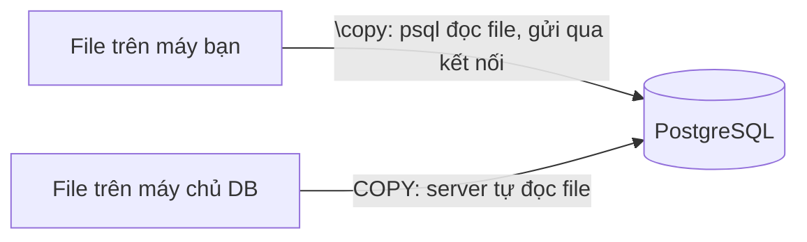
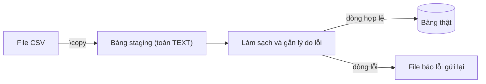

# Ngày 24: Nhập và xuất dữ liệu với CSV

> **Tóm tắt:** Dữ liệu thật thường đến từ file: danh sách khách từ form đăng ký, bảng giá từ nhà cung cấp, file kiểm kê kho xuất từ Excel. Bài này dùng `COPY` và `\copy` của PostgreSQL để nạp file CSV vào bảng và xuất kết quả truy vấn ra CSV, kèm quy trình nạp qua bảng staging để xử lý những dòng lỗi mà không làm hỏng cả lần nhập.

**Sau bài này bạn có thể:**

- Nạp file CSV vào bảng bằng `COPY ... FROM` và `\copy ... FROM`, chỉ định đúng header, dấu phân cách, cách biểu diễn NULL.
- Phân biệt `COPY` (file nằm trên máy chủ database) với `\copy` (file nằm trên máy chạy psql), và biết khi nào dùng cái nào.
- Nạp một file "bẩn" vào bảng staging, kiểm tra từng dòng bằng SQL, đưa dòng hợp lệ vào bảng thật và xuất danh sách dòng lỗi.
- Xuất kết quả một truy vấn bất kỳ ra file CSV mở được bằng Excel.

**Cần biết trước:** [Ngày 6](06-insert-update-delete.md) (INSERT ... SELECT, UPDATE ... FROM, ON CONFLICT), [Ngày 13](13-case-when.md) (CASE, FILTER), [Ngày 16](16-transactions-acid.md) (transaction).

## File mẫu dùng trong bài

Các file nằm trong thư mục [setup/data](../setup/data). File `docker-compose.yml` gắn (mount) thư mục này vào container, nên bên trong container PostgreSQL thấy chúng ở `/data`:

| File | Nội dung | Điểm cần chú ý |
| --- | --- | --- |
| `new_customers.csv` | 4 khách mới | Có ô trống, có dấu phẩy và dấu nháy kép trong dữ liệu |
| `price_update.csv` | Bảng giá mới cho 4 SKU | Dấu phân cách `;`, xuống dòng kiểu Windows (CRLF) |
| `supplier_products.csv` | 11 sản phẩm từ nhà cung cấp | Cố ý có 6 dòng lỗi các kiểu |
| `customers_utf16.csv` | 1 khách | Lưu bằng mã hóa UTF-16 (kiểu "Unicode Text" của Excel) |
| `new_employees.tsv` | 3 nhân viên mới | Phân cách bằng tab, NULL viết là `N/A` (dùng ở bài tập) |
| `stock_count.csv` | Kết quả kiểm kê kho | Có SKU sai, số lượng gõ nhầm (dùng ở bài tập) |

Xem nội dung một file ngay trong container:

```sh
docker compose exec db cat /data/new_customers.csv
```

```text
full_name,email,phone,city,birth_date
Nguyễn Thị Hoa,hoa.nguyen@gmail.com,0901111222,Hà Nội,2003-08-19
Trần Minh Khang,khang.tran@student.hcmute.edu.vn,,"Thủ Đức, TP. Hồ Chí Minh",2005-01-07
Lê Thu Hà,,0913333444,Đà Nẵng,
"Phạm ""Tony"" Tuấn",tony.pham@gmail.com,0935555666,Cần Thơ,1999-12-31
```

Các ví dụ dưới đây thêm và sửa dữ liệu trong schema `shop`. Làm xong bài, chạy lại hai file init để đưa dữ liệu về như cũ (mục "Làm lại từ đầu" trong [setup/README.md](../setup/README.md)), nếu không kết quả các bài sau sẽ lệch.

## CSV là gì, và những quy tắc cần nhớ

CSV (comma-separated values) là file văn bản, mỗi dòng là một bản ghi, các ô cách nhau bằng dấu phẩy. Đơn giản, nhưng có vài quy tắc mà ai làm import cũng phải biết:

- **Dòng tiêu đề (header):** dòng đầu thường là tên cột. Phải báo cho lệnh nhập biết để bỏ qua, không thì nó bị coi là dữ liệu.
- **Ô chứa dấu phẩy** phải đặt trong nháy kép: `"Thủ Đức, TP. Hồ Chí Minh"`.
- **Ô chứa nháy kép** thì nhân đôi nháy: `"Phạm ""Tony"" Tuấn"` nghĩa là `Phạm "Tony" Tuấn`.
- **Dấu phân cách** không phải lúc nào cũng là dấu phẩy. Excel trên máy cài định dạng số kiểu Việt Nam (dấu phẩy là dấu thập phân) thường xuất CSV phân cách bằng dấu chấm phẩy `;`.
- **NULL và chuỗi rỗng:** trong định dạng CSV của PostgreSQL, ô trống không có nháy (`,,`) được hiểu là NULL, còn `""` là chuỗi rỗng.
- **Mã hóa (encoding):** tiếng Việt cần UTF-8. File lưu bằng mã hóa khác sẽ bị lỗi hoặc ra chữ sai.
- **Xuống dòng:** Windows dùng CRLF (`\r\n`), Linux/macOS dùng LF (`\n`). Chế độ CSV của PostgreSQL nhận cả hai, miễn là trong một file không trộn lẫn.

## COPY: nạp file vào bảng

Cú pháp:

```text
COPY ten_bang (cot1, cot2, ...)
FROM '/duong/dan/file.csv'
WITH (FORMAT csv, HEADER true, DELIMITER ',', NULL '', ENCODING 'UTF8');
```

`FORMAT csv` và `HEADER true` gần như lúc nào cũng cần. `DELIMITER` mặc định là dấu phẩy, `NULL` mặc định là ô trống không nháy, `ENCODING` mặc định là mã hóa của phiên làm việc (UTF8 trong môi trường của khóa học).

Nạp 4 khách mới. File không có `customer_id` và `created_at` nên liệt kê đúng 5 cột có trong file; hai cột kia lấy giá trị tự sinh và `DEFAULT now()`:

```sql
COPY customers (full_name, email, phone, city, birth_date)
FROM '/data/new_customers.csv'
WITH (FORMAT csv, HEADER true);
```

```text
COPY 4
```

```sql
SELECT customer_id, full_name, email, phone, city, birth_date
FROM customers
WHERE customer_id > 18
ORDER BY customer_id;
```

| customer_id | full_name | email | phone | city | birth_date |
| --- | --- | --- | --- | --- | --- |
| 19 | Nguyễn Thị Hoa | hoa.nguyen@gmail.com | 0901111222 | Hà Nội | 2003-08-19 |
| 20 | Trần Minh Khang | khang.tran@student.hcmute.edu.vn | NULL | Thủ Đức, TP. Hồ Chí Minh | 2005-01-07 |
| 21 | Lê Thu Hà | NULL | 0913333444 | Đà Nẵng | NULL |
| 22 | Phạm "Tony" Tuấn | tony.pham@gmail.com | 0935555666 | Cần Thơ | 1999-12-31 |

Ô trống đã thành NULL, dấu phẩy trong `city` và nháy kép trong tên đều được giữ đúng.

`COPY` nhanh hơn nhiều so với hàng nghìn câu `INSERT` riêng lẻ, vì dữ liệu được đẩy liên tục trong một lệnh. Đây là cách nạp dữ liệu lớn chuẩn của PostgreSQL.

## COPY hay \copy: file nằm ở đâu?

Đây là chỗ người mới hay vấp nhất.

| | `COPY ... FROM/TO 'file'` | `\copy ... from/to 'file'` |
| --- | --- | --- |
| Là gì | Lệnh SQL, chạy trên máy chủ PostgreSQL | Lệnh của psql (bắt đầu bằng `\`), chạy trên máy bạn |
| File nằm ở | Máy chủ database (với Docker: bên trong container) | Máy đang chạy psql |
| Quyền cần có | Superuser, hoặc role `pg_read_server_files` / `pg_write_server_files` | Chỉ cần quyền INSERT/SELECT trên bảng |
| Dùng được trong | Mọi công cụ (psql, Adminer, DBeaver, code ứng dụng) | Chỉ psql |



Khi bạn chạy `docker compose exec db psql ...`, psql cũng chạy bên trong container, nên cả `COPY` lẫn `\copy` đều thấy `/data`. Nếu bạn cài psql trực tiếp trên Windows và kết nối tới `localhost:5432`, `\copy` đọc file theo đường dẫn Windows (ví dụ `'D:/repos/sql-challenge/setup/data/new_customers.csv'`), còn `COPY` thì không thấy file đó.

Với database trên cloud (Supabase, Neon, RDS...) bạn không có quyền superuser và không đặt file lên máy chủ được, nên `\copy` là lựa chọn duy nhất. Một user bình thường chạy `COPY` với file sẽ nhận lỗi:

```sql
COPY customers (full_name, email, phone, city, birth_date)
FROM '/data/new_customers.csv'
WITH (FORMAT csv, HEADER true);
```

```text
ERROR:  permission denied to COPY from a file
DETAIL:  Only roles with privileges of the "pg_read_server_files" role may COPY from a file.
HINT:  Anyone can COPY to stdout or from stdin. psql's \copy command also works for anyone.
```

Cú pháp `\copy` giống hệt `COPY`, chỉ khác dấu `\` ở đầu và **phải viết trên một dòng**, không có dấu `;` ở cuối. Lệnh dưới đây làm đúng việc của lệnh `COPY` ở mục trước (nếu đã chạy lệnh kia rồi thì lệnh này báo lỗi trùng email, vì `email` là UNIQUE):

```sql
\copy customers (full_name, email, phone, city, birth_date) FROM '/data/new_customers.csv' WITH (FORMAT csv, HEADER true)
```

`\copy` cũng nhận dữ liệu từ `STDIN`, tiện khi cần biến đổi file trước khi nạp. Ví dụ file `customers_utf16.csv` được lưu bằng UTF-16 (Excel gọi là "Unicode Text"). PostgreSQL không đọc được mã hóa này:

```sql
COPY customers (full_name, email, phone, city, birth_date)
FROM '/data/customers_utf16.csv'
WITH (FORMAT csv, HEADER true);
```

```text
ERROR:  invalid byte sequence for encoding "UTF8": 0xff
CONTEXT:  COPY customers, line 1
```

Cách sửa đơn giản nhất là mở file bằng Excel hoặc VS Code rồi lưu lại dạng "CSV UTF-8". Hoặc chuyển mã bằng `iconv` rồi đẩy thẳng vào `\copy ... FROM STDIN`:

```sh
docker compose exec -T db sh -c "iconv -f UTF-16 -t UTF-8 /data/customers_utf16.csv | psql -U postgres -d sql_challenge -c \"\\copy customers (full_name, email, phone, city, birth_date) FROM STDIN WITH (FORMAT csv, HEADER true)\""
```

```text
COPY 1
```

Với file mã hóa một byte như Windows-1252 hay LATIN1, chỉ cần thêm `ENCODING 'WIN1252'` hoặc `ENCODING 'LATIN1'` vào `WITH (...)`, PostgreSQL tự chuyển sang UTF-8.

> **Ghi chú dialect:** MySQL dùng `LOAD DATA INFILE` (file trên máy chủ, bị giới hạn bởi biến `secure_file_priv`) và `LOAD DATA LOCAL INFILE` (file trên máy client, cần bật `local_infile` ở cả server và client). Xuất file dùng `SELECT ... INTO OUTFILE`, ghi lên máy chủ, không tự có dòng header và không ghi đè file đã tồn tại. SQL Server dùng `BULK INSERT` để nhập, và công cụ dòng lệnh `bcp ... queryout` hoặc Import/Export Wizard trong SSMS để xuất.

## Dấu phân cách khác và cập nhật hàng loạt

File `price_update.csv` dùng dấu `;`:

```text
sku;new_price
LAP-001;31990000
PHN-002;17990000
ACC-004;7490000
TAB-001;15990000
```

File này không chứa sản phẩm mới mà chứa giá mới. Cách làm: nạp vào một bảng tạm (`TEMP TABLE`, tự mất khi đóng phiên), xem trước, rồi `UPDATE ... FROM` (Ngày 6):

```sql
CREATE TEMP TABLE price_update (
    sku       VARCHAR(20) PRIMARY KEY,
    new_price NUMERIC(12,0) NOT NULL
);

\copy price_update FROM '/data/price_update.csv' WITH (FORMAT csv, HEADER true, DELIMITER ';')

SELECT p.sku, p.name, p.price AS gia_cu, u.new_price AS gia_moi
FROM products p
JOIN price_update u ON u.sku = p.sku
ORDER BY p.sku;
```

| sku | name | gia_cu | gia_moi |
| --- | --- | --- | --- |
| ACC-004 | Tai nghe Sony WH-1000XM5 | 7990000 | 7490000 |
| LAP-001 | ASUS ROG Strix G16 | 32990000 | 31990000 |
| PHN-002 | Samsung Galaxy S24 | 18990000 | 17990000 |
| TAB-001 | iPad Air M2 11 inch | 16990000 | 15990000 |

Thấy đúng rồi mới cập nhật:

```sql
UPDATE products p
SET price = u.new_price
FROM price_update u
WHERE u.sku = p.sku;
```

```text
UPDATE 4
```

Quên `DELIMITER ';'` thì cả dòng `LAP-001;31990000` bị coi là một ô:

```sql
COPY price_update FROM '/data/price_update.csv' WITH (FORMAT csv, HEADER true);
```

```text
ERROR:  missing data for column "new_price"
CONTEXT:  COPY price_update, line 2: "LAP-001;31990000"
```

## Xử lý file có dòng lỗi qua bảng staging

File từ nhà cung cấp `supplier_products.csv` có 11 dòng, dùng tên danh mục thay vì `category_id`:

```text
sku,name,category,price,stock_quantity
LAP-007,ASUS Vivobook 15,Laptop văn phòng,15490000,10
PHN-005,OPPO Reno11 F,Điện thoại,8990000,12
ACC-010,Chuột Razer DeathAdder V3,Chuột & Bàn phím,1590000,25
ACC-011,Tai nghe JBL Tune 520BT,Tai nghe & Loa,"1.290.000",30
TAB-003,,Máy tính bảng,7990000,5
LAP-001,ASUS ROG Strix G16 (2025),Laptop gaming,34990000,2
NET-001,Router TP-Link Archer AX23,Thiết bị mạng,1290000,15
ACC-012,Bàn phím Logitech K380,Bàn phím,790000,20
ACC-013,Sạc dự phòng Anker 10000mAh,Sạc & Cáp,690000,-3
PC-004,Màn hình Samsung Odyssey G5,PC & Màn hình,abc,4
PHN-005,OPPO Reno11 F,Điện thoại,8990000,12
```

### Vì sao không nạp thẳng?

`COPY` là "tất cả hoặc không gì cả": chỉ một ô sai kiểu là cả lệnh thất bại, không dòng nào được nạp. Thử nạp vào một bảng có kiểu dữ liệu chặt:

```sql
DROP TABLE IF EXISTS supplier_typed;
CREATE TABLE supplier_typed (
    sku            VARCHAR(20),
    name           VARCHAR(200),
    category       VARCHAR(100),
    price          NUMERIC(12,0),
    stock_quantity INT
);

COPY supplier_typed FROM '/data/supplier_products.csv' WITH (FORMAT csv, HEADER true);
```

```text
ERROR:  invalid input syntax for type numeric: "1.290.000"
CONTEXT:  COPY supplier_typed, line 5, column price: "1.290.000"
```

```sql
SELECT count(*) FROM supplier_typed;
```

| count |
| --- |
| 0 |

Thông báo lỗi chỉ cho biết dòng sai đầu tiên. Sửa xong dòng 5 thì lại vấp dòng 11, rồi dòng khác... Và có những lỗi kiểu dữ liệu không bắt được: tên trống, danh mục không tồn tại, SKU trùng.

### Quy trình staging

Cách làm chuẩn trong thực tế:



**Bước 1: bảng staging toàn cột `TEXT`.** Không có ràng buộc, không có kiểu số, nên mọi dòng đều vào được. Thêm `line_no` để biết dòng nào trong file, và cột `error` để ghi lý do lỗi:

```sql
DROP TABLE IF EXISTS stg_supplier_products;
CREATE TABLE stg_supplier_products (
    line_no        INT GENERATED ALWAYS AS IDENTITY,
    sku            TEXT,
    name           TEXT,
    category       TEXT,
    price          TEXT,
    stock_quantity TEXT,
    error          TEXT
);

\copy stg_supplier_products (sku, name, category, price, stock_quantity) FROM '/data/supplier_products.csv' WITH (FORMAT csv, HEADER true)
```

```text
COPY 11
```

**Bước 2: làm sạch những gì sửa được.** Bỏ khoảng trắng thừa, viết hoa SKU, đổi tên rỗng thành NULL, và bỏ dấu chấm phân cách hàng nghìn khi giá có dạng `1.290.000` (chỉ khi đúng mẫu "1 đến 3 chữ số, rồi các nhóm .ddd", để không biến nhầm `12.5` thành `125`):

```sql
UPDATE stg_supplier_products
SET sku            = upper(trim(sku)),
    name           = NULLIF(trim(name), ''),
    category       = trim(category),
    price          = CASE WHEN trim(price) ~ '^[0-9]{1,3}(\.[0-9]{3})+$'
                          THEN replace(trim(price), '.', '')
                          ELSE trim(price) END,
    stock_quantity = trim(stock_quantity);
```

Toán tử `~` so khớp biểu thức chính quy (regular expression) của PostgreSQL, `!~` là phủ định. `'^[0-9]+$'` nghĩa là "từ đầu đến cuối chỉ gồm chữ số".

**Bước 3: gắn lý do lỗi cho từng dòng.** Một câu `UPDATE` với `CASE`, kiểm tra lần lượt từ lỗi định dạng tới lỗi nghiệp vụ. `CASE` dừng ở điều kiện đúng đầu tiên, nên `stock_quantity::int` chỉ chạy khi đã chắc chắn là số:

```sql
UPDATE stg_supplier_products s
SET error = CASE
        WHEN s.name IS NULL                       THEN 'thiếu tên sản phẩm'
        WHEN s.price !~ '^[0-9]+$'                THEN 'giá không phải số'
        WHEN s.stock_quantity !~ '^-?[0-9]+$'     THEN 'tồn kho không phải số'
        WHEN s.stock_quantity::int < 0            THEN 'tồn kho âm'
        WHEN NOT EXISTS (SELECT 1 FROM categories c WHERE c.name = s.category)
                                                  THEN 'không có danh mục ' || s.category
        WHEN EXISTS (SELECT 1 FROM products p WHERE p.sku = s.sku)
                                                  THEN 'SKU đã có trong shop'
        WHEN EXISTS (SELECT 1 FROM stg_supplier_products d
                     WHERE d.sku = s.sku AND d.line_no < s.line_no)
                                                  THEN 'SKU trùng trong file'
    END;

SELECT line_no + 1 AS dong_trong_file, sku, error
FROM stg_supplier_products
WHERE error IS NOT NULL
ORDER BY line_no;
```

| dong_trong_file | sku | error |
| --- | --- | --- |
| 6 | TAB-003 | thiếu tên sản phẩm |
| 7 | LAP-001 | SKU đã có trong shop |
| 9 | ACC-012 | không có danh mục Bàn phím |
| 10 | ACC-013 | tồn kho âm |
| 11 | PC-004 | giá không phải số |
| 12 | PHN-005 | SKU trùng trong file |

`line_no + 1` vì dòng 1 của file là header. Dòng `ACC-011` có giá `1.290.000` không còn trong danh sách lỗi vì bước 2 đã sửa được.

```sql
SELECT count(*) FILTER (WHERE error IS NULL)     AS hop_le,
       count(*) FILTER (WHERE error IS NOT NULL) AS loi
FROM stg_supplier_products;
```

| hop_le | loi |
| --- | --- |
| 5 | 6 |

**Bước 4: đưa dòng hợp lệ vào bảng thật.** `INSERT ... SELECT` (Ngày 6), JOIN với `categories` để đổi tên danh mục thành `category_id`, ép kiểu từ TEXT sang kiểu thật. Bọc trong transaction để nếu có gì bất ngờ thì không nạp nửa chừng:

```sql
BEGIN;

INSERT INTO products (sku, name, category_id, price, stock_quantity)
SELECT s.sku, s.name, c.category_id, s.price::numeric, s.stock_quantity::int
FROM stg_supplier_products s
JOIN categories c ON c.name = s.category
WHERE s.error IS NULL
ORDER BY s.line_no
RETURNING product_id, sku, name, category_id, price, stock_quantity;

COMMIT;
```

| product_id | sku | name | category_id | price | stock_quantity |
| --- | --- | --- | --- | --- | --- |
| 25 | LAP-007 | ASUS Vivobook 15 | 4 | 15490000 | 10 |
| 26 | PHN-005 | OPPO Reno11 F | 7 | 8990000 | 12 |
| 27 | ACC-010 | Chuột Razer DeathAdder V3 | 10 | 1590000 | 25 |
| 28 | ACC-011 | Tai nghe JBL Tune 520BT | 11 | 1290000 | 30 |
| 29 | NET-001 | Router TP-Link Archer AX23 | 13 | 1290000 | 15 |

Danh mục `Thiết bị mạng` giờ đã có sản phẩm đầu tiên.

**Bước 5: xuất dòng lỗi để gửi lại nhà cung cấp:**

```sql
\copy (SELECT line_no + 1 AS dong, sku, name, category, price, stock_quantity, error FROM stg_supplier_products WHERE error IS NOT NULL ORDER BY line_no) TO '/data/supplier_products_errors.csv' WITH (FORMAT csv, HEADER true)
```

File `setup/data/supplier_products_errors.csv` trên máy bạn:

```text
dong,sku,name,category,price,stock_quantity,error
6,TAB-003,,Máy tính bảng,7990000,5,thiếu tên sản phẩm
7,LAP-001,ASUS ROG Strix G16 (2025),Laptop gaming,34990000,2,SKU đã có trong shop
9,ACC-012,Bàn phím Logitech K380,Bàn phím,790000,20,không có danh mục Bàn phím
10,ACC-013,Sạc dự phòng Anker 10000mAh,Sạc & Cáp,690000,-3,tồn kho âm
11,PC-004,Màn hình Samsung Odyssey G5,PC & Màn hình,abc,4,giá không phải số
12,PHN-005,OPPO Reno11 F,Điện thoại,8990000,12,SKU trùng trong file
```

> Từ PostgreSQL 17, `COPY` có thêm tùy chọn `ON_ERROR ignore` để bỏ qua dòng sai kiểu dữ liệu. Khóa học dùng PostgreSQL 16 nên chưa có, và kể cả có thì nó cũng chỉ bắt lỗi kiểu dữ liệu, không bắt được lỗi nghiệp vụ như danh mục sai hay SKU trùng. Bảng staging vẫn là cách làm linh hoạt nhất.

## Xuất dữ liệu ra CSV

`COPY ... TO` xuất cả bảng, còn `COPY (truy vấn) TO` xuất kết quả của một truy vấn bất kỳ. Ví dụ báo cáo doanh thu theo tháng năm 2025:

```sql
COPY (
    SELECT to_char(o.order_date, 'YYYY-MM') AS thang,
           count(DISTINCT o.order_id)        AS so_don,
           ROUND(SUM(oi.quantity * oi.unit_price * (1 - oi.discount))) AS doanh_thu
    FROM orders o
    JOIN order_items oi ON oi.order_id = o.order_id
    WHERE o.status <> 'cancelled'
      AND o.order_date >= '2025-01-01' AND o.order_date < '2026-01-01'
    GROUP BY thang
    ORDER BY thang
) TO '/data/revenue_2025.csv' WITH (FORMAT csv, HEADER true);
```

```text
COPY 12
```

File `setup/data/revenue_2025.csv` xuất hiện ngay trên máy bạn (nhờ thư mục được mount):

```text
thang,so_don,doanh_thu
2025-01,2,27689000
2025-02,2,13661000
2025-03,1,1380000
2025-04,2,42379500
2025-05,2,16570000
2025-06,2,50769000
2025-07,2,11720000
2025-08,1,8980000
2025-09,3,43568500
2025-10,1,18990000
2025-11,3,40762500
2025-12,2,49661000
```

`COPY ... TO STDOUT` in thẳng ra màn hình, tiện để xem nhanh hoặc chuyển hướng sang file:

```sql
COPY (SELECT category_id, name, parent_id FROM categories WHERE category_id <= 4 ORDER BY category_id)
TO STDOUT WITH (FORMAT csv, HEADER true);
```

```text
category_id,name,parent_id
1,Máy tính,
2,Laptop,1
3,Laptop gaming,2
4,Laptop văn phòng,2
```

NULL được xuất thành ô trống. Muốn xuất ra file trên máy bạn mà không cần thư mục mount, chạy psql với `--csv` và chuyển hướng bằng shell:

```sh
docker compose exec -T db psql -U postgres -d sql_challenge --csv -c "SELECT sku, name, price FROM products ORDER BY sku" > products.csv
```

Chạy lệnh này trong Git Bash hoặc PowerShell 7. Windows PowerShell 5.1 cũ ghi file bằng UTF-16 khi dùng `>`, làm hỏng tiếng Việt.

### Còn Excel thì sao?

PostgreSQL không xuất được file `.xlsx`. Đặt đuôi `.xlsx` cho lệnh `COPY ... FORMAT csv` thì nội dung vẫn là CSV, Excel sẽ báo định dạng không khớp. Có hai cách đúng:

1. **Mở CSV bằng Excel.** Nhấp đúp vào file CSV UTF-8 không có BOM, Excel trên Windows thường đọc sai tiếng Việt. Thay vào đó vào Data > From Text/CSV, chọn File Origin là "65001: Unicode (UTF-8)" và đúng dấu phân cách.
2. **Tạo file Excel thật bằng code**, ví dụ Python với pandas và openpyxl (`pip install pandas openpyxl "psycopg[binary]"`):

```python
import os
import pandas as pd
import psycopg

SQL = """
SELECT to_char(o.order_date, 'YYYY-MM') AS thang,
       count(DISTINCT o.order_id)        AS so_don,
       ROUND(SUM(oi.quantity * oi.unit_price * (1 - oi.discount))) AS doanh_thu
FROM orders o
JOIN order_items oi ON oi.order_id = o.order_id
WHERE o.status <> 'cancelled'
  AND o.order_date >= %s AND o.order_date < %s
GROUP BY thang
ORDER BY thang
"""

with psycopg.connect(os.environ["DATABASE_URL"]) as conn:
    cur = conn.execute(SQL, ("2025-01-01", "2026-01-01"))
    df = pd.DataFrame(cur.fetchall(), columns=[col.name for col in cur.description])

df["doanh_thu"] = df["doanh_thu"].astype("int64")
df.to_excel("revenue_2025.xlsx", index=False, sheet_name="2025")      # file Excel thật
df.to_csv("revenue_2025.csv", index=False, encoding="utf-8-sig")      # CSV có BOM, Excel mở đúng dấu
print(df.head(3))
```

```text
     thang  so_don  doanh_thu
0  2025-01       2   27689000
1  2025-02       2   13661000
2  2025-03       1    1380000
```

Mã hóa `utf-8-sig` thêm 3 byte BOM ở đầu file, đủ để Excel nhận ra UTF-8 khi nhấp đúp. Cách kết nối từ Python xem lại [Ngày 23](23-sql-connect-apps.md).

## Lỗi thường gặp

**1. Quên `HEADER true`.** Dòng tiêu đề bị nạp như dữ liệu:

```sql
COPY customers (full_name, email, phone, city, birth_date)
FROM '/data/new_customers.csv'
WITH (FORMAT csv);
```

```text
ERROR:  invalid input syntax for type date: "birth_date"
CONTEXT:  COPY customers, line 1, column birth_date: "birth_date"
```

Nếu mọi cột đều là chữ thì không có lỗi nào, dòng `full_name,email,...` lặng lẽ thành một khách hàng. Luôn kiểm tra số dòng sau khi nạp.

**2. Dùng `COPY` với đường dẫn trên máy bạn.** Server không thấy ổ D: của bạn:

```sql
COPY customers (full_name, email, phone, city, birth_date)
FROM 'D:/repos/sql-challenge/setup/data/new_customers.csv'
WITH (FORMAT csv, HEADER true);
```

```text
ERROR:  could not open file "D:/repos/sql-challenge/setup/data/new_customers.csv" for reading: No such file or directory
HINT:  COPY FROM instructs the PostgreSQL server process to read a file. You may want a client-side facility such as psql's \copy.
```

Dùng `/data/...` (đường dẫn trong container) hoặc `\copy`.

**3. Quên `FORMAT csv`.** Mặc định `COPY` dùng định dạng `text`, phân cách bằng tab, nên cả dòng bị dồn vào cột đầu:

```sql
COPY customers (full_name, email, phone, city, birth_date)
FROM '/data/new_customers.csv'
WITH (HEADER true);
```

```text
ERROR:  missing data for column "email"
CONTEXT:  COPY customers, line 2: "Nguyễn Thị Hoa,hoa.nguyen@gmail.com,0901111222,Hà Nội,2003-08-19"
```

**4. Không liệt kê cột.** Không có danh sách cột thì `COPY` hiểu file có đủ mọi cột theo thứ tự trong bảng, bắt đầu từ `customer_id`:

```sql
COPY customers FROM '/data/new_customers.csv' WITH (FORMAT csv, HEADER true);
```

```text
ERROR:  invalid input syntax for type integer: "Nguyễn Thị Hoa"
CONTEXT:  COPY customers, line 2, column customer_id: "Nguyễn Thị Hoa"
```

**5. Viết `\copy` trên nhiều dòng.** `\copy` là lệnh của psql, kết thúc ở cuối dòng:

```sql
\copy customers (full_name, email, phone, city, birth_date)
FROM '/data/new_customers.csv' WITH (FORMAT csv, HEADER true);
```

```text
\copy: parse error at end of line
ERROR:  syntax error at or near "FROM"
```

Viết cả lệnh trên một dòng. Truy vấn dài thì tạo `VIEW` hoặc bảng tạm trước, rồi `\copy (SELECT * FROM ten_view) TO ...`.

**6. Nhầm NULL với chuỗi rỗng.** Trong CSV của PostgreSQL, `,,` là NULL còn `,"",` là chuỗi rỗng:

```sql
CREATE TEMP TABLE t_null (a TEXT, b TEXT);
COPY t_null FROM STDIN WITH (FORMAT csv);
x,
y,""
\.
SELECT a, b, b IS NULL AS b_is_null, length(b) FROM t_null;
```

| a | b | b_is_null | length |
| --- | --- | --- | --- |
| x | NULL | t | NULL |
| y |  | f | 0 |

File dùng chữ khác cho NULL (`NULL`, `N/A`, `\N`) thì khai báo bằng tùy chọn `NULL 'N/A'`.

**7. Ngày tháng kiểu `19/08/2003`.** PostgreSQL mặc định hiểu ngày theo kiểu năm-tháng-ngày (`2003-08-19`). File có ngày kiểu Việt Nam thì nạp vào staging dạng TEXT rồi đổi bằng `to_date(cot, 'DD/MM/YYYY')`.

## Bài tập

Chạy lại hai file init trước khi làm để kết quả khớp với đáp án. Các file đầu vào đã có sẵn trong `setup/data`.

### Cơ bản

**Bài 1.** Xuất danh sách sản phẩm đang hết hàng (`stock_quantity = 0`) gồm `sku`, `name`, `stock_quantity`, sắp theo `sku`, ra file `/data/out_of_stock.csv` có header. Dùng `\copy`.

<details>
<summary>Đáp án</summary>

```sql
\copy (SELECT sku, name, stock_quantity FROM products WHERE stock_quantity = 0 ORDER BY sku) TO '/data/out_of_stock.csv' WITH (FORMAT csv, HEADER true)
```

Kết quả: `COPY 3`, file `setup/data/out_of_stock.csv`:

```text
sku,name,stock_quantity
ACC-006,Loa JBL Flip 6,0
LAP-003,Acer Nitro V 15,0
PHN-004,Nokia 105 4G,0
```
</details>

**Bài 2.** File `new_employees.tsv` phân cách bằng tab và ghi `N/A` cho ô không có giá trị. Nạp file vào bảng `employees`, rồi xem các nhân viên mới.

```text
full_name	title	manager_id	hire_date	salary
Trương Mỹ Linh	Nhân viên bán hàng	2	2026-10-01	10500000
Hồ Đức Thịnh	Kỹ thuật viên	3	2026-10-01	12500000
Lưu Bảo Ngọc	Thực tập sinh kỹ thuật	N/A	2026-10-15	5000000
```

<details>
<summary>Đáp án</summary>

`E'\t'` là cách viết ký tự tab trong chuỗi PostgreSQL.

```sql
\copy employees (full_name, title, manager_id, hire_date, salary) FROM '/data/new_employees.tsv' WITH (FORMAT csv, HEADER true, DELIMITER E'\t', NULL 'N/A')

SELECT employee_id, full_name, title, manager_id, hire_date, salary
FROM employees
WHERE employee_id > 8
ORDER BY employee_id;
```

Kết quả: `COPY 3`

| employee_id | full_name | title | manager_id | hire_date | salary |
| --- | --- | --- | --- | --- | --- |
| 9 | Trương Mỹ Linh | Nhân viên bán hàng | 2 | 2026-10-01 | 10500000 |
| 10 | Hồ Đức Thịnh | Kỹ thuật viên | 3 | 2026-10-01 | 12500000 |
| 11 | Lưu Bảo Ngọc | Thực tập sinh kỹ thuật | NULL | 2026-10-15 | 5000000 |
</details>

**Bài 3.** Xuất các đơn hàng từ 01/01/2026 ra `/data/orders_2026.csv` gồm `order_id`, ngày đặt (kiểu date), tên khách, `status` và tổng tiền đơn (làm tròn đến đồng). Mỗi đơn một dòng, sắp theo `order_id`.

<details>
<summary>Đáp án</summary>

```sql
\copy (SELECT o.order_id, o.order_date::date AS order_date, c.full_name, o.status, ROUND(SUM(oi.quantity * oi.unit_price * (1 - oi.discount))) AS total FROM orders o JOIN customers c ON c.customer_id = o.customer_id JOIN order_items oi ON oi.order_id = o.order_id WHERE o.order_date >= '2026-01-01' GROUP BY o.order_id, c.full_name ORDER BY o.order_id) TO '/data/orders_2026.csv' WITH (FORMAT csv, HEADER true)
```

Kết quả: `COPY 15`. Năm dòng đầu của file:

```text
order_id,order_date,full_name,status,total
26,2026-01-08,Đặng Thu Giang,delivered,2690000
27,2026-01-20,Dương Minh Khoa,delivered,31340500
28,2026-02-02,Hoàng Thị Em,cancelled,2490000
29,2026-02-25,Bùi Văn Hùng,delivered,11560000
30,2026-03-15,Lý Thanh Mai,delivered,18490000
```

(... tổng 15 đơn)
</details>

### Vận dụng

**Bài 4.** Xuất bảng sản phẩm thuộc danh mục `Tai nghe & Loa` (`category_id = 11`) cho một đồng nghiệp dùng Excel cài định dạng Việt Nam: phân cách bằng `;`, cột `name` luôn đặt trong nháy kép. Gợi ý: tùy chọn `FORCE_QUOTE (ten_cot)`.

<details>
<summary>Đáp án</summary>

```sql
\copy (SELECT sku, name, price, stock_quantity FROM products WHERE category_id = 11 ORDER BY sku) TO '/data/headphones_excel.csv' WITH (FORMAT csv, HEADER true, DELIMITER ';', FORCE_QUOTE (name))
```

Kết quả: `COPY 3`

```text
sku;name;price;stock_quantity
ACC-004;"Tai nghe Sony WH-1000XM5";7990000;8
ACC-005;"Tai nghe AirPods Pro 2";5990000;12
ACC-006;"Loa JBL Flip 6";2690000;0
```
</details>

**Bài 5.** Nhân viên kho gửi file kiểm kê `stock_count.csv`:

```text
sku,counted_quantity
ACC-001,57
ACC-002,20
ACC-007, 38
acc-008,195
PHN-003,2O
XYZ-999,3
LAP-002,3
```

Nạp vào bảng staging. Viết truy vấn báo cáo từng dòng: SKU, số đếm được, lý do lỗi (nếu có), tồn kho trên hệ thống và chênh lệch. Sau đó cập nhật `stock_quantity` theo số kiểm kê cho các dòng hợp lệ có chênh lệch, trong một transaction.

<details>
<summary>Đáp án</summary>

Dòng `PHN-003` gõ nhầm chữ O thay cho số 0, dòng `XYZ-999` không có trong shop, dòng `acc-008` viết thường và `ACC-007` có dấu cách thừa (hai dòng này sửa được bằng `upper(trim(...))`).

```sql
DROP TABLE IF EXISTS stg_stock_count;
CREATE TABLE stg_stock_count (
    line_no          INT GENERATED ALWAYS AS IDENTITY,
    sku              TEXT,
    counted_quantity TEXT
);

\copy stg_stock_count (sku, counted_quantity) FROM '/data/stock_count.csv' WITH (FORMAT csv, HEADER true)

SELECT s.line_no + 1 AS dong,
       s.sku,
       s.counted_quantity,
       CASE
           WHEN trim(s.counted_quantity) !~ '^[0-9]+$' THEN 'số lượng không hợp lệ'
           WHEN p.product_id IS NULL                 THEN 'không có SKU này'
       END AS error,
       p.stock_quantity AS ton_he_thong,
       CASE WHEN trim(s.counted_quantity) ~ '^[0-9]+$' AND p.product_id IS NOT NULL
            THEN trim(s.counted_quantity)::int - p.stock_quantity END AS chenh_lech
FROM stg_stock_count s
LEFT JOIN products p ON p.sku = upper(trim(s.sku))
ORDER BY s.line_no;
```

| dong | sku | counted_quantity | error | ton_he_thong | chenh_lech |
| --- | --- | --- | --- | --- | --- |
| 2 | ACC-001 | 57 | NULL | 60 | -3 |
| 3 | ACC-002 | 20 | NULL | 20 | 0 |
| 4 | ACC-007 |  38 | NULL | 40 | -2 |
| 5 | acc-008 | 195 | NULL | 200 | -5 |
| 6 | PHN-003 | 2O | số lượng không hợp lệ | 25 | NULL |
| 7 | XYZ-999 | 3 | không có SKU này | NULL | NULL |
| 8 | LAP-002 | 3 | NULL | 3 | 0 |

```sql
BEGIN;

UPDATE products p
SET stock_quantity = trim(s.counted_quantity)::int
FROM stg_stock_count s
WHERE p.sku = upper(trim(s.sku))
  AND trim(s.counted_quantity) ~ '^[0-9]+$'
  AND p.stock_quantity <> trim(s.counted_quantity)::int
RETURNING p.sku, p.stock_quantity;

COMMIT;
```

| sku | stock_quantity |
| --- | --- |
| ACC-001 | 57 |
| ACC-007 | 38 |
| ACC-008 | 195 |
</details>

**Bài 6.** Sao lưu bảng `customers` ra CSV rồi nạp lại vào bảng mới `customers_restore` có cùng cấu trúc. Chứng minh hai bảng giống hệt nhau, kể cả các giá trị NULL.

<details>
<summary>Đáp án</summary>

`CREATE TABLE ... (LIKE customers)` tạo bảng cùng cột và kiểu dữ liệu (không kèm IDENTITY), nên nạp được cả cột `customer_id`. So sánh hai chiều bằng `EXCEPT` (Ngày 12): nếu không có dòng nào khác nhau thì hai bảng giống nhau.

```sql
\copy customers TO '/data/customers_backup.csv' WITH (FORMAT csv, HEADER true)

DROP TABLE IF EXISTS customers_restore;
CREATE TABLE customers_restore (LIKE customers);

\copy customers_restore FROM '/data/customers_backup.csv' WITH (FORMAT csv, HEADER true)

SELECT (SELECT count(*) FROM customers) AS goc,
       (SELECT count(*) FROM customers_restore) AS khoi_phuc;

SELECT count(*) AS khac_nhau FROM (
    (SELECT * FROM customers EXCEPT SELECT * FROM customers_restore)
    UNION ALL
    (SELECT * FROM customers_restore EXCEPT SELECT * FROM customers)
) d;
```

| goc | khoi_phuc |
| --- | --- |
| 18 | 18 |

| khac_nhau |
| --- |
| 0 |

`EXCEPT` coi hai NULL là giống nhau, nên kết quả 0 chứng tỏ cả các ô NULL (email của khách 5 và 17, ...) cũng được giữ nguyên qua vòng xuất rồi nhập.
</details>

### Thử thách

**Bài 7.** Đổi quy tắc nhập file nhà cung cấp: SKU đã có trong shop thì **không** coi là lỗi, mà cập nhật giá theo file và cộng thêm số lượng vào tồn kho. Viết lại bước 3 và bước 4 của quy trình staging (bắt đầu lại từ bước 1 trên dữ liệu gốc). Vì sao vẫn phải giữ kiểm tra "SKU trùng trong file"?

<details>
<summary>Đáp án</summary>

Bỏ điều kiện `SKU đã có trong shop` khỏi bước 3, và dùng UPSERT `ON CONFLICT (sku) DO UPDATE` (Ngày 6) ở bước 4. Trong `DO UPDATE`, `EXCLUDED` là dòng định chèn, `products` là dòng đang có.

```sql
UPDATE stg_supplier_products s
SET error = CASE
        WHEN s.name IS NULL                       THEN 'thiếu tên sản phẩm'
        WHEN s.price !~ '^[0-9]+$'                THEN 'giá không phải số'
        WHEN s.stock_quantity !~ '^-?[0-9]+$'     THEN 'tồn kho không phải số'
        WHEN s.stock_quantity::int < 0            THEN 'tồn kho âm'
        WHEN NOT EXISTS (SELECT 1 FROM categories c WHERE c.name = s.category)
                                                  THEN 'không có danh mục ' || s.category
        WHEN EXISTS (SELECT 1 FROM stg_supplier_products d
                     WHERE d.sku = s.sku AND d.line_no < s.line_no)
                                                  THEN 'SKU trùng trong file'
    END;

BEGIN;

INSERT INTO products (sku, name, category_id, price, stock_quantity)
SELECT s.sku, s.name, c.category_id, s.price::numeric, s.stock_quantity::int
FROM stg_supplier_products s
JOIN categories c ON c.name = s.category
WHERE s.error IS NULL
ORDER BY s.line_no
ON CONFLICT (sku) DO UPDATE
SET price          = EXCLUDED.price,
    stock_quantity = products.stock_quantity + EXCLUDED.stock_quantity
RETURNING product_id, sku, price, stock_quantity;

COMMIT;
```

| product_id | sku | price | stock_quantity |
| --- | --- | --- | --- |
| 25 | LAP-007 | 15490000 | 10 |
| 26 | PHN-005 | 8990000 | 12 |
| 27 | ACC-010 | 1590000 | 25 |
| 28 | ACC-011 | 1290000 | 30 |
| 1 | LAP-001 | 34990000 | 7 |
| 30 | NET-001 | 1290000 | 15 |

`LAP-001` giữ `product_id = 1`, giá thành 34.990.000 và tồn kho 5 + 2 = 7. Id 29 bị bỏ qua: PostgreSQL đã lấy sẵn một giá trị IDENTITY cho dòng LAP-001 trước khi phát hiện xung đột.

Vẫn phải loại SKU trùng trong file vì một lệnh `INSERT ... ON CONFLICT DO UPDATE` không được cập nhật cùng một dòng hai lần. Nếu để cả hai dòng `PHN-005` lọt vào, lệnh báo lỗi và không nạp gì:

```text
ERROR:  ON CONFLICT DO UPDATE command cannot affect row a second time
HINT:  Ensure that no rows proposed for insertion within the same command have duplicate constrained values.
```
</details>

## Tóm tắt

- `COPY ... FROM/TO` là cách nạp và xuất dữ liệu nhanh nhất của PostgreSQL. Gần như luôn cần `FORMAT csv, HEADER true`; thêm `DELIMITER`, `NULL`, `ENCODING`, `FORCE_QUOTE` khi file khác chuẩn.
- `COPY` đọc/ghi file trên máy chủ database và cần quyền đặc biệt. `\copy` của psql đọc/ghi file trên máy bạn, ai cũng dùng được, nhưng phải viết trên một dòng.
- `COPY (truy vấn) TO ...` xuất kết quả của bất kỳ truy vấn nào.
- `COPY` là tất cả hoặc không gì cả. File không sạch thì nạp vào bảng staging toàn `TEXT`, làm sạch, gắn lý do lỗi bằng `CASE`, đưa dòng hợp lệ vào bảng thật bằng `INSERT ... SELECT` trong transaction, và xuất dòng lỗi ra file.
- Tiếng Việt cần UTF-8. PostgreSQL không xuất `.xlsx`; muốn có Excel thật thì dùng thư viện như pandas/openpyxl, hoặc CSV có BOM.
- Sau khi nạp luôn kiểm tra số dòng (`COPY n`, `SELECT count(*)`).

## Đọc thêm

- [PostgreSQL 16: COPY](https://www.postgresql.org/docs/16/sql-copy.html)
- [psql: lệnh \copy](https://www.postgresql.org/docs/16/app-psql.html#APP-PSQL-META-COMMANDS-COPY)
- [Populating a Database](https://www.postgresql.org/docs/16/populate.html): mẹo nạp dữ liệu lớn nhanh hơn

---

[⬅️ Ngày 23: Kết nối SQL từ ứng dụng](23-sql-connect-apps.md) | [📚 Mục lục](../README.md) | [Ngày 25: SQL và dữ liệu lớn ➡️](25-big-data.md)
