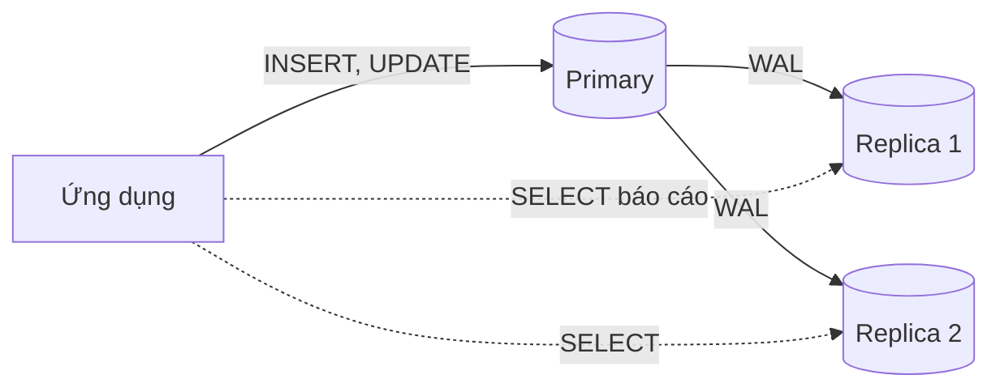

# Ngày 25: SQL và dữ liệu lớn

> **Tóm tắt:** Khi một bảng lên tới hàng triệu, hàng tỷ dòng, index thôi chưa đủ: ta cần chia bảng thành nhiều phần (partition), nhân bản cơ sở dữ liệu ra nhiều máy (replication), chia dữ liệu sang nhiều máy (sharding), hoặc chuyển phần phân tích sang kho dữ liệu dạng cột. Bài này thực hành phân vùng bảng (partitioning) trên PostgreSQL với 1 triệu đơn hàng của schema `perf`, và giới thiệu các kỹ thuật còn lại ở mức tổng quan.

**Sau bài này bạn có thể:**

- Tạo bảng phân vùng RANGE, LIST, HASH đúng luật PostgreSQL (khóa chính chứa cột phân vùng, cận trên không bao gồm, đủ phân vùng HASH).
- Đọc EXPLAIN để biết truy vấn có được cắt tỉa phân vùng (partition pruning) hay không, và viết lại điều kiện WHERE để được cắt tỉa.
- Xóa hoặc lưu trữ dữ liệu cũ bằng `DETACH PARTITION` thay cho `DELETE` hàng trăm nghìn dòng.
- Giải thích replication, sharding, kho dữ liệu cột giải quyết vấn đề gì và đổi lại điều gì.

**Cần biết trước:** [Ngày 15](15-index.md) (index), [Ngày 16](16-transactions-acid.md) (transaction), [Ngày 20](20-query-performance.md) (đọc EXPLAIN).

> Bài này dùng schema `perf`. Nếu chưa có, chạy `setup/perf_seed.sql` theo hướng dẫn ở [setup/README.md](../setup/README.md#dữ-liệu-lớn-cho-các-bài-hiệu-năng). Số đo thời gian trong bài là số đo thật trên máy tác giả, máy bạn sẽ ra số khác; hãy so sánh tương đối giữa các cách làm.

## 1. Khi nào dữ liệu là "lớn"?

Không có con số cố định. Với SQL, dữ liệu trở nên "lớn" khi một trong các việc sau bắt đầu đau:

| Dấu hiệu | Ví dụ |
| --- | --- |
| Truy vấn phải đọc quá nhiều trang dữ liệu | Báo cáo một tháng nhưng phải quét cả bảng 5 năm |
| Bảo trì chậm | `DELETE` đơn hàng cũ khóa bảng hàng phút, `VACUUM` và tạo index mất hàng giờ |
| Một máy không chịu nổi | Ổ đĩa đầy, CPU 100% vì quá nhiều người đọc cùng lúc |
| Báo cáo phân tích làm chậm hệ thống bán hàng | Truy vấn tổng hợp cả năm chạy cùng lúc với hàng nghìn đơn mới mỗi phút |

Mỗi dấu hiệu có một hướng giải quyết khác nhau:

| Kỹ thuật | Chia cái gì | Ở đâu | Giải quyết |
| --- | --- | --- | --- |
| Partitioning (phân vùng) | Một bảng thành nhiều bảng con | Cùng một máy, cùng một database | Truy vấn chỉ đọc phần cần đọc, xóa dữ liệu cũ nhanh |
| Replication (nhân bản) | Sao chép toàn bộ dữ liệu | Nhiều máy | Chia tải đọc, dự phòng khi máy chính hỏng |
| Sharding (chia mảnh) | Các dòng khác nhau sang các máy khác nhau | Nhiều máy | Dữ liệu và lượng ghi vượt quá một máy |
| Kho dữ liệu cột | Lưu theo cột thay vì theo dòng | Hệ thống riêng cho phân tích | Truy vấn tổng hợp trên hàng tỷ dòng |

Phần lớn bài này nói về partitioning, vì đó là kỹ thuật bạn tự làm được ngay bằng SQL trên một máy PostgreSQL.

## 2. Phân vùng bảng (partitioning)

### 2.1. Ý tưởng

Hãy nghĩ tới tủ hồ sơ của một cửa hàng. Nếu mọi hóa đơn từ trước tới nay nằm chung một ngăn, muốn tìm hóa đơn năm 2024 bạn phải lật hết. Nếu mỗi năm một ngăn, bạn mở đúng ngăn 2024 và bỏ qua các ngăn khác. Muốn hủy hồ sơ năm 2023, bạn rút cả ngăn ra, không cần nhặt từng tờ.

Phân vùng trong PostgreSQL làm đúng như vậy:

- Bạn tạo một **bảng cha** (partitioned table) khai báo `PARTITION BY ...`. Bảng cha không tự chứa dòng nào.
- Bạn tạo các **phân vùng** (partition) bằng `CREATE TABLE ... PARTITION OF bảng_cha FOR VALUES ...`. Mỗi phân vùng là một bảng thật, chứa một phần dữ liệu.
- Ứng dụng vẫn `INSERT`, `SELECT` trên bảng cha như bảng bình thường. PostgreSQL tự đưa mỗi dòng vào đúng phân vùng, và khi đọc thì tự bỏ qua các phân vùng chắc chắn không có dòng khớp. Việc bỏ qua này gọi là **cắt tỉa phân vùng (partition pruning)**.

Cột (hoặc biểu thức) dùng để chia gọi là **khóa phân vùng** (partition key). PostgreSQL có ba cách chia:

| Kiểu | Chia theo | Ví dụ hợp lý |
| --- | --- | --- |
| `RANGE` | Khoảng giá trị liên tục | Đơn hàng theo năm, theo tháng |
| `LIST` | Danh sách giá trị cụ thể | Đơn theo kênh bán (`online`, `offline`), theo vùng |
| `HASH` | Phần dư của giá trị băm | Chia đều khách hàng thành N phần khi không có cách chia tự nhiên |

### 2.2. Phân vùng RANGE: đơn hàng theo năm

Ta sẽ tạo `perf.orders_by_year`, một bản sao của `perf.orders` (1 triệu đơn, từ 01/2023 tới 10/2026) nhưng chia theo năm. Bảng gốc `perf.orders` giữ nguyên để so sánh.

Thử cách viết "tự nhiên" trước, với `order_id` làm khóa chính như bảng gốc:

```sql
DROP TABLE IF EXISTS perf.orders_by_year;

CREATE TABLE perf.orders_by_year (
    order_id     INT PRIMARY KEY,
    customer_id  INT           NOT NULL,
    order_date   TIMESTAMPTZ   NOT NULL,
    status       VARCHAR(20)   NOT NULL,
    total_amount NUMERIC(12,0) NOT NULL
) PARTITION BY RANGE (order_date);
```

PostgreSQL từ chối:

```text
ERROR:  unique constraint on partitioned table must include all partitioning columns
DETAIL:  PRIMARY KEY constraint on table "orders_by_year" lacks column "order_date" which is part of the partition key.
```

Lý do: mỗi phân vùng có index riêng, và PostgreSQL chỉ kiểm tra trùng lặp bên trong từng phân vùng. Nó chỉ đảm bảo được "không trùng trên toàn bảng" khi chính cột phân vùng nằm trong khóa: hai dòng khác `order_date` năm thì chắc chắn nằm ở hai phân vùng khác nhau nên không thể trùng khóa. Quy tắc này áp dụng cho cả `PRIMARY KEY` và `UNIQUE`.

Cách đúng: đưa `order_date` vào khóa chính.

```sql
DROP TABLE IF EXISTS perf.orders_by_year;

CREATE TABLE perf.orders_by_year (
    order_id     INT,
    customer_id  INT           NOT NULL,
    order_date   TIMESTAMPTZ   NOT NULL,
    status       VARCHAR(20)   NOT NULL,
    total_amount NUMERIC(12,0) NOT NULL,
    PRIMARY KEY (order_id, order_date)
) PARTITION BY RANGE (order_date);

CREATE TABLE perf.orders_2023 PARTITION OF perf.orders_by_year
    FOR VALUES FROM ('2023-01-01') TO ('2024-01-01');
CREATE TABLE perf.orders_2024 PARTITION OF perf.orders_by_year
    FOR VALUES FROM ('2024-01-01') TO ('2025-01-01');
CREATE TABLE perf.orders_2025 PARTITION OF perf.orders_by_year
    FOR VALUES FROM ('2025-01-01') TO ('2026-01-01');
CREATE TABLE perf.orders_2026 PARTITION OF perf.orders_by_year
    FOR VALUES FROM ('2026-01-01') TO ('2027-01-01');

-- Phân vùng mặc định: nhận mọi dòng không thuộc phân vùng nào ở trên
CREATE TABLE perf.orders_default PARTITION OF perf.orders_by_year DEFAULT;
```

Đổi lại, `order_id` một mình không còn được đảm bảo duy nhất bởi ràng buộc. Ở đây `order_id` lấy từ bảng gốc nên vẫn không trùng; trong hệ thống thật, giá trị sinh từ `IDENTITY` hoặc sequence cũng không trùng, chỉ là cơ sở dữ liệu không còn chặn giúp bạn nếu ai đó tự chèn id trùng.

Hai điều cần nhớ về cận của RANGE:

- **`FROM` bao gồm, `TO` không bao gồm.** Phân vùng 2024 chứa mọi thời điểm `>= 2024-01-01 00:00` và `< 2025-01-01 00:00`. Vì thế cận trên của năm này chính là cận dưới của năm sau, không có khe hở, không chồng lấn.
- `order_date` là `TIMESTAMPTZ`, nên `'2024-01-01'` được hiểu theo múi giờ của phiên lúc tạo phân vùng. Database của khóa học dùng `Asia/Ho_Chi_Minh`, nên cận là `2024-01-01 00:00:00+07`.

Nạp dữ liệu từ bảng gốc rồi đếm số dòng mỗi phân vùng. Cột ẩn `tableoid` cho biết dòng nằm ở bảng con nào, ép sang `regclass` để in ra tên bảng:

```sql
INSERT INTO perf.orders_by_year
SELECT order_id, customer_id, order_date, status, total_amount
FROM perf.orders;

ANALYZE perf.orders_by_year;

SELECT tableoid::regclass AS phan_vung, count(*) AS so_don
FROM perf.orders_by_year
GROUP BY tableoid
ORDER BY 1;
```

| phan_vung | so_don |
| --- | --- |
| perf.orders_2023 | 264867 |
| perf.orders_2024 | 264671 |
| perf.orders_2025 | 264498 |
| perf.orders_2026 | 205964 |

`perf.orders_default` không có dòng nào nên không xuất hiện. Lệnh `INSERT` 1 triệu dòng mất khoảng 4,7 giây trên máy tác giả.

### 2.3. Partition pruning: chỉ đọc phân vùng cần đọc

Để plan gọn và dễ đọc, ta tắt chạy song song trong phiên này (chỉ ảnh hưởng phiên hiện tại):

```sql
SET max_parallel_workers_per_gather = 0;

EXPLAIN (COSTS OFF)
SELECT count(*)
FROM perf.orders_by_year
WHERE order_date >= '2024-01-01' AND order_date < '2025-01-01';
```

```text
 Aggregate
   ->  Seq Scan on orders_2024 orders_by_year
         Filter: ((order_date >= '2024-01-01 00:00:00+07'::timestamp with time zone) AND (order_date < '2025-01-01 00:00:00+07'::timestamp with time zone))
```

Plan chỉ có `orders_2024`. Bốn phân vùng còn lại bị cắt tỉa ngay lúc lập kế hoạch, không đọc một trang nào.

Giờ lọc theo một cột **không phải** khóa phân vùng:

```sql
EXPLAIN (COSTS OFF)
SELECT count(*)
FROM perf.orders_by_year
WHERE total_amount > 29000000;
```

```text
 Aggregate
   ->  Append
         ->  Seq Scan on orders_2023 orders_by_year_1
               Filter: (total_amount > '29000000'::numeric)
         ->  Seq Scan on orders_2024 orders_by_year_2
               Filter: (total_amount > '29000000'::numeric)
         ->  Seq Scan on orders_2025 orders_by_year_3
               Filter: (total_amount > '29000000'::numeric)
         ->  Seq Scan on orders_2026 orders_by_year_4
               Filter: (total_amount > '29000000'::numeric)
         ->  Seq Scan on orders_default orders_by_year_5
               Filter: (total_amount > '29000000'::numeric)
```

Nút `Append` ghép kết quả của cả 5 phân vùng: không cắt tỉa được gì, vì PostgreSQL không biết phân vùng nào có đơn trên 29 triệu.

Bẫy hay gặp nhất là bọc cột phân vùng trong một hàm, giống bẫy sargability của index ở Ngày 15:

```sql
EXPLAIN (COSTS OFF)
SELECT count(*)
FROM perf.orders_by_year
WHERE EXTRACT(YEAR FROM order_date) = 2024;
```

```text
 Aggregate
   ->  Append
         ->  Seq Scan on orders_2023 orders_by_year_1
               Filter: (EXTRACT(year FROM order_date) = '2024'::numeric)
         ->  Seq Scan on orders_2024 orders_by_year_2
               Filter: (EXTRACT(year FROM order_date) = '2024'::numeric)
         ->  Seq Scan on orders_2025 orders_by_year_3
               Filter: (EXTRACT(year FROM order_date) = '2024'::numeric)
         ->  Seq Scan on orders_2026 orders_by_year_4
               Filter: (EXTRACT(year FROM order_date) = '2024'::numeric)
         ->  Seq Scan on orders_default orders_by_year_5
               Filter: (EXTRACT(year FROM order_date) = '2024'::numeric)
```

Cùng ý nghĩa "năm 2024" nhưng quét cả 5 phân vùng. Quy tắc: **muốn được cắt tỉa, WHERE phải so sánh trực tiếp cột phân vùng với giá trị** (`=`, `<`, `>=`, `BETWEEN`, `IN`), không bọc cột trong hàm hay phép ép kiểu.

![Partition pruning trên bảng perf.orders_by_year. Truy vấn lọc order_date từ 2024-01-01 (bao gồm) tới 2025-01-01 (không bao gồm) đi vào bảng cha orders_by_year, bảng cha không chứa dữ liệu và được chia RANGE theo order_date thành năm phân vùng: orders_2023 có 264.867 dòng, orders_2024 có 264.671 dòng, orders_2025 có 264.498 dòng, orders_2026 có 205.964 dòng, và orders_default nhận dòng ngoài mọi khoảng. Chỉ orders_2024 được quét, bốn phân vùng còn lại bị bỏ qua khi lập kế hoạch. Nếu WHERE bọc cột trong hàm như EXTRACT(YEAR FROM order_date) = 2024 thì cả năm phân vùng đều bị quét.](img/partition-pruning.png#gh-light-mode-only)
![Partition pruning trên bảng perf.orders_by_year. Truy vấn lọc order_date từ 2024-01-01 (bao gồm) tới 2025-01-01 (không bao gồm) đi vào bảng cha orders_by_year, bảng cha không chứa dữ liệu và được chia RANGE theo order_date thành năm phân vùng: orders_2023 có 264.867 dòng, orders_2024 có 264.671 dòng, orders_2025 có 264.498 dòng, orders_2026 có 205.964 dòng, và orders_default nhận dòng ngoài mọi khoảng. Chỉ orders_2024 được quét, bốn phân vùng còn lại bị bỏ qua khi lập kế hoạch. Nếu WHERE bọc cột trong hàm như EXTRACT(YEAR FROM order_date) = 2024 thì cả năm phân vùng đều bị quét.](img/partition-pruning-dark.png#gh-dark-mode-only)

<small>File gốc: [nền sáng](../diagrams/big-data/partition-pruning.html) · [nền tối](../diagrams/big-data/partition-pruning-dark.html)</small>

**Cắt tỉa lúc chạy.** Khi giá trị so sánh chỉ biết lúc thực thi (như `now()` hay tham số của câu lệnh chuẩn bị sẵn), PostgreSQL cắt tỉa ở bước khởi động thực thi. EXPLAIN ANALYZE ghi lại bằng dòng `Subplans Removed`:

```sql
EXPLAIN (ANALYZE, COSTS OFF)
SELECT count(*)
FROM perf.orders_by_year
WHERE order_date >= now() - INTERVAL '30 days';
```

```text
 Aggregate (actual time=75.430..75.432 rows=1 loops=1)
   ->  Append (actual time=0.023..73.591 rows=17372 loops=1)
         Subplans Removed: 3
         ->  Seq Scan on orders_2026 orders_by_year_1 (actual time=0.023..71.154 rows=17372 loops=1)
               Filter: (order_date >= (now() - '30 days'::interval))
               Rows Removed by Filter: 188592
         ->  Seq Scan on orders_default orders_by_year_2 (actual time=0.018..0.018 rows=0 loops=1)
               Filter: (order_date >= (now() - '30 days'::interval))
 Planning Time: 0.388 ms
 Execution Time: 75.475 ms
```

Ba phân vùng 2023, 2024, 2025 bị loại. Số dòng và phân vùng còn lại phụ thuộc ngày bạn chạy.

### 2.4. Đo thật: bảng thường và bảng phân vùng

Cùng truy vấn đếm đơn năm 2024, chạy trên bảng gốc `perf.orders` (không có index trên `order_date`) và trên bảng phân vùng:

```sql
EXPLAIN (ANALYZE, BUFFERS, COSTS OFF)
SELECT count(*) FROM perf.orders
WHERE order_date >= '2024-01-01' AND order_date < '2025-01-01';

EXPLAIN (ANALYZE, BUFFERS, COSTS OFF)
SELECT count(*) FROM perf.orders_by_year
WHERE order_date >= '2024-01-01' AND order_date < '2025-01-01';
```

Bảng gốc:

```text
 Aggregate (actual time=282.131..282.133 rows=1 loops=1)
   Buffers: shared hit=57 read=8140
   ->  Seq Scan on orders (actual time=0.038..248.777 rows=264671 loops=1)
         Filter: ((order_date >= '2024-01-01 00:00:00+07'::timestamp with time zone) AND (order_date < '2025-01-01 00:00:00+07'::timestamp with time zone))
         Rows Removed by Filter: 735329
         Buffers: shared hit=57 read=8140
 Planning Time: 0.122 ms
 Execution Time: 282.176 ms
```

Bảng phân vùng:

```text
 Aggregate (actual time=114.717..114.719 rows=1 loops=1)
   Buffers: shared hit=2170
   ->  Seq Scan on orders_2024 orders_by_year (actual time=0.014..82.223 rows=264671 loops=1)
         Filter: ((order_date >= '2024-01-01 00:00:00+07'::timestamp with time zone) AND (order_date < '2025-01-01 00:00:00+07'::timestamp with time zone))
         Buffers: shared hit=2170
 Planning Time: 0.190 ms
 Execution Time: 114.756 ms
```

| | Trang đọc (Buffers) | Thời gian (nhiều lần chạy trên máy tác giả) |
| --- | --- | --- |
| `perf.orders` | 8197 | 186 đến 285 ms |
| `perf.orders_by_year` | 2170 | 82 đến 118 ms |

Bảng phân vùng chỉ đọc khoảng một phần tư số trang, vì nó chỉ quét một trong bốn năm. Con số đáng tin là số trang; thời gian dao động tùy dữ liệu đã nằm sẵn trong bộ nhớ hay chưa.

> Partition không thay thế index. Nếu truy vấn chỉ lấy vài dòng (ví dụ đơn của một khách), một index B-tree trên bảng thường đã đủ nhanh. Partition có lợi khi truy vấn đọc **một phần lớn** dữ liệu theo khóa phân vùng (báo cáo theo tháng, theo năm) và khi cần xóa cả khối dữ liệu cũ.

### 2.5. Index trên bảng phân vùng

Tạo index trên bảng cha thì PostgreSQL tự tạo index tương ứng trên từng phân vùng, kể cả phân vùng tạo sau này:

```sql
CREATE INDEX ON perf.orders_by_year (customer_id);

SELECT tablename, indexname
FROM pg_indexes
WHERE schemaname = 'perf' AND tablename LIKE 'orders\_20%'
ORDER BY tablename, indexname;
```

| tablename | indexname |
| --- | --- |
| orders_2023 | orders_2023_customer_id_idx |
| orders_2023 | orders_2023_pkey |
| orders_2024 | orders_2024_customer_id_idx |
| orders_2024 | orders_2024_pkey |
| orders_2025 | orders_2025_customer_id_idx |
| orders_2025 | orders_2025_pkey |
| orders_2026 | orders_2026_customer_id_idx |
| orders_2026 | orders_2026_pkey |

Truy vấn tìm đơn của một khách mà không lọc theo `order_date` vẫn phải dò index ở mọi phân vùng. Càng nhiều phân vùng, chi phí này càng lớn, nên đừng chia quá nhỏ.

### 2.6. Phân vùng LIST: đơn hàng theo kênh bán

Quay lại DSC Shop. Bảng `orders` có cột `channel` chỉ nhận `online` hoặc `offline`, rất hợp để chia theo danh sách. Ta tạo một bản sao phân vùng (bảng `orders` gốc giữ nguyên):

```sql
DROP TABLE IF EXISTS orders_by_channel;

CREATE TABLE orders_by_channel (
    order_id    INT,
    customer_id INT         NOT NULL,
    order_date  TIMESTAMPTZ NOT NULL,
    status      VARCHAR(20) NOT NULL,
    channel     VARCHAR(10) NOT NULL,
    PRIMARY KEY (order_id, channel)
) PARTITION BY LIST (channel);

CREATE TABLE orders_online  PARTITION OF orders_by_channel FOR VALUES IN ('online');
CREATE TABLE orders_offline PARTITION OF orders_by_channel FOR VALUES IN ('offline');

INSERT INTO orders_by_channel
SELECT order_id, customer_id, order_date, status, channel
FROM orders;

SELECT tableoid::regclass AS phan_vung, count(*) AS so_don
FROM orders_by_channel
GROUP BY tableoid
ORDER BY 1;
```

| phan_vung | so_don |
| --- | --- |
| orders_online | 25 |
| orders_offline | 15 |

Một ngày cửa hàng mở thêm kênh `app`. Dòng mới không thuộc danh sách nào:

```sql
INSERT INTO orders_by_channel VALUES (41, 1, now(), 'pending', 'app');
```

```text
ERROR:  no partition of relation "orders_by_channel" found for row
DETAIL:  Partition key of the failing row contains (channel) = (app).
```

Thêm phân vùng `DEFAULT` để hứng mọi giá trị còn lại:

```sql
CREATE TABLE orders_channel_khac PARTITION OF orders_by_channel DEFAULT;

INSERT INTO orders_by_channel VALUES (41, 1, now(), 'pending', 'app');

SELECT tableoid::regclass AS phan_vung, order_id, channel
FROM orders_by_channel
WHERE order_id = 41;
```

| phan_vung | order_id | channel |
| --- | --- | --- |
| orders_channel_khac | 41 | app |

Cắt tỉa hoạt động với `=` và `IN` trên cột phân vùng:

```sql
EXPLAIN (COSTS OFF)
SELECT * FROM orders_by_channel
WHERE channel = 'offline' AND status = 'delivered';
```

```text
 Seq Scan on orders_offline orders_by_channel
   Filter: (((channel)::text = 'offline'::text) AND ((status)::text = 'delivered'::text))
```

### 2.7. Phân vùng HASH: chia đều khi không có cách chia tự nhiên

Khách hàng không có "năm" hay "kênh" để chia. Nếu chỉ muốn chia đều 100.000 khách của `perf.customers` thành 4 phần, dùng HASH: PostgreSQL băm `customer_id`, lấy phần dư khi chia cho `MODULUS` để chọn phân vùng.

```sql
DROP TABLE IF EXISTS perf.customers_hash;

CREATE TABLE perf.customers_hash (
    customer_id INT PRIMARY KEY,
    full_name   VARCHAR(100) NOT NULL,
    city        VARCHAR(100) NOT NULL
) PARTITION BY HASH (customer_id);

CREATE TABLE perf.customers_hash_0 PARTITION OF perf.customers_hash FOR VALUES WITH (MODULUS 4, REMAINDER 0);
CREATE TABLE perf.customers_hash_1 PARTITION OF perf.customers_hash FOR VALUES WITH (MODULUS 4, REMAINDER 1);
CREATE TABLE perf.customers_hash_2 PARTITION OF perf.customers_hash FOR VALUES WITH (MODULUS 4, REMAINDER 2);
CREATE TABLE perf.customers_hash_3 PARTITION OF perf.customers_hash FOR VALUES WITH (MODULUS 4, REMAINDER 3);

INSERT INTO perf.customers_hash
SELECT customer_id, full_name, city FROM perf.customers;

SELECT tableoid::regclass AS phan_vung, count(*) AS so_khach
FROM perf.customers_hash
GROUP BY tableoid
ORDER BY 1;
```

| phan_vung | so_khach |
| --- | --- |
| perf.customers_hash_0 | 25126 |
| perf.customers_hash_1 | 24978 |
| perf.customers_hash_2 | 24971 |
| perf.customers_hash_3 | 24925 |

Ở đây `PRIMARY KEY (customer_id)` hợp lệ vì khóa chính đã chứa cột phân vùng. Phải tạo **đủ** 4 phần dư 0, 1, 2, 3; bảng HASH không được có phân vùng `DEFAULT`:

```sql
CREATE TABLE perf.customers_hash_x PARTITION OF perf.customers_hash DEFAULT;
```

```text
ERROR:  a hash-partitioned table may not have a default partition
```

HASH chỉ cắt tỉa được với phép `=` trên khóa (tìm một khách theo id); điều kiện khoảng như `customer_id < 100` hay lọc theo cột khác vẫn quét mọi phân vùng:

```sql
EXPLAIN (COSTS OFF)
SELECT * FROM perf.customers_hash WHERE customer_id = 4242;
```

```text
 Index Scan using customers_hash_0_pkey on customers_hash_0 customers_hash
   Index Cond: (customer_id = 4242)
```

### 2.8. Lợi ích lớn nhất: xóa và lưu trữ dữ liệu cũ

Giả sử chính sách là chỉ giữ đơn của 3 năm gần nhất. Với bảng thường, bạn phải `DELETE` hàng trăm nghìn dòng: chậm, sinh nhiều WAL (nhật ký ghi), để lại các dòng chết chờ `VACUUM` dọn. Với bảng phân vùng, bạn tách cả phân vùng ra bằng một thao tác trên danh mục hệ thống.

So sánh trên máy tác giả (`\timing on` là lệnh psql để in thời gian chạy):

```sql
\timing on

-- Cách 1: DELETE từng dòng (bọc trong transaction rồi ROLLBACK để giữ dữ liệu)
BEGIN;
DELETE FROM perf.orders_by_year
WHERE order_date >= '2023-01-01' AND order_date < '2024-01-01';
ROLLBACK;

-- Cách 2: tách cả phân vùng 2023 ra khỏi bảng cha
ALTER TABLE perf.orders_by_year DETACH PARTITION perf.orders_2023;

\timing off
```

```text
DELETE 264867
Time: 739.608 ms
...
ALTER TABLE
Time: 3.244 ms
```

Qua nhiều lần chạy trên máy tác giả, `DELETE` mất từ 210 tới 740 ms, còn `DETACH` thường chỉ 3 tới 33 ms (có lần lên 282 ms khi phải chờ khóa). Quan trọng hơn thời gian: `DELETE` để lại 264.867 dòng chết cho `VACUUM` dọn, `DETACH` thì không, và khoảng cách càng lớn khi bảng càng lớn. Sau khi tách, `perf.orders_2023` trở thành một bảng độc lập: bạn có thể sao lưu nó (Ngày 30 học `pg_dump`) rồi `DROP TABLE`, hoặc gắn lại khi cần:

```sql
SELECT count(*) FROM perf.orders_by_year;   -- 735133: không còn đơn 2023
SELECT count(*) FROM perf.orders_2023;      -- 264867: dữ liệu vẫn còn, ở bảng riêng

ALTER TABLE perf.orders_by_year ATTACH PARTITION perf.orders_2023
    FOR VALUES FROM ('2023-01-01') TO ('2024-01-01');

SELECT count(*) FROM perf.orders_by_year;   -- 1000000
```

Khi `ATTACH`, PostgreSQL quét bảng để kiểm tra mọi dòng nằm đúng khoảng (và phân vùng `DEFAULT` không chứa dòng nào thuộc khoảng mới).

> **Ghi chú dialect:** MySQL khai báo phân vùng ngay trong `CREATE TABLE`: `PARTITION BY RANGE (YEAR(sale_date)) (PARTITION p2024 VALUES LESS THAN (2025), PARTITION p2025 VALUES LESS THAN (2026), PARTITION pmax VALUES LESS THAN MAXVALUE)`. `VALUES LESS THAN` cũng là cận trên không bao gồm, và MySQL cũng bắt mọi khóa chính, khóa UNIQUE phải chứa các cột dùng trong biểu thức phân vùng. SQL Server dùng hai đối tượng riêng là partition function và partition scheme (`CREATE PARTITION FUNCTION ... AS RANGE RIGHT FOR VALUES (...)`).

## 3. Nén dữ liệu: TOAST

PostgreSQL không có tùy chọn "nén cả bảng". Thay vào đó, cơ chế TOAST tự nén từng **giá trị lớn** (thường từ khoảng 2 KB trở lên) của các kiểu có độ dài thay đổi như `TEXT`, `VARCHAR`, `JSONB`, và chuyển giá trị quá lớn ra một bảng phụ. Các cột số nhỏ như `INT`, `NUMERIC(12,0)` của đơn hàng không được nén.

Mỗi cột có thể chỉnh hai thứ, đều bằng `ALTER COLUMN`:

| Thiết lập | Ý nghĩa |
| --- | --- |
| `SET COMPRESSION pglz` / `lz4` | Thuật toán nén (PostgreSQL 14+). `lz4` thường nén và giải nén nhanh hơn `pglz` |
| `SET STORAGE EXTENDED` | Mặc định cho `TEXT`/`JSONB`: được nén, được đưa ra ngoài dòng |
| `SET STORAGE EXTERNAL` | Đưa ra ngoài dòng nhưng **không nén** (đọc một đoạn con của chuỗi dài nhanh hơn) |
| `SET STORAGE MAIN` | Được nén, cố giữ trong dòng |

Thử nghiệm với ba cột chứa cùng một đoạn mô tả dài (lặp lại tên sản phẩm 500 lần, nên nén rất tốt, dữ liệu thật thường nén kém hơn):

```sql
DROP TABLE IF EXISTS product_docs;

CREATE TABLE product_docs (
    product_id INT PRIMARY KEY,
    mo_ta_pglz TEXT,                     -- mặc định: pglz
    mo_ta_lz4  TEXT COMPRESSION lz4,
    mo_ta_raw  TEXT
);
ALTER TABLE product_docs ALTER COLUMN mo_ta_raw SET STORAGE EXTERNAL;

INSERT INTO product_docs
SELECT product_id, d, d, d
FROM (SELECT product_id, repeat(name || ' - ' || sku || '. ', 500) AS d
      FROM products) AS t;

SELECT product_id,
       octet_length(mo_ta_pglz)         AS so_byte_goc,
       pg_column_size(mo_ta_pglz)       AS pglz,
       pg_column_size(mo_ta_lz4)        AS lz4,
       pg_column_size(mo_ta_raw)        AS external_khong_nen,
       pg_column_compression(mo_ta_lz4) AS kieu_nen
FROM product_docs
ORDER BY product_id
LIMIT 3;
```

| product_id | so_byte_goc | pglz | lz4 | external_khong_nen | kieu_nen |
| --- | --- | --- | --- | --- | --- |
| 1 | 15000 | 214 | 107 | 15000 | lz4 |
| 2 | 13500 | 195 | 98 | 13500 | lz4 |
| 3 | 13500 | 195 | 98 | 13500 | lz4 |

`pg_column_size` cho biết số byte giá trị thật sự chiếm. Cột `EXTERNAL` giữ nguyên 15000 byte: thiết lập này **tắt** nén, đừng nhầm.

Nén giảm dung lượng và số trang phải đọc, đổi lại tốn CPU để nén khi ghi và giải nén khi đọc. Nó hợp với dữ liệu ghi một lần, đọc nhiều lần; không phải lúc nào cũng làm truy vấn nhanh hơn.

> **Ghi chú dialect:** MySQL InnoDB nén theo bảng bằng `ROW_FORMAT=COMPRESSED` (thường làm ghi chậm hơn), SQL Server có `DATA_COMPRESSION = ROW` hoặc `PAGE`.

## 4. Vượt ra khỏi một máy

Phần này là tổng quan để bạn biết tên và biết khi nào cần tìm hiểu sâu.

### 4.1. Replication: nhân bản để chia tải đọc và dự phòng

Một máy **primary** nhận mọi lệnh ghi. Các máy **replica** (standby) nhận liên tục nhật ký WAL từ primary và áp dụng lại, nên có bản sao gần như tức thời của toàn bộ dữ liệu. PostgreSQL có sẵn streaming replication.



- Lợi: chia tải đọc (báo cáo chạy trên replica, không làm chậm bán hàng); primary hỏng thì nâng một replica lên thay.
- Đổi lại: replica có thể **trễ** (replication lag) vài mili giây tới vài giây. Người dùng vừa đặt hàng xong mà đọc từ replica có thể chưa thấy đơn của mình. Replication không giúp tăng sức ghi, vì mọi lệnh ghi vẫn dồn vào một primary.

### 4.2. Sharding: chia dòng sang nhiều máy

Khi dữ liệu hoặc lượng ghi vượt quá một máy, ta chia các dòng sang nhiều máy (shard), mỗi máy giữ một phần. Cột quyết định dòng đi về shard nào gọi là **shard key**, ví dụ `customer_id`. Nghe giống partition, nhưng mỗi phần nằm ở một máy chủ khác.

| Cách chia | Ví dụ | Nhược điểm |
| --- | --- | --- |
| Theo khoảng | Khách id 1 đến 500.000 ở máy 1, phần còn lại ở máy 2 | Id tăng dần nên mọi khách mới dồn vào máy cuối (điểm nóng) |
| Theo hash | `hash(customer_id) % 4` chọn máy | Truy vấn theo khoảng phải hỏi mọi máy; thêm máy thì phải chuyển rất nhiều dữ liệu |

Cái giá chung của sharding:

- JOIN và transaction xuyên nhiều shard khó và chậm. Vì vậy chọn shard key sao cho dữ liệu hay dùng chung nằm cùng shard (đơn hàng, dòng hàng, thanh toán của một khách cùng theo `customer_id`).
- Truy vấn không có shard key (ví dụ "doanh thu toàn hệ thống theo tháng") phải gửi tới mọi shard rồi gộp lại.
- Chia lại khi thêm máy (resharding) là việc lớn.

PostgreSQL gốc không tự sharding; có các extension và hệ thống xây trên nó như Citus. Với hầu hết ứng dụng cỡ vừa, một máy PostgreSQL tốt cộng partition, index và replica là đủ trong rất lâu. Hãy coi sharding là lựa chọn cuối cùng.

### 4.3. Kho dữ liệu cột (columnar data warehouse)

PostgreSQL lưu **theo dòng**: các cột của một đơn hàng nằm cạnh nhau. Rất hợp với hệ thống giao dịch (OLTP: Online Transaction Processing): đọc, ghi trọn một đơn.

Câu hỏi phân tích như "tổng `total_amount` theo tháng trên 1 tỷ đơn" chỉ cần 2 cột, nhưng kho lưu theo dòng vẫn phải đọc mọi cột của mọi dòng. Hệ thống **lưu theo cột** đặt mọi giá trị của một cột cạnh nhau, nên:

- Chỉ đọc đúng các cột truy vấn cần.
- Nén rất tốt, vì các giá trị cùng kiểu, hay lặp (cột `status` chỉ có 5 giá trị).

Đổi lại, cập nhật từng dòng chậm. Đây là lựa chọn cho phân tích (OLAP: Online Analytical Processing). Ví dụ: ClickHouse, DuckDB, Amazon Redshift, Google BigQuery, Snowflake. Mô hình phổ biến: hệ thống bán hàng chạy PostgreSQL, định kỳ chép dữ liệu (ETL/ELT) sang kho cột để làm báo cáo. Hầu hết các hệ này vẫn dùng SQL, nên những gì bạn học trong khóa này dùng được ngay.

## Lỗi thường gặp

**1. Khóa chính không chứa cột phân vùng.** `id SERIAL PRIMARY KEY` trên bảng `PARTITION BY RANGE (sale_date)` báo `unique constraint on partitioned table must include all partitioning columns`. Sửa: `PRIMARY KEY (id, sale_date)`.

**2. Viết cận trên như thể nó được bao gồm.** Cận `TO ('2025-12-31')` bỏ sót đúng ngày 31/12:

```sql
DROP TABLE IF EXISTS sales_sai_can;

CREATE TABLE sales_sai_can (
    sale_id   INT,
    sale_date DATE NOT NULL,
    amount    NUMERIC(12,0) NOT NULL,
    PRIMARY KEY (sale_id, sale_date)
) PARTITION BY RANGE (sale_date);

CREATE TABLE sales_sai_can_2025 PARTITION OF sales_sai_can
    FOR VALUES FROM ('2025-01-01') TO ('2025-12-31');   -- SAI
CREATE TABLE sales_sai_can_2026 PARTITION OF sales_sai_can
    FOR VALUES FROM ('2026-01-01') TO ('2026-12-31');   -- SAI

INSERT INTO sales_sai_can VALUES (1, '2025-12-30', 500000);  -- được
INSERT INTO sales_sai_can VALUES (2, '2025-12-31', 700000);  -- lỗi
```

```text
ERROR:  no partition of relation "sales_sai_can" found for row
DETAIL:  Partition key of the failing row contains (sale_date) = (2025-12-31).
```

Sửa: cận trên của năm này là ngày đầu năm sau, `FROM ('2025-01-01') TO ('2026-01-01')`. Thêm phân vùng `DEFAULT` cũng giúp không mất dòng, nhưng không thay được việc viết cận đúng.

```sql
DROP TABLE sales_sai_can;
```

**3. Phân vùng chồng lấn.** PostgreSQL chặn ngay:

```sql
CREATE TABLE perf.orders_2026b PARTITION OF perf.orders_by_year
    FOR VALUES FROM ('2026-06-01') TO ('2027-06-01');
```

```text
ERROR:  partition "orders_2026b" would overlap partition "orders_2026"
```

**4. Tạo thiếu phân vùng HASH.** Khai báo `MODULUS 4` mà chỉ tạo phần dư 0 và 1 thì mọi dòng băm ra dư 2, 3 đều lỗi, và HASH không có `DEFAULT` để hứng:

```sql
DROP TABLE IF EXISTS hash_thieu;
CREATE TABLE hash_thieu (customer_id INT PRIMARY KEY) PARTITION BY HASH (customer_id);
CREATE TABLE hash_thieu_0 PARTITION OF hash_thieu FOR VALUES WITH (MODULUS 4, REMAINDER 0);
CREATE TABLE hash_thieu_1 PARTITION OF hash_thieu FOR VALUES WITH (MODULUS 4, REMAINDER 1);

INSERT INTO hash_thieu SELECT generate_series(1, 10);
```

```text
ERROR:  no partition of relation "hash_thieu" found for row
DETAIL:  Partition key of the failing row contains (customer_id) = (2).
```

Sửa: tạo đủ `REMAINDER 0` tới `MODULUS - 1`.

```sql
DROP TABLE hash_thieu;
```

**5. Bọc cột phân vùng trong hàm** (`EXTRACT(YEAR FROM order_date) = 2024`, `order_date::date = '2024-12-25'`): mất cắt tỉa, quét mọi phân vùng. Viết thành khoảng trên chính cột đó.

**6. Chia quá nhỏ.** Phân vùng theo ngày cho bảng vài triệu dòng tạo ra hàng nghìn bảng con: lập kế hoạch chậm hơn, truy vấn không lọc theo ngày phải dò hàng nghìn index. Mỗi phân vùng nên đủ lớn (thường từ hàng triệu dòng trở lên); với dữ liệu nhỏ như schema `shop`, partition chỉ để học, không có lợi về hiệu năng.

## Bài tập

Các bài dưới đây giả sử bạn đã chạy các ví dụ ở trên (có `perf.orders_by_year` với 4 phân vùng năm và `orders_default`).

### Cơ bản

**Bài 1.** Tạo bảng `payments_by_method`, bản sao của `payments` được phân vùng LIST theo `method`: một phân vùng cho `cash`, một cho `card`, một chung cho `momo` và `bank_transfer`. Nạp dữ liệu từ `payments`, rồi in số lần thanh toán và tổng tiền của từng phân vùng.

<details>
<summary>Đáp án</summary>

```sql
DROP TABLE IF EXISTS payments_by_method;

CREATE TABLE payments_by_method (
    payment_id INT,
    order_id   INT           NOT NULL,
    amount     NUMERIC(12,0) NOT NULL,
    method     VARCHAR(20)   NOT NULL,
    paid_at    TIMESTAMPTZ   NOT NULL,
    PRIMARY KEY (payment_id, method)
) PARTITION BY LIST (method);

CREATE TABLE payments_cash     PARTITION OF payments_by_method FOR VALUES IN ('cash');
CREATE TABLE payments_card     PARTITION OF payments_by_method FOR VALUES IN ('card');
CREATE TABLE payments_transfer PARTITION OF payments_by_method FOR VALUES IN ('momo', 'bank_transfer');

INSERT INTO payments_by_method
SELECT payment_id, order_id, amount, method, paid_at
FROM payments;

SELECT tableoid::regclass AS phan_vung, count(*) AS so_lan, sum(amount) AS tong_tien
FROM payments_by_method
GROUP BY tableoid
ORDER BY 1;
```

Kết quả:

| phan_vung | so_lan | tong_tien |
| --- | --- | --- |
| payments_cash | 8 | 99331000 |
| payments_card | 7 | 112317500 |
| payments_transfer | 22 | 324642500 |

Khóa chính phải là `(payment_id, method)` vì chứa cột phân vùng.
</details>

**Bài 2.** Dùng `EXPLAIN` kiểm tra truy vấn `SELECT sum(amount) FROM payments_by_method WHERE method = 'momo';` quét những phân vùng nào, rồi chạy để lấy kết quả.

<details>
<summary>Đáp án</summary>

```sql
EXPLAIN (COSTS OFF)
SELECT sum(amount) FROM payments_by_method WHERE method = 'momo';

SELECT sum(amount) FROM payments_by_method WHERE method = 'momo';
```

```text
 Aggregate
   ->  Seq Scan on payments_transfer payments_by_method
         Filter: ((method)::text = 'momo'::text)
```

Kết quả:

| sum |
| --- |
| 157951000 |

Chỉ quét `payments_transfer`. Vẫn còn dòng `Filter` vì phân vùng này chứa cả `bank_transfer`.
</details>

**Bài 3.** Một đơn đặt đúng lúc `2025-01-01 00:00:00` và một đơn lúc `2024-12-31 23:59:59` sẽ rơi vào phân vùng nào của `perf.orders_by_year`? Kiểm chứng bằng `INSERT ... RETURNING tableoid::regclass` trong một transaction rồi `ROLLBACK`.

<details>
<summary>Đáp án</summary>

```sql
BEGIN;

INSERT INTO perf.orders_by_year VALUES (1000001, 1, '2025-01-01 00:00:00', 'pending', 500000)
RETURNING tableoid::regclass AS phan_vung, order_id, order_date;

INSERT INTO perf.orders_by_year VALUES (1000002, 1, '2024-12-31 23:59:59', 'pending', 500000)
RETURNING tableoid::regclass AS phan_vung, order_id, order_date;

ROLLBACK;
```

Kết quả:

| phan_vung | order_id | order_date |
| --- | --- | --- |
| perf.orders_2025 | 1000001 | 2025-01-01 00:00:00+07 |

| phan_vung | order_id | order_date |
| --- | --- | --- |
| perf.orders_2024 | 1000002 | 2024-12-31 23:59:59+07 |

Đúng 0 giờ ngày 1/1/2025 là cận `FROM` (bao gồm) của `orders_2025`, đồng thời là cận `TO` (không bao gồm) của `orders_2024`.
</details>

### Vận dụng

**Bài 4.** Truy vấn sau đếm đơn ngày Giáng sinh 2024 nhưng quét cả 5 phân vùng. Giải thích vì sao và viết lại để chỉ quét một phân vùng, kết quả không đổi.

```sql
SELECT count(*) FROM perf.orders_by_year WHERE order_date::date = '2024-12-25';
```

<details>
<summary>Đáp án</summary>

Phép ép kiểu `order_date::date` bọc cột phân vùng, nên PostgreSQL không so được điều kiện với cận của các phân vùng. Viết lại thành khoảng nửa mở trên chính cột `order_date`:

```sql
EXPLAIN (COSTS OFF)
SELECT count(*) FROM perf.orders_by_year
WHERE order_date >= '2024-12-25' AND order_date < '2024-12-26';

SELECT count(*) FROM perf.orders_by_year
WHERE order_date >= '2024-12-25' AND order_date < '2024-12-26';
```

```text
 Aggregate
   ->  Seq Scan on orders_2024 orders_by_year
         Filter: ((order_date >= '2024-12-25 00:00:00+07'::timestamp with time zone) AND (order_date < '2024-12-26 00:00:00+07'::timestamp with time zone))
```

Kết quả (giống truy vấn cũ):

| count |
| --- |
| 685 |
</details>

**Bài 5.** Đếm số đơn theo `status` trong quý 1/2025 trên `perf.orders_by_year`, sắp giảm dần theo số đơn. Kiểm tra bằng EXPLAIN rằng chỉ phân vùng 2025 bị quét.

<details>
<summary>Đáp án</summary>

```sql
EXPLAIN (COSTS OFF)
SELECT status, count(*) AS so_don
FROM perf.orders_by_year
WHERE order_date >= '2025-01-01' AND order_date < '2025-04-01'
GROUP BY status
ORDER BY so_don DESC;

SELECT status, count(*) AS so_don
FROM perf.orders_by_year
WHERE order_date >= '2025-01-01' AND order_date < '2025-04-01'
GROUP BY status
ORDER BY so_don DESC;
```

```text
 Sort
   Sort Key: (count(*)) DESC
   ->  HashAggregate
         Group Key: orders_by_year.status
         ->  Seq Scan on orders_2025 orders_by_year
               Filter: ((order_date >= '2025-01-01 00:00:00+07'::timestamp with time zone) AND (order_date < '2025-04-01 00:00:00+07'::timestamp with time zone))
```

Kết quả:

| status | so_don |
| --- | --- |
| delivered | 55498 |
| cancelled | 5362 |
| shipped | 2574 |
| paid | 1307 |
| pending | 649 |
</details>

### Thử thách

**Bài 6.** Một đơn đặt trước cho năm 2027 đã lỡ được chèn vào `perf.orders_by_year` và rơi vào `orders_default`:

```sql
INSERT INTO perf.orders_by_year VALUES (1000001, 1, '2027-03-01 09:00', 'pending', 500000)
RETURNING tableoid::regclass AS phan_vung;
```

Giờ bạn tạo phân vùng `perf.orders_2027` cho năm 2027. Chuyện gì xảy ra? Hãy tạo được phân vùng này và đưa đơn kia về đúng chỗ, trong một transaction.

<details>
<summary>Đáp án</summary>

Tạo thẳng thì lỗi, vì phân vùng `DEFAULT` đang giữ một dòng thuộc khoảng mới:

```sql
CREATE TABLE perf.orders_2027 PARTITION OF perf.orders_by_year
    FOR VALUES FROM ('2027-01-01') TO ('2028-01-01');
```

```text
ERROR:  updated partition constraint for default partition "orders_default" would be violated by some row
```

Cách làm: chép các dòng 2027 ra bảng tạm, xóa khỏi `orders_default`, tạo phân vùng, rồi chèn lại qua bảng cha.

```sql
BEGIN;

CREATE TEMP TABLE tam_2027 ON COMMIT DROP AS
SELECT * FROM perf.orders_default
WHERE order_date >= '2027-01-01' AND order_date < '2028-01-01';

DELETE FROM perf.orders_default
WHERE order_date >= '2027-01-01' AND order_date < '2028-01-01';

CREATE TABLE perf.orders_2027 PARTITION OF perf.orders_by_year
    FOR VALUES FROM ('2027-01-01') TO ('2028-01-01');

INSERT INTO perf.orders_by_year SELECT * FROM tam_2027;

COMMIT;

SELECT tableoid::regclass AS phan_vung, order_id, order_date
FROM perf.orders_by_year
WHERE order_id = 1000001;
```

Kết quả:

| phan_vung | order_id | order_date |
| --- | --- | --- |
| perf.orders_2027 | 1000001 | 2027-03-01 09:00:00+07 |

Bài học: tạo sẵn phân vùng cho kỳ sắp tới (ví dụ bằng một tác vụ định kỳ) thay vì để dữ liệu dồn vào `DEFAULT`. Dọn lại sau bài (xóa phân vùng 2027, xóa luôn đơn thử):

```sql
DROP TABLE perf.orders_2027;
```
</details>

**Bài 7.** DSC Shop phát triển lên 50 triệu đơn hàng, 2 triệu khách. Các truy vấn phổ biến: (a) khách xem lịch sử đơn của mình, (b) báo cáo doanh thu theo tháng, (c) xóa đơn cũ hơn 5 năm. Bạn chọn khóa phân vùng nào cho `orders`? Nếu một ngày phải sharding, chọn shard key nào? Giải thích ngắn.

<details>
<summary>Đáp án</summary>

Không có một đáp án duy nhất, đây là một hướng hợp lý:

- **Phân vùng `orders` theo RANGE `order_date`, mỗi tháng hoặc mỗi quý một phân vùng.** (b) đọc đúng các phân vùng của khoảng thời gian cần báo cáo. (c) trở thành `DETACH` rồi `DROP` các phân vùng cũ, gần như tức thời. (a) không lọc theo ngày nên phải dò mọi phân vùng; giải quyết bằng index `customer_id` trên bảng cha (tự có trên từng phân vùng) và giới hạn lịch sử hiển thị trong vài năm gần nhất để vẫn được cắt tỉa (`AND order_date >= now() - INTERVAL '2 years'`).
- **Shard key: `customer_id`.** Đơn, dòng hàng, thanh toán của một khách nằm cùng một shard, nên (a) chỉ hỏi một máy và JOIN vẫn nằm trong một máy. Báo cáo (b) phải hỏi mọi shard rồi gộp, nên thường chuyển sang kho dữ liệu cột. Không chọn `order_date` làm shard key, vì mọi đơn mới sẽ dồn vào shard của tháng hiện tại.
- Trước khi nghĩ tới sharding, 50 triệu dòng vẫn nằm gọn trong một máy PostgreSQL có partition, index và một replica cho báo cáo.
</details>

### Dọn dẹp

Các bảng của bài này không thuộc bộ dữ liệu gốc. Xóa khi học xong:

```sql
DROP TABLE IF EXISTS perf.orders_by_year, perf.customers_hash,
                     orders_by_channel, payments_by_method, product_docs;
```

## Tóm tắt

- Partition chia một bảng lớn thành nhiều bảng con trên cùng một máy. Ứng dụng vẫn làm việc với bảng cha.
- RANGE cho dữ liệu theo thời gian, LIST cho tập giá trị cố định, HASH để chia đều khi không có cách chia tự nhiên (phải tạo đủ `MODULUS` phân vùng, không có `DEFAULT`).
- Luật PostgreSQL: khóa chính và `UNIQUE` phải chứa cột phân vùng; cận RANGE là `FROM` bao gồm, `TO` không bao gồm; các phân vùng không được chồng lấn; `DEFAULT` hứng dòng ngoài mọi khoảng.
- Partition pruning chỉ xảy ra khi WHERE so sánh trực tiếp cột phân vùng. Kiểm tra bằng EXPLAIN: chỉ thấy phân vùng cần thiết, hoặc `Subplans Removed` khi cắt tỉa lúc chạy.
- Lợi ích lớn: truy vấn theo khoảng đọc ít trang hơn, và xóa dữ liệu cũ bằng `DETACH`/`DROP` thay vì `DELETE`.
- TOAST tự nén giá trị lớn theo từng cột (`SET COMPRESSION`, `SET STORAGE`); `EXTERNAL` là không nén. Nén tiết kiệm I/O nhưng tốn CPU.
- Replication chia tải đọc và dự phòng (có độ trễ); sharding chia dòng sang nhiều máy (khó JOIN, transaction xuyên shard); kho dữ liệu cột dành cho phân tích trên dữ liệu rất lớn.

## Đọc thêm

- [PostgreSQL: Table Partitioning](https://www.postgresql.org/docs/16/ddl-partitioning.html)
- [PostgreSQL: TOAST](https://www.postgresql.org/docs/16/storage-toast.html)
- [Có index rồi mà truy vấn vẫn quét toàn bảng? Sargability và một hàm bọc quanh cột](https://tiennhm.io.vn/blog/sql-index-khong-duoc-dung-sargable): cùng một nguyên nhân làm mất partition pruning.

---

[⬅️ Ngày 24: Nhập và xuất dữ liệu với CSV](24-import-export-data.md) | [📚 Mục lục](../README.md) | [Ngày 26: SQL và NoSQL ➡️](26-sql-nosql.md)
