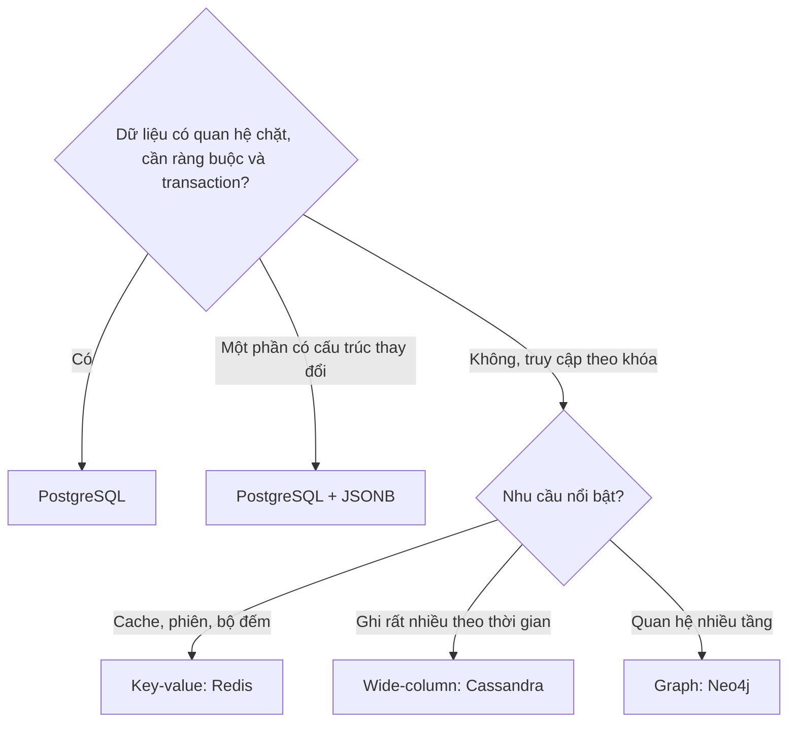

# Ngày 26: SQL và NoSQL

> **Tóm tắt:** NoSQL không phải "SQL kém hơn" hay "SQL đời mới", mà là một nhóm cơ sở dữ liệu có mô hình dữ liệu khác bảng quan hệ: document, key-value, wide-column, graph. Bài đọc này so sánh hai hướng một cách chính xác (transaction, JOIN, mở rộng, CAP), cho thấy cùng một đơn hàng DSC Shop được mô hình hóa thế nào ở mỗi bên, và đưa ra cách chọn cho từng loại bài toán.

**Sau bài này bạn có thể:**

- Kể tên 4 loại NoSQL chính và một bài toán phù hợp với mỗi loại.
- Giải thích đúng các khác biệt về schema, JOIN, transaction và cách mở rộng giữa PostgreSQL và một hệ NoSQL như MongoDB.
- Phân biệt ACID với CAP, và hiểu CAP nói về hệ phân tán.
- Chuyển một quan hệ 1-n (khách hàng, đơn hàng) giữa hai cách mô hình hóa: bảng + JOIN và document lồng nhau (embed) hoặc tham chiếu (reference).
- Chọn được giữa PostgreSQL, PostgreSQL + JSONB, hoặc một hệ NoSQL cho một yêu cầu cụ thể và nêu lý do.

**Cần biết trước:** [Ngày 10](10-join.md) (JOIN), [Ngày 16](16-transactions-acid.md) (ACID), [Ngày 22](22-sql-json-practice.md) (JSONB), [Ngày 25](25-big-data.md) (replication, sharding).

## 1. NoSQL là gì?

NoSQL thường được hiểu là "Not only SQL": các cơ sở dữ liệu không tổ chức dữ liệu thành bảng quan hệ. Không có một "NoSQL" duy nhất, mà là bốn họ khá khác nhau:

| Loại | Dữ liệu trông như thế nào | Hệ tiêu biểu | Hợp với |
| --- | --- | --- | --- |
| Document | Mỗi bản ghi là một tài liệu JSON (hoặc BSON), có thể lồng mảng, đối tượng | MongoDB, Firestore, Couchbase | Dữ liệu có cấu trúc thay đổi, thường đọc trọn một "cục": hồ sơ người dùng, nội dung CMS, catalog |
| Key-value | Một khóa trỏ tới một giá trị, hệ thống không cần biết giá trị bên trong | Redis, Amazon DynamoDB, Memcached | Cache, phiên đăng nhập, giỏ hàng, bộ đếm, hàng đợi đơn giản |
| Wide-column | Dòng được nhóm theo khóa phân vùng, mỗi phân vùng chứa rất nhiều dòng sắp theo một khóa | Apache Cassandra, ScyllaDB, HBase | Ghi cực nhiều theo thời gian: log, dữ liệu cảm biến IoT, tin nhắn |
| Graph | Đỉnh và cạnh có thuộc tính | Neo4j, Amazon Neptune | Quan hệ nhiều tầng: mạng bạn bè, gợi ý, phát hiện gian lận |

Nhiều hệ ngày nay thuộc nhiều loại cùng lúc (DynamoDB vừa key-value vừa document). Ngược lại, PostgreSQL với kiểu `JSONB` (Ngày 22) cũng làm được phần lớn việc của một document store.

## 2. So sánh SQL và NoSQL

Bảng dưới so PostgreSQL (đại diện SQL) với MongoDB (hệ NoSQL phổ biến nhất), vì nói "NoSQL" chung chung thì hầu như câu nào cũng có ngoại lệ.

| Tiêu chí | PostgreSQL | MongoDB |
| --- | --- | --- |
| Mô hình | Bảng, dòng, cột; quan hệ qua khóa ngoại | Collection chứa document JSON (BSON), có thể lồng nhau |
| Schema | Khai báo trước (`CREATE TABLE`), CSDL kiểm tra kiểu, `NOT NULL`, `CHECK`, khóa ngoại khi ghi | Linh hoạt theo mặc định, mỗi document có thể khác nhau; có thể bật kiểm tra bằng JSON Schema validation. Ứng dụng phải tự lo phần còn lại |
| Ngôn ngữ truy vấn | SQL chuẩn, dùng được ở hầu hết hệ quan hệ và nhiều kho dữ liệu | API riêng (`find`, `aggregate`) của từng hệ; Cassandra có CQL trông giống SQL |
| JOIN | Thế mạnh: JOIN nhiều bảng tùy ý, bộ tối ưu tự chọn cách nối | Có `$lookup` (tương tự LEFT JOIN) trong aggregation pipeline, nhưng thiết kế thường lồng dữ liệu (embed) để khỏi phải nối |
| Transaction | ACID đầy đủ, nhiều câu lệnh, nhiều bảng | Thao tác trên một document luôn nguyên tử; transaction ACID nhiều document có từ bản 4.0 (replica set) và 4.2 (sharded cluster), nhưng tốn kém hơn và nên dùng ít |
| Mở rộng | Chủ yếu mở rộng dọc (máy mạnh hơn); mở rộng ngang qua read replica, và sharding bằng công cụ như Citus | Sharding có sẵn, thiết kế để chia dữ liệu ra nhiều máy từ đầu |
| Ràng buộc toàn vẹn | Khóa ngoại, `UNIQUE`, `CHECK` do CSDL đảm bảo | Có unique index; không có khóa ngoại, ứng dụng tự đảm bảo tham chiếu đúng |

Hai điểm hay bị nói sai:

- "NoSQL không có transaction": sai với MongoDB 4.0 trở đi, và với nhiều hệ khác. Đúng hơn là: mức hỗ trợ transaction tùy từng hệ, và nhiều hệ khuyến khích thiết kế để mỗi thao tác chỉ chạm một bản ghi.
- "SQL không mở rộng ngang được": SQL mở rộng ngang khó hơn, nhưng làm được (replica, sharding ở Ngày 25). Có cả một nhóm hệ gọi là NewSQL (CockroachDB, Google Spanner, TiDB, YugabyteDB) giữ SQL và transaction ACID nhưng tự chia dữ liệu ra nhiều máy.

## 3. ACID và CAP là hai chuyện khác nhau

**ACID** (Ngày 16) là tính chất của **transaction**: Atomicity, Consistency, Isolation, Durability. Chữ C ở đây nghĩa là transaction đưa dữ liệu từ trạng thái hợp lệ sang trạng thái hợp lệ (không vi phạm ràng buộc).

**CAP** là định lý về **hệ phân tán** (dữ liệu nằm trên nhiều máy nối qua mạng). Ba tính chất:

- **C**onsistency: mọi lần đọc thấy giá trị ghi mới nhất, như thể chỉ có một bản dữ liệu.
- **A**vailability: mọi yêu cầu tới máy còn sống đều được trả lời.
- **P**artition tolerance: hệ vẫn chạy khi mạng giữa các máy bị đứt.

Mạng đứt là chuyện chắc chắn sẽ xảy ra, nên khi nó xảy ra, hệ phải chọn: **từ chối phục vụ để giữ nhất quán (CP)** hay **vẫn phục vụ nhưng có thể trả dữ liệu cũ (AP)**. CAP áp dụng cho mọi hệ phân tán, kể cả PostgreSQL có replica (Ngày 25: đọc từ replica có thể thấy dữ liệu cũ). Chữ C của CAP cũng khác chữ C của ACID.

Nhiều hệ AP mô tả mình bằng **BASE** (Basically Available, Soft state, Eventually consistent): luôn phục vụ, dữ liệu giữa các máy có thể lệch tạm thời và sẽ khớp lại sau (nhất quán cuối cùng, eventual consistency). Nhiều hệ cho chỉnh mức nhất quán theo từng truy vấn (Cassandra, MongoDB đều có), nên CAP là một lựa chọn cấu hình hơn là một nhãn cố định của sản phẩm.

## 4. Cùng một đơn hàng, hai cách mô hình hóa

Đơn 12 của DSC Shop trong PostgreSQL nằm rải ở bốn bảng: `orders`, `customers`, `order_items`, `products`. Muốn xem trọn đơn phải JOIN. Trong MongoDB, cách thường gặp là lưu cả đơn thành **một document**, lồng (embed) thông tin khách và danh sách sản phẩm vào trong.

PostgreSQL có thể dựng đúng document đó từ các bảng. `jsonb_build_object` tạo một đối tượng JSON từ các cặp khóa, giá trị; `jsonb_agg` là hàm tổng hợp như `SUM` (Ngày 8), nhưng gom nhiều dòng thành một mảng JSON:

```sql
SELECT jsonb_pretty(
    jsonb_build_object(
        'order_id',   o.order_id,
        'order_date', o.order_date,
        'status',     o.status,
        'customer',   jsonb_build_object('customer_id', c.customer_id,
                                         'full_name',   c.full_name,
                                         'city',        c.city),
        'items', (
            SELECT jsonb_agg(jsonb_build_object('sku',        p.sku,
                                                'name',       p.name,
                                                'quantity',   oi.quantity,
                                                'unit_price', oi.unit_price)
                             ORDER BY p.sku)
            FROM order_items AS oi
            JOIN products AS p ON p.product_id = oi.product_id
            WHERE oi.order_id = o.order_id
        )
    )
) AS don_hang
FROM orders AS o
JOIN customers AS c ON c.customer_id = o.customer_id
WHERE o.order_id = 12;
```

Kết quả (psql in thêm dấu `+` cuối mỗi dòng, ở đây đã bỏ cho dễ đọc; `JSONB` tự sắp lại thứ tự khóa):

```json
{
    "items": [
        {
            "sku": "ACC-003",
            "name": "Bàn phím cơ Keychron K2",
            "quantity": 1,
            "unit_price": 1890000
        },
        {
            "sku": "LAP-002",
            "name": "Lenovo Legion 5",
            "quantity": 1,
            "unit_price": 29990000
        }
    ],
    "status": "delivered",
    "customer": {
        "city": "TP. Hồ Chí Minh",
        "full_name": "Dương Minh Khoa",
        "customer_id": 10
    },
    "order_id": 12,
    "order_date": "2025-06-30T22:05:00+07:00"
}
```

Trong MongoDB, document này được lưu nguyên như vậy và đọc lại chỉ bằng một lệnh, không cần JOIN:

```js
db.orders.findOne({ order_id: 12 });

// Các đơn có mua sản phẩm LAP-002: truy vấn thẳng vào mảng lồng nhau
db.orders.find({ "items.sku": "LAP-002" }, { order_id: 1, status: 1 });
```

Đọc nhanh và gọn, nhưng hãy để ý cái giá:

| Dữ liệu được lồng | Hệ quả |
| --- | --- |
| `customer.full_name`, `city` | Lặp lại trong mọi đơn của khách. Khách đổi tên hay chuyển nhà thì phải sửa nhiều document, sót một cái là dữ liệu mâu thuẫn. Đây đúng là dị thường cập nhật mà chuẩn hóa (Ngày 27) loại bỏ |
| `items[].name`, `unit_price` | Đây lại là điều **nên** làm: tên và giá tại lúc mua là sự thật lịch sử của đơn. PostgreSQL cũng lưu `unit_price` trong `order_items` vì lý do này |
| Muốn hỏi "tổng doanh thu theo danh mục" | Danh mục không nằm trong document đơn; phải `$lookup` sang collection sản phẩm, hoặc chép thêm danh mục vào mỗi item |

Quy tắc kinh nghiệm khi thiết kế document:

- **Embed** khi dữ liệu con thuộc về cha, luôn được đọc cùng cha và số lượng có giới hạn (dòng hàng của một đơn, địa chỉ giao hàng).
- **Reference** (chỉ lưu id, giống khóa ngoại) khi dữ liệu dùng chung ở nhiều nơi và hay thay đổi (thông tin khách, sản phẩm), hoặc khi số lượng con có thể tăng không giới hạn (mọi đơn của một khách). MongoDB giới hạn mỗi document 16 MB, nên mảng tăng mãi là thiết kế xấu.
- Thiết kế document xuất phát từ **câu hỏi mà ứng dụng sẽ hỏi**; thiết kế bảng chuẩn hóa xuất phát từ **bản chất của dữ liệu**. Vì thế mô hình quan hệ chịu được những câu hỏi mới chưa ai nghĩ tới tốt hơn.

## 5. Khi nào chọn gì



| Bài toán | Lựa chọn hợp lý | Vì sao |
| --- | --- | --- |
| Đơn hàng, thanh toán, tồn kho của DSC Shop | PostgreSQL | Nhiều thực thể liên quan, cần khóa ngoại, transaction trừ kho và ghi đơn cùng lúc |
| Thông số kỹ thuật sản phẩm, mỗi loại một kiểu | Cột `JSONB` trong PostgreSQL (như `products.attributes`) | Phần lớn dữ liệu vẫn quan hệ, chỉ một phần linh hoạt |
| Giỏ hàng, phiên đăng nhập, giới hạn số lần gọi API | Redis | Đọc ghi theo khóa, cần cực nhanh, chấp nhận hết hạn |
| Nội dung bài viết, hồ sơ người dùng cấu trúc đa dạng, đội phát triển đổi schema liên tục | MongoDB | Đọc trọn một document, ít JOIN |
| Hàng tỷ dòng log, dữ liệu cảm biến | Cassandra, hoặc kho cột/hệ chuyên cho chuỗi thời gian | Ghi tuần tự khối lượng rất lớn, truy vấn theo khóa và khoảng thời gian |
| "Bạn của bạn của bạn", gợi ý theo quan hệ | Neo4j | Duyệt quan hệ nhiều bước là thao tác chính |

Hệ thống thật thường dùng **nhiều loại cùng lúc** (polyglot persistence): PostgreSQL giữ đơn hàng là nguồn sự thật, Redis làm cache và giỏ hàng, một kho cột phục vụ báo cáo. Với dự án mới, mặc định hợp lý là bắt đầu bằng PostgreSQL và chỉ thêm hệ khác khi có một nhu cầu cụ thể mà PostgreSQL làm không tốt.

## Lỗi thường gặp

**1. "Chọn MongoDB vì dữ liệu của tôi là JSON."** API trả JSON không có nghĩa dữ liệu nên lưu dạng document. Dữ liệu của DSC Shop vẫn có quan hệ chặt dù ứng dụng nhận JSON; PostgreSQL dựng JSON được ngay (mục 4) và có `JSONB` cho phần thật sự linh hoạt.

**2. "NoSQL không có schema."** Schema vẫn tồn tại, chỉ là chuyển từ CSDL sang code ứng dụng (schema-on-read). Ba phiên bản ứng dụng ghi ba dạng document khác nhau thì code đọc phải xử lý cả ba.

**3. "NoSQL nhanh hơn SQL."** Nhanh hơn cho đúng kiểu truy cập nó được thiết kế (đọc một document theo khóa). Với câu hỏi không lường trước (báo cáo, lọc theo nhiều tiêu chí, nối dữ liệu) thì thường chậm hơn và khó viết hơn.

**4. Đánh đồng CAP với ACID**, hoặc nói "NoSQL dùng CAP thay cho ACID". ACID nói về transaction, CAP nói về hệ phân tán khi mạng đứt (mục 3).

**5. Embed mọi thứ.** Lồng toàn bộ đơn hàng vào document khách hàng: mảng tăng mãi, mỗi lần thêm đơn phải ghi lại document lớn, và báo cáo theo đơn trở nên khó.

## Bài tập

Bài đọc nên bài tập chủ yếu là phân tích; các bài có SQL chạy trên DSC Shop, phần MongoDB chỉ để so sánh (không bắt buộc cài).

### Cơ bản

**Bài 1.** Ghép mỗi nhu cầu với loại NoSQL phù hợp nhất (document, key-value, wide-column, graph):
(a) lưu phiên đăng nhập, tự hết hạn sau 30 phút; (b) ghi nhiệt độ từ 10.000 cảm biến mỗi giây; (c) tìm "khách mua X cũng mua Y" qua nhiều bước quan hệ; (d) lưu bài viết blog có số trường thay đổi theo loại bài.

<details>
<summary>Đáp án</summary>

(a) key-value (Redis, có thời gian hết hạn cho từng khóa); (b) wide-column (Cassandra), hoặc hệ chuyên cho chuỗi thời gian; (c) graph (Neo4j); (d) document (MongoDB), hoặc một cột `JSONB` trong PostgreSQL.
</details>

**Bài 2.** Đúng hay sai? Giải thích ngắn.
(a) MongoDB không hỗ trợ transaction nhiều document. (b) PostgreSQL chỉ mở rộng được theo chiều dọc. (c) Chữ C trong CAP và chữ C trong ACID cùng nghĩa. (d) Hệ phân tán nào cũng phải đánh đổi giữa C và A khi mạng giữa các máy bị đứt.

<details>
<summary>Đáp án</summary>

(a) Sai: có từ MongoDB 4.0 (replica set) và 4.2 (sharded cluster). (b) Sai: có read replica để chia tải đọc và sharding qua công cụ như Citus, dù phức tạp hơn. (c) Sai: C của ACID là không vi phạm ràng buộc; C của CAP là mọi lần đọc thấy bản ghi mới nhất. (d) Đúng: đó là nội dung định lý CAP.
</details>

### Vận dụng

**Bài 3.** Viết truy vấn SQL dựng document của khách `customer_id = 2` theo kiểu "embed": gồm `customer_id`, `full_name` và mảng `orders`, mỗi phần tử có `order_id`, `order_date` (chỉ lấy ngày), `status`, sắp theo ngày đặt.

<details>
<summary>Đáp án</summary>

```sql
SELECT jsonb_pretty(
    jsonb_build_object(
        'customer_id', c.customer_id,
        'full_name',   c.full_name,
        'orders', (
            SELECT jsonb_agg(jsonb_build_object('order_id',   o.order_id,
                                                'order_date', o.order_date::date,
                                                'status',     o.status)
                             ORDER BY o.order_date)
            FROM orders AS o
            WHERE o.customer_id = c.customer_id
        )
    )
) AS khach_hang
FROM customers AS c
WHERE c.customer_id = 2;
```

Kết quả (đã bỏ dấu `+` của psql):

```json
{
    "orders": [
        {
            "status": "delivered",
            "order_id": 2,
            "order_date": "2025-01-20"
        },
        {
            "status": "delivered",
            "order_id": 8,
            "order_date": "2025-04-22"
        },
        {
            "status": "delivered",
            "order_id": 22,
            "order_date": "2025-11-11"
        },
        {
            "status": "delivered",
            "order_id": 34,
            "order_date": "2026-06-15"
        }
    ],
    "full_name": "Trần Thị Bình",
    "customer_id": 2
}
```
</details>

**Bài 4.** Liệt kê khách ở `Hà Nội` kèm số đơn, sắp giảm dần theo số đơn, bằng SQL. Sau đó viết truy vấn MongoDB tương ứng trong hai thiết kế: (A) đơn hàng được embed trong document khách (`customers.orders` là mảng); (B) collection `orders` riêng, mỗi đơn có `customer_id` (reference). Thiết kế nào gặp vấn đề khi một khách có hàng chục nghìn đơn, và thiết kế nào gặp vấn đề khi khách đổi tên?

<details>
<summary>Đáp án</summary>

```sql
SELECT c.customer_id, c.full_name, count(o.order_id) AS so_don
FROM customers AS c
LEFT JOIN orders AS o ON o.customer_id = c.customer_id
WHERE c.city = 'Hà Nội'
GROUP BY c.customer_id, c.full_name
ORDER BY so_don DESC, c.customer_id;
```

Kết quả:

| customer_id | full_name | so_don |
| --- | --- | --- |
| 2 | Trần Thị Bình | 4 |
| 7 | Đặng Thu Giang | 2 |
| 13 | Phan Thị Oanh | 2 |
| 15 | Nguyễn Văn An | 2 |

MongoDB:

```js
// (A) Embed: đếm phần tử mảng, không cần nối
db.customers.aggregate([
    { $match: { city: "Hà Nội" } },
    { $project: { full_name: 1, so_don: { $size: { $ifNull: ["$orders", []] } } } },
    { $sort: { so_don: -1, _id: 1 } }
]);

// (B) Reference: nối bằng $lookup, tương tự LEFT JOIN
db.customers.aggregate([
    { $match: { city: "Hà Nội" } },
    { $lookup: { from: "orders", localField: "customer_id",
                 foreignField: "customer_id", as: "orders" } },
    { $project: { full_name: 1, so_don: { $size: "$orders" } } },
    { $sort: { so_don: -1, customer_id: 1 } }
]);
```

- Hàng chục nghìn đơn: thiết kế (A) gặp vấn đề. Mảng tăng không giới hạn, document phình to (giới hạn 16 MB), mỗi lần thêm đơn phải ghi lại document lớn.
- Khách đổi tên: nếu (B) chỉ lưu `customer_id` thì chỉ sửa một chỗ. Vấn đề xảy ra khi đơn hàng chép sẵn tên khách vào trong (như document đơn 12 ở mục 4): phải sửa mọi đơn. Bảng chuẩn hóa của PostgreSQL không gặp cả hai vấn đề.
</details>

### Thử thách

**Bài 5.** DSC Shop muốn hiện mục "Thường được mua cùng". Một bạn đề xuất cài ngay Neo4j. Trước khi quyết định, hãy viết bằng SQL: liệt kê các cặp sản phẩm cùng xuất hiện trong ít nhất 2 đơn. Dựa vào kết quả và quy mô dữ liệu, bạn có đồng ý cài thêm Neo4j không?

<details>
<summary>Đáp án</summary>

SELF JOIN `order_items` với chính nó theo `order_id`; điều kiện `b.product_id > a.product_id` để mỗi cặp chỉ đếm một lần và không ghép sản phẩm với chính nó.

```sql
SELECT a.product_id AS sp_a, pa.name AS ten_a,
       b.product_id AS sp_b, pb.name AS ten_b,
       count(*) AS so_don_chung
FROM order_items AS a
JOIN order_items AS b ON b.order_id = a.order_id AND b.product_id > a.product_id
JOIN products AS pa ON pa.product_id = a.product_id
JOIN products AS pb ON pb.product_id = b.product_id
GROUP BY a.product_id, pa.name, b.product_id, pb.name
HAVING count(*) >= 2
ORDER BY so_don_chung DESC, sp_a, sp_b;
```

Kết quả:

| sp_a | ten_a | sp_b | ten_b | so_don_chung |
| --- | --- | --- | --- | --- |
| 12 | Xiaomi Redmi Note 13 | 22 | Sạc Anker 65W | 2 |
| 16 | Chuột Logitech G102 | 18 | Bàn phím cơ Keychron K2 | 2 |
| 22 | Sạc Anker 65W | 23 | Cáp USB-C to USB-C 1m | 2 |

Gợi ý "mua cùng" một bước chỉ là một SELF JOIN, PostgreSQL làm tốt kể cả với hàng triệu dòng hàng (có thể tính sẵn định kỳ vào một materialized view, Ngày 19). Thêm một hệ CSDL nghĩa là thêm việc vận hành, đồng bộ dữ liệu, sao lưu. Graph database chỉ đáng cân nhắc khi bài toán chính là duyệt quan hệ nhiều bước, sâu và thay đổi liên tục (ví dụ mạng xã hội, phát hiện vòng gian lận).
</details>

**Bài 6.** Thiết kế lưu trữ cho ba tính năng mới của DSC Shop: (a) giỏ hàng của khách chưa đăng nhập, mất sau 7 ngày; (b) lịch sử sản phẩm khách đã xem (rất nhiều lượt ghi, chỉ dùng để gợi ý); (c) đánh giá sản phẩm có ảnh, số sao, và trả lời của cửa hàng. Chọn công nghệ cho mỗi cái và giải thích.

<details>
<summary>Đáp án</summary>

Một phương án hợp lý:

- (a) Redis: khóa là mã phiên, giá trị là danh sách sản phẩm, đặt thời gian hết hạn 7 ngày. Mất dữ liệu cũng không nghiêm trọng. Khi khách đặt hàng, đơn được ghi vào PostgreSQL trong một transaction.
- (b) Ghi vào bảng PostgreSQL phân vùng theo tháng (Ngày 25) là đủ ở quy mô vừa, xóa dữ liệu cũ bằng `DETACH`. Khi lên tới hàng tỷ lượt xem, chuyển sang wide-column (Cassandra) hoặc kho cột.
- (c) PostgreSQL: bảng `reviews` có khóa ngoại tới `products` và `customers`, `CHECK (rating BETWEEN 1 AND 5)`, bảng con cho ảnh hoặc cột `JSONB` cho danh sách URL ảnh. Đánh giá gắn chặt với sản phẩm, khách, và đơn đã mua, nên cần ràng buộc quan hệ.
</details>

## Tóm tắt

- NoSQL gồm bốn họ chính: document, key-value, wide-column, graph; mỗi họ tối ưu cho một kiểu truy cập.
- So sánh đúng: MongoDB có transaction ACID nhiều document (từ 4.0) và `$lookup`; PostgreSQL mở rộng ngang được qua replica, sharding. Khác biệt thật nằm ở mô hình dữ liệu và cái giá phải trả, không phải "có hay không".
- ACID nói về transaction; CAP nói về hệ phân tán khi mạng đứt (chọn nhất quán hay sẵn sàng). BASE là cách mô tả các hệ ưu tiên sẵn sàng, nhất quán cuối cùng.
- Embed khi dữ liệu con thuộc về cha, đọc cùng cha và có giới hạn; reference khi dữ liệu dùng chung, hay đổi, hoặc tăng không giới hạn.
- Mặc định bắt đầu bằng PostgreSQL (kèm `JSONB` cho phần linh hoạt), thêm hệ NoSQL khi có nhu cầu cụ thể.

## Đọc thêm

- [MongoDB: Data Modeling](https://www.mongodb.com/docs/manual/data-modeling/)
- [MongoDB: Transactions](https://www.mongodb.com/docs/manual/core/transactions/)
- [PostgreSQL: JSON Functions and Operators](https://www.postgresql.org/docs/16/functions-json.html)

---

[⬅️ Ngày 25: SQL và dữ liệu lớn](25-big-data.md) | [📚 Mục lục](../README.md) | [Ngày 27: Thiết kế cơ sở dữ liệu ➡️](27-database-design-best-practices.md)
