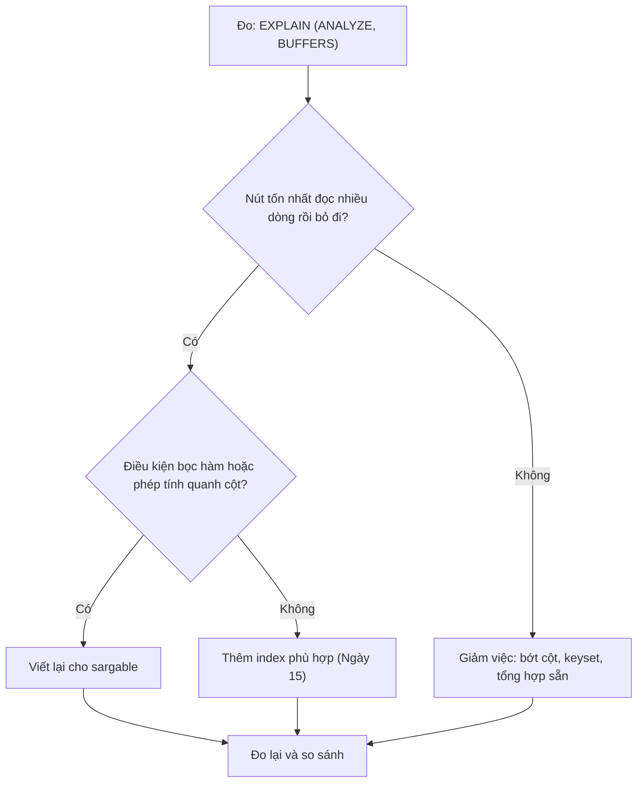

# Ngày 28: Tối ưu truy vấn

> **Tóm tắt:** Ngày 15 học tạo index, Ngày 20 học đọc plan. Bài này ghép hai kỹ năng đó để sửa truy vấn chậm: viết điều kiện sao cho index dùng được (sargable), viết lại subquery, chọn giữa `EXISTS`, `IN` và `JOIN`, chỉ lấy cột cần, phân trang keyset, tránh N+1. Mọi kết luận đều được đo bằng `EXPLAIN ANALYZE` trên schema `perf`.

**Sau bài này bạn có thể:**

- Nhận ra điều kiện không sargable (hàm, phép tính, ép kiểu bọc quanh cột, `LIKE '%...'`) và viết lại để dùng được index.
- Viết lại subquery tương quan thành `JOIN` + `GROUP BY` và giải thích khi nào việc đó quan trọng.
- Chọn đúng giữa `IN`, `EXISTS`, `JOIN` và thay `NOT IN` bằng `NOT EXISTS`.
- Dùng covering index (`INCLUDE`) để có Index Only Scan, và phân trang keyset thay cho `OFFSET` lớn.
- Nhận ra vấn đề N+1 và quyết định khi nào dùng materialized view cho báo cáo lặp lại.

**Cần biết trước:** [Ngày 11](11-subquery.md) (subquery, EXISTS, bẫy NOT IN), [Ngày 15](15-index.md), [Ngày 19](19-views.md) (materialized view), [Ngày 20](20-query-performance.md), [Ngày 23](23-sql-connect-apps.md).

## Quy trình: đo, tìm nguyên nhân, sửa, đo lại

Tối ưu không phải là thuộc lòng mẹo. Mỗi lần làm đều theo một vòng:



Quy ước giống Ngày 15 và 20: ví dụ chạy trên schema `perf` (xem [setup/README.md](../setup/README.md)), bắt đầu từ trạng thái chỉ có index của khóa chính; ví dụ nào tạo index thì tự `DROP INDEX` ở cuối; tắt chạy song song để plan gọn:

```sql
SET max_parallel_workers_per_gather = 0;
```

Thời gian là số đo thật trên máy tác giả (PostgreSQL 16 trong Docker, máy đang chạy nhiều việc khác nên số dao động). Máy bạn sẽ ra số khác; hãy so sánh kiểu plan và cỡ chênh lệch.

## Sargability: đừng bọc hàm quanh cột

Một điều kiện gọi là **sargable** (viết tắt của *Search ARGument ABLE*) khi database dùng được index để tìm theo nó. Quy tắc thực hành: **để cột "trần" một bên của phép so sánh**, mọi phép tính dồn về phía hằng số.

Lý do: index trên `order_date` lưu các giá trị `order_date` đã sắp xếp. Nó không biết gì về `date_trunc('month', order_date)` hay `order_date::date`. Muốn biết dòng nào thỏa `date_trunc(...) = ...`, PostgreSQL phải tính hàm cho **từng dòng**.

### Lọc theo tháng, theo ngày

Đếm đơn tháng 9/2026, đã có index trên `order_date`:

```sql
CREATE INDEX idx_orders_order_date ON perf.orders (order_date);

EXPLAIN ANALYZE
SELECT COUNT(*) FROM perf.orders
WHERE date_trunc('month', order_date) = '2026-09-01';
```

```text
 Aggregate  (cost=23209.50..23209.51 rows=1 width=8) (actual time=153.507..153.509 rows=1 loops=1)
   ->  Seq Scan on orders  (cost=0.00..23197.00 rows=5000 width=0) (actual time=0.018..150.643 rows=21677 loops=1)
         Filter: (date_trunc('month'::text, order_date) = '2026-09-01 00:00:00+07'::timestamp with time zone)
         Rows Removed by Filter: 978323
 Planning Time: 0.244 ms
 Execution Time: 153.552 ms
```

Index có đó nhưng không dùng được: Seq Scan, tính `date_trunc` cho 1 triệu dòng. Để ý thêm `rows=5000`: planner không có thống kê cho biểu thức nên đoán đại 0,5% (thực tế 21.677). Viết lại thành khoảng nửa mở `[đầu tháng, đầu tháng sau)`:

```sql
EXPLAIN ANALYZE
SELECT COUNT(*) FROM perf.orders
WHERE order_date >= '2026-09-01' AND order_date < '2026-10-01';
```

```text
 Aggregate  (cost=718.71..718.72 rows=1 width=8) (actual time=3.155..3.156 rows=1 loops=1)
   ->  Index Only Scan using idx_orders_order_date on orders  (cost=0.42..665.56 rows=21257 width=0) (actual time=0.013..2.278 rows=21677 loops=1)
         Index Cond: ((order_date >= '2026-09-01 00:00:00+07'::timestamp with time zone) AND (order_date < '2026-10-01 00:00:00+07'::timestamp with time zone))
         Heap Fetches: 1
 Planning Time: 0.135 ms
 Execution Time: 3.195 ms
```

Cùng kết quả 21.677 đơn, từ khoảng 154 ms xuống 3 ms, và ước lượng `rows=21257` sát thực tế. Dùng `< '2026-10-01'` thay vì `<= '2026-09-30'` vì `order_date` có cả giờ: đơn lúc 15:00 ngày 30/9 lớn hơn `'2026-09-30 00:00'` và sẽ bị bỏ sót.

Ép kiểu `::date` cũng là bọc hàm quanh cột:

```sql
EXPLAIN ANALYZE
SELECT COUNT(*) FROM perf.orders
WHERE order_date::date = '2026-09-15';
```

```text
 Aggregate  (cost=23209.50..23209.51 rows=1 width=8) (actual time=103.624..103.625 rows=1 loops=1)
   ->  Seq Scan on orders  (cost=0.00..23197.00 rows=5000 width=0) (actual time=0.075..103.517 rows=719 loops=1)
         Filter: ((order_date)::date = '2026-09-15'::date)
         Rows Removed by Filter: 999281
 Planning Time: 0.042 ms
 Execution Time: 103.658 ms
```

```sql
EXPLAIN ANALYZE
SELECT COUNT(*) FROM perf.orders
WHERE order_date >= '2026-09-15' AND order_date < '2026-09-16';

DROP INDEX perf.idx_orders_order_date;
```

```text
 Aggregate  (cost=27.30..27.31 rows=1 width=8) (actual time=0.107..0.107 rows=1 loops=1)
   ->  Index Only Scan using idx_orders_order_date on orders  (cost=0.42..25.64 rows=661 width=0) (actual time=0.010..0.074 rows=719 loops=1)
         Index Cond: ((order_date >= '2026-09-15 00:00:00+07'::timestamp with time zone) AND (order_date < '2026-09-16 00:00:00+07'::timestamp with time zone))
         Heap Fetches: 0
 Planning Time: 0.091 ms
 Execution Time: 0.121 ms
```

Lưu ý: `order_date` là `TIMESTAMPTZ`, nên "ngày 15/9" được hiểu theo múi giờ của phiên (database mẫu đặt `Asia/Ho_Chi_Minh`, thấy ở đuôi `+07`). Cả hai cách viết đều theo cùng múi giờ đó nên cho cùng 719 đơn.

### Phép tính trên cột

"Đơn có tổng tiền cộng VAT 10% vượt 33 triệu", có index trên `total_amount`:

```sql
CREATE INDEX idx_orders_total_amount ON perf.orders (total_amount);

EXPLAIN ANALYZE
SELECT COUNT(*) FROM perf.orders
WHERE total_amount * 1.1 > 33000000;
```

```text
 Aggregate  (cost=24030.33..24030.34 rows=1 width=8) (actual time=159.010..159.012 rows=1 loops=1)
   ->  Seq Scan on orders  (cost=0.00..23197.00 rows=333333 width=0) (actual time=0.040..158.608 rows=3299 loops=1)
         Filter: ((total_amount * 1.1) > '33000000'::numeric)
         Rows Removed by Filter: 996701
 Planning Time: 0.247 ms
 Execution Time: 159.033 ms
```

Chuyển phép tính sang vế hằng số:

```sql
EXPLAIN ANALYZE
SELECT COUNT(*) FROM perf.orders
WHERE total_amount > 33000000 / 1.1;

DROP INDEX perf.idx_orders_total_amount;
```

```text
 Aggregate  (cost=124.44..124.45 rows=1 width=8) (actual time=0.621..0.622 rows=1 loops=1)
   ->  Index Only Scan using idx_orders_total_amount on orders  (cost=0.42..114.94 rows=3801 width=0) (actual time=0.026..0.421 rows=3299 loops=1)
         Index Cond: (total_amount > 30000000.000000000000)
         Heap Fetches: 0
 Planning Time: 0.164 ms
 Execution Time: 0.639 ms
```

PostgreSQL tính `33000000 / 1.1` một lần thành hằng số rồi tra index. Cẩn thận khi chuyển vế với phép chia nguyên hoặc làm tròn: chỉ viết lại khi hai điều kiện tương đương chính xác (ở đây `total_amount` là `NUMERIC`, phép chia cho ra đúng 30.000.000).

### LIKE: tiền tố được, hậu tố không

Tìm khách có email bắt đầu bằng `user4242`. Với index B-tree thông thường:

```sql
CREATE INDEX idx_customers_email ON perf.customers (email);

EXPLAIN ANALYZE
SELECT customer_id, email FROM perf.customers WHERE email LIKE 'user4242%';

DROP INDEX perf.idx_customers_email;
```

```text
 Seq Scan on customers  (cost=0.00..2411.00 rows=10 width=25) (actual time=0.443..15.951 rows=11 loops=1)
   Filter: ((email)::text ~~ 'user4242%'::text)
   Rows Removed by Filter: 99989
 Planning Time: 1.091 ms
 Execution Time: 15.979 ms
```

Index không được dùng dù điều kiện là tiền tố. Nguyên nhân: database mẫu dùng collation (quy tắc so sánh chuỗi) `en_US.utf8`, trong đó thứ tự sắp xếp không trùng với thứ tự từng byte, nên B-tree thường không dùng cho `LIKE` được. Cần một index tạo với *operator class* `varchar_pattern_ops` (với cột `TEXT` là `text_pattern_ops`), sắp xếp theo từng ký tự:

```sql
CREATE INDEX idx_customers_email_pattern ON perf.customers (email varchar_pattern_ops);

EXPLAIN ANALYZE
SELECT customer_id, email FROM perf.customers WHERE email LIKE 'user4242%';
```

```text
 Index Scan using idx_customers_email_pattern on customers  (cost=0.42..8.44 rows=10 width=25) (actual time=0.033..0.040 rows=11 loops=1)
   Index Cond: (((email)::text ~>=~ 'user4242'::text) AND ((email)::text ~<~ 'user4243'::text))
   Filter: ((email)::text ~~ 'user4242%'::text)
 Planning Time: 0.510 ms
 Execution Time: 0.058 ms
```

PostgreSQL đổi `LIKE 'user4242%'` thành khoảng `>= 'user4242' AND < 'user4243'` để tra index. Nhưng ký tự đại diện ở **đầu** chuỗi thì không có khoảng nào để tra:

```sql
EXPLAIN ANALYZE
SELECT customer_id, email FROM perf.customers WHERE email LIKE '%4242@example.com';

DROP INDEX perf.idx_customers_email_pattern;
```

```text
 Seq Scan on customers  (cost=0.00..2411.00 rows=10 width=25) (actual time=0.565..13.331 rows=10 loops=1)
   Filter: ((email)::text ~~ '%4242@example.com'::text)
   Rows Removed by Filter: 99990
 Planning Time: 0.066 ms
 Execution Time: 13.351 ms
```

Tìm theo chuỗi con ở giữa (`LIKE '%abc%'`) cần loại index khác (GIN với extension `pg_trgm`) hoặc tìm kiếm toàn văn, nằm ngoài phạm vi khóa học.

Kết quả của truy vấn tiền tố (11 khách):

```sql
SELECT customer_id, email FROM perf.customers WHERE email LIKE 'user4242%' ORDER BY customer_id;
```

| customer_id | email |
| --- | --- |
| 4242 | user4242@example.com |
| 42420 | user42420@example.com |
| 42421 | user42421@example.com |
| ... | ... |
| 42429 | user42429@example.com |

(... tổng 11 dòng)

| Không sargable | Viết lại |
| --- | --- |
| `date_trunc('month', order_date) = '2026-09-01'` | `order_date >= '2026-09-01' AND order_date < '2026-10-01'` |
| `EXTRACT(YEAR FROM order_date) = 2025` | `order_date >= '2025-01-01' AND order_date < '2026-01-01'` |
| `order_date::date = '2026-09-15'` | `order_date >= '2026-09-15' AND order_date < '2026-09-16'` |
| `total_amount * 1.1 > 33000000` | `total_amount > 33000000 / 1.1` |
| `lower(email) = 'x@y.com'` | Lưu email đã chuẩn hóa chữ thường, hoặc expression index `lower(email)` (Ngày 15) |
| `email LIKE '%abc'` | Không viết lại được bằng B-tree; xem lại yêu cầu tìm kiếm |

## Viết lại truy vấn

### JOIN dấu phẩy và JOIN ... ON cho cùng một plan

Nhiều tài liệu nói "dùng dấu phẩy trong `FROM` là sai, gây tích Descartes, `INNER JOIN` tối ưu hơn". Điều này **không đúng**. Hai câu sau tương đương về ngữ nghĩa và PostgreSQL sinh cùng một plan:

```sql
EXPLAIN
SELECT c.full_name, o.order_id
FROM customers c, orders o
WHERE c.customer_id = o.customer_id;

EXPLAIN
SELECT c.full_name, o.order_id
FROM customers c
JOIN orders o ON o.customer_id = c.customer_id;
```

Cả hai cho:

```text
 Hash Join  (cost=11.57..24.11 rows=200 width=222)
   Hash Cond: (o.customer_id = c.customer_id)
   ->  Seq Scan on orders o  (cost=0.00..12.00 rows=200 width=8)
   ->  Hash  (cost=10.70..10.70 rows=70 width=222)
         ->  Seq Scan on customers c  (cost=0.00..10.70 rows=70 width=222)
```

(`rows=200`, `rows=70` khác xa 40 và 18 dòng thật vì các bảng `shop` chưa được `ANALYZE`, xem Ngày 20.)

Tích Descartes chỉ xảy ra khi **quên điều kiện nối**:

```sql
SELECT COUNT(*) FROM customers c, orders o;                                     -- quên điều kiện
SELECT COUNT(*) FROM customers c, orders o WHERE c.customer_id = o.customer_id; -- đủ điều kiện
```

| Câu | count |
| --- | --- |
| Quên điều kiện | 720 |
| Đủ điều kiện | 40 |

18 khách × 40 đơn = 720 dòng vô nghĩa. Vậy lý do nên dùng `JOIN ... ON` là **dễ đọc và khó quên điều kiện nối** (điều kiện nối nằm ngay cạnh bảng, tách khỏi điều kiện lọc trong `WHERE`), không phải vì nó chạy nhanh hơn.

### Subquery tương quan trong SELECT

Tính tổng chi tiêu của mỗi khách ở Huế bằng subquery tương quan (chạy lại một lần cho mỗi dòng khách, Ngày 11). Khi `perf.orders.customer_id` **chưa có index**, chỉ cần xem plan dự kiến:

```sql
EXPLAIN
SELECT c.customer_id, c.full_name,
       (SELECT SUM(o.total_amount)
        FROM perf.orders o
        WHERE o.customer_id = c.customer_id) AS tong_chi
FROM perf.customers c
WHERE c.city = 'Huế';
```

```text
 Seq Scan on customers c  (cost=0.00..206910719.88 rows=9997 width=54)
   Filter: ((city)::text = 'Huế'::text)
   SubPlan 1
     ->  Aggregate  (cost=20697.03..20697.04 rows=1 width=32)
           ->  Seq Scan on orders o  (cost=0.00..20697.00 rows=11 width=6)
                 Filter: (customer_id = c.customer_id)
 JIT:
   Functions: 11
   Options: Inlining true, Optimization true, Expressions true, Deforming true
```

`SubPlan 1` là một Seq Scan cả triệu đơn, chạy lại cho **mỗi** khách trong khoảng 10.000 khách: cost hơn 206 tỷ. Đừng chạy `EXPLAIN ANALYZE` câu này, nó sẽ chạy hàng chục phút. Viết lại theo kiểu tập hợp: nối một lần rồi gom nhóm.

```sql
EXPLAIN ANALYZE
SELECT c.customer_id, c.full_name, SUM(o.total_amount) AS tong_chi
FROM perf.customers c
LEFT JOIN perf.orders o ON o.customer_id = c.customer_id
WHERE c.city = 'Huế'
GROUP BY c.customer_id, c.full_name;
```

```text
 HashAggregate  (cost=23857.92..23982.89 rows=9997 width=54) (actual time=312.391..316.547 rows=9886 loops=1)
   Group Key: c.customer_id
   Batches: 1  Memory Usage: 4497kB
   ->  Hash Right Join  (cost=2535.96..23358.07 rows=99970 width=28) (actual time=13.163..256.113 rows=98866 loops=1)
         Hash Cond: (o.customer_id = c.customer_id)
         ->  Seq Scan on orders o  (cost=0.00..18197.00 rows=1000000 width=10) (actual time=0.022..93.035 rows=1000000 loops=1)
         ->  Hash  (cost=2411.00..2411.00 rows=9997 width=22) (actual time=12.973..12.974 rows=9886 loops=1)
               Buckets: 16384  Batches: 1  Memory Usage: 658kB
               ->  Seq Scan on customers c  (cost=0.00..2411.00 rows=9997 width=22) (actual time=0.027..10.681 rows=9886 loops=1)
                     Filter: ((city)::text = 'Huế'::text)
                     Rows Removed by Filter: 90114
 Planning Time: 1.970 ms
 Execution Time: 318.462 ms
```

Mỗi bảng chỉ đọc một lần, khoảng 0,3 giây. `LEFT JOIN` giữ cả khách chưa có đơn (tổng là `NULL`), giống bản subquery.

Công bằng mà nói: khi cột nối **có index**, subquery tương quan không còn thảm họa.

```sql
CREATE INDEX idx_orders_customer_id ON perf.orders (customer_id);

EXPLAIN ANALYZE
SELECT c.customer_id, c.full_name,
       (SELECT SUM(o.total_amount)
        FROM perf.orders o
        WHERE o.customer_id = c.customer_id) AS tong_chi
FROM perf.customers c
WHERE c.city = 'Huế';

DROP INDEX perf.idx_orders_customer_id;
```

```text
 Seq Scan on customers c  (cost=0.00..477057.27 rows=9997 width=54) (actual time=17.973..178.848 rows=9886 loops=1)
   Filter: ((city)::text = 'Huế'::text)
   Rows Removed by Filter: 90114
   SubPlan 1
     ->  Aggregate  (cost=47.47..47.48 rows=1 width=32) (actual time=0.015..0.015 rows=1 loops=9886)
           ->  Bitmap Heap Scan on orders o  (cost=4.51..47.44 rows=11 width=6) (actual time=0.004..0.013 rows=10 loops=9886)
                 Recheck Cond: (customer_id = c.customer_id)
                 Heap Blocks: exact=98793
                 ->  Bitmap Index Scan on idx_orders_customer_id  (cost=0.00..4.51 rows=11 width=0) (actual time=0.002..0.002 rows=10 loops=9886)
                       Index Cond: (customer_id = c.customer_id)
 Planning Time: 0.325 ms
 JIT:
   Functions: 12
   Options: Inlining false, Optimization false, Expressions true, Deforming true
   Timing: Generation 0.526 ms, Inlining 0.000 ms, Optimization 2.233 ms, Emission 15.466 ms, Total 18.226 ms
 Execution Time: 244.628 ms
```

`loops=9886`: subquery chạy 9.886 lần, mỗi lần tra index khoảng 0,015 ms, tổng khoảng 0,15 giây. Ngang với bản `JOIN`. Kết luận rút ra từ số đo, không phải từ khẩu hiệu: bản `JOIN` + `GROUP BY` an toàn hơn vì không phụ thuộc vào việc có index; bản subquery chỉ ổn khi chắc chắn có index cho cột tương quan.

### EXISTS, IN và JOIN

"Khách ở Huế có ít nhất một đơn đang chờ (`pending`)". Ba cách viết:

```sql
EXPLAIN ANALYZE
SELECT c.customer_id, c.full_name
FROM perf.customers c
WHERE c.city = 'Huế'
  AND c.customer_id IN (SELECT o.customer_id FROM perf.orders o WHERE o.status = 'pending');
```

```text
 Hash Semi Join  (cost=20817.41..23277.41 rows=963 width=22) (actual time=101.061..118.857 rows=888 loops=1)
   Hash Cond: (c.customer_id = o.customer_id)
   ->  Seq Scan on customers c  (cost=0.00..2411.00 rows=9997 width=22) (actual time=0.016..13.078 rows=9886 loops=1)
         Filter: ((city)::text = 'Huế'::text)
         Rows Removed by Filter: 90114
   ->  Hash  (cost=20697.00..20697.00 rows=9633 width=4) (actual time=100.768..100.769 rows=9860 loops=1)
         Buckets: 16384  Batches: 1  Memory Usage: 475kB
         ->  Seq Scan on orders o  (cost=0.00..20697.00 rows=9633 width=4) (actual time=0.040..96.458 rows=9860 loops=1)
               Filter: ((status)::text = 'pending'::text)
               Rows Removed by Filter: 990140
 Planning Time: 0.904 ms
 Execution Time: 119.177 ms
```

```sql
EXPLAIN ANALYZE
SELECT c.customer_id, c.full_name
FROM perf.customers c
WHERE c.city = 'Huế'
  AND EXISTS (SELECT 1 FROM perf.orders o
              WHERE o.customer_id = c.customer_id AND o.status = 'pending');
```

```text
 Hash Semi Join  (cost=20817.41..23277.41 rows=963 width=22) (actual time=120.494..135.265 rows=888 loops=1)
   Hash Cond: (c.customer_id = o.customer_id)
   ->  Seq Scan on customers c  (cost=0.00..2411.00 rows=9997 width=22) (actual time=0.010..11.781 rows=9886 loops=1)
         Filter: ((city)::text = 'Huế'::text)
         Rows Removed by Filter: 90114
   ->  Hash  (cost=20697.00..20697.00 rows=9633 width=4) (actual time=120.458..120.461 rows=9860 loops=1)
         Buckets: 16384  Batches: 1  Memory Usage: 475kB
         ->  Seq Scan on orders o  (cost=0.00..20697.00 rows=9633 width=4) (actual time=0.015..114.113 rows=9860 loops=1)
               Filter: ((status)::text = 'pending'::text)
               Rows Removed by Filter: 990140
 Planning Time: 0.277 ms
 Execution Time: 135.353 ms
```

Hai plan giống hệt nhau (cùng cost), là một **Semi Join**: mỗi khách chỉ cần tìm thấy một đơn khớp là đủ. Chênh lệch 119 ms và 135 ms chỉ là dao động giữa hai lần đo. Trong PostgreSQL hiện đại, `IN (subquery)` và `EXISTS` thường cho cùng plan; câu "EXISTS luôn nhanh hơn IN" là kinh nghiệm từ các phiên bản và hệ quản trị cũ.

Còn `JOIN` thì **khác về kết quả**:

```sql
SELECT COUNT(*) AS so_dong
FROM perf.customers c
JOIN perf.orders o ON o.customer_id = c.customer_id
WHERE c.city = 'Huế' AND o.status = 'pending';
```

| so_dong |
| --- |
| 925 |

925 dòng thay vì 888 khách: khách có hai đơn `pending` xuất hiện hai lần. Muốn dùng `JOIN` phải thêm `DISTINCT`, tức là làm thêm việc khử trùng. Quy tắc chọn:

- Cần **cột của bảng kia** trong kết quả: `JOIN`.
- Chỉ cần **kiểm tra có tồn tại**: `EXISTS` hoặc `IN`.

### NOT IN và NOT EXISTS

"Khách chưa từng đặt đơn nào". Với `NOT EXISTS`:

```sql
EXPLAIN ANALYZE
SELECT c.customer_id
FROM perf.customers c
WHERE NOT EXISTS (SELECT 1 FROM perf.orders o WHERE o.customer_id = c.customer_id);
```

```text
 Hash Right Anti Join  (cost=3411.00..34568.46 rows=7097 width=4) (actual time=421.466..423.766 rows=7 loops=1)
   Hash Cond: (o.customer_id = c.customer_id)
   ->  Seq Scan on orders o  (cost=0.00..18197.00 rows=1000000 width=4) (actual time=0.014..92.000 rows=1000000 loops=1)
   ->  Hash  (cost=2161.00..2161.00 rows=100000 width=4) (actual time=27.683..27.686 rows=100000 loops=1)
         Buckets: 131072  Batches: 1  Memory Usage: 4540kB
         ->  Seq Scan on customers c  (cost=0.00..2161.00 rows=100000 width=4) (actual time=0.019..11.213 rows=100000 loops=1)
 Planning Time: 0.175 ms
 Execution Time: 424.360 ms
```

Một **Anti Join**, đọc mỗi bảng một lần, tìm ra 7 khách:

```sql
SELECT c.customer_id
FROM perf.customers c
WHERE NOT EXISTS (SELECT 1 FROM perf.orders o WHERE o.customer_id = c.customer_id)
ORDER BY c.customer_id;
```

| customer_id |
| --- |
| 5930 |
| 12038 |
| 14346 |
| 26619 |
| 39171 |
| 40458 |
| 87558 |

Cùng câu hỏi với `NOT IN`:

```sql
EXPLAIN
SELECT c.customer_id
FROM perf.customers c
WHERE c.customer_id NOT IN (SELECT o.customer_id FROM perf.orders o);
```

```text
 Seq Scan on customers c  (cost=0.00..1480202411.00 rows=50000 width=4)
   Filter: (NOT (SubPlan 1))
   SubPlan 1
     ->  Materialize  (cost=0.00..27104.00 rows=1000000 width=4)
           ->  Seq Scan on orders o  (cost=0.00..18197.00 rows=1000000 width=4)
 JIT:
   Functions: 8
   Options: Inlining true, Optimization true, Expressions true, Deforming true
```

Cost gần 1,5 tỷ: với mỗi khách, dò tuần tự trong danh sách 1 triệu `customer_id`. Chạy thật với giới hạn 30 giây:

```sql
SET statement_timeout = '30s';

SELECT c.customer_id
FROM perf.customers c
WHERE c.customer_id NOT IN (SELECT o.customer_id FROM perf.orders o);

RESET statement_timeout;
```

```text
ERROR:  canceling statement due to statement timeout
```

PostgreSQL không đổi được `NOT IN` thành Anti Join vì ngữ nghĩa của nó khác khi có `NULL`: nếu subquery trả về dù chỉ một `NULL`, `NOT IN` cho kết quả rỗng (bẫy đã học ở Ngày 11). Planner phải tôn trọng ngữ nghĩa đó, nên chỉ còn cách chạy subplan. (Khi danh sách đủ nhỏ để vừa `work_mem`, PostgreSQL dùng một bảng băm, gọi là "hashed SubPlan", và nhanh hơn nhiều; ở đây 1 triệu giá trị không vừa 4MB mặc định.) Vậy cả về đúng đắn lẫn tốc độ: **dùng `NOT EXISTS` thay cho `NOT IN (subquery)`**.

## Chỉ lấy cột cần: covering index

`SELECT *` có ba cái giá: truyền dữ liệu thừa qua mạng, ứng dụng tốn bộ nhớ, và **chặn Index Only Scan**. Báo cáo doanh thu tháng 9/2026 chỉ cần `order_date` và `total_amount`. Với index thường trên `order_date`:

```sql
CREATE INDEX idx_orders_order_date ON perf.orders (order_date);

EXPLAIN (ANALYZE, BUFFERS)
SELECT order_date, total_amount
FROM perf.orders
WHERE order_date >= '2026-09-01' AND order_date < '2026-10-01';

DROP INDEX perf.idx_orders_order_date;
```

```text
 Bitmap Heap Scan on orders  (cost=454.31..8970.16 rows=21257 width=14) (actual time=3.308..21.635 rows=21677 loops=1)
   Recheck Cond: ((order_date >= '2026-09-01 00:00:00+07'::timestamp with time zone) AND (order_date < '2026-10-01 00:00:00+07'::timestamp with time zone))
   Heap Blocks: exact=7652
   Buffers: shared hit=7654 read=60
   ->  Bitmap Index Scan on idx_orders_order_date  (cost=0.00..449.00 rows=21257 width=0) (actual time=2.014..2.015 rows=21677 loops=1)
         Index Cond: ((order_date >= '2026-09-01 00:00:00+07'::timestamp with time zone) AND (order_date < '2026-10-01 00:00:00+07'::timestamp with time zone))
         Buffers: shared hit=2 read=60
 Planning:
   Buffers: shared hit=51 read=4
 Planning Time: 0.346 ms
 Execution Time: 22.851 ms
```

Index chỉ có `order_date`, nên để lấy `total_amount` PostgreSQL phải mở 7.652 trang của bảng (gần như cả bảng 8.197 trang, vì đơn của một tháng rải khắp nơi). Đưa `total_amount` vào index bằng `INCLUDE`: cột này được lưu kèm ở lá của index nhưng không tham gia sắp xếp. Index như vậy gọi là **covering index** (index bao phủ truy vấn).

```sql
CREATE INDEX idx_orders_date_incl ON perf.orders (order_date) INCLUDE (total_amount);

EXPLAIN (ANALYZE, BUFFERS)
SELECT order_date, total_amount
FROM perf.orders
WHERE order_date >= '2026-09-01' AND order_date < '2026-10-01';
```

```text
 Index Only Scan using idx_orders_date_incl on orders  (cost=0.42..757.56 rows=21257 width=14) (actual time=0.015..2.143 rows=21677 loops=1)
   Index Cond: ((order_date >= '2026-09-01 00:00:00+07'::timestamp with time zone) AND (order_date < '2026-10-01 00:00:00+07'::timestamp with time zone))
   Heap Fetches: 1
   Buffers: shared hit=4 read=84
 Planning:
   Buffers: shared hit=20 read=4
 Planning Time: 0.233 ms
 Execution Time: 2.897 ms
```

88 trang thay vì hơn 7.700, từ khoảng 23 ms xuống 3 ms. Nhưng chỉ cần quay lại `SELECT *`:

```sql
EXPLAIN (ANALYZE, BUFFERS)
SELECT *
FROM perf.orders
WHERE order_date >= '2026-09-01' AND order_date < '2026-10-01';

DROP INDEX perf.idx_orders_date_incl;
```

```text
 Bitmap Heap Scan on orders  (cost=546.31..9062.16 rows=21257 width=31) (actual time=2.510..11.953 rows=21677 loops=1)
   Recheck Cond: ((order_date >= '2026-09-01 00:00:00+07'::timestamp with time zone) AND (order_date < '2026-10-01 00:00:00+07'::timestamp with time zone))
   Heap Blocks: exact=7652
   Buffers: shared hit=7738
   ->  Bitmap Index Scan on idx_orders_date_incl  (cost=0.00..540.99 rows=21257 width=0) (actual time=1.372..1.373 rows=21677 loops=1)
         Index Cond: ((order_date >= '2026-09-01 00:00:00+07'::timestamp with time zone) AND (order_date < '2026-10-01 00:00:00+07'::timestamp with time zone))
         Buffers: shared hit=86
 Planning:
   Buffers: shared hit=13
 Planning Time: 0.087 ms
 Execution Time: 12.732 ms
```

Lại phải đọc 7.652 trang bảng, vì `status` và `customer_id` không có trong index. (Thời gian lần này thấp hơn lần đầu vì các trang đã nằm sẵn trong bộ nhớ: `hit=7738`, không còn `read`. Đây là lý do Ngày 20 khuyên nhìn `Buffers` chứ không chỉ nhìn thời gian.)

Index Only Scan còn phụ thuộc `VACUUM`: `Heap Fetches` là số lần vẫn phải mở bảng vì trang chưa được đánh dấu "mọi dòng đều nhìn thấy được". Bảng vừa bị sửa nhiều thì con số này tăng; autovacuum sẽ dọn dần, hoặc bạn chạy `VACUUM perf.orders;`.

> **Ghi chú dialect:** SQL Server cũng có `INCLUDE` cho index. MySQL không có `INCLUDE`; muốn index bao phủ thì đưa cột vào chính index (`(order_date, total_amount)`).

## Phân trang keyset thay cho OFFSET

Ngày 4 đã nhắc: `OFFSET n` vẫn phải đọc rồi bỏ đi `n` dòng. Phân trang đơn hàng theo thời gian, có index `(order_date, order_id)` (thêm `order_id` để thứ tự là duy nhất khi hai đơn trùng giờ):

```sql
CREATE INDEX idx_orders_date_id ON perf.orders (order_date, order_id);

EXPLAIN ANALYZE
SELECT order_id, order_date, total_amount
FROM perf.orders
ORDER BY order_date, order_id
LIMIT 20 OFFSET 20;
```

```text
 Limit  (cost=1.69..2.95 rows=20 width=18) (actual time=0.051..0.077 rows=20 loops=1)
   ->  Index Scan using idx_orders_date_id on orders  (cost=0.42..63180.19 rows=1000000 width=18) (actual time=0.017..0.074 rows=40 loops=1)
 Planning Time: 0.294 ms
 Execution Time: 0.092 ms
```

Trang 2 rất nhanh. Trang 25.001 (`OFFSET 500000`):

```sql
EXPLAIN ANALYZE
SELECT order_id, order_date, total_amount
FROM perf.orders
ORDER BY order_date, order_id
LIMIT 20 OFFSET 500000;
```

```text
 Limit  (cost=31590.31..31591.57 rows=20 width=18) (actual time=566.919..566.941 rows=20 loops=1)
   ->  Index Scan using idx_orders_date_id on orders  (cost=0.42..63180.19 rows=1000000 width=18) (actual time=0.006..546.648 rows=500020 loops=1)
 Planning Time: 0.029 ms
 Execution Time: 566.958 ms
```

Nút Index Scan trả 500.020 dòng để `Limit` vứt đi 500.000. Càng về sau càng chậm.

**Phân trang keyset** (còn gọi là *seek method*): ứng dụng nhớ khóa sắp xếp của **dòng cuối trang trước**, và trang sau bắt đầu ngay sau nó. Dòng cuối của trang 25.000:

```sql
SELECT order_id, order_date
FROM perf.orders
ORDER BY order_date, order_id
LIMIT 1 OFFSET 499999;
```

| order_id | order_date |
| --- | --- |
| 196852 | 2024-11-21 05:50:45.831043+07 |

Trang tiếp theo, dùng so sánh hàng `(a, b) > (x, y)` (đúng thứ tự từ điển: so `a` trước, bằng nhau mới so `b`):

```sql
EXPLAIN ANALYZE
SELECT order_id, order_date, total_amount
FROM perf.orders
WHERE (order_date, order_id) > ('2024-11-21 05:50:45.831043+07', 196852)
ORDER BY order_date, order_id
LIMIT 20;
```

```text
 Limit  (cost=0.42..2.39 rows=20 width=18) (actual time=0.034..0.074 rows=20 loops=1)
   ->  Index Scan using idx_orders_date_id on orders  (cost=0.42..49251.02 rows=500507 width=18) (actual time=0.032..0.070 rows=20 loops=1)
         Index Cond: (ROW(order_date, order_id) > ROW('2024-11-21 05:50:45.831043+07'::timestamp with time zone, 196852))
 Planning Time: 0.194 ms
 Execution Time: 0.133 ms
```

Index nhảy thẳng tới vị trí đó, chỉ đọc 20 dòng: khoảng 0,13 ms so với 567 ms, và giữ nguyên tốc độ ở mọi trang. Kết quả trùng với trang `OFFSET 500000`:

```sql
SELECT order_id, order_date, total_amount
FROM perf.orders
WHERE (order_date, order_id) > ('2024-11-21 05:50:45.831043+07', 196852)
ORDER BY order_date, order_id
LIMIT 20;

DROP INDEX perf.idx_orders_date_id;
```

| order_id | order_date | total_amount |
| --- | --- | --- |
| 41832 | 2024-11-21 05:50:59.87041+07 | 14573000 |
| 34881 | 2024-11-21 05:51:56.552302+07 | 13954000 |
| 594451 | 2024-11-21 05:54:31.478047+07 | 24511000 |
| ... | ... | ... |
| 894842 | 2024-11-21 06:37:43.387428+07 | 19394000 |

(... tổng 20 dòng)

Đổi lại, keyset không cho "nhảy tới trang 731" bất kỳ, chỉ đi tới/lui từng trang. Nó hợp với cuộn vô hạn, nút "Xem thêm", API trả dữ liệu theo lô. Cách so sánh hàng `(a, b) > (x, y)` chỉ đúng khi mọi cột sắp xếp **cùng chiều** (cùng `ASC` hoặc cùng `DESC`).

> **Ghi chú dialect:** MySQL hỗ trợ so sánh hàng `(a, b) > (x, y)` nhưng có phiên bản không dùng index hiệu quả cho nó; cách viết chắc chắn là `a > x OR (a = x AND b > y)`. SQL Server không hỗ trợ so sánh hàng, phải viết dạng `OR` đó.

## Vấn đề N+1

N+1 không nằm trong một câu SQL nào, mà nằm ở **cách ứng dụng gọi SQL**. Ví dụ trang "đơn hàng mới nhất" viết bằng Python (psycopg, Ngày 23):

```python
# Sai: 1 truy vấn lấy đơn + N truy vấn lấy tên khách
orders = conn.execute(
    "SELECT order_id, customer_id FROM orders ORDER BY order_date DESC LIMIT 5"
).fetchall()
for order_id, customer_id in orders:
    name = conn.execute(
        "SELECT full_name FROM customers WHERE customer_id = %s", (customer_id,)
    ).fetchone()[0]
    print(order_id, name)
```

Mỗi câu bên trong vòng lặp có thể chỉ mất 0,05 ms trong server, nhưng mỗi lần gọi là một lượt đi về qua mạng (thường từ vài phần mười mili giây trong cùng máy chủ tới hàng chục mili giây khi qua Internet). Trang hiện 50 đơn là 51 lượt đi về. Các ORM (thư viện ánh xạ bảng thành đối tượng) rất dễ sinh ra mẫu này khi bạn truy cập `order.customer.full_name` trong vòng lặp. `EXPLAIN ANALYZE` từng câu sẽ báo "rất nhanh", nên phải nhìn **số lượng câu** trong log hoặc công cụ theo dõi.

Cách sửa: một câu `JOIN` lấy đủ dữ liệu.

```sql
SELECT o.order_id, o.order_date, o.status, c.full_name
FROM orders o
JOIN customers c ON c.customer_id = o.customer_id
ORDER BY o.order_date DESC
LIMIT 5;
```

| order_id | order_date | status | full_name |
| --- | --- | --- | --- |
| 40 | 2026-10-14 22:00:00+07 | pending | Lê Hoàng Cường |
| 39 | 2026-10-05 09:00:00+07 | paid | Nguyễn Văn An |
| 38 | 2026-09-20 16:30:00+07 | paid | Phan Thị Oanh |
| 37 | 2026-09-02 10:00:00+07 | shipped | Nguyễn Văn An |
| 36 | 2026-08-08 18:00:00+07 | delivered | Mai Đức Uy |

Với ORM, dùng tính năng tải kèm (eager loading, ví dụ `joinedload`/`selectinload` trong SQLAlchemy, `include` trong Prisma) để ORM tự sinh `JOIN` hoặc một câu `IN (...)` thay vì N câu.

## Báo cáo lặp lại: tổng hợp sẵn

Có những truy vấn đã tối ưu hết mức mà vẫn phải đọc phần lớn bảng, ví dụ doanh thu từng tháng của mọi đơn đã giao. Nếu báo cáo được mở hàng trăm lần mỗi ngày còn dữ liệu cũ không đổi, hãy **tính sẵn** bằng materialized view (Ngày 19) và làm mới định kỳ. Bài tập 6 đo cụ thể. Hai điều cần nhớ:

- Materialized view **không tự cập nhật**. Phải chạy `REFRESH MATERIALIZED VIEW ...` (theo lịch, hoặc sau mỗi lần nạp dữ liệu). Giữa hai lần làm mới, báo cáo trả số liệu cũ.
- Khi bảng lớn tới mức chính việc quét cũng quá tốn, cách tổ chức dữ liệu như partition (chia bảng theo tháng, chỉ đọc phần cần) là chủ đề của [Ngày 25](25-big-data.md).

> **Ghi chú dialect:** MySQL không có materialized view; thường thay bằng một bảng tổng hợp được cập nhật bằng job định kỳ hoặc trigger. SQL Server có *indexed view*, được cập nhật tự động khi bảng gốc đổi nhưng có nhiều giới hạn về cú pháp.

## Lỗi thường gặp

**1. Bọc hàm quanh cột có index.** `WHERE EXTRACT(YEAR FROM order_date) = 2025`, `WHERE order_date::date = ...`, `WHERE total_amount * 1.1 > ...`. Viết lại thành điều kiện trên cột trần (bảng ở mục [Sargability](#sargability-đừng-bọc-hàm-quanh-cột)).

**2. Dùng `BETWEEN '2026-09-01' AND '2026-09-30'` cho cột có giờ.** Bỏ sót mọi đơn sau 00:00 ngày 30/9. Dùng khoảng nửa mở `>= '2026-09-01' AND < '2026-10-01'`.

**3. Tin "mẹo" mà không đo.** "INNER JOIN nhanh hơn dấu phẩy", "EXISTS luôn nhanh hơn IN", "subquery luôn chậm": các số đo ở trên cho thấy cả ba đều không đúng nguyên văn với PostgreSQL. Điều đúng là: đo bằng `EXPLAIN ANALYZE` trên dữ liệu đủ lớn.

**4. `NOT IN (subquery)`.** Sai khi subquery có `NULL` và có thể chậm khủng khiếp. Dùng `NOT EXISTS`.

**5. Dùng `JOIN` để kiểm tra tồn tại rồi `DISTINCT` cho hết trùng.** Dùng `EXISTS`, vừa đúng ý vừa không phải khử trùng.

**6. `OFFSET` lớn cho trang sâu.** Dùng keyset khi giao diện cho phép.

**7. Sửa nhiều thứ cùng lúc.** Tạo ba index và viết lại câu cùng một lượt thì không biết thay đổi nào có tác dụng, và giữ lại cả những index vô dụng (mỗi index làm chậm ghi, Ngày 15). Sửa từng thứ, đo sau mỗi thay đổi, xóa index không giúp gì.

> **Ghi chú dialect:** Các nguyên tắc trong bài (sargability, tránh `NOT IN`, keyset, N+1) đúng với mọi hệ quản trị, nhưng cách xem plan khác nhau: MySQL dùng `EXPLAIN` / `EXPLAIN ANALYZE` (từ 8.0.18), SQL Server dùng Actual Execution Plan hoặc `SET STATISTICS IO, TIME ON`. Kết quả "IN và EXISTS cùng plan" là của PostgreSQL; hệ quản trị khác có thể xử lý khác, nên vẫn phải đo.

## Bài tập

Bài trên schema `perf` bắt đầu từ trạng thái chỉ có khóa chính, với `SET max_parallel_workers_per_gather = 0;`. Thời gian trên máy bạn sẽ khác.

### Cơ bản

**Bài 1.** Ứng dụng lọc đơn theo ngày bằng câu dưới đây. Tạo index trên `order_date`, chứng minh câu này không dùng được index, rồi viết lại cho sargable và đo lại.

```sql
SELECT order_id, total_amount FROM perf.orders
WHERE to_char(order_date, 'YYYY-MM-DD') = '2026-10-01';
```

<details>
<summary>Đáp án</summary>

```sql
CREATE INDEX idx_orders_order_date ON perf.orders (order_date);

EXPLAIN ANALYZE
SELECT order_id, total_amount FROM perf.orders
WHERE to_char(order_date, 'YYYY-MM-DD') = '2026-10-01';

EXPLAIN ANALYZE
SELECT order_id, total_amount FROM perf.orders
WHERE order_date >= '2026-10-01' AND order_date < '2026-10-02';

SELECT COUNT(*) FROM perf.orders
WHERE order_date >= '2026-10-01' AND order_date < '2026-10-02';

DROP INDEX perf.idx_orders_order_date;
```

Kết quả (máy tác giả):

| Cách viết | Plan | Execution Time |
| --- | --- | --- |
| `to_char(...) = '2026-10-01'` | `Seq Scan on orders`, `Rows Removed by Filter: 999271` | 315.470 ms |
| `>= '2026-10-01' AND < '2026-10-02'` | `Bitmap Index Scan on idx_orders_order_date` → `Bitmap Heap Scan` | 1.293 ms |

| count |
| --- |
| 729 |

</details>

**Bài 2.** Câu sau định đếm số đơn `pending` của cửa hàng nhưng trả về 18. Tìm lỗi và sửa.

```sql
SELECT COUNT(*) FROM customers c, orders o WHERE o.status = 'pending';
```

<details>
<summary>Đáp án</summary>

Câu thiếu điều kiện nối `c.customer_id = o.customer_id`, nên mỗi đơn `pending` được ghép với cả 18 khách (tích Descartes). Ở đây không cần bảng `customers` chút nào:

```sql
SELECT COUNT(*) FROM orders o WHERE o.status = 'pending';
```

Kết quả:

| count |
| --- |
| 1 |

Nếu cần thông tin khách, viết `JOIN customers c ON c.customer_id = o.customer_id` để điều kiện nối không thể bị quên.

</details>

### Vận dụng

**Bài 3.** Trên DSC Shop, tìm sản phẩm bán chạy nhất (theo tổng số lượng, không tính đơn `cancelled`) **của từng danh mục**. Nếu nhiều sản phẩm đồng hạng thì lấy hết. Không dùng window function (sẽ học ở Ngày 29).

<details>
<summary>Đáp án</summary>

```sql
WITH ban AS (
    SELECT p.category_id, p.product_id, p.name, SUM(oi.quantity) AS so_luong
    FROM order_items oi
    JOIN orders o   ON o.order_id = oi.order_id
    JOIN products p ON p.product_id = oi.product_id
    WHERE o.status <> 'cancelled'
    GROUP BY p.category_id, p.product_id, p.name
)
SELECT cat.name AS danh_muc, b.name AS san_pham, b.so_luong
FROM ban b
JOIN categories cat ON cat.category_id = b.category_id
WHERE b.so_luong = (SELECT MAX(b2.so_luong) FROM ban b2 WHERE b2.category_id = b.category_id)
ORDER BY danh_muc, san_pham;
```

Kết quả:

| danh_muc | san_pham | so_luong |
| --- | --- | --- |
| Chuột & Bàn phím | Chuột Logitech G102 | 6 |
| Điện thoại | Xiaomi Redmi Note 13 | 5 |
| Laptop gaming | Acer Nitro V 15 | 2 |
| Laptop gaming | Lenovo Legion 5 | 2 |
| Laptop văn phòng | Dell Inspiron 14 | 2 |
| Laptop văn phòng | MacBook Air M2 13 inch | 2 |
| Máy tính bảng | iPad Air M2 11 inch | 2 |
| Máy tính bảng | Samsung Galaxy Tab S9 FE | 2 |
| PC & Màn hình | Màn hình Dell P2422H | 3 |
| PC & Màn hình | Màn hình LG UltraGear 27 inch | 3 |
| Sạc & Cáp | Cáp USB-C to USB-C 1m | 13 |
| Tai nghe & Loa | Tai nghe AirPods Pro 2 | 3 |
| Tai nghe & Loa | Tai nghe Sony WH-1000XM5 | 3 |

Lỗi hay gặp là viết `GROUP BY danh_muc, san_pham ORDER BY so_luong DESC LIMIT 10`: đó là 10 cặp bán chạy nhất **toàn cửa hàng**, không phải sản phẩm đứng đầu **mỗi** danh mục. CTE `ban` được tính một lần, subquery tương quan chỉ chạy trên kết quả nhỏ đã tổng hợp. Ngày 29 sẽ viết gọn hơn bằng `RANK() OVER (PARTITION BY category_id ...)`. Trên dữ liệu lớn, index giúp nhất cho truy vấn này là index trên cột nối `order_items(product_id)` (DSC Shop đã có); partition theo danh mục thì không giúp, vì truy vấn cần mọi danh mục.

</details>

**Bài 4.** Tìm các sản phẩm chưa từng được bán (không có trong `order_items`) bằng `NOT EXISTS` và bằng `NOT IN`. Hai câu có cho cùng kết quả không? Vì sao vẫn nên chọn `NOT EXISTS`?

<details>
<summary>Đáp án</summary>

```sql
SELECT p.sku, p.name
FROM products p
WHERE NOT EXISTS (SELECT 1 FROM order_items oi WHERE oi.product_id = p.product_id);

SELECT p.sku, p.name
FROM products p
WHERE p.product_id NOT IN (SELECT oi.product_id FROM order_items oi);
```

Kết quả (cả hai câu):

| sku | name |
| --- | --- |
| ACC-009 | Lót chuột DSC XXL |

Ở đây hai câu trùng kết quả vì `order_items.product_id` là `NOT NULL`. Nhưng nếu cột trong subquery có thể `NULL` (hoặc sau này bị đổi thành cho phép `NULL`), `NOT IN` sẽ âm thầm trả về rỗng. Thêm nữa, trên bảng lớn `NOT IN` không được chuyển thành Anti Join và có thể chậm khủng khiếp (ví dụ trên `perf` phải hủy sau 30 giây). `NOT EXISTS` đúng trong mọi trường hợp và có plan tốt.

</details>

**Bài 5.** Trang danh sách sản phẩm của DSC Shop sắp theo giá giảm dần, mỗi trang 5 sản phẩm. Trang 1 kết thúc ở `iPhone 15 128GB` (`product_id` 10, giá 19.990.000). Viết câu lấy trang 2 bằng keyset. Chú ý chọn thứ tự sắp xếp sao cho dùng được so sánh hàng.

<details>
<summary>Đáp án</summary>

So sánh hàng `(price, product_id) < (...)` chỉ đúng khi cả hai cột cùng chiều, nên sắp `price DESC, product_id DESC` (cột `product_id` để phá hòa khi hai sản phẩm cùng giá).

```sql
-- Trang 1
SELECT product_id, name, price FROM products
ORDER BY price DESC, product_id DESC
LIMIT 5;

-- Trang 2: bắt đầu sau (19990000, 10)
SELECT product_id, name, price FROM products
WHERE (price, product_id) < (19990000, 10)
ORDER BY price DESC, product_id DESC
LIMIT 5;
```

Kết quả trang 1:

| product_id | name | price |
| --- | --- | --- |
| 1 | ASUS ROG Strix G16 | 32990000 |
| 2 | Lenovo Legion 5 | 29990000 |
| 5 | MacBook Air M2 13 inch | 24990000 |
| 3 | Acer Nitro V 15 | 21990000 |
| 10 | iPhone 15 128GB | 19990000 |

Kết quả trang 2:

| product_id | name | price |
| --- | --- | --- |
| 11 | Samsung Galaxy S24 | 18990000 |
| 4 | Dell Inspiron 14 | 18490000 |
| 14 | iPad Air M2 11 inch | 16990000 |
| 6 | HP Pavilion 15 | 16990000 |
| 9 | PC văn phòng DSC Basic | 9990000 |

Trang 2 trùng với `LIMIT 5 OFFSET 5` cùng thứ tự sắp xếp. Để ý `iPad Air` và `HP Pavilion` cùng giá 16.990.000: nhờ `product_id DESC` mà thứ tự giữa chúng luôn cố định, nên không dòng nào bị lặp hay bị bỏ khi chuyển trang.

</details>

### Thử thách

**Bài 6.** Báo cáo "doanh thu từng tháng của các đơn đã giao" trên `perf.orders` được mở rất nhiều lần mỗi ngày. Đo truy vấn gốc, rồi tạo materialized view `perf.mv_doanh_thu_thang`, đo việc đọc 4 tháng gần nhất từ view và thời gian `REFRESH`. Khi nào cách này không phù hợp?

<details>
<summary>Đáp án</summary>

```sql
EXPLAIN ANALYZE
SELECT date_trunc('month', order_date) AS thang, SUM(total_amount) AS doanh_thu
FROM perf.orders
WHERE status = 'delivered'
GROUP BY 1;

DROP MATERIALIZED VIEW IF EXISTS perf.mv_doanh_thu_thang;
CREATE MATERIALIZED VIEW perf.mv_doanh_thu_thang AS
SELECT date_trunc('month', order_date) AS thang, SUM(total_amount) AS doanh_thu
FROM perf.orders
WHERE status = 'delivered'
GROUP BY 1;

EXPLAIN ANALYZE
SELECT thang, doanh_thu FROM perf.mv_doanh_thu_thang
WHERE thang >= '2026-07-01'
ORDER BY thang;

SELECT thang, doanh_thu FROM perf.mv_doanh_thu_thang
WHERE thang >= '2026-07-01'
ORDER BY thang;

\timing on
REFRESH MATERIALIZED VIEW perf.mv_doanh_thu_thang;
\timing off

DROP MATERIALIZED VIEW perf.mv_doanh_thu_thang;
```

Kết quả (máy tác giả):

| Thao tác | Thời gian |
| --- | --- |
| Truy vấn gốc (`Seq Scan` 1 triệu đơn → `HashAggregate` 46 tháng) | 472.342 ms |
| Đọc 4 tháng từ materialized view (`Seq Scan on mv_doanh_thu_thang`, 46 dòng) | 0.045 ms |
| `REFRESH MATERIALIZED VIEW` | 332 ms |

| thang | doanh_thu |
| --- | --- |
| 2026-07-01 00:00:00+07 | 289058531000 |
| 2026-08-01 00:00:00+07 | 284913926000 |
| 2026-09-01 00:00:00+07 | 276530348000 |
| 2026-10-01 00:00:00+07 | 101061785000 |

Mỗi lần mở báo cáo chỉ còn đọc 46 dòng. Cái giá là `REFRESH` tốn ngang truy vấn gốc và số liệu chỉ mới tới lần làm mới gần nhất. Không phù hợp khi báo cáo cần số liệu tức thời (ví dụ doanh thu hôm nay theo từng phút), hoặc khi dữ liệu nguồn thay đổi liên tục mà báo cáo hiếm khi được mở. (Index không giúp nhiều ở đây: truy vấn cần 85% số đơn.)

</details>

**Bài 7.** Câu sau đếm số đơn của mỗi khách DSC Shop bằng subquery tương quan. Viết lại bằng `LEFT JOIN` + `GROUP BY`, cho kết quả giống hệt (kể cả khách chưa có đơn). Vì sao viết `COUNT(*)` thay cho `COUNT(o.order_id)` lại sai?

```sql
SELECT c.customer_id, c.full_name,
       (SELECT COUNT(*) FROM orders o WHERE o.customer_id = c.customer_id) AS so_don
FROM customers c
ORDER BY c.customer_id;
```

<details>
<summary>Đáp án</summary>

```sql
SELECT c.customer_id, c.full_name, COUNT(o.order_id) AS so_don
FROM customers c
LEFT JOIN orders o ON o.customer_id = c.customer_id
GROUP BY c.customer_id, c.full_name
ORDER BY c.customer_id;
```

Kết quả (giống câu gốc):

| customer_id | full_name | so_don |
| --- | --- | --- |
| 1 | Nguyễn Văn An | 5 |
| 2 | Trần Thị Bình | 4 |
| 3 | Lê Hoàng Cường | 3 |
| ... | ... | ... |
| 15 | Nguyễn Văn An | 2 |
| 16 | Tạ Quang Sơn | 0 |
| 17 | Châu Ngọc Trâm | 0 |
| 18 | Mai Đức Uy | 2 |

(... tổng 18 dòng)

Với `LEFT JOIN`, khách chưa có đơn vẫn có **một** dòng, các cột của `orders` là `NULL`. `COUNT(*)` đếm dòng nên cho 1; `COUNT(o.order_id)` bỏ qua `NULL` nên cho 0 (Ngày 8). Kiểm chứng với khách 15, 16, 17:

```sql
SELECT c.customer_id, c.full_name, COUNT(*) AS so_don
FROM customers c
LEFT JOIN orders o ON o.customer_id = c.customer_id
WHERE c.customer_id IN (15, 16, 17)
GROUP BY c.customer_id, c.full_name
ORDER BY c.customer_id;
```

| customer_id | full_name | so_don |
| --- | --- | --- |
| 15 | Nguyễn Văn An | 2 |
| 16 | Tạ Quang Sơn | 1 |
| 17 | Châu Ngọc Trâm | 1 |

Khách 16 và 17 bị đếm sai thành 1 đơn. Lưu ý `GROUP BY c.customer_id, c.full_name`: không gom theo tên, vì hai khách 1 và 15 cùng tên `Nguyễn Văn An`.

</details>

## Tóm tắt

- Tối ưu theo vòng: đo bằng `EXPLAIN (ANALYZE, BUFFERS)`, tìm nút tốn nhất, sửa một thứ, đo lại.
- Viết điều kiện sargable: cột trần một bên, phép tính dồn về hằng số; lọc thời gian bằng khoảng nửa mở. `LIKE 'abc%'` dùng được index (cần `varchar_pattern_ops`/`text_pattern_ops` với collation không phải `C`), `LIKE '%abc'` thì không.
- JOIN dấu phẩy và `JOIN ... ON` cùng plan; chọn `JOIN ... ON` vì dễ đọc và khó quên điều kiện nối.
- Subquery tương quan an toàn khi cột tương quan có index; bản `JOIN` + `GROUP BY` không phụ thuộc index.
- `IN` và `EXISTS` cho cùng Semi Join trong PostgreSQL; `JOIN` có thể nhân dòng. Thay `NOT IN (subquery)` bằng `NOT EXISTS`.
- Chỉ lấy cột cần; covering index `INCLUDE` cho Index Only Scan. `SELECT *` phá nó.
- Phân trang keyset giữ tốc độ ở mọi trang; `OFFSET` lớn đọc rồi vứt đi.
- N+1 nằm ở ứng dụng: gộp thành một câu `JOIN`. Báo cáo lặp lại đọc nhiều dữ liệu: materialized view + `REFRESH` định kỳ.

## Đọc thêm

- [Có index rồi mà truy vấn vẫn quét toàn bảng? Sargability và một hàm bọc quanh cột](https://tiennhm.io.vn/blog/sql-index-khong-duoc-dung-sargable) — Cột đã có index, câu WHERE lọc đúng cột đó, nhưng execution plan vẫn là Seq Scan.
- [Thêm 4 index làm INSERT chậm 6 lần: cái giá không ai nhắc khi bảo bạn đánh index](https://tiennhm.io.vn/blog/chi-phi-ghi-cua-index) — Mọi hướng dẫn tối ưu đều bảo thêm index, rất ít bài nói về hoá đơn.
- Tài liệu PostgreSQL: [Index-Only Scans and Covering Indexes](https://www.postgresql.org/docs/16/indexes-index-only-scans.html), [Operator Classes and Operator Families](https://www.postgresql.org/docs/16/indexes-opclass.html).

---

[⬅️ Ngày 27: Thiết kế cơ sở dữ liệu](27-database-design-best-practices.md) | [📚 Mục lục](../README.md) | [Ngày 29: Window function và truy vấn đệ quy ➡️](29-recursive-queries-window-functions.md)
