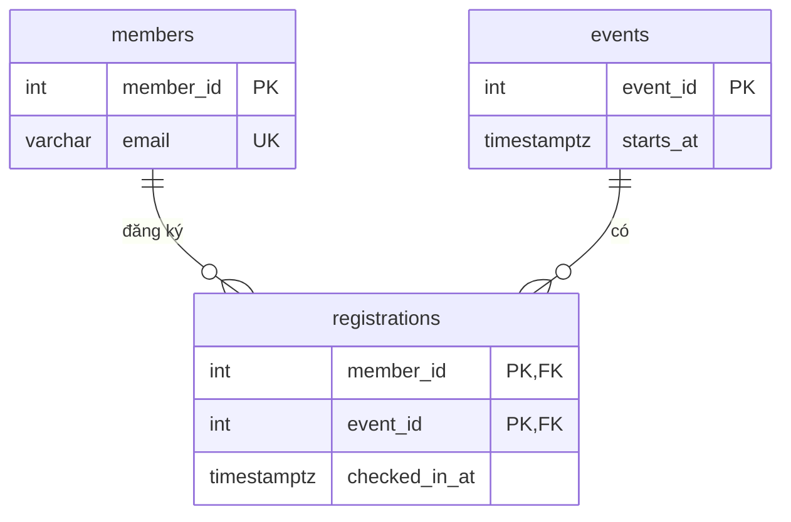

# Tổng kết và dự án cuối khóa

> **Tóm tắt:** Trang này nhìn lại 30 ngày học SQL theo bốn chặng, cho bạn 10 câu ôn tập có đáp án chạy được trên DSC Shop, và giao **dự án cuối khóa** kèm rubric chấm điểm chi tiết để mentor CLB chấm thống nhất. Cuối trang là gợi ý những gì nên học tiếp sau khóa này.

**Sau bài này bạn có thể:**
- Tự kiểm tra mình đã nắm từng chặng chưa bằng 10 câu ôn tập có đáp án.
- Thiết kế và xây dựng một database hoàn chỉnh cho một bài toán thật: từ ERD, schema 3NF có ràng buộc, dữ liệu mẫu, đến truy vấn báo cáo, index, API và sao lưu.
- Đọc rubric để biết bài nộp thế nào là đạt, giỏi, và tự chấm trước khi nộp.
- Chọn hướng học tiếp phù hợp (backend, phân tích dữ liệu, data engineering, quản trị database).

**Cần biết trước:** toàn bộ khóa học, xem [Lộ trình 30 ngày](00-30-day-sql-learning-roadmap.md).

---

## 1. Nhìn lại 30 ngày

Cả khóa dùng một hệ quản trị là **PostgreSQL 16** và một bộ dữ liệu chung là cửa hàng **DSC Shop** ([setup/README.md](../setup/README.md)). Bốn chặng đi từ "đọc được dữ liệu" tới "xây được một hệ thống dùng database đúng cách":

| Chặng | Ngày | Bạn đã học | Sau chặng này bạn làm được |
| --- | --- | --- | --- |
| 1. Nền tảng và truy vấn đơn giản | 1-7 | SQL và RDBMS, môi trường Docker/psql; kiểu dữ liệu và ràng buộc; `SELECT`, `WHERE`, NULL và logic ba trị; `ORDER BY`, `LIMIT`; hàm chuỗi, ngày giờ, `COALESCE`; `INSERT`, `UPDATE`, `DELETE`, UPSERT | Tạo bảng có ràng buộc, lọc và sửa dữ liệu an toàn trong `BEGIN ... ROLLBACK` |
| 2. Tổng hợp và kết hợp dữ liệu | 8-14 | Hàm tổng hợp; `GROUP BY`, `HAVING`; các loại `JOIN`, SELF JOIN, anti-join; subquery, `EXISTS`, CTE; `UNION`/`INTERSECT`/`EXCEPT`; `CASE`, `FILTER` | Trả lời câu hỏi nghiệp vụ trải trên nhiều bảng, tránh bẫy nhân dòng và `NOT IN` với NULL |
| 3. Index, transaction và các đối tượng database | 15-21 | Index B-tree và cách đo; transaction, ACID, isolation level, khóa dòng; function, procedure, trigger; view, materialized view; `EXPLAIN ANALYZE` | Làm truy vấn nhanh hơn có số đo, viết thao tác nhiều bước không bị hỏng dữ liệu, đóng gói logic trong database |
| 4. SQL trong thực tế | 22-30 | JSONB; kết nối từ Python/Node.js bằng truy vấn tham số hóa; `COPY`; partition; SQL và NoSQL; thiết kế và chuẩn hóa; tối ưu truy vấn; window function và CTE đệ quy; phân quyền, hash mật khẩu, `pg_dump` | Thiết kế database cho một bài toán mới, nối nó với ứng dụng, viết báo cáo phân tích, bảo vệ và sao lưu dữ liệu |

Dự án cuối khóa ở mục 3 dùng lại kiến thức của **cả bốn chặng**. Nếu làm dự án mà thấy hổng chỗ nào, quay lại đúng ngày đó trong bảng trên.

---

## 2. Câu hỏi ôn tập cuối khóa

Mười câu, mỗi câu chạm vào một nhóm kỹ năng chính. Tự làm trước rồi mới mở đáp án. Mọi đáp án SQL chạy trên dữ liệu gốc của DSC Shop; câu nào có tạo đối tượng hay sửa dữ liệu đều tự dọn hoặc `ROLLBACK` ở cuối.

### Cơ bản

**Câu 1 (Ngày 3-5).** Lấy tất cả đơn hàng trong 3 tháng gần nhất tính đến ngày 17/10/2026, sắp xếp theo thời gian đặt.

<details>
<summary>Đáp án</summary>

```sql
SELECT order_id,
       customer_id,
       order_date,
       status
FROM orders
WHERE order_date >= DATE '2026-10-17' - INTERVAL '3 months'
ORDER BY order_date;
```

Kết quả:

| order_id | customer_id | order_date | status |
| --- | --- | --- | --- |
| 36 | 18 | 2026-08-08 18:00:00+07 | delivered |
| 37 | 1 | 2026-09-02 10:00:00+07 | shipped |
| 38 | 13 | 2026-09-20 16:30:00+07 | paid |
| 39 | 15 | 2026-10-05 09:00:00+07 | paid |
| 40 | 3 | 2026-10-14 22:00:00+07 | pending |

Trong ứng dụng thật, thay `DATE '2026-10-17'` bằng `CURRENT_DATE`. Ở đây dùng ngày cố định để kết quả không thay đổi theo ngày bạn chạy. Điều kiện viết trực tiếp trên cột `order_date` (không bọc hàm quanh cột) nên dùng được index nếu có (Ngày 28).

> **Ghi chú dialect:** MySQL viết `order_date >= CURDATE() - INTERVAL 3 MONTH` (hoặc `DATE_SUB(CURDATE(), INTERVAL 3 MONTH)`), SQL Server viết `order_date >= DATEADD(MONTH, -3, CAST(GETDATE() AS DATE))`.
</details>

**Câu 2 (Ngày 10).** Tìm những khách hàng chưa từng đặt đơn nào.

<details>
<summary>Đáp án</summary>

```sql
SELECT c.customer_id,
       c.full_name,
       c.created_at::date AS ngay_dang_ky
FROM customers c
LEFT JOIN orders o ON o.customer_id = c.customer_id
WHERE o.order_id IS NULL
ORDER BY c.customer_id;
```

Kết quả:

| customer_id | full_name | ngay_dang_ky |
| --- | --- | --- |
| 16 | Tạ Quang Sơn | 2025-11-20 |
| 17 | Châu Ngọc Trâm | 2026-01-15 |

Đây là anti-join. Cách viết tương đương: `WHERE NOT EXISTS (SELECT 1 FROM orders o WHERE o.customer_id = c.customer_id)` (Ngày 11).
</details>

**Câu 3 (Ngày 8, 9, 13).** Phân loại các đơn đã thanh toán thành ba nhóm theo giá trị: lớn (từ 20 triệu), vừa (5 đến dưới 20 triệu), nhỏ (dưới 5 triệu). Mỗi nhóm có bao nhiêu đơn và tổng doanh thu bao nhiêu?

<details>
<summary>Đáp án</summary>

```sql
WITH order_totals AS (
    SELECT o.order_id,
           ROUND(SUM(oi.quantity * oi.unit_price * (1 - oi.discount))) AS tong_tien
    FROM orders o
    JOIN order_items oi ON oi.order_id = o.order_id
    WHERE o.status NOT IN ('pending', 'cancelled')
    GROUP BY o.order_id
)
SELECT CASE
           WHEN tong_tien >= 20000000 THEN 'Lớn (từ 20 triệu)'
           WHEN tong_tien >= 5000000  THEN 'Vừa (5-20 triệu)'
           ELSE 'Nhỏ (dưới 5 triệu)'
       END AS nhom_don,
       COUNT(*) AS so_don,
       SUM(tong_tien) AS doanh_thu
FROM order_totals
GROUP BY 1
ORDER BY MIN(tong_tien) DESC;
```

Kết quả:

| nhom_don | so_don | doanh_thu |
| --- | --- | --- |
| Lớn (từ 20 triệu) | 11 | 298101500 |
| Vừa (5-20 triệu) | 18 | 222083500 |
| Nhỏ (dưới 5 triệu) | 7 | 16106000 |

Phải tính tổng tiền từng đơn trước (trong CTE), rồi mới phân loại. Nếu `CASE` trên từng dòng `order_items` thì đang phân loại dòng hàng chứ không phải đơn. `GROUP BY 1` nghĩa là nhóm theo cột thứ nhất trong `SELECT`.
</details>

### Vận dụng

**Câu 4 (Ngày 17).** Viết function `so_don_cua_khach` nhận vào `customer_id` và trả về số đơn đã thanh toán của khách đó.

<details>
<summary>Đáp án</summary>

```sql
CREATE OR REPLACE FUNCTION so_don_cua_khach(p_customer_id INT)
RETURNS BIGINT
LANGUAGE sql
AS $$
    SELECT COUNT(*)
    FROM orders
    WHERE customer_id = p_customer_id
      AND status NOT IN ('pending', 'cancelled');
$$;

SELECT so_don_cua_khach(1) AS khach_1,
       so_don_cua_khach(16) AS khach_16;
```

Kết quả:

| khach_1 | khach_16 |
| --- | --- |
| 5 | 0 |

`COUNT(*)` trả về kiểu `BIGINT` nên function khai báo `RETURNS BIGINT`. Khách 16 chưa mua gì, `COUNT` trả 0 chứ không phải NULL. Dọn function sau khi thử:

```sql
DROP FUNCTION so_don_cua_khach(INT);
```
</details>

**Câu 5 (Ngày 29).** Xếp hạng khách hàng theo tổng chi tiêu, in 5 khách đứng đầu.

<details>
<summary>Đáp án</summary>

```sql
WITH chi_tieu AS (
    SELECT o.customer_id,
           ROUND(SUM(oi.quantity * oi.unit_price * (1 - oi.discount))) AS tong_chi
    FROM orders o
    JOIN order_items oi ON oi.order_id = o.order_id
    WHERE o.status NOT IN ('pending', 'cancelled')
    GROUP BY o.customer_id
)
SELECT c.customer_id,
       c.full_name,
       ct.tong_chi,
       RANK() OVER (ORDER BY ct.tong_chi DESC) AS hang
FROM chi_tieu ct
JOIN customers c ON c.customer_id = ct.customer_id
ORDER BY hang
LIMIT 5;
```

Kết quả:

| customer_id | full_name | tong_chi | hang |
| --- | --- | --- | --- |
| 10 | Dương Minh Khoa | 63220500 | 1 |
| 15 | Nguyễn Văn An | 58970000 | 2 |
| 2 | Trần Thị Bình | 58262500 | 3 |
| 18 | Mai Đức Uy | 46980000 | 4 |
| 14 | Huỳnh Tấn Phát | 45880500 | 5 |

Khách hạng 2 là Nguyễn Văn An **số 15**, không phải khách 1 cùng tên. In kèm `customer_id` để không nhầm.
</details>

**Câu 6 (Ngày 22).** Liệt kê các sản phẩm có RAM từ 16 GB trở lên (thông tin nằm trong cột JSONB `attributes`), kèm tên CPU.

<details>
<summary>Đáp án</summary>

```sql
SELECT sku,
       name,
       attributes ->> 'cpu' AS cpu,
       (attributes ->> 'ram_gb')::int AS ram_gb
FROM products
WHERE (attributes ->> 'ram_gb')::int >= 16
ORDER BY price DESC;
```

Kết quả:

| sku | name | cpu | ram_gb |
| --- | --- | --- | --- |
| LAP-001 | ASUS ROG Strix G16 | Intel Core i7-13650HX | 16 |
| LAP-002 | Lenovo Legion 5 | AMD Ryzen 7 7840HS | 16 |
| LAP-006 | HP Pavilion 15 | AMD Ryzen 5 7530U | 16 |

`->>` lấy giá trị dạng text, nên phải ép sang `int` trước khi so sánh số. Sản phẩm không có khóa `ram_gb` (hoặc `attributes` là NULL) cho ra NULL và tự bị loại.
</details>

**Câu 7 (Ngày 19).** Tạo view `v_doanh_thu_thang` cho biết số đơn và doanh thu mỗi tháng (chỉ đơn đã thanh toán), rồi dùng view để xem các tháng từ 07/2026.

<details>
<summary>Đáp án</summary>

```sql
CREATE OR REPLACE VIEW v_doanh_thu_thang AS
SELECT DATE_TRUNC('month', o.order_date)::date AS thang,
       COUNT(DISTINCT o.order_id) AS so_don,
       ROUND(SUM(oi.quantity * oi.unit_price * (1 - oi.discount))) AS doanh_thu
FROM orders o
JOIN order_items oi ON oi.order_id = o.order_id
WHERE o.status NOT IN ('pending', 'cancelled')
GROUP BY DATE_TRUNC('month', o.order_date);

SELECT to_char(thang, 'YYYY-MM') AS thang, so_don, doanh_thu
FROM v_doanh_thu_thang
WHERE thang >= '2026-07-01'
ORDER BY thang;
```

Kết quả:

| thang | so_don | doanh_thu |
| --- | --- | --- |
| 2026-07 | 1 | 17091000 |
| 2026-08 | 1 | 29990000 |
| 2026-09 | 2 | 17630000 |
| 2026-10 | 1 | 39980000 |

`COUNT(DISTINCT o.order_id)` vì sau JOIN với `order_items`, một đơn nhiều dòng hàng sẽ xuất hiện nhiều lần (bẫy nhân dòng ở Ngày 10). Dọn view:

```sql
DROP VIEW v_doanh_thu_thang;
```
</details>

### Thử thách

**Câu 8 (Ngày 6, 16).** Bán 2 chuột Logitech G102 (`ACC-001`) cho khách 16 tại cửa hàng, nhân viên 4 bán. Việc này gồm ba bước: tạo đơn, thêm dòng hàng, trừ tồn kho. Viết sao cho ba bước thành công cùng nhau hoặc không bước nào có hiệu lực. Để không làm thay đổi dữ liệu mẫu, kết thúc bằng `ROLLBACK` thay cho `COMMIT`.

<details>
<summary>Đáp án</summary>

```sql
BEGIN;

INSERT INTO orders (customer_id, employee_id, order_date, status, channel)
VALUES (16, 4, now(), 'paid', 'offline')
RETURNING order_id;

INSERT INTO order_items (order_id, product_id, quantity, unit_price)
SELECT currval(pg_get_serial_sequence('orders', 'order_id')), product_id, 2, price
FROM products
WHERE sku = 'ACC-001';

UPDATE products
SET stock_quantity = stock_quantity - 2
WHERE sku = 'ACC-001'
RETURNING sku, stock_quantity;

ROLLBACK;

SELECT sku, stock_quantity FROM products WHERE sku = 'ACC-001';
```

Kết quả lần lượt (trên dữ liệu vừa nạp lại):

| order_id |
| --- |
| 41 |

| sku | stock_quantity |
| --- | --- |
| ACC-001 | 58 |

Sau `ROLLBACK`:

| sku | stock_quantity |
| --- | --- |
| ACC-001 | 60 |

Những điểm cần thấy:

- `currval(pg_get_serial_sequence('orders', 'order_id'))` lấy id vừa sinh trong **chính phiên này**, nên an toàn khi nhiều người cùng đặt hàng. Trong code ứng dụng, bạn đọc giá trị trả về từ `RETURNING order_id` rồi truyền vào câu sau.
- `unit_price` lấy từ `price` hiện tại, đúng quy ước "giá lúc mua" của DSC Shop.
- Chạy lại lần nữa bạn sẽ thấy `order_id` là 42, 43... Sequence **không** quay lui khi `ROLLBACK`, nên id có thể bị "nhảy số". Đó là hành vi bình thường, đừng dựa vào id liên tục.
- Trong thực tế, bước trừ kho nên kiểm tra đủ hàng (`CHECK (stock_quantity >= 0)` của bảng sẽ chặn số âm) và khi nhiều người mua cùng lúc thì cần khóa dòng `SELECT ... FOR UPDATE` (Ngày 16).
</details>

**Câu 9 (Ngày 20, 28).** Một đồng đội viết truy vấn đếm đơn năm 2025 như sau và than "chạy chậm khi bảng có hàng triệu dòng, dù đã có index trên `order_date`". Vì sao? Viết lại cho tốt hơn, và nêu quy trình chung để tối ưu một truy vấn chậm.

```sql
SELECT COUNT(*) AS so_don_2025
FROM orders
WHERE EXTRACT(YEAR FROM order_date) = 2025;
```

<details>
<summary>Đáp án</summary>

Bọc hàm `EXTRACT(...)` quanh cột khiến điều kiện không còn "sargable": index B-tree sắp xếp theo `order_date`, không theo `EXTRACT(YEAR FROM order_date)`, nên planner không dùng index để tìm đúng khoảng mà phải đọc toàn bảng. Viết lại thành một khoảng trên chính cột đó:

```sql
SELECT COUNT(*) AS so_don_2025
FROM orders
WHERE order_date >= '2025-01-01'
  AND order_date <  '2026-01-01';
```

Kết quả (cả hai cách đều cho cùng số trên DSC Shop):

| so_don_2025 |
| --- |
| 25 |

Dùng `< '2026-01-01'` thay cho `<= '2025-12-31'` vì `order_date` là `TIMESTAMPTZ`: đơn lúc 15 giờ ngày 31/12 lớn hơn `'2025-12-31 00:00'` và sẽ bị bỏ sót.

Quy trình chung (Ngày 15, 20, 28):

1. Đo trước: `EXPLAIN (ANALYZE, BUFFERS)` để thấy thời gian thật, kiểu scan, số dòng ước lượng so với thực tế.
2. Tìm nguyên nhân: Seq Scan trên bảng lớn với điều kiện chọn lọc cao, ước lượng lệch xa thực tế (chạy `ANALYZE`), Sort hoặc Hash tràn ra đĩa, vòng Nested Loop quá nhiều lần.
3. Sửa đúng chỗ: viết điều kiện sargable, thêm index phù hợp (cột lọc, khóa ngoại, index nhiều cột theo thứ tự tiền tố trái), chỉ lấy cột cần thiết thay cho `SELECT *`, thay `OFFSET` lớn bằng phân trang keyset, gom N+1 truy vấn thành một.
4. Đo lại với cùng dữ liệu và ghi số trước/sau. Không đo thì không biết mình đã tối ưu hay chưa.
</details>

**Câu 10 (Ngày 23, 30).** Bạn sẽ ngăn SQL injection thế nào trong một API đăng nhập? Viết đoạn code Python minh họa cách đúng, và nói rõ mật khẩu được lưu và kiểm tra ra sao.

<details>
<summary>Đáp án</summary>

Hai nguyên tắc:

1. **Không bao giờ ghép chuỗi** dữ liệu người dùng vào câu SQL. Luôn dùng truy vấn tham số hóa: câu SQL và dữ liệu được gửi tách nhau, nên dữ liệu không bao giờ bị hiểu thành lệnh SQL.
2. **Không lưu mật khẩu dạng rõ** và không so sánh mật khẩu trong câu SQL. Lưu chuỗi hash có salt (bcrypt, argon2), lấy hash ra theo username rồi so sánh ở tầng ứng dụng.

```python
import bcrypt
import psycopg

def dang_nhap(conn: psycopg.Connection, username: str, password: str) -> bool:
    # %s là tham số: psycopg gửi username tách khỏi câu SQL
    row = conn.execute(
        "SELECT password_hash FROM app_users WHERE username = %s",
        (username,),
    ).fetchone()
    if row is None:
        return False
    return bcrypt.checkpw(password.encode("utf-8"), row[0].encode("utf-8"))
```

Cách sai cần tránh: `f"SELECT ... WHERE username = '{username}'"`. Chỉ cần nhập `' OR '1'='1' --` là câu SQL bị đổi nghĩa. Ngoài ra, user mà ứng dụng dùng để kết nối database chỉ nên có đúng quyền nó cần (`GRANT SELECT, INSERT ...` trên các bảng cần thiết), không dùng `postgres` (Ngày 30).
</details>

---

## 3. Dự án cuối khóa

### 3.1. Mục tiêu và hình thức

Bạn (cá nhân hoặc nhóm 2-3 người) xây dựng **từ đầu** database cho một bài toán mới, không dùng lại DSC Shop, kèm một API nhỏ dùng database đó. Thời gian gợi ý: **2 tuần**. Cuối kỳ có buổi demo 10 phút và vấn đáp 5 phút với mentor.

Mục tiêu là chứng minh bạn **vận dụng** được kiến thức, nên rubric chấm cả việc chạy đúng lẫn việc bạn giải thích được vì sao làm vậy.

### 3.2. Chọn đề tài

Chọn một trong ba đề dưới đây, hoặc tự đề xuất đề tài có độ phức tạp tương đương (cần mentor duyệt trước ngày 2).

**Đề A. Quản lý sự kiện CLB.** Thành viên, các ban trong CLB (ban có thể có ban con), sự kiện, đăng ký tham gia, check-in tại sự kiện, phân công nhân sự cho sự kiện, phản hồi sau sự kiện.

**Đề B. Thư viện CLB.** Đầu sách, bản sao (một đầu sách có nhiều cuốn), tác giả (sách nhiều tác giả), thể loại dạng cây, thành viên, phiếu mượn, gia hạn, trả trễ và tiền phạt.

**Đề C. Đặt phòng lab và thiết bị.** Phòng, thiết bị (thuộc phòng, có trạng thái), lịch đặt theo khung giờ (không được trùng lịch), người duyệt, nhật ký sự cố và sửa chữa.

Gợi ý điểm xuất phát cho Đề A, để bạn tự mở rộng (đây mới là quan hệ n-n cơ bản, chưa đủ cho dự án):



### 3.3. Yêu cầu bài nộp

Nộp một repo (hoặc thư mục nén) theo cấu trúc:

```text
du-an-cuoi-khoa/
├── README.md              mô tả đề tài, cách chạy, phân công (nếu làm nhóm)
├── docs/
│   ├── erd.png            ERD (vẽ bằng dbdiagram, draw.io, Mermaid... tùy bạn)
│   └── thiet-ke.md        giải thích chuẩn hóa và các quyết định thiết kế
├── db/
│   ├── 01_schema.sql      tạo schema, bảng, ràng buộc, index
│   ├── 02_seed.sql        dữ liệu mẫu
│   ├── 03_objects.sql     view, function/procedure, trigger
│   └── 04_security.sql    role, quyền
├── queries/
│   └── bao-cao.sql        15-20 truy vấn báo cáo, mỗi câu có chú thích câu hỏi nghiệp vụ
├── perf/
│   └── explain.md         EXPLAIN ANALYZE trước và sau khi thêm index
├── app/                   API nhỏ (Python hoặc Node.js)
└── backup/
    └── huong-dan.md       lệnh sao lưu, khôi phục và kết quả khôi phục thử
```

Yêu cầu bắt buộc theo từng phần:

1. **ERD và thiết kế.** Ít nhất 6 bảng, có ít nhất một quan hệ n-n qua bảng trung gian. `thiet-ke.md` chỉ ra các phụ thuộc hàm chính và giải thích vì sao schema đạt 3NF; nếu có chỗ cố ý phi chuẩn hóa thì nêu lý do (Ngày 27).
2. **Schema.** Đủ khóa chính, khóa ngoại (chọn `ON DELETE` có chủ đích), `NOT NULL`, `UNIQUE`, `CHECK`, `DEFAULT` hợp lý; tiền dùng `NUMERIC`, thời điểm dùng `TIMESTAMPTZ` (Ngày 2). Script chạy lại được nhiều lần (`DROP ... IF EXISTS` hoặc tạo lại schema).
3. **Dữ liệu mẫu.** Đủ để mọi truy vấn báo cáo trả về kết quả có ý nghĩa: mỗi bảng chính ít nhất 20-30 dòng, có cả NULL, dữ liệu "chưa có liên quan" (thành viên chưa đăng ký sự kiện nào...). Cho phần hiệu năng: một bảng lớn ít nhất 100.000 dòng sinh bằng `generate_series` (tham khảo `setup/perf_seed.sql`).
4. **15-20 truy vấn báo cáo.** Mỗi truy vấn trả lời một câu hỏi nghiệp vụ viết bằng tiếng Việt ở dòng chú thích. Toàn bộ phải dùng được ít nhất: JOIN 3 bảng trở lên, anti-join hoặc `NOT EXISTS`, `GROUP BY` + `HAVING`, subquery hoặc CTE, `CASE` hoặc `FILTER`, toán tử tập hợp, ít nhất 2 window function khác loại (xếp hạng, lũy kế, `LAG`...), và một CTE đệ quy nếu đề có cấu trúc cây.
5. **Transaction.** Ít nhất một nghiệp vụ nhiều bước chạy trong transaction (ví dụ: mượn sách = tạo phiếu + đổi trạng thái bản sao), có xử lý trường hợp tranh chấp (khóa dòng hoặc ràng buộc chặn trùng) và giải thích chọn isolation level nào (Ngày 16).
6. **View.** Ít nhất 2 view, trong đó một view dùng để giới hạn những cột người dùng khác được xem (Ngày 19).
7. **Function/procedure và trigger.** Ít nhất 1 function hoặc procedure có xử lý lỗi bằng `RAISE`, và 1 trigger có lý do tồn tại rõ ràng (audit log, chặn dữ liệu sai, cập nhật trạng thái). Giải thích vì sao việc đó nên đặt trong database (Ngày 17, 18).
8. **Hiệu năng.** Chọn ít nhất 2 truy vấn trên bảng lớn, ghi `EXPLAIN (ANALYZE, BUFFERS)` trước và sau khi thêm index, so sánh thời gian và kiểu scan, giải thích vì sao index giúp được (hoặc vì sao không) (Ngày 15, 20, 28).
9. **API nhỏ.** 3-5 endpoint (ví dụ: danh sách sự kiện có phân trang, đăng ký sự kiện, báo cáo top thành viên tích cực) bằng Python (psycopg) hoặc Node.js (pg). **Mọi** câu SQL dùng truy vấn tham số hóa; nghiệp vụ nhiều bước chạy trong transaction; thông tin kết nối đọc từ biến môi trường, không ghi cứng trong code (Ngày 23).
10. **Bảo mật và sao lưu.** Role riêng cho ứng dụng với quyền tối thiểu; nếu có lưu mật khẩu thì lưu hash; lệnh `pg_dump` và `pg_restore`, kèm bằng chứng đã khôi phục thử vào một database mới và so sánh số dòng (Ngày 30).

### 3.4. Lịch gợi ý

| Thời gian | Việc | Mốc kiểm tra với mentor |
| --- | --- | --- |
| Ngày 1-2 | Chọn đề, liệt kê nghiệp vụ, vẽ ERD | Mentor duyệt đề và ERD |
| Ngày 3-4 | Viết `01_schema.sql`, `02_seed.sql` | Script chạy được trên database rỗng |
| Ngày 5-7 | Viết truy vấn báo cáo | Nộp nháp 10 truy vấn đầu |
| Ngày 8-9 | Transaction, view, function, trigger, role | |
| Ngày 10-11 | Sinh dữ liệu lớn, đo `EXPLAIN`, thêm index | |
| Ngày 12-13 | API, sao lưu và khôi phục thử | |
| Ngày 14 | Hoàn thiện README, tập demo | Demo và vấn đáp |

### 3.5. Rubric chấm điểm (100 điểm)

Mỗi tiêu chí có ba mức. "Đầy đủ" nhận toàn bộ điểm, "Một phần" nhận khoảng một nửa (mentor chọn điểm trong khoảng ghi ở cột), "Chưa đạt" nhận 0.

| # | Tiêu chí | Điểm | Đầy đủ | Một phần | Chưa đạt |
| --- | --- | --- | --- | --- | --- |
| 1 | ERD và chuẩn hóa | 15 | ERD đúng ký hiệu, ≥ 6 bảng, có n-n; giải thích được phụ thuộc hàm và vì sao đạt 3NF; phi chuẩn hóa (nếu có) có lý do | 6-10: ERD có nhưng thiếu quan hệ hoặc lệch với schema; giải thích chuẩn hóa chung chung | Không có ERD, hoặc có lặp dữ liệu rõ ràng (vi phạm 2NF/3NF) mà không nhận ra |
| 2 | Schema và ràng buộc | 15 | Đủ PK, FK có `ON DELETE` chủ đích, `NOT NULL`, `UNIQUE`, `CHECK`; kiểu dữ liệu đúng (NUMERIC cho tiền, TIMESTAMPTZ); script chạy lại được | 6-10: thiếu vài ràng buộc quan trọng, hoặc sai kiểu ở 1-2 cột | Thiếu FK, dùng FLOAT cho tiền ở nhiều chỗ, script không chạy được |
| 3 | Dữ liệu mẫu | 5 | Đủ số lượng, có NULL và trường hợp biên, có bảng lớn sinh bằng `generate_series` | 2-3: dữ liệu ít, nhiều truy vấn trả về rỗng hoặc 1 dòng | Không có seed hoặc seed lỗi |
| 4 | Truy vấn báo cáo | 20 | 15-20 truy vấn chạy đúng, phủ đủ các kỹ thuật ở yêu cầu 4, mỗi câu có câu hỏi nghiệp vụ rõ, không bẫy nhân dòng hay `NOT IN` với NULL | 8-14: dưới 15 truy vấn, hoặc thiếu 2-3 kỹ thuật, hoặc 1-2 câu sai kết quả | Dưới 8 truy vấn chạy được, hoặc nhiều câu sai |
| 5 | Transaction | 8 | Nghiệp vụ nhiều bước trong transaction, xử lý tranh chấp, giải thích isolation level | 3-5: có `BEGIN/COMMIT` nhưng không xử lý tranh chấp hoặc không giải thích | Không có transaction |
| 6 | View | 5 | ≥ 2 view có ích, một view giới hạn cột nhạy cảm | 2-3: có 1 view, hoặc view chỉ là `SELECT *` | Không có view |
| 7 | Function/procedure và trigger | 8 | Function có xử lý lỗi, trigger có mục đích rõ, giải thích vì sao đặt trong database | 3-5: có một trong hai, hoặc chạy được nhưng không có xử lý lỗi | Không có hoặc không chạy được |
| 8 | Hiệu năng | 9 | ≥ 2 truy vấn có EXPLAIN ANALYZE trước/sau trên bảng ≥ 100.000 dòng, số liệu thật, giải thích đúng kiểu scan và vì sao nhanh hơn | 4-6: chỉ 1 truy vấn, hoặc đo trên bảng quá nhỏ, hoặc giải thích chưa đúng | Không đo, hoặc số liệu không có thật |
| 9 | API tham số hóa | 10 | 3-5 endpoint chạy được; 100% truy vấn tham số hóa; transaction cho nghiệp vụ nhiều bước; cấu hình qua biến môi trường | 4-6: API chạy nhưng có endpoint thiếu transaction hoặc ghi cứng mật khẩu | Có bất kỳ câu SQL ghép chuỗi từ input người dùng (lỗi SQL injection), hoặc API không chạy |
| 10 | Bảo mật và sao lưu | 5 | Role quyền tối thiểu cho ứng dụng; mật khẩu (nếu có) lưu hash; có bằng chứng khôi phục thử thành công | 2-3: có backup nhưng chưa khôi phục thử, hoặc ứng dụng dùng user `postgres` | Không có backup, hoặc lưu mật khẩu dạng rõ |

Quy ước tổng điểm:

- **Đạt:** từ 60 điểm. **Khá:** từ 75. **Giỏi:** từ 85.
- **Điều kiện bắt buộc:** `db/01_schema.sql` và `db/02_seed.sql` phải chạy được trên một database rỗng. Không chạy được thì tiêu chí 2, 3, 4 tối đa chỉ được mức "Một phần".
- **Lỗi bảo mật nghiêm trọng** (SQL ghép chuỗi từ input, mật khẩu dạng rõ, mật khẩu database commit lên repo): tiêu chí liên quan nhận 0 và bài không được xếp loại Giỏi dù đủ điểm.
- **Vấn đáp:** mentor chọn ngẫu nhiên 2 truy vấn và 1 quyết định thiết kế để hỏi. Không giải thích được phần mình nộp thì tiêu chí tương ứng hạ một mức.
- **Điểm cộng** (tối đa +5, tổng không quá 100): partition cho bảng lớn, row-level security, materialized view có lịch refresh, test tự động cho API, CI chạy script SQL.

### 3.6. Hướng dẫn cho mentor khi chấm

Để chấm nhất quán giữa các mentor:

1. Dựng database sạch và chạy script của học viên. Với môi trường Docker của khóa học:

   ```sh
   docker compose exec -T db psql -U postgres -c "DROP DATABASE IF EXISTS cham_bai" -c "CREATE DATABASE cham_bai"
   docker compose exec -T db psql -U postgres -d cham_bai -v ON_ERROR_STOP=1 < db/01_schema.sql
   docker compose exec -T db psql -U postgres -d cham_bai -v ON_ERROR_STOP=1 < db/02_seed.sql
   ```

   `ON_ERROR_STOP=1` làm psql dừng ngay ở lỗi đầu tiên, nên bạn biết chắc script có chạy trọn vẹn hay không.
2. Chạy `queries/bao-cao.sql` tương tự, đối chiếu vài kết quả với dữ liệu seed bằng cách tự đếm tay trên 1-2 câu.
3. Tìm nhanh lỗi SQL injection trong `app/`: mọi chỗ gọi `execute`/`query` mà chuỗi SQL được tạo bằng f-string, `+` hoặc template string có biến từ request.
4. Mở `perf/explain.md`: số dòng của bảng lớn có đủ không, có cả "trước" và "sau" không, kiểu scan có đổi không.
5. Ghi điểm từng tiêu chí kèm 1 câu nhận xét; nhận xét quan trọng hơn con số với người học.

---

## 4. Lỗi thường gặp khi làm dự án

- **Thiết kế bảng theo màn hình giao diện** thay vì theo thực thể, dẫn tới một bảng chứa lặp thông tin của thực thể khác. Bắt đầu từ ERD, kiểm tra phụ thuộc hàm (Ngày 27).
- **Dùng `FLOAT` cho tiền** và `TIMESTAMP` (không múi giờ) cho thời điểm sự kiện. Dùng `NUMERIC` và `TIMESTAMPTZ` (Ngày 2).
- **Lưu tổng tiền, số lượng đăng ký... thành cột** rồi quên cập nhật. Nếu tính được từ dữ liệu gốc, hãy tính bằng truy vấn hoặc view; chỉ lưu khi đã đo thấy cần và có trigger hoặc transaction giữ cho đúng.
- **Seed quá ít dữ liệu** nên mọi truy vấn trả 0-1 dòng, và `EXPLAIN` trên bảng 30 dòng luôn ra Seq Scan. Sinh bảng lớn bằng `generate_series`.
- **Ghép chuỗi SQL trong API** "cho nhanh", hoặc commit file `.env` có mật khẩu lên repo.
- **Kết luận "index làm nhanh hơn" mà không có số đo**, hoặc đo một lần duy nhất ngay sau khi tạo bảng (cache còn lạnh). Chạy vài lần, ghi số ổn định.

---

## 5. Học gì tiếp theo?

Khóa học đã phủ phần lõi. Những hướng dưới đây là phần **chưa có** trong 30 ngày, chọn theo việc bạn muốn làm:

| Bạn muốn | Học tiếp | Gợi ý bắt đầu |
| --- | --- | --- |
| Làm backend | Migration schema (Alembic, Flyway, Prisma Migrate), ORM ở mức sâu, connection pooler (PgBouncer), cách thiết kế API phân trang và lọc | Đưa dự án cuối khóa sang dùng migration thay cho script tay |
| Phân tích dữ liệu | `GROUPING SETS`/`ROLLUP`/`CUBE`, phân tích cohort và retention, SQL kết hợp Python (pandas) hoặc công cụ BI (Metabase, Power BI) | Viết báo cáo cohort khách hàng theo tháng đăng ký trên DSC Shop |
| Data engineering | Mô hình kho dữ liệu (star schema, fact và dimension), dbt, pipeline ETL/ELT, kho dữ liệu dạng cột | Thiết kế star schema cho doanh thu DSC Shop |
| Quản trị database | MVCC và `VACUUM`, WAL, cài đặt replication thật, `pg_stat_statements` để tìm truy vấn chậm, giám sát và cảnh báo | Bật `pg_stat_statements` trên Docker và tìm 5 truy vấn tốn thời gian nhất |
| Mở rộng PostgreSQL | Full-text search (`tsvector`), PostGIS cho dữ liệu bản đồ, extension `pgvector` cho tìm kiếm vector | Thêm tìm kiếm tên sản phẩm có dấu/không dấu cho DSC Shop |

Luyện tập đều đặn quan trọng hơn học thêm chủ đề mới. Các trang luyện SQL có chấm tự động (LeetCode Database, HackerRank SQL) hợp để giữ tay quen; khi luyện, nhớ để ý dialect của từng trang có thể là MySQL thay vì PostgreSQL.

## Tóm tắt

- Khóa học đi qua bốn chặng: nền tảng (1-7), tổng hợp và kết hợp dữ liệu (8-14), index, transaction và các đối tượng database (15-21), SQL trong thực tế (22-30).
- Mười câu ôn tập phủ các kỹ năng chính; câu nào chưa làm được, quay lại đúng ngày ghi trong câu hỏi.
- Dự án cuối khóa yêu cầu một database thiết kế từ đầu: ERD và 3NF, schema có ràng buộc, seed, 15-20 truy vấn báo cáo, transaction, view, function/trigger, đo EXPLAIN trước/sau index, API tham số hóa, role quyền tối thiểu và sao lưu có khôi phục thử.
- Rubric 100 điểm với ba mức cho mỗi tiêu chí, điều kiện bắt buộc về script chạy được, và quy tắc hạ mức với lỗi bảo mật nghiêm trọng.
- Hướng học tiếp chọn theo vai trò: backend, phân tích dữ liệu, data engineering, quản trị database.

## Đọc thêm

- Tài liệu chính thức PostgreSQL 16: <https://www.postgresql.org/docs/16/>, đặc biệt phần [SQL Commands](https://www.postgresql.org/docs/16/sql-commands.html) để tra cú pháp khi làm dự án.
- [Luỹ kế của bạn sai ngay dòng đầu: window function, RANGE và cái mặc định ít ai đọc](https://tiennhm.io.vn/blog/window-function-vs-group-by) — đọc lại trước khi viết các truy vấn lũy kế trong dự án.
- [LEFT JOIN của bạn đã thành INNER JOIN mà không ai báo](https://tiennhm.io.vn/blog/left-join-thanh-inner-join) — bẫy hay gặp nhất khi viết báo cáo có LEFT JOIN.

---

[⬅️ Ngày 30: Bảo mật cơ sở dữ liệu](30-database-security.md) | [📚 Mục lục](../README.md)
