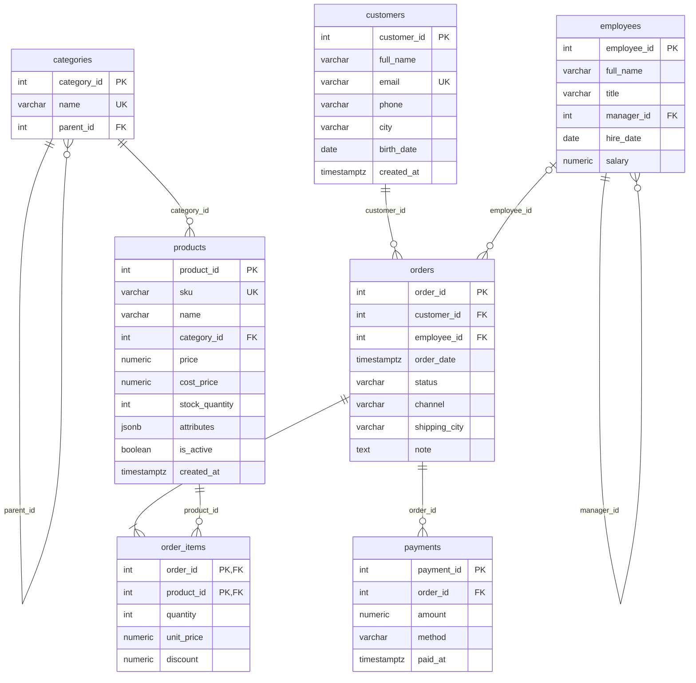

# Môi trường thực hành

Cả khóa học dùng **PostgreSQL 16** và một bộ dữ liệu chung: cửa hàng đồ công nghệ **DSC Shop**. Mọi ví dụ và bài tập trong các bài học đều chạy được trên bộ dữ liệu này, và kết quả in trong bài là kết quả thật khi chạy trên dữ liệu gốc.

## Cài đặt

### Cách 1: Docker (khuyến nghị)

Cần cài [Docker Desktop](https://www.docker.com/products/docker-desktop/). Ở thư mục gốc của repo:

```sh
docker compose up -d
```

Lệnh này dựng hai dịch vụ:

| Dịch vụ | Địa chỉ | Dùng để |
| --- | --- | --- |
| PostgreSQL 16 | `localhost:5432`, user `postgres`, mật khẩu `postgres`, database `sql_challenge` | chạy SQL |
| Adminer | <http://localhost:8080> (System: PostgreSQL, Server: `db`) | giao diện web để gõ SQL và xem bảng |

Lần chạy đầu tiên, PostgreSQL tự chạy [init/01_schema.sql](init/01_schema.sql) và [init/02_seed.sql](init/02_seed.sql) để tạo bảng và nạp dữ liệu.

Mở `psql` ngay trong container:

```sh
docker compose exec db psql -U postgres -d sql_challenge
```

Bạn cũng có thể dùng DBeaver, pgAdmin, DataGrip hoặc extension PostgreSQL của VS Code, kết nối tới `localhost:5432` với thông tin ở bảng trên.

### Cách 2: Cài PostgreSQL trực tiếp

1. Cài PostgreSQL 16 trở lên từ <https://www.postgresql.org/download/>.
2. Tạo database và nạp dữ liệu (chạy ở thư mục gốc của repo):

```sh
createdb -U postgres sql_challenge
psql -U postgres -d sql_challenge -f setup/init/01_schema.sql -f setup/init/02_seed.sql
```

### Dữ liệu lớn cho các bài hiệu năng

Ngày 04 (đo phân trang), 15, 19, 20, 21, 25 và 28 cần dữ liệu đủ lớn để thấy khác biệt khi có và không có index. File [perf_seed.sql](perf_seed.sql) tạo schema `perf` với 100.000 khách và 1.000.000 đơn hàng (mất khoảng 10 giây):

```sh
# Docker
docker compose exec -T db psql -U postgres -d sql_challenge < setup/perf_seed.sql
# Cài trực tiếp
psql -U postgres -d sql_challenge -f setup/perf_seed.sql
```

### Làm lại từ đầu

Khi đã sửa, xóa lung tung trong lúc thực hành, chạy lại hai file init để đưa schema `shop` về trạng thái gốc:

```sh
docker compose exec -T db psql -U postgres -d sql_challenge -f /docker-entrypoint-initdb.d/01_schema.sql -f /docker-entrypoint-initdb.d/02_seed.sql
```

Nếu đang ở trong psql (mở bằng `docker compose exec db psql ...`), gõ thẳng:

```text
\i /docker-entrypoint-initdb.d/01_schema.sql
\i /docker-entrypoint-initdb.d/02_seed.sql
```

Hoặc xóa hẳn database và dựng lại: `docker compose down -v && docker compose up -d`.

## Bộ dữ liệu DSC Shop

Các bảng nằm trong schema `shop`. Database đã đặt sẵn `search_path = shop, public` nên bạn viết `customers` thay vì `shop.customers`, và đặt `timezone = 'Asia/Ho_Chi_Minh'` nên ngày giờ hiển thị theo giờ Việt Nam, khớp với kết quả trong bài.



| Bảng | Số dòng | Mô tả |
| --- | --- | --- |
| `categories` | 13 | Danh mục dạng cây: `parent_id` trỏ về danh mục cha (`Máy tính` > `Laptop` > `Laptop gaming`) |
| `products` | 24 | Sản phẩm. `price` là giá bán hiện tại (VNĐ), `attributes` là thông số kỹ thuật dạng JSONB |
| `customers` | 18 | Khách hàng |
| `employees` | 8 | Nhân viên dạng cây: `manager_id` trỏ về quản lý trực tiếp, sâu 4 cấp |
| `orders` | 40 | Đơn hàng từ 01/2025 đến 10/2026. Đơn `offline` có `employee_id` là người bán, đơn `online` thì không |
| `order_items` | 60 | Dòng hàng của mỗi đơn. Tiền một dòng = `quantity * unit_price * (1 - discount)` |
| `payments` | 37 | Thanh toán. Đơn `pending` và `cancelled` chưa có thanh toán, đơn 12 trả góp 2 lần |

Một số quy ước:

- Tiền là `NUMERIC(12,0)` tính bằng VNĐ, không dùng `FLOAT` vì số thực dấu phẩy động làm sai số tiền.
- Không có cột tổng tiền trong `orders`: tổng tiền đơn luôn tính từ `order_items`, nên không thể bị lệch.
- `unit_price` là giá lúc mua, có thể khác `products.price` hiện tại (đơn 2 và đơn 7 mua lúc giá còn cao hơn).
- `status` đi theo vòng đời `pending` → `paid` → `shipped` → `delivered`, hoặc `cancelled`.

### Dữ liệu cố ý chưa "sạch"

Dữ liệu thật hiếm khi gọn gàng, nên bộ dữ liệu này cố ý có những điểm để luyện tập:

| Tình huống | Ở đâu |
| --- | --- |
| Giá trị NULL | `customers.email`, `phone`, `city`, `birth_date`; `products.cost_price`, `attributes`; `orders.employee_id`, `shipping_city`, `note` |
| Cùng một thành phố, nhiều cách viết | `customers.city`: `TP. Hồ Chí Minh`, `Hồ Chí Minh`, `TP.HCM`; `Đà Nẵng` và `đà nẵng` |
| Trùng tên khác người | Hai khách tên `Nguyễn Văn An` (id 1 và 15) |
| Không có dữ liệu liên quan | Khách 16, 17 chưa mua đơn nào; sản phẩm `ACC-009` chưa bán được; danh mục `Thiết bị mạng` chưa có sản phẩm |
| Hết hàng, ngừng kinh doanh | `stock_quantity = 0` (3 sản phẩm), `is_active = FALSE` (Nokia 105 4G) |

### Schema `perf`

Chỉ có sau khi chạy `perf_seed.sql`. Gồm `perf.customers` (100.000 dòng) và `perf.orders` (1.000.000 dòng, có sẵn cột `total_amount`). Bảng `perf.orders` cố ý chưa có index nào ngoài khóa chính, để bạn tự đo trước và sau khi tạo index.
